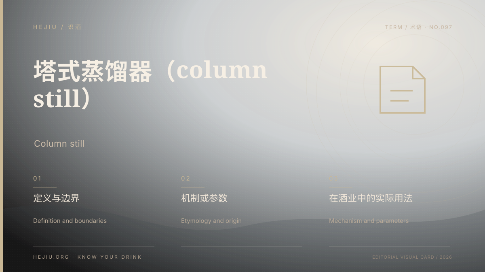

# Column still

Figure: thematic illustration for Column still. Image: AI-assisted illustration generated with Doubao Seedream 5.0 (project-owned); not a photograph of the subject.

## Definition and boundaries

A column still, also called a continuous still, is a distillation device that can be fed continuously and can produce spirit continuously. Its core is a vertical column containing multiple plates or packing, where rising vapour and falling liquid meet and exchange heat and components on each stage. Low-boiling components concentrate at the top, high-boiling components at the bottom.

Two misunderstandings are worth clearing up first. A column still is not a synonym for low-quality distillation; it simply separates more efficiently, and whether it suits a product depends on the goal. It is also not the same as a laboratory fractionating column: an industrial column still has a feed plate, reflux system, reboiler and multiple sections, while a laboratory column is usually small with few stages. Column versus pot is a distinction of equipment, not a moral contest between modern and traditional.

## Etymology and origin

Column comes from Latin columna, meaning pillar or upright pillar. Still comes from Latin stillare, “to drip”. Rectification comes from Latin rectificare, “to make right or pure”. The Chinese name for the device emphasises the vertical tower, while the alternative name emphasises continuous operation; both describe different sides of the same equipment.

This history shows that continuous distillation grew out of fractionation practice in the chemical and petroleum industries and was later borrowed by the spirits industry. Today's column stills include plate columns with dozens of trays, packed columns and hybrid designs, so one word cannot cover every form.

## Mechanism and parameters

A pot still processes one batch at a time; a column still compresses repeated distillation into a single column. Each plate acts as one theoretical simple distillation, and more plates mean better separation. Vapour rises from the bottom, reflux liquid falls from the top, and the two meet on the plates: high-boiling components in the vapour condense into the liquid, while low-boiling components in the liquid are carried away by the vapour.

Feed position is critical. The section above the feed plate is the rectifying section, which raises purity; the section below is the stripping section, which recovers alcohol from the residue. The reflux ratio is the amount of liquid returned to the column compared with the amount of product drawn off. A higher reflux ratio gives higher purity but lower output and higher energy use. Plate count, reflux ratio, feed position and heating power together determine the composition of the distillate.

High purity means more flavour compounds are separated out. Ethanol and water form an azeotrope at atmospheric pressure, boiling at about 78.2°C with an ethanol mass fraction of about 95.6%, so ordinary distillation is limited to roughly 95% vol. This is why continuous distillation is often used for neutral spirit, vodka base and industrial alcohol. Retaining more flavour requires a lower reflux ratio, fewer plates or a different design.

## Practical use in the drinks industry

In [whisky](ref:whisky) production, column stills are used mainly for grain whisky, a component of blended whisky; Scotch grain whisky is typically made by continuous distillation; the regulations define Single Grain Scotch Whisky without requiring pot stills, and all Scotch whisky must be distilled below 94.8% abv. Pot stills are used mainly for malt whisky. The two are not substitutes but different roles in the product structure.

In [rum](ref:rum) production, column stills are often used for light rum, producing a clean, fresh base; heavy rum is more often made with pot stills or specially designed equipment that retains esters and aroma. A single region can run both routes for different product lines. Gin and vodka, which rely on neutral alcohol, also depend on continuous distillation for high-purity base spirit, with style built later through maceration, redistillation or blending.

In operation, continuous distillation demands stable feed composition, temperature and pressure. Feed interruption, reflux-ratio swings or column flooding all affect purity and flavour. Unlike the batch-by-batch cuts of a pot still, quality control in a column still depends more on continuous monitoring and stable parameters.

## Confusable terms

Column and pot stills first differ in batch versus continuous operation. Pot distillation is a batch operation where reflux comes mainly from neck geometry and natural condensation, retaining more flavour at lower efficiency; column distillation is continuous, with strong separation and high efficiency, suited to large-scale production. The rectifying and stripping sections are two opposite functional zones inside the column. The rectifying section is above the feed plate and raises the concentration of light components; the stripping section is below the feed plate and recovers alcohol from the residue.

Continuous and batch distillation are another operating contrast. Continuous distillation feeds and draws product without interruption; batch distillation processes one charge at a time. Column still versus laboratory fractionating column differs in scale and structure. The former is industrial equipment with reflux control and multiple sections; the latter is small and used for teaching or laboratory separation. Treating them as the same underestimates the complexity of an industrial column.

## Common misuses and disputes

First, column distillation does not mean low quality. It separates efficiently, and suitability depends on the product goal. Second, there is no single column-still design: plate, packed and hybrid columns all exist. Third, high purity does not mean no flavour; flavour can still come from raw material, fermentation and later processing. Fourth, continuous distillation does not make every product identical, because reflux ratio and feed position remain adjustable.

The dispute is mainly whether high purity sacrifices style. Supporters argue that continuous distillation provides a stable, scalable base and is essential for blended products; critics argue that over-rectification erases the detail of raw material and fermentation. The defensible position is that a column still is a tool for efficiency and purity, and flavour retention depends on how it is run, not on the equipment alone.

## Typical values and examples

- Ethanol-water azeotrope: about 78.2°C; ethanol mass fraction: about 95.6%.
- Ordinary distillation alcohol limit: about 95% vol.
- Scotch whisky distillation limit: below 94.8% abv.
- A column still can contain dozens of plates; a higher reflux ratio gives higher purity and lower output.
- Typical uses: grain whisky, light rum, and neutral base for vodka and gin.
- Comparison: in the same region, light rum may use a column still while heavy rum uses a pot still or a special design.

These parameters explain why column-still style is not decided by the word “continuous” alone, but by plates, reflux ratio, feed position and later processing.

## See also

- [Distillation](ref:distillation): basic principles and equipment types.
- [Whisky](ref:whisky): grain whisky versus malt whisky.
- [Rum](ref:rum): light and heavy production routes.

The comparison with [Distillation](ref:distillation) and [Rum](ref:rum) runs through definition and applicable standard. Each answers a different question.
