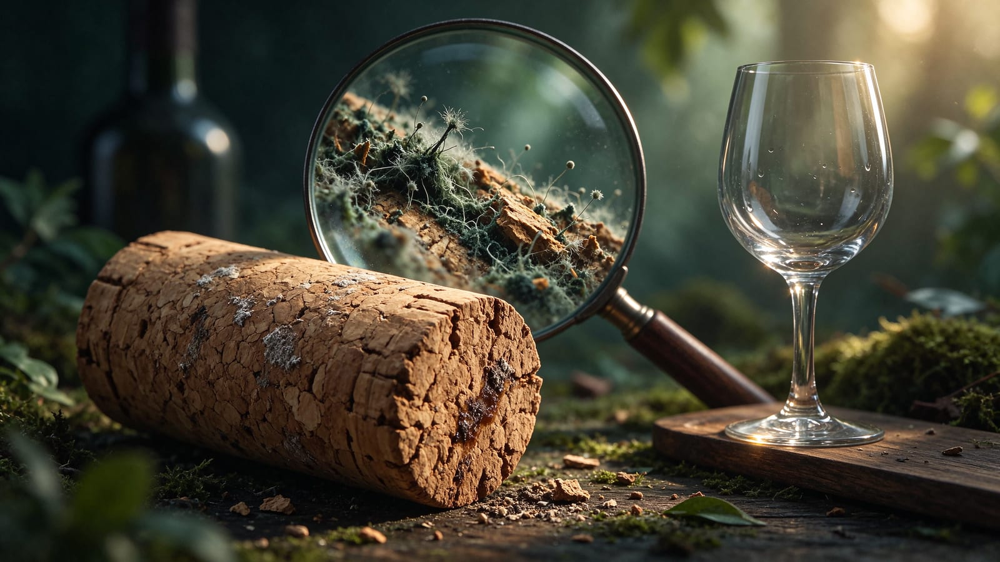

# Cork taint

Figure: Editorial illustration of cork taint: a cork cross-section, mould-like texture and a magnifier; AI-assisted illustration, not a photograph. Image: Hejiu editorial team, project-owned.

## Definition and boundaries

Cork taint is one of the most common sensory faults in wine, typically showing as damp cardboard, musty, stale aromas that suppress the wine's original fruit. It is caused mainly by a group of compounds called haloanisoles, most commonly 2,4,6-trichloroanisole (TCA). Related compounds include 2,4,6-tribromoanisole, pentachloroanisole and tetrachloroanisole, which smell similar but differ slightly in threshold and origin.

Several distinctions matter here. Cork taint is not “cork crumbs in the wine”; visible wood fragments do not constitute taint. It is not a food-safety incident either: TCA causes a sensory defect, not an acute toxicity risk. The phrase “corked wine” is also broader than true contamination: it is sometimes used for any musty note, while real cork taint needs a compound and a concentration behind it.

## Etymology and origin

Cork taint is an industry descriptive phrase: cork names the closure and taint means an outside contamination or off-flavour. The chemical name 2,4,6-trichloroanisole combines “trichloro”, a benzene ring and “anisole”, and the abbreviation TCA is standard trade shorthand. The name ties the fault to a structure, yet contamination does not come only from corks: oak barrels, cellar woodwork, cardboard packaging and musty water can all be sources.

TCA is not a substance the cork tree produces naturally. Material from the Australian Wine Research Institute states that three conditions must be met for TCA formation: the presence of the precursor 2,4,6-trichlorophenol (TCP) or chlorine in general, fungi able to convert TCP into TCA, and moisture. Chlorophenols were used widely for treating wood products and are common in the environment, so damp, mouldy cellar walls, pallets and packaging can become starting points.

## Mechanism and parameters

The sensory threshold of TCA is extremely low. The Australian Wine Research Institute cites a study that put the aroma threshold of TCA in Pinot Noir at about 1.4 ng/L, with the threshold possibly lower in dry white wines and higher in full-bodied reds. Another study reported a consumer rejection threshold of about 3.1 ng/L. In other words, people may notice the fault before routine instrumental testing finds a “clear” level.

Sensitivity varies greatly between people. The same institute notes that about 15% of the population cannot smell chlorophenol in wine, and those who can still differ in sensitivity. This explains a common experience: one person calls the wine strongly musty while another says it is merely a little muted.

Typical descriptions include wet cardboard, mustiness, damp basement and a greyed-out fruit character. At higher levels there is clear mustiness and bitterness; at low levels the wine may simply seem muted or “not clean”, which is hard to pin down. This low-level case is the easiest to misjudge and is often put down to “the bottle is off” or “it needed more air”.

## Practical use in the drinks industry

For producers, cork taint brings returns, recalls and reputational risk, which is why the industry has long worked on improving cork treatment, testing and sorting. Common measures include sensory screening and instrumental testing of cork batches, controlling cellar humidity and mould, avoiding chlorine-based sanitisers and running small-scale storage trials on suspect batches. This is also why screw caps, synthetic closures and glass closures gained market space.

For consumers, if a restaurant bottle seems contaminated, it is reasonable to ask the sommelier to confirm and replace it; that is normal quality feedback, not fussiness. Useful checks are whether the odour persists, whether it suppresses fruit and whether it remains after a change of glass or decanting. TCA is not removed by decanting or filtering, and changing vessel will not improve it, which separates it from reductive notes.

Alternative closures are not automatically higher quality. Screw caps have advantages in freshness and TCA avoidance, but they also change the oxygen exchange that long ageing depends on; natural cork has its own supporters for tradition and permeability. It is a process trade-off, not a simple old-versus-new contest.

## Confusable terms

Cork taint and reduction are often confused at the glass. Reductive odours come from low oxygen and sulfur metabolism and often show as rotten eggs, cabbage, onion or burnt rubber; mild reduction may partly lift with decanting. Cork taint is damp cardboard and mustiness, and decanting does not help. Cork taint and [oxidation](ref:oxidation) move in another direction. Oxidation brings apple, nut, honey or sherry-like staleness from excessive oxygen contact, a different direction from TCA mustiness.

Cork taint and ordinary mustiness also need separating. Damp cellars, mould on cork surfaces and wet cardboard can all produce musty notes without reaching the TCA threshold; the judgement needs the suppression of fruit, persistence and other contamination clues. Cork taint and earthy notes are not the same thing either. Wet earth, beetroot or mustiness can come from geosmin or 2-methylisoborneol (MIB), which are common in contaminated water rather than in cork.

## Common misuses and disputes

First, equating cork taint with “cork crumbs in the wine”; visible fragments do not constitute taint. Second, assuming every cork is contaminated; incidence varies by batch, origin and process. Third, believing TCA can be removed by decanting or filtering; changing vessel will not improve it either. Fourth, judging any musty note as TCA; other clues are needed, and a wine that is merely reduced or served at the wrong temperature should not be condemned.

The dispute centres on alternative closures and incidence. Supporters of screw caps emphasise TCA avoidance and freshness; supporters of natural cork emphasise permeability, ageing potential and tradition. The defensible position is that closure is one variable, and TCA is a risk that can be reduced through raw-material screening, cleaning and testing rather than an inevitable property of one closure type.

## Typical values and examples

- TCA aroma threshold in Pinot Noir: about 1.4 ng/L.
- TCA consumer rejection threshold: about 3.1 ng/L.
- Share of the population unable to smell chlorophenol: about 15%.
- Three conditions for TCA formation: precursor TCP or chlorine, fungi and moisture.
- Common sources: corks, oak barrels, cellar woodwork, cardboard packaging and musty water.
- Comparison: a wine that merely seems “muted” may sit below the obvious mustiness threshold, while one with clear mustiness and bitterness is usually above the consumer rejection threshold.

In plain terms, cork taint is not a yes-or-no “musty or not” judgement, but a continuum shaped by compound, concentration and individual sensitivity.

## See also

- [Aroma](ref:aroma): aroma layers versus fault odours.
- [Wine](ref:wine): wine categories and an overview of common faults.

Further reading: [Fining](ref:c-extra-1), [Acidity](ref:c-extra-2).

[Aroma](ref:aroma) and [Oxidation](ref:oxidation) answer different questions about Cork taint: definition and applicable standard. Read them as a pair rather than as alternatives.
