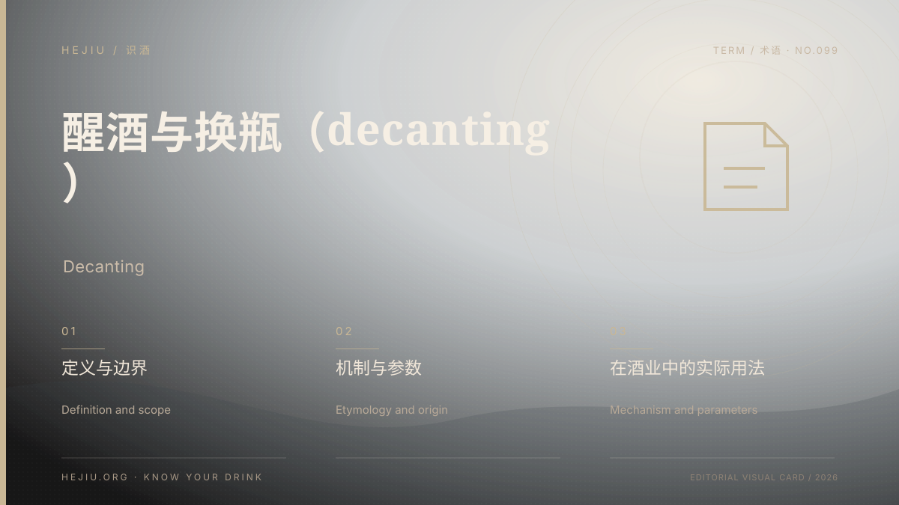

# Decanting

Decanting means pouring wine slowly from its bottle into another vessel, usually a wide-bottomed glass decanter. The action has two purposes: separating the wine from sediment at the bottom of the bottle, and letting the wine contact air. Their conditions differ, and treating them as one leads to the mistaken conclusion that every wine should be decanted.

Figure: thematic illustration for Decanting. Image: AI-assisted illustration generated with Doubao Seedream 5.0 (project-owned); not a photograph of the subject.

## Definition and scope

The boundary of decanting is "moving wine from its bottle into another vessel". It does not include swirling in the glass, and it does not include racking in the winery. Sediment formed during bottle ageing of [red wine](ref:red-wine) can be separated by decanting; a young wine with a closed aroma can be opened by contact with air. Conversely, a wine that is already oxidised or cork-tainted will not recover because the container changed.

It also differs from filtration. Decanting relies on gravity and a slow pour, leaving sediment in the bottle; filtration relies on a medium that traps particles. Decanting removes most coarse sediment, but fine particles can still reach the glass, so "decanting equals complete removal of sediment" does not hold.

## Etymology and origin

Decant first appears in English in 1633, from French décanter and New Latin decantare, originally meaning to pour off the clear liquid from the edge of a vessel without disturbing the sediment; it began as an alchemical term. The noun decanter appeared in 1715. Chinese renderings stress either waking the wine, separating the clear liquid from sediment, or changing the vessel, and these describe different sides of the same action.

The etymology also reveals a key point: decant originally meant pouring off without disturbing the sediment, so sediment separation is the oldest function, while air contact is a later service aim. Understanding decanting only as "aeration" misses its most basic use.

## Mechanism and parameters

Sediment comes mainly from polymerised pigments and [tannin](ref:tannin), plus precipitated tartrates. It is not a safety issue, but it feels gritty and bitter in the mouth. Before decanting, stand the bottle upright so that the sediment collects at the base; pour slowly and continuously, using a candle or a light to watch the shoulder, and stop as soon as the sediment approaches the outlet. The small amount left in the bottle can be discarded, or kept in a glass to settle and taste separately.

The effect of air contact depends on the area of the gas-liquid interface and on time. A wide decanter offers more contact area and releases aroma faster; a narrow vessel retains more aroma. Temperature matters too: too cold and the aroma is closed, too warm and the alcohol stands out. Timing varies: a young, tightly structured wine may need 30 minutes to 2 hours; a delicate wine with a long [vintage](ref:vintage) may need only a brief pour, or none. Sparkling wine and very fragile old wine are usually not decanted for long.

## Use in the industry

Restaurants often decant by candlelight, with the server watching the sediment line at the shoulder; old bottles may first be held in a decanting cradle to reduce movement. A sommelier will open and taste before deciding whether to decant and for how long, rather than applying a fixed rule. The winery does not "decant", but racking and micro-oxygenation serve a comparable purpose of exposing wine to air, at a different scale and stage.

Service details matter: the decanter must be clean and free of detergent residue; the cork should be checked before pouring; the wine should be drunk reasonably soon after decanting, because its aroma keeps changing in contact with air. For old wine, deciding whether to decant is often a judgement of risk rather than a piece of theatre.

## Terms easily confused

- **Decanting versus racking**: racking is the winery operation of separating wine from sediment, while decanting is the pre-drinking transfer. The aim is similar, but the setting and scale differ.
- **Decanting versus filtration**: decanting relies on gravity and pouring, filtration on a trapping medium; decanting cannot guarantee removal of fine sediment.
- **Decanting versus glass aeration**: a decanter offers a large contact area over a long time, while swirling in a glass offers a small area for a short time; the two cannot be converted into one duration.
- **Pouring off versus changing vessel**: one phrase stresses sediment separation, the other stresses the new container; in practice both usually happen at once.

## Misconceptions and disputes

First, all red wines are assumed to need decanting. Young, easy-drinking wines can be ready on opening, and over-decanting dissipates the fruit. Second, longer is assumed to be better. Timing should follow the condition of the wine, and old wines are especially fragile. Third, decanting is expected to repair faults; cork taint and serious oxidation do not disappear with a new vessel. Fourth, temperature and glassware are ignored while the shape of the decanter gets all the attention.

One dispute is whether old wine should be decanted at all. Supporters argue that a brief transfer separates sediment and releases aroma; opponents argue that air contact makes already limited fruit fade quickly. Another dispute concerns wide versus narrow designs: a wide base helps aeration, a narrow neck helps retain aroma, and the two cannot be had at once. Scientifically, the effect of oxygen on aroma is complex, and no fixed duration fits every bottle.

## Typical figures and examples

- Standing upright: several hours to 24 hours, so that sediment collects at the base.
- Decanting time: about 5 minutes to 2 hours; high-tannin wines such as Syrah, Barolo and Brunello may take about 2 hours.
- A standard bottle holds 750 mL; a wide decanter exposes a much larger gas-liquid area than the bottle mouth.
- Sediment composition: polymerised pigments and tannins, plus a little tartrate.
- Example: a 1990s Bordeaux reaches its aromatic peak 15–30 minutes after opening and loses fruit clearly after 2 hours, showing how narrow the window is for old wine.
- Example: cork taint (TCA) does not disappear with decanting; changing the vessel cannot repair a chemical fault.

## See also

- [Red wine](ref:red-wine): structure and ageing.
- [Vintage](ref:vintage): wine age and bottle maturation.
- [Aroma](ref:aroma): aroma layers and the effect of oxidation.

**At a glance:** Decanting moves wine from its bottle into another vessel for two purposes — separating sediment and exposing the wine to air; old reds and young tannic wines have different goals, not every wine benefits, and timing depends on age and condition. 

Start with where the term is used. From there, consider what it is contrasted with, then whether the source is a standard. That is how a practical judgment about Decanting is built.
