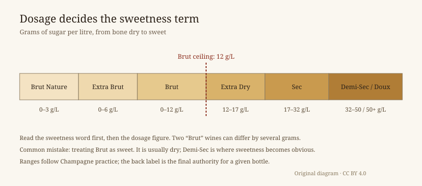

# Dosage

Dosage is the small volume of liquid added to traditional-method [sparkling wine](ref:sparkling-wine) after [disgorging](ref:disgorgement) and before the final closure. It is usually a blend of the same base wine and sugar, known in French as liqueur d'expédition. The step has two jobs: replace the wine lost during disgorging, and set the finished sweetness class.

Figure: dosage in grams per litre against the sweetness term on the label. Original diagram, CC BY 4.0.

## Definition and scope

The boundary of dosage is liquid added after disgorging. It is not the fermentation liquid added before the second fermentation (liqueur de tirage), and it is not the sugar left behind when fermentation stops. Dosage may contain sugar and wine, or wine alone; the sugar may be sucrose or concentrated grape juice. Its volume is small, but its sugar concentration is high, so it has a decisive effect on the sweetness of the whole bottle.

Nor must every sparkling wine receive sugar: the rules allow a zero dosage if the finished wine meets the sugar condition and no sugar was added after the second fermentation. Tank-fermented wines can be dosed too, but the process position and pressure management differ.

## Etymology and origin

Dosage comes from the French verb doser, to add in measured doses; English borrowed the spelling rather than coining a new word. Liqueur d'expédition literally means "shipping liqueur", because it is added before the wine is shipped. Chinese renderings stress either topping up the volume or flavouring and sweetening, but they describe different sides of the same action.

In older texts, dosage and liqueur are often used interchangeably; modern rules define the classes by sugar bands, so dosage becomes the process and brut, sec and the like become label categories.

## Mechanism and parameters

The basic calculation is target sugar concentration multiplied by bottle volume. In a 750 mL bottle, 10 g/L requires 7.5 g of sugar; that figure does not yet subtract the residual sugar already in the base wine, and it ignores the volume contributed by the dosage itself. In practice, the winemaker measures the base wine's residual sugar, works back from the target to a dosage recipe, and confirms the result with a bench sample.

Fructose usually tastes sweeter than sucrose, and glucose is milder. Acidity, temperature, carbon dioxide pressure and alcohol all shift the perception, so grams on the label do not equal how sweet the wine tastes. After dosage the wine needs a rest period so that wine and sugar integrate and do not separate; dissolved oxygen and microbial risk also need control, because dosage reopens a wine that had already been stabilised.

The volume of the dosage also shifts alcohol and pressure: 25 mL in a 750 mL bottle dilutes by about 3.3%, and a lower-alcohol dosage can cut finished strength by under 0.5 percentage points; keeping the dosage near wine temperature limits carbon dioxide loss, and dosing vessels and lines must be kept clean to avoid introducing microbes.

## Use in the industry

Dosing to the target class after disgorging, then closing and labelling, is the standard traditional-method sequence. EU labelling rules tie the sweetness terms for sparkling wine to sugar bands, and Champagne and other traditional-method regions work within that system. Producers may build the dosage from older reserve wine to add nutty, honeyed or oxidative notes, or use concentrated grape juice to emphasise fruit.

A zero-dosage product must meet the brut nature condition: less than 3 g/L of sugar and no sugar added after the second fermentation. In practice, "zero dosage" describes the process, while the label wording remains bound by the rules; the two cannot be swapped freely. The dosage recipe is treated as part of a house style, and the same base wine can show quite different characters on dosage alone.

## Terms easily confused

- **Dosage versus residual sugar**: dosage is sugar added after disgorging, residual sugar is sugar left when fermentation stops or is halted. Both count towards the finished sugar, but their origin and purpose differ.
- **Dosage versus liqueur de tirage**: the latter is the sugar and yeast liquid added before the second fermentation to create bubbles; dosage is the flavouring liquid added after disgorging to top up volume and fix sweetness.
- **Brut nature versus zero dosage**: brut nature legally requires less than 3 g/L and no sugar added after the second fermentation; "zero dosage" describes the process, and the label wording is constrained by the rules.
- **Extra dry versus brut**: in everyday language extra dry sounds drier, but in sparkling-wine rules it is sweeter than brut (12–17 g/L against 0–12 g/L).

## Misconceptions and disputes

First, dosage is treated as cutting corners. Disgorging necessarily loses wine, and without topping up the volume would have to be made up another way, so dosage is a standard step. Second, the sweetness term is equated with perceived sweetness, ignoring how acidity and temperature adjust it. Third, brut nature is assumed to contain no residual sugar at all; the rule allows less than 3 g/L, not an absolute zero. Fourth, dosage is assumed to affect sweetness only, when the added wine also changes aroma and texture.

One dispute is whether zero dosage is "purer". In a high-acid, lean year a small dosage can help balance; in a ripe, full-bodied year zero dosage need not taste hard. Treating the dosage number as a quality verdict turns a style question into a moral one. Another dispute concerns the oxidative notes that reserve wine in the dosage can bring, and whether that counts as purity; producers and drinkers disagree.

## Typical figures and examples

- Brut nature: below 3 g/L, with no sugar added after the second fermentation.
- Extra brut: 0–6 g/L.
- Brut: below 12 g/L.
- Extra dry: 12–17 g/L.
- Sec: 17–32 g/L.
- Demi-sec: 32–50 g/L.
- Doux: above 50 g/L.
- In a 750 mL bottle, 10 g/L corresponds to 7.5 g of sugar; 12 g/L corresponds to 9 g.
- Example: the same base wine dosed at 3 g/L and at 12 g/L falls in the extra brut range in the first case and near the brut ceiling in the second, changing both sweetness and food pairing.
- Example: a base wine with 1 g/L residual sugar and a target of 8 g/L needs a dosage calculated at about 7 g of sugar per litre, then scaled to the bottle volume.

## See also

- [Sparkling wine](ref:sparkling-wine): the full traditional-method process and styles.
- [Disgorgement](ref:disgorgement): the step immediately before dosage.
- [Residual sugar](ref:residual-sugar): sugar sources and how they relate to sweetness labelling.

For Dosage, begin with where the term is used, then what it is contrasted with, and finish with whether the source is a standard; that order keeps the account grounded.

The comparison with [Sparkling wine](ref:sparkling-wine) and [Disgorgement](ref:disgorgement) runs through definition and applicable standard. Each answers a different question.

**Short definition:** Dosage is the topping liquid added after disgorging traditional-method sparkling wine, usually a blend of base wine and sugar; it replaces the volume lost at disgorging and sets the finished sweetness class, from brut nature to doux under EU rules.
