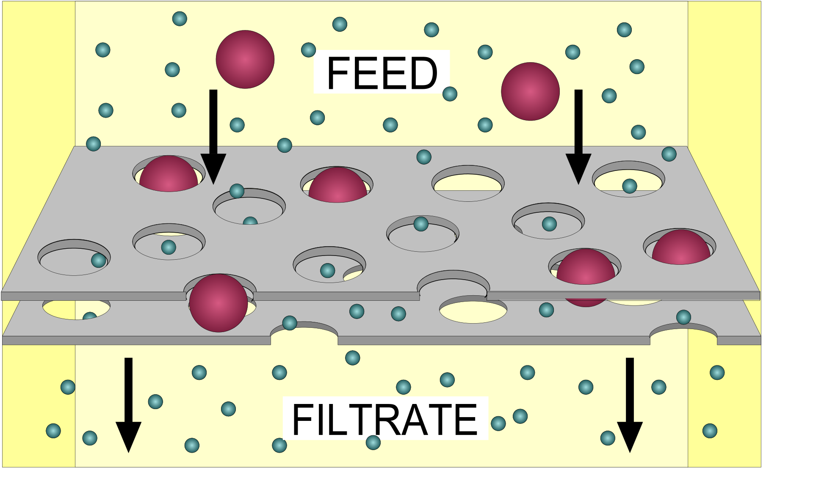

# Filtration

Filtration passes wine through a medium that physically retains suspended particles, yeast and bacteria. Its immediate aims are clarity and microbiological stability, not "filtering out flavour". Filtration is often confused with fining, but the mechanisms differ: fining uses adsorption and flocculation to turn dissolved or colloidal material into settlable particles, while filtration uses pore size to hold back particles that have already formed. The two are often used together and cannot replace each other.

Figure: Diagram of Filtration. Image: Wikiwayman, CC BY-SA 3.0, via Wikimedia Commons ([source page](https://commons.wikimedia.org/wiki/File:FilterDiagram.svg)).

## Definition and boundaries

First, filtration is not fining. Second, it is not disgorgement, which only ejects the yeast plug gathered at the bottle neck. Third, sterile filtration is not sterile bottling: the filling environment, bottle and closure also determine microbiological risk. Fourth, unfiltered does not mean unclarified; many wines are clarified by settling, racking and fining without passing through a filter medium. Fifth, filtration cannot remove dissolved off-flavour molecules such as TCA. Sixth, performance depends on wine temperature, viscosity and particle size, so the same pore size does not behave identically under different conditions.

## Etymology and origin

English filtration comes from Latin filtrum, originally felt or filter cloth, and later any operation that passes liquid through a porous material and leaves solids behind. French filtration and German Filtration share the same root. In winemaking, filter is both the equipment and the action; Chinese "guolv" stresses removal. Cloth, sand and straw have historically been used to clarify wine, while modern practice uses diatomaceous earth, cellulose pads, membrane cartridges and cross-flow systems.

## Mechanism and parameters

Depth filtration uses a thick medium such as diatomaceous earth, cellulose pads or cartridges; particles are retained inside the medium, giving a high dirt-holding capacity suited to turbid wine. Surface filtration uses a membrane with a more uniform pore size; particles are retained at the surface, with common pore sizes around 0.65, 0.45 and 0.2 micrometres. OIV defines sterilising filtration as using membranes or prefabricated pads with a maximum average pore diameter of 0.65 micrometres, and requires the equipment to be sterilised with hot water or steam beforehand. AWRI treats 0.45 micrometres as "absolute" filtration capable of retaining most yeasts and bacteria. Media are also rated "nominal" or "absolute": nominal values are approximate ranges, while absolute values are the ones suitable for discussing microbiological stability. Cross-flow filtration keeps wine moving along the membrane surface, reducing cake build-up and suiting high flow or high turbidity.

## Practical use in the industry

A typical sequence is: end of fermentation, settling or racking to remove most [lees](ref:lees), [fining](ref:fining) if needed, and filtration before bottling. White wines are often kept clear at low temperature, while reds are treated more cautiously because excessive filtration can strip colour, tannin and texture. Some producers choose not to filter in order to retain particles and palate, but then need sulfur dioxide, alcohol, pH and hygiene to control risk. Sterile filtration is usually placed at the front of the bottling line; cartridges are sterilised before use, and pressure drop and integrity are monitored afterwards. Filtration also affects the clarity of fruit wines, sake and spirits, not only wine. On a bottling line it is designed together with sterilisation and antioxidant management; a single filtration step cannot solve every stability problem.

## Confusable terms compared

First, filtration versus fining: fining acts on dissolved or colloidal material, filtration on particles, and the usual order is fining first, filtration later. Second, sterile filtration versus sterile bottling: the first lowers the microbial load in the wine, the second controls the filling environment and container, and the first alone cannot guarantee a sterile product. Third, depth versus surface filtration: depth media hold more dirt and suit rough filtration, while surface membranes have uniform pores and suit fine filtration and sterilisation. Fourth, filtration versus racking or settling: racking separates by gravity, filtration by a medium, and an unfiltered wine may still be racked several times.

## Common misuses and disputes

First, "filtration always destroys flavour". The effect depends on pore size, medium, wine and operation; rough filtration can indeed strip aroma and texture, but moderate filtration may not. Second, "unfiltered is more natural and better". Unfiltered is a process choice and can carry microbial and sediment risk. Third, "filtration solves cork taint". [Cork taint](ref:cork-taint) comes from volatile compounds such as TCA, and filtration cannot remove molecules already in the wine. Fourth, "0.45 micrometres is absolutely sterile". Absolute filtration requires integrity testing and correct operation; pore size is only a precondition. The wider dispute is flavour versus stability, which has no single answer and depends on the wine's positioning, shipping distance and shelf life.

## Typical figures and examples

OIV's sterilising filtration provision gives a maximum average pore diameter of 0.65 micrometres; common membrane cartridges are 0.45 and 0.2 micrometres; AWRI calls 0.45 micrometres the absolute filtration level. A typical stability check passes about 100 millilitres of wine through a 0.45-micrometre membrane, then incubates the membrane on media for 10 days to detect yeast and bacterial growth. Depth filtration is often run at a nominal 0.8 micrometres after a second racking. These figures show that filtration is an engineering balance of pore size, pressure, flow and dirt-holding capacity, not an on-off switch.

## Coordination with fining and settling

Bentonite, a common fining agent, mainly removes protein to prevent post-bottling protein haze; filtration then removes fine particles that have not settled after fining. If the order is reversed and wine is filtered before fining, the flocculated material can cloud the wine again. In scheduling, fining, settling, racking and filtration are often grouped into one preparation period, with turbidity and stability checked after each step. For reds, the effect on pigments and tannins also matters; for sweet wines, sugar and microbial status before and after filtration need attention.

## See also

- [Fining](ref:fining): clarification by adsorption and flocculation.
- [Lees](ref:lees): a major source of suspended solids.
- [Cork taint](ref:cork-taint): a volatile off-flavour that filtration cannot solve.

To read Filtration, start with where the term is used, then what it is contrasted with, then whether the source is a standard; no single check settles it.

**At a glance:** Filtration passes wine through a medium that physically retains particles and microorganisms; depth and surface filtration differ in structure, and filtration affects clarity, stability and flavour but is not the same as fining.

**Read alongside.** Put Filtration next to Fining, Lees, Cork taint: the first fixes identity and boundary, the others provide a region, process or peer comparison. Read this page first, then return to those entries; the links become coordinates, not decoration.

**Sources and limits.** The key claims about Filtration are checked against the following sources: International Organisation of Vine and Wine (OIV) (Used to check the place of filtration in oenological terminology), Oxford University Press (Used for entries on filtration, sterile filtration and unfined/unfiltered wine), The Australian Wine Research Institute and 5 sources in total. Prices, batches and status change; the body is project-written and does not reproduce source text.

For Filtration, this page was last checked in 2026; prices, batches and availability change, so confirm them against the sources below.
