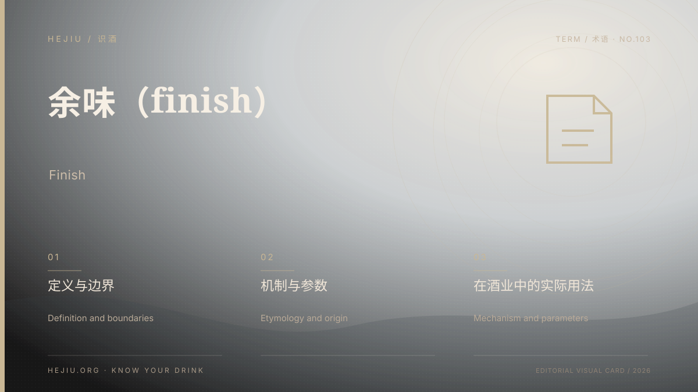

# Finish

Finish (also called length, aftertaste or the tail) is the taste, aroma and mouthfeel that continue in the mouth and nose after a drink is swallowed or spat out. It is not the burst at the moment of swallowing but the fading curve over the following seconds to tens of seconds. In tasting, length, layers, cleanliness and direction together form the judgement, rather than an isolated number of seconds.

Figure: thematic illustration for Finish. Image: AI-assisted illustration generated with Doubao Seedream 5.0 (project-owned); not a photograph of the subject.

## Definition and boundaries

Finish describes "what is still happening after the sip": lingering acidity, tannin grip, alcoholic heat, returning sweetness, bitterness, minerality or smoke. It has a clear start (swallowing or spitting) and a fuzzy end (the last identifiable taste disappearing). No legal minimum in seconds exists; OIV sensory terminology and national labelling rules do not set a numerical grade for finish. Short, medium and long are descriptive bands, not certifications. Finish is also not the whole of "flavour"; it is the tail of flavour on the time axis. Returning sweetness is one possible element of finish, but it describes a direction of taste, not duration; a wine can return sweetness clearly yet close quickly, or finish long without any returning sweetness.

## Etymology and origin

Finish comes from the English idea of completion or closing, used in tasting for the closing stage after swallowing; length stresses duration and aftertaste stresses residual flavour. The French tasting tradition uses the caudalie, with 1 caudalie equal to roughly one second of persistence. The unit comes from practice rather than regulation, so tasters still translate between seconds and short, medium and long; whether the same wine is recorded as 15 or 25 seconds often depends on the taster's sensitivity and note-taking habits.

## Mechanism and parameters

Length is shaped by several components at once. Acidity gives a fresh tail and stimulates saliva, which prolongs flavour; tannin binds salivary proteins and creates grip and dryness; alcohol raises the sense of heat and volatilisation, keeping aroma in the rear of the nose longer; residual sugar, glycerol and extract add viscosity and returning sweetness; volatile sulfides, esters, terpenes and oak-derived phenols set the direction. Temperature, carbonation and individual saliva flow also change the impression. Higher temperature speeds volatilisation, pushes aroma up the nose faster and can make alcoholic heat more obvious; lower temperature suppresses aroma and makes the close seem shorter and cleaner. Carbonation brings a brief tingle and freshness, but the real finish only shows once the bubbles are gone. "Complete structure" usually means these components do not undercut one another during the close.

## Practical use in the industry

In [wine](ref:wine) tasting, finish is used to judge concentration, balance and ageing potential; in [whisky](ref:whisky), short, medium and long are combined with dry, sweet, smoky or spicy descriptions; in [beer](ref:beer), BJCP-style writing separates finish from aftertaste, covering lingering bitterness, malt sweetness and fermentation cleanliness. Producers also use the finish to adjust maceration, hop additions and distillation cuts, because the close is where structural problems show: a dragging bitterness, a sharp acid edge or alcoholic heat becomes obvious in the last seconds. In competitions and score sheets, finish often appears as a separate dimension, but judges also read balance, complexity and cleanliness and do not score on length alone.

## Confusable terms

First, finish versus aroma. Aroma is the volatile smell at the smelling stage; finish is residual taste and retronasal aroma after the sip. They can correlate, but they are not the same measurement. Second, finish versus body. Body is the weight felt on entry; finish is duration after swallowing. A heavy body can have a short finish, and a light body can have a long one. Third, length versus quality. Length is only one dimension; quality also depends on layers, balance and cleanliness. Fourth, finish versus tail. Tail is the more colloquial "end", often the last stretch; finish is the tasting term covering the whole passage from swallowing to disappearance.

## Common misuses and disputes

Equating a long finish with quality is the commonest misuse. High alcohol, high residual sugar or over-extraction can create a long burn or bitterness without being pleasant. Second, mistaking alcoholic heat for "a long finish"; third, ignoring temperature and glass shape, since the same wine may close shorter and cleaner when cold; fourth, recording only "long or short" and omitting the specific flavours; fifth, presenting personal preference as an objective verdict. There is also dispute over timing: two tasters' "20 seconds" do not match, and mouth state, breathing and speech all interrupt the finish. Another misuse is to equate a long finish with ageing potential; ageing potential also depends on acidity, tannin structure, alcohol and storage, and finish is only one clue.

## Typical figures and examples

In common tasting practice, a short finish is about 5 seconds or less, medium about 5–15 seconds, long about 15–30 seconds, and very long beyond 30 seconds; these bands are not legal standards. At 1 caudalie equal to roughly 1 second, a wine closing over 20 seconds can be recorded as about 20 caudalies. Example: a red wine that still shows [tannin](ref:tannin) grip and black pepper 20 seconds after swallowing can be written as "long, peppery"; a crisp lager that closes cleanly within 3 seconds can be written as "short, clean". Two wines lasting 40 seconds should not receive the same quality judgement if one is only bitter and the other still shows fruit and minerality. A sweet wine with high residual sugar, for example above 100 g/L, often seems to finish long because of viscosity and sweetness, but without enough acidity the close feels sweet and cloying rather than balanced; seconds must be read inside the structure.

## Recording and describing

When recording finish, write three things: duration, main flavours and cleanliness. Estimate duration in seconds or caudalies, or use a phone timer to record the interval from swallowing to the last disappearing taste; describe main flavours across acidity, sweetness, bitterness, saltiness, umami, tannin, alcohol, smoke and minerality; check cleanliness for mould, vinegar, cardboard or excess sulfur. When buying, a long finish suits slow drinking and age-worthy styles, while a short, clean finish suits fresh and food-friendly styles; either way, read it alongside [acidity](ref:acidity), body and personal preference.

## See also

- [Wine](ref:wine): where finish sits in wine tasting.
- [Whisky](ref:whisky): smoke, spice and wood in the close.
- [Beer](ref:beer): the close of hop bitterness and malt sweetness.
- [Tannin](ref:tannin): how astringency shapes the tail.
- [Acidity](ref:acidity): the source of a fresh finish and saliva flow.

For Finish, begin with where the term is used. Then look at what it is contrasted with, and finally ask whether the source is a standard. The answers point to different choices, not to a single score.
