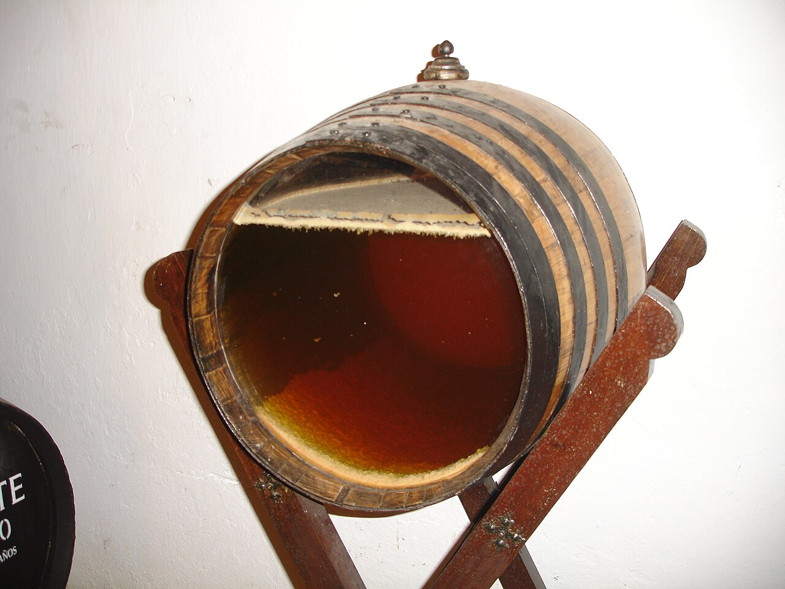

# Flor

Flor is the layer of yeast film that forms on the surface of Sherry during biological ageing. In Spanish it is called velo de flor, the "veil of flowers". It is made up of several yeast strains, mainly within Saccharomyces; the film separates the wine from air while metabolising alcohol, glycerol and dissolved oxygen into acetaldehyde and related compounds. Flor is not mould and not a sign of spoilage; in Fino and Manzanilla it is the precondition of the style.

Figure: Flor. Image: El Pantera, CC BY-SA 3.0, via Wikimedia Commons ([source page](https://commons.wikimedia.org/wiki/File:FLOR-ValdiviaJerez59.jpg)).

## Definition and boundaries

First, flor is a film, not lees. Lees settle at the bottom of the cask, flor grows at the surface, and the two drive different chemistry. Second, flor is not a required step for every Sherry: Oloroso keeps no flor and follows an oxidative route. Third, flor is not mould or contamination but a controlled yeast community; once the film breaks, acetic acid bacteria and oxygen move in. Fourth, flor is not "the thicker the better"; activity and continuity matter more than thickness. Fifth, flor is a process state, not a flavour adjective; only the legal terms Fino and Manzanilla describe the resulting style.

## Etymology and origin

Spanish flor means "flower", and velo de flor is the "veil" or "curtain" of flowers that covers the liquid surface. English borrows flor rather than translating it as flower. In the bodegas, cellarmasters say "la flor está viva" ("the flor is alive"), treating the film as something that must be looked after. The Chinese term for flor is also the same word used for hops, which is a translation trap: Sherry's flor has nothing to do with brewers' hops. Etymology helps prevent the mistake of treating flor as an ingredient.

## Mechanism and parameters

The base wine is first fortified to about 15% vol, a strength at which flor yeast survives while most acetic acid bacteria and wild yeasts are suppressed. Fino and Manzanilla are therefore fixed at 15%, while Oloroso is fortified to at least 17% vol, at which flor cannot be sustained. The wine is filled into 500-litre American oak butts with some headspace, and the yeast multiplies at the surface into a film. The film consumes alcohol, glycerol, dissolved oxygen and some volatile acidity, producing acetaldehyde, acetals and esters that give bread, almond, sea-air and saline notes. Temperature, humidity, ventilation and cask hygiene all affect thickness and life span; once the film breaks, oxidation and acetification risk rise. The film is usually only a few millimetres thick, appearing as a white to cream-coloured layer rather than a thick mat. Flor yeast is not a single strain but a community of strains with different tolerances to alcohol, temperature and nutrients, which helps explain why cellars in the same region can develop different house styles.

## Practical use in the industry

After harvest, base wines that are light in colour, delicate and low in pressure are marked with a "/" (palo) and sent to biological ageing; heavier, more structured batches are marked "O" and sent directly to oxidative ageing. After fortification the wine enters the sobretablas stage, roughly 6 months to a year, before a second classification: butts with a vigorous film are marked palma and confirmed for Fino/Manzanilla, while butts with a weak or broken film are fortified to 17% vol and redirected to Oloroso. Amontillado is the intermediate form that spends time under flor and then moves to oxidation; Palo Cortado often follows a similar turn. The solera and criaderas system tops up the wine step by step, feeding the flor while keeping the style stable. For producers, maintaining flor is daily work: watching the surface, controlling the pace of topping up, keeping the cask opening clean and adjusting alcohol when necessary. If the film dies, the wine does not become Oloroso at once, but it begins to oxidise, and the producer must decide on classification before the flavour turns.

## Confusable terms compared

First, flor versus [oxidation](ref:oxidation): flor ageing deliberately excludes oxygen, oxidative ageing invites it; the first stays pale and saline, the second turns dark with nut and caramel notes. Second, flor versus lees: lees are the settled layer of dead yeast and solids, flor is a living film at the surface; bâtonnage and flor maintenance are different practices. Third, Fino versus Oloroso: the two can come from the same base wine, and the split depends on whether flor is kept and how far the wine is fortified. Fourth, flor versus hops: the first is Sherry's yeast film, the second is a brewing ingredient; they share a Chinese name but not an English one.

## Common misuses and disputes

First, treating flor as mould or dirt. Second, assuming that every Sherry grows flor. Third, assuming that a thicker film means a better wine. Fourth, attributing Fino's saline note to added salt, when it comes mainly from yeast metabolism and the mineral character of the wine. Fifth, ignoring how fragile flor is and assuming that once the cask is filled nothing more is needed. The wider dispute is whether biological ageing is necessarily better than oxidative ageing: it is a style choice, not a quality ranking, and one bodega can make both routes from the same base wine. A second dispute concerns the management of flor yeast strains, whose proportions affect the balance of acetaldehyde and esters.

## Typical figures and examples

Fino and Manzanilla are fortified to 15% vol; Oloroso to at least 17% vol; flor cannot be sustained above 17% vol. Solera butts commonly hold 500 litres. The sobretablas stage lasts about 6–12 months before the second classification. Manzanilla is aged only in the bodegas of Sanlúcar de Barrameda, a geographical limit that gives it a more pronounced sea-air character. These figures come from Sherry regulatory material and are useful when reading labels and process notes.

## Solera and topping up

The solera stacks casks in stages, drawing wine for bottling from the oldest criadera and replacing it with younger wine step by step. Topping up must slightly exceed the volume drawn so that the level and the flor are maintained; too vigorous a top-up can break the film, while too little leaves the film short of nutrients. Cellarmasters judge the film by its continuity, the smell at the cask opening and volatile acidity measurements. This dynamic management explains why Sherry can keep a stable style over decades, and why even a non-vintage Sherry shows small variations between bottlings.

## See also

- [Oxidation](ref:oxidation): oxidative ageing compared with biological ageing.
- [Aroma](ref:aroma): the aromatics flor metabolism produces.
- [Fortified wine](ref:fortified-wine): Sherry in its wider context.

Further reading: [Acidity](ref:c-extra-1).

**In brief:** Flor is the yeast film that forms on the surface of Sherry during biological ageing, shielding the wine from oxygen and metabolising alcohol and glycerol; Fino and Manzanilla depend on flor, while Oloroso follows an oxidative route.

Read Flor through where the term is used, then what it is contrasted with, and finally whether the source is a standard. The sequence matters.

The comparison with [Oxidation](ref:oxidation) and [Fortified wine](ref:fortified-wine) runs through definition and applicable standard. Each answers a different question.
