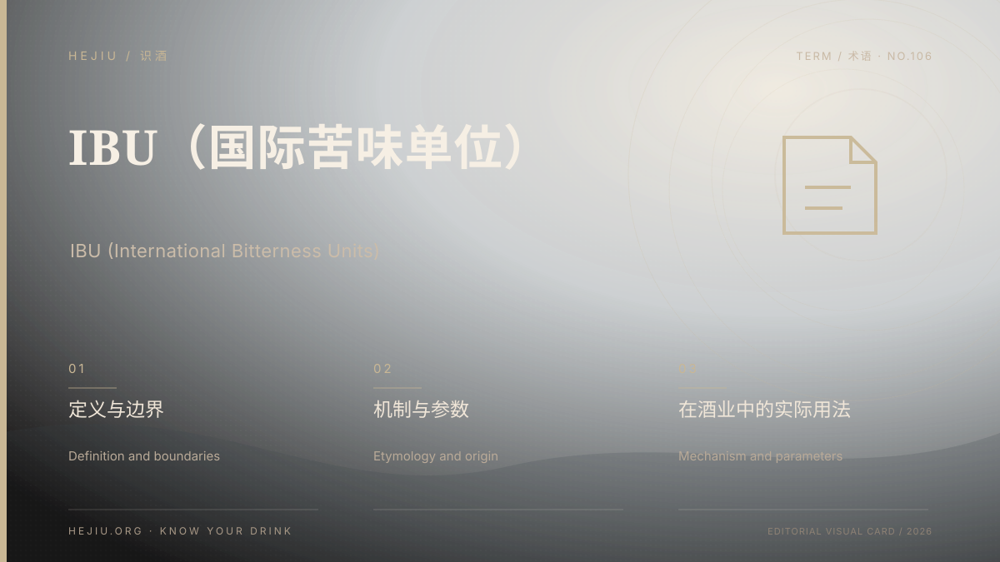

# IBU (International Bitterness Units)

IBU (International Bitterness Units) is the unit the beer industry uses to quantify bitterness. 1 IBU is roughly 1 milligram of iso-alpha acids per litre of beer, or 1 ppm. It describes the concentration of hop-derived bitter compounds, not the bitterness intensity felt on the tongue at the moment of drinking. Beers at the same IBU can taste completely different because of malt sweetness, carbonation and temperature.

Figure: thematic illustration for IBU (International Bitterness Units). Image: AI-assisted illustration generated with Doubao Seedream 5.0 (project-owned); not a photograph of the subject.

## Definition and boundaries

IBU measures iso-alpha acids, the products formed when alpha acids isomerise during the boil. It excludes bitterness from roasted malt, astringency from hop polyphenols, and the sensation from alcohol and carbonation. IBU is therefore a chemical index, not a complete sensory score. A value calculated by recipe software is a prediction; a laboratory value is a measurement; the two may differ. IBU also says nothing about hop aroma, which comes from a different group of compounds. It is not a mandatory labelling unit in national regulations but a voluntary metric used widely by the industry and competitions, so "no IBU on the label" does not mean "no bitterness".

## Etymology and origin

IBU stands for International Bitterness Units and became common in the later twentieth century as beer analysis standardised. It draws on the bitterness-measurement traditions of the European EBC and the American ASBC; the systems used different methods but centred on iso-alpha acids. On modern labels IBU has become a shared language in craft beer, although not every jurisdiction requires it and results from different laboratories are not always directly comparable. The EBC and ASBC methods both rely on the absorbance or chromatographic response of iso-alpha acids, but sample preparation, dilution and instrument calibration introduce differences.

## Mechanism and parameters

Alpha acids such as humulone and cohumulone isomerise during the boil into iso-alpha acids, which are more water-soluble and more stable in bitterness. IBU is often measured by spectrophotometry around 275 nm, and also by chromatography or solid-phase extraction. Hop utilisation depends on boil time, hop form, pH, wort concentration and addition timing, commonly around 20%–35%. The same hop charge can give different IBU under different processes, and two beers labelled 40 IBU can have completely different bitterness texture. Alpha acid content itself varies with hop variety, origin, harvest year and storage, and stale hops lose part of their alpha acids; recipe software therefore usually needs the actual alpha acid percentage, not just hop weight.

## Practical use in the industry

Brewers use IBU to design recipes, keep batches consistent and judge style with the BU:GU ratio, the balance of bitterness against fermentable sugar. Empirically, a BU:GU of about 0.5 reads as balanced between bitterness and malt sweetness, while close to 1.0 makes bitterness clearly dominant; this is not a formula, since yeast attenuation, body and carbonation all change the impression. Pale beers commonly sit at 10–20 IBU, IPAs often at 40 or above, and double IPAs commonly at 60–100; these are style references, not legal limits. IBU also appears in competition scoring and label communication, but it cannot explain hop aroma, which comes mainly from hop oils such as myrcene, humulene and linalool. For [beer](ref:beer), IBU is recipe language; for the drinker, it is one entry point into bitterness.

## Confusable terms

First, IBU versus perceived bitterness. IBU is iso-alpha acid concentration; perceived bitterness also depends on sugar, pH, carbonation and temperature. Second, IBU versus hop aroma. IBU measures bitter acids, while hop aroma comes from oils and thiols; high IBU does not mean high aroma. Third, IBU versus GU. GU describes fermentable sugar concentration and IBU describes bitterness; the ratio between them is the balance clue. Fourth, IBU versus SRM/EBC colour. Colour describes depth of shade and IBU describes bitterness; a dark beer is not necessarily high-IBU, and a pale beer can be very bitter.

## Common misuses and disputes

First, treating IBU as a more-is-more sensory scale; second, assuming higher IBU is better; third, treating a calculated recipe value as a measured one; fourth, ignoring how malt sweetness and body balance bitterness; fifth, comparing IBU across styles without the style baseline. There is also the claim that IBU is obsolete: it remains a valid process metric, but cannot replace sensory description. Another dispute concerns measurement basis, since spectrophotometry and chromatography respond differently to complex matrices, so label values are not always directly comparable.

## Typical figures and examples

1 IBU equals 1 milligram of iso-alpha acids per litre, or 1 ppm. Pale beers commonly sit at 10–20 IBU, IPAs often at 40 or above, and double IPAs commonly at 60–100; a 45 IBU IPA with high residual sugar may taste less cleanly bitter than a 35 IBU dry lager. In measurement, spectrophotometry often reads absorbance around 275 nm, and hop utilisation commonly falls around 20%–35%. [Czech Pilsner Urquell](ref:pilsner) is a typical low-to-medium IBU beer with clean bitterness; [Guinness Draught](ref:guinness) is known for roasted malt and softer bitterness. These figures show that IBU is a process parameter, not a palate scale. Reading BU:GU in the 0.5–1.0 range gets closer to actual balance than IBU alone; outside a style baseline, 40 IBU means completely different things in a lager and a double IPA.

## Recording and describing

When recording IBU, also note style, alcohol content, original gravity and the BU:GU ratio; "45 IBU" alone is insufficient. When describing bitterness, separate intensity, texture (sharp, round, woody, herbal) and duration. When buying, IBU can help you choose or avoid hop-forward styles, but the final test is the actual drink; a label value may be calculated rather than measured. Read IBU together with [fermentation](ref:fermentation) to understand why the same recipe can give different results at different breweries; recording hop varieties, addition times and utilisation assumptions keeps IBU from becoming an isolated number.

## See also

- [Beer](ref:beer): raw materials, fermentation and the style framework.
- [Czech Pilsner Urquell](ref:pilsner): low-to-medium IBU with clean bitterness.
- [Guinness Draught](ref:guinness): roasted malt and soft bitterness.
- [Fermentation](ref:fermentation): the relationship between bitter compounds and fermentation.

Start with where the term is used. From there, consider what it is contrasted with, then whether the source is a standard. That is how a practical judgment about IBU (International Bitterness Units) is built.

[Beer](ref:beer) and [Guinness Draught](ref:guinness) are the nearest useful comparisons: one clarifies definition, the other tests applicable standard.

**Short definition:** IBU is the unit for beer bitterness, with 1 IBU roughly equal to 1 milligram of iso-alpha acids per litre; it measures hop-derived bitterness, not the bitterness felt on the palate, and not hop aroma.

**Read alongside.** Put IBU (International Bitterness Units) next to Beer, Pilsner Urquell, Guinness Draught: the first fixes identity and boundary, the others provide a region, process or peer comparison. Read this term first, then return to those entries; the links become coordinates, not decoration.

**Sources and limits.** The key claims about IBU (International Bitterness Units) are checked against the following sources: Beer Judge Certification Program (Used to check typical IBU ranges for beer styles), ASBC (Used to check the measurement basis for IBU and iso-alpha acids; no method text is reproduced), Brewers Association (Used for notes on bitterness and style parameters) and 4 sources in total. Prices, batches and status change; the body is project-written and does not reproduce source text.
