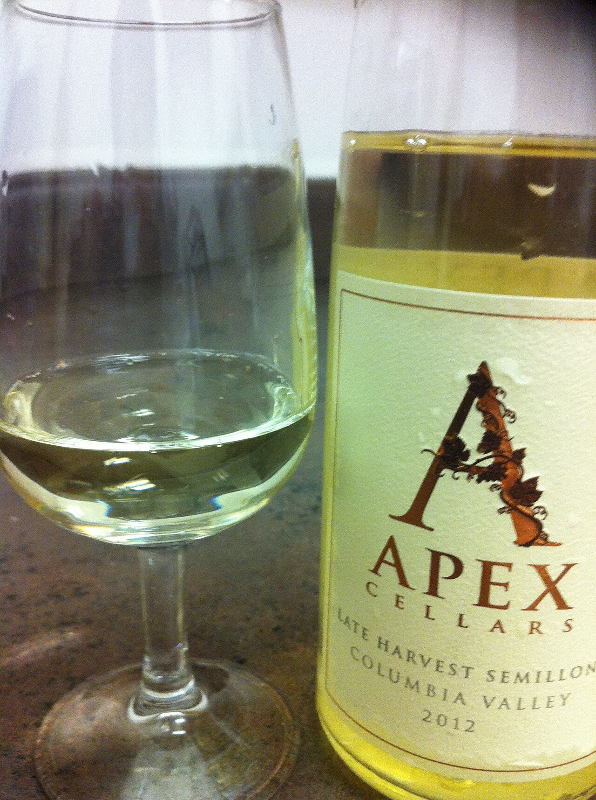

# Late harvest

Late harvest (French vendange tardive) means leaving grapes on the vine beyond normal ripeness and picking them later. In the extra time, the fruit loses water through transpiration, sugar and flavour compounds concentrate, acidity falls, and the berries soften and darken. Late harvest is an important base for sweet and high-alcohol wines, but it is not the same as noble rot and is not necessarily sweeter.

Figure: Late harvest. Image: Agne27, CC BY-SA 3.0, via Wikimedia Commons ([source page](https://commons.wikimedia.org/wiki/File:Late_harvest_Semillon.jpg)).

## Definition and boundaries

First, late harvest is a matter of time, a pick later than normal ripeness; noble rot is fungal transformation. Second, late harvest is not necessarily sweet: if fermentation runs to completion, the result can be a dry, high-alcohol wine. Third, late harvest is not passerillage: drying can happen on or off the vine, and the core is water loss. Fourth, "late harvest" on a label means different things in different regions; some uses are regulated and others are descriptive. Fifth, "late" is relative to the normal picking date for that region and variety, not a fixed calendar date.

## Etymology and origin

English late harvest is a descriptive phrase; French vendange tardive literally means "late harvest"; German Spätlese means "late picking". All three stress timing. Alsace brought Vendanges Tardives and Sélection de Grains Nobles into its AOC rules in the decree of 1 March 1984, while Germany formalised Spätlese and the other ripeness grades in its 1971 wine law. Chinese "wanshou" is a direct translation of the English, sometimes rendered as "late picking", and labels often mix it with "late-picked sweet white".

## Mechanism and parameters

The physical mechanism is transpiration: berry weight falls while sugar, acid, minerals and aroma precursors concentrate. Sugar is measured in °Brix, °Oechsle or potential alcohol; acidity falls through respiration and metabolism. A later pick raises potential alcohol and lowers acidity, ripening the style; leaving fruit too long brings over-ripeness, low acidity and rot risk. Botrytis, rain, birds and autumn temperature swings all change the result. Growers combine sugar, acidity, tasting and weather forecasts to choose the picking window. Water loss depends on skin thickness, stems and sunshine; thin-skinned varieties lose water more easily and are also more prone to disease.

## Practical use in the industry

Alsace: Vendanges Tardives requires the grapes to reach a legal minimum natural sugar, Sélection de Grains Nobles a higher one, and both usually require hand picking and selective sorting. Canadian ice wine requires the fruit to freeze on the vine and is typically picked below −8°C, an extreme form combining late harvest with freezing. Germany: Spätlese belongs to the Prädikat system, requires a later pick than the normal harvest, and its minimum ripeness varies by region; Auslese, Beerenauslese and Trockenbeerenauslese rise step by step. Late-picked grapes may ferment slowly at high sugar, be stopped early or retain residual sugar; sweetness depends on fermentation progress and the rules.

## Confusable terms compared

First, late harvest versus [noble rot](ref:noble-rot): late harvest is only a delayed pick, noble rot is fungal transformation; the two can overlap but are not interchangeable. Second, late harvest versus drying: late harvest relies on water loss on the vine, while drying can happen on the vine or after picking, with similar goals but different risks and flavours. Third, Spätlese versus Auslese: the first is "late picking", the second "selection", with a higher ripeness threshold; neither name is a direct sweetness scale. Fourth, Vendanges Tardives versus Sélection de Grains Nobles: the first is late harvest, the second requires botrytised or selected berries and a higher sugar threshold. Fifth, late harvest versus ice wine: ice wine requires fruit frozen on the vine, while late harvest only requires a delay; the two often overlap but differ in rules and risk.

## Common misuses and disputes

First, assuming late harvest is always sweet. Second, assuming late harvest always means noble rot. Third, assuming later is always better and ignoring acidity and rot risk. Fourth, comparing "late harvest" across regions without allowing for legal differences. Fifth, treating late-harvest wine as "sweet wine with added sugar" and ignoring its raw-material base. Whether late harvest is a quality marker remains disputed: it reflects concentrated raw material, but quality still depends on acidity, balance and cleanliness; a sugar bomb is not automatically a good wine. Sixth, treating the sweetness of late-harvest wine as a fermentation-control result; many such wines rely on high-sugar raw material and an early stop together.

## Typical figures and examples

The French decree of 1 March 1984 sets a minimum natural sugar of 243 g/L must for Alsace Vendanges Tardives and 279 g/L for Sélection de Grains Nobles, with separate rules for individual varieties. German Spätlese starts at roughly 76 °Oe and rises with region and variety; the 1971 wine law established this ripeness grading. Late-harvest [sweet](ref:sweet) whites commonly range from about 9%–14% vol alcohol and from about 50 g/L to more than 150 g/L [residual sugar](ref:residual-sugar). For late-picked grapes at 24 °Brix, potential alcohol is about 13.5%–14.5% vol; stopping fermentation early leaves more residual sugar. Acidity loss depends on variety and night temperature; wide day-night swings help keep both acidity and sugar. In Alsace, Vendanges Tardives and Sélection de Grains Nobles labels must also state the vintage and one of the permitted varieties, so the label carries more information than an ordinary white.

## Picking decisions and risks

Late harvest is a gamble with the weather. Sunny days and cool nights favour concentration and acidity retention; persistent rain dilutes sugar and encourages grey rot; strong wind can dry the fruit too far. Growers guard against birds, wasps and mould, using netting or parcel-by-parcel picking when needed. After harvest, rapid cooling and gentle pressing limit oxidation and fermentation problems. Vintage variation is usually more pronounced than in dry wine, because autumn weather decides whether the fruit can be left that long. The same block is often picked in several passes, taking ripe bunches first and leaving the rest on the vine. Late harvest is not automatically dearer the later it gets; price also depends on yield, selection and positioning.

## See also

- [Noble rot](ref:noble-rot): the other concentration route, driven by fungus.
- [Sweet](ref:sweet): how sweet wines are classified and perceived.
- [Residual sugar](ref:residual-sugar): the measured basis of sweetness in late-harvest wine.

[Noble rot](ref:noble-rot) and [Residual sugar](ref:residual-sugar) are the two useful reference points for Late harvest. [Noble rot](ref:noble-rot) sets out definition; [Residual sugar](ref:residual-sugar) brings in applicable standard. Read them together.

**At a glance:** Late harvest is the practice of leaving grapes on the vine beyond normal ripeness so that water loss concentrates sugar and flavour; it can make sweet wine, but it is not the same as noble rot and not always sweet.
