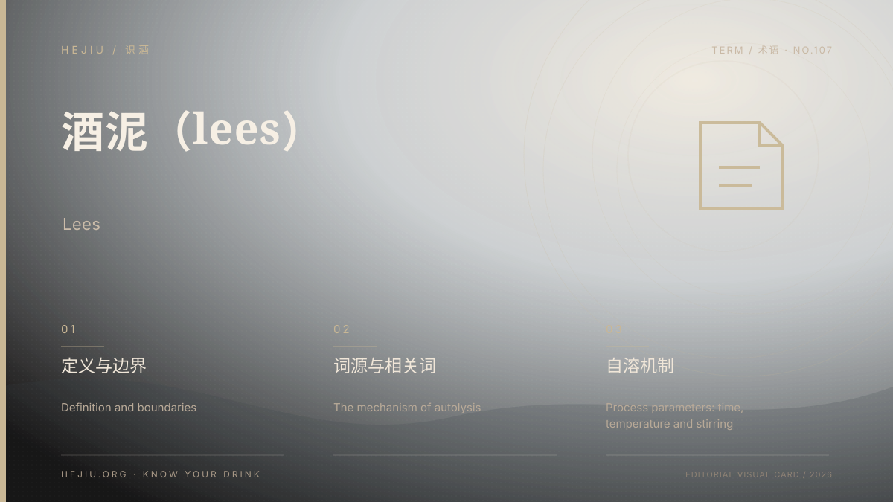

# Lees

Lees are the solid matter that settles to the bottom of a vessel after [fermentation](ref:fermentation) ends. They consist mainly of spent yeast cells, along with grape pulp and skin residue, tartrates, proteins and a little other particulate matter. Lees are not a synonym for dirt, nor waste that must be removed at once; in winemaking they can add flavour and texture, and they can also cause faults.

Figure: thematic illustration for Lees. Image: AI-assisted illustration generated with Doubao Seedream 5.0 (project-owned); not a photograph of the subject.

> **Quick verdict**
> **In one line:** This term explains Lees in one line: definition, boundary and usage.
>
> - **Best for:** Anyone who has met Lees and needs a precise definition, boundary and usage.
> - **Not for:** If you want need the full legal text or legal/medical advice.
> - **Check first:**
>   - White wine is the most common setting, especially for styles seeking texture and complexity rather than pure fruit.
>   - The first pair is lees and sediment.

## Definition and boundaries

The industry usually distinguishes two kinds. Gross lees are the coarser solids that settle first after fermentation, including pulp residue and heavier particles. They are bulky, prone to spoilage, and are generally separated soon afterwards by racking, commonly within 24-48 hours for the first racking. Fine lees are the finer yeast cells and small particles that settle slowly and stay suspended longer.

The distinction matters. Gross lees left in the wine for a long time tend to produce reductive, sulfide-like odours and bitterness; fine lees are often deliberately retained to improve texture. Treating the two as one thing leads to the opposite misconceptions that "lees are always bad" or "more lees are always better". Lees are also not the same as sediment: tartrate crystals, protein deposits and microbial haze can all be sediment without being lees contact in the winemaking sense.

## Origin and related words

Lees come from the French lie, the yeast and solids that settle after wine or vinegar fermentation, and English borrowed the term for winemaking. French sur lie means "on the lees", describing wine aged with fine lees; batonnage, also spelled battonage, comes from baton, a stick, and means stirring the lees. In English, autolysis is the breakdown of yeast cells that drives the flavour and texture of lees contact.

These words are often mixed up. Sur lie describes a state, batonnage describes an action, and autolysis describes a cellular change. They are related but not equivalent. Knowing the origins prevents treating lees ageing and lees stirring as the same operation.

## The mechanism of autolysis

After fermentation the yeast cells gradually die. Enzymes break down the cell membrane and wall, releasing the contents into the wine; this is autolysis. The released material includes mannoproteins, polysaccharides, amino acids, nucleotides and some lipids. Mannoproteins add roundness and body and may also relate to protein and tartrate stability.

Autolysis needs time and conditions. Warmer temperature, a thicker lees layer and more frequent stirring speed it up; cooler temperature, thin lees and a clear wine slow it down. Excessive autolysis brings bitterness and a yeasty taste, so lees contact is not "the longer, the better"; it is a balance between the target style and the risk. Red wines carry more solids and are harder to manage.

## Process parameters: time, temperature and stirring

Typical duration varies by wine. Still white wine sur lie is often 6-12 months, with some styles extended to 18 months; traditional-method sparkling wine spends longer on yeast lees in bottle, and Champagne has a legal minimum of 15 months for non-vintage and 36 months for vintage. Temperature is usually held around 10-18 °C; cooler conditions help retain fresh fruit, while warmer conditions speed autolysis and reduction risk.

Stirring frequency depends on the goal. Early on it may be weekly or fortnightly to resuspend fine lees; later it is reduced to avoid excess oxidation and bitterness. Stirring introduces oxygen, so it must be matched with sulfur dioxide management and headspace control. Fine lees in a sealed vessel can produce reductive odours, in severe cases hydrogen sulfide or mercaptan faults; the answer is aeration or racking, not more stirring.

## How it is used in the industry

[White wine](ref:white-wine) is the most common setting, especially for styles seeking texture and complexity rather than pure fruit. Ageing on lees in stainless steel or oak changes markedly with the vessel, lees depth and stirring frequency. Burgundian Chardonnay and Loire Muscadet sur lie are commonly cited examples; the latter is known for a rounder palate and a light yeasty note after lees ageing.

[Sparkling wine](ref:sparkling-wine) base wines are also often aged on lees. In traditional-method sparkling wine the wine spends months to years on the yeast lees after the second fermentation in bottle, and that period before disgorging is the main source of bread and biscuit aromas. Some red wines also keep fine lees briefly to soften tannin, but reds carry more solids and demand more careful management. The purpose differs by wine type: texture in whites, aroma and bubble finesse in sparkling wine, tannin softening in reds.

## Sensory and textural effects

The effects fall roughly into three groups. First, texture: as yeast cells autolyse they release mannoproteins and polysaccharides, making the wine rounder and fuller and reducing harshness. Second, aroma: bread, biscuit, cream or nut-like notes can develop, a technique Champagne and some white wines use to build style. Third, stability: lees contact consumes dissolved oxygen, slowing oxidation, and may help stabilise colour and proteins.

These effects do not stack linearly. Thin lees and short time give little effect; thick lees and high temperature bring reductive and bitter notes. In tasting, recording yeast, bread and cream notes separately is more useful than saying "leesy". Bread aromas can also come from oak, yeast strain and ageing time and should not all be credited to lees.

## Terms easily confused

The first pair is lees and sediment. Sediment is the broader idea, including tartrates, proteins, pigment polymers and microbes; lees specifically means the yeast and organic solids that settle after fermentation. The second pair is sur lie and batonnage. The first is the state of ageing on lees, the second the action of stirring; wine can be aged on lees without stirring, and stirring can happen without long lees ageing.

The third pair is lees contact and filtration. Lees ageing is an ageing method; filtration is a clarification method. A wine can be aged on lees and then filtered, or bottled unfiltered. The fourth pair is lees and dead yeast. Lees contain dead yeast but also pulp residue and tartrates; equating the two ignores the rest of the solid mix.

## Common misuses and disputes

First, lees do not equal spoilage. Whether they cause problems depends on type, time, temperature and oxygen management. Second, lees contact is not "the longer, the better"; too long brings reductive and bitter notes. Third, lees ageing is not the same as skipping filtration; they are different stages. Fourth, bread aromas do not come from lees alone; oak, yeast strain and ageing time all play a part.

Disputes centre on the line between reduction and complexity. Supporters of long lees ageing point to a distinctive texture and aroma; critics note that fine lees in a sealed environment readily produce sulfide faults and that the method ties up vessels for a long time. Another dispute is whether stirring is essential: some producers keep lees without stirring and argue that this limits oxidation, while others stir regularly to release mannoproteins. Both approaches depend on the wine's goal and risk management.

## Typical figures and examples

Verifiable figures include: gross lees are commonly separated by racking within 24-48 hours after fermentation; still white wine sur lie often runs 6-12 months; Champagne has a legal minimum of 15 months for non-vintage and 36 months for vintage; lees ageing is often held around 10-18 C; stirring can start weekly and then be reduced.

Concrete examples: a Muscadet sur lie may stay on its lees through the winter and be separated only before bottling, giving a rounder palate than a standard Muscadet; a non-vintage Champagne spends at least 12 months on lees in bottle before disgorging and dosage; a white wine left too long on thick lees in a sealed tank may develop hydrogen sulfide, which aeration or racking can correct.

## See also

- [White wine](ref:white-wine)
- [Sparkling wine](ref:sparkling-wine)
- [Fermentation](ref:fermentation)

Lees is best read by starting with where the term is used, moving to what it is contrasted with, and ending with whether the source is a standard.
