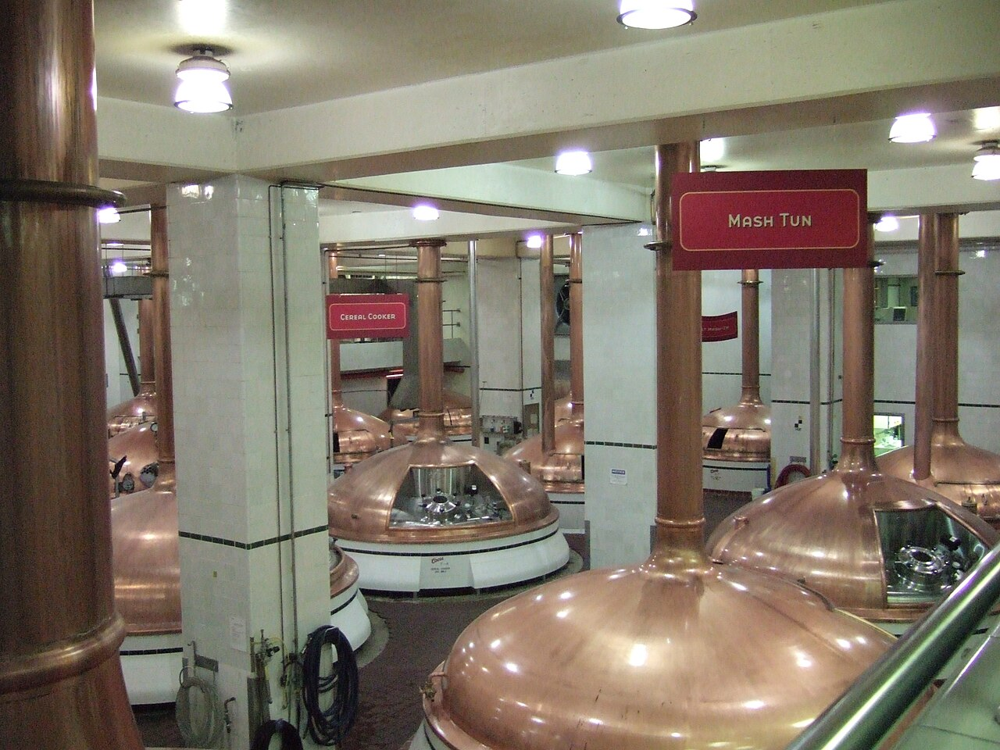

# Mash

A mash is the thick mixture of milled malt, or grist, and hot water in a mash tun. It is not wort but the precursor of wort: starch granules gelatinise in the hot water, the malt's amylases cut starch into sugar, proteases break protein down, and a sugar- and amino-acid-rich liquid begins to form. Only the lautering that follows separates that liquid from the spent grain.

The state of the mash decides extract yield and sugar profile, and it also decides whether fermentation runs smoothly. A thick mash can leave enzymes and substrate poorly mixed and make lautering difficult; a thin mash dilutes the enzymes, stretches the mash time and raises energy use. Too cool and the enzymes are sluggish; too hot and they die early, leaving too much residual sugar. Mashing is not simply soaking grain in warm water; it is a precise control of temperature, time and concentration.

Figure: A mash tun at a brewery, where milled malt and hot water undergo enzyme conversion. Image: Sdgjake, CC BY-SA 3.0, via Wikimedia Commons ([source page](https://commons.wikimedia.org/wiki/File:Coors_Mash_Tun.jpg)).

## Water-to-grist ratio and temperature: the physical state of the mash

Mash thickness is usually described by the water-to-grist ratio, commonly 2.5 to 4 litres of water per kilogram of grist. A thicker mash suits protein rests and high-gravity mashing; a thinner mash helps starch gelatinise and heats more evenly. Commercial breweries adjust the ratio to malt modification and equipment rather than following a fixed formula.

Temperature is the central variable. Common rests include a protein rest near 50 degrees Celsius, where proteases improve foam and clarity; a saccharification rest at 62 to 65 degrees Celsius, where beta-amylase and alpha-amylase work together; a gelatinisation rest above 70 degrees Celsius for residual starch; and a mash-out at 75 to 78 degrees Celsius, which stops enzyme activity, lowers viscosity and makes lautering easier.

The heating rate matters as much as the target temperature. Direct firing can overheat part of the mash, kill enzymes in the hot zone while starch elsewhere is still ungelatinised. Modern mash tuns use steam jackets, stirrers and programmed temperature control to keep the mash even. Traditional equipment relies on the brewer's hand and eye, with less stability and repeatability.

## What enzymes do in the mash

The enzymes in a mash come mainly from malt. Alpha-amylase cuts long starch chains into shorter dextrins; beta-amylase removes maltose from the ends. Together they produce a mixture of fermentable sugar and unfermentable dextrin. Proteases break protein into peptides and amino acids for yeast nutrition. Beta-glucanases break down malt beta-glucans, lowering viscosity and improving lautering.

PH has a large effect on enzyme activity. Mash pH is usually held at 5.2 to 5.6, close to the optimum for amylases and proteases. Calcium stabilises alpha-amylase and helps protein coagulate; too much carbonate raises pH and suppresses the enzymes. Brewers correct pH through brewing-water adjustment or acid addition rather than hoping for the best.

The sugar profile affects not only alcohol but body and foam. A high fermentable fraction gives more alcohol, less residual sugar and a thinner body; a high dextrin fraction gives a fuller body and better foam support. The same malt can produce very different beers when the rest temperatures and times change. That is why identical recipes so often taste different across breweries.

## From mash to wort

When mashing ends, the mash goes into a lauter tun. The spent grain forms a filter bed on the plates, and clear wort runs off from the bottom. The first runnings may be cloudy with fine particles and lipid; the brewer recirculates them over the bed until the liquid clears, a step called vorlauf.

Sparging follows: hot water is sprayed over the grain bed to recover sugar still held in the spent grain. Sparge water is usually close to mash-out temperature and its pH is controlled so that tannins from the husk are not washed out. Over-sparging dilutes the wort and can add astringency; under-sparging wastes sugar. The brewer decides when to stop from wort gravity and yield targets.

At the end of lautering, the solid part of the mash is spent grain and the liquid part is wort. Spent grain still contains protein, fibre and some sugar, and can be used as feed, compost or biomass fuel. The "waste" from a mash is not really waste; it is part of a circular economy.

## Whisky, sake and baijiu: other kinds of mash

Whisky distilleries use a mash tun as well. Milled malt and hot water are mixed, mashed and lautered to wort; the wort is cooled, fermented into wash and then distilled. Unlike beer, whisky wort is usually not hopped and not boiled, so the flavour of the mash passes more directly into the final spirit.

Sake's moromi is a mixture of steamed rice, koji and water in which saccharification and fermentation run at the same time, known as multiple parallel fermentation. It has no malt and no lauter tun; at the end the moromi is pressed to separate sake from the rice solids. Calling moromi a mash is acceptable in English if one explains that the enzymes come from koji, not malt.

Chinese baijiu's solid-state fermentation is also often translated as solid-state mash. Sorghum, qu, and water are mixed, saccharified and fermented in pits, then distilled. The concept overlaps with a beer mash, but water content, microbial ecology and downstream process are entirely different. Terms can be borrowed; facts cannot be flattened.

## Common misunderstandings and how to judge

The first misunderstanding is that mash and wort are the same. A mash is a solid-liquid mixture; wort is the liquid after separation. Confusing them hides the effect of lautering on flavour and turbidity. The second is that a longer mash is always better. Too long and the enzymes overwork, producing too much fermentable sugar, a thinner body and possibly husk tannins.

The third is that the thermometer reading is the mash temperature. Temperature can vary across a mash tun, especially without stirring. Brewers measure at several points to keep enzyme action even. The fourth is that a black iodine test means failure. The iodine test detects residual starch; a dark result means saccharification is incomplete, but a small amount of dextrin is not always a defect and depends on style.

To judge a mash, brewers watch the temperature curve, pH, iodine test, viscosity and lautering speed. Home brewers can use an insulated mash tun and iodine solution, record temperature and time for every batch, and gradually build their own process parameters. A mash is a carrier of experience, not a fixed recipe sheet.

## See also and references

- Malting: see [malting](ref:malting).
- Saccharification: see [saccharification](ref:saccharification).
- Fermentation: see [fermentation](ref:fermentation).
- Distillation: see [distillation](ref:distillation).
- Beer: see [beer](ref:beer).
- Whisky: see [whisky](ref:whisky).

**In brief:** A mash is the mixture of milled malt and hot water in a mash tun, where enzymes convert starch into fermentable sugar. It is the precursor of wort, not wort itself, and its water-to-grist ratio, temperature and pH shape the sugar profile and the extract yield.
