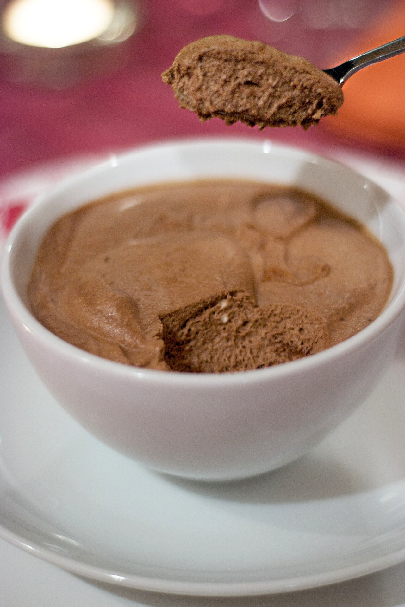

# Mousse

Mousse is how the foam behaves after [sparkling wine](ref:sparkling-wine) is poured into a glass: how the bubbles start, how coarse or fine they are, how thick the foam layer is and how long it lasts. It is a sensory description, not an analytical result and not a bubble count. Keeping that distinction clear makes it easier to discuss service, wine composition and winemaking separately.

Figure: Mousse. Image: Lu from Seattle, USA, CC BY 2.0, via Wikimedia Commons ([source page](https://commons.wikimedia.org/wiki/File:Chocolate_coffee_mousse.jpg)).

## Definition and scope

Mousse describes the dynamic state of the wine after it leaves the bottle: where bubbles nucleate, how fast they rise, and whether the foam collapses quickly once bubbles burst. The boundary is specific. Pressure inside the bottle is a physical quantity; mousse is what the drinker sees and feels in the glass. Two wines at the same pressure can show very different mousse because of temperature and glassware. A single bubble (French bulle) is only a building block; mousse is the texture of the whole foam.

Any drink containing carbon dioxide has a mousse, including tank-fermented sparkling wine and carbonated drinks. In wine writing, however, the word appears mainly in the context of traditional-method [sparkling wine](ref:sparkling-wine), not still wine.

## Etymology and origin

Mousse is borrowed directly from French, where it means foam; in French it also names a whipped, foam-like dessert. English wine writing keeps the French spelling rather than translating it to foam. The trade also uses bead for the rising bubble chain and foam for the surface layer. Chinese renderings such as "bubble texture" or "foam" all point to mousse, though the word for bubble can suggest counting individual bubbles.

Mousse and mousseux differ by only a few letters but are not the same thing. French mousseux is a category name for sparkling wine, meaning a wine that contains gas; mousse is the foam behaviour. Mixing the two in one sentence shifts the discussion from a category to a texture without warning.

## Mechanism and parameters

Pressure is the foundation. Traditional-method Champagne sits at roughly 5–6 bar at close to 20°C; Champagne industry material describes the pressure rising by about 6 kg per square centimetre by the end of the second fermentation, equivalent to about 5.9 bar and close to three times the pressure in an ordinary car tyre. When the bottle is opened, the carbon dioxide partial pressure at the opening falls sharply and dissolved gas escapes according to Henry's law, forming bubbles.

Nucleation usually happens at tiny scratches, polishing dust or fibres in the glass. Grease or detergent residue suppresses nucleation and the foam collapses quickly. Warmer temperatures lower carbon dioxide solubility and speed release, so bubbles look livelier but foam is shorter-lived; too cold a serving slows gas release and closes the aroma.

Wine composition provides the foam's framework. Proteins and polysaccharides slow drainage of the bubble films, and mannoproteins produced during ageing on [lees](ref:lees) are especially important for foam stability. Sugar in the [dosage](ref:dosage) changes foam viscoelasticity, and high sugar often gives a coarser, more persistent foam. Longer ageing on the lees usually makes bubbles finer, but base wine, pressure and temperature still set limits.

## Use in the industry

On the production side, the second fermentation that builds pressure is called prise de mousse, and the target is usually a bottle pressure of 5–6 bar. Too little pressure gives weak bubbles; too much raises the risk of bottle breakage and corks popping. On the service side, fast-rising bubbles and foam that vanishes at once often point to a warm serving or an unclean glass.

Tasting notes usually split mousse into several dimensions: whether the bubbles are fine or coarse, whether they rise continuously or in bursts, whether the foam is thin or thick, and whether it lasts. Restaurants avoid vigorous shaking and high temperatures, and pour slowly down the side of the glass to limit the one-off loss of carbon dioxide.

## Terms easily confused

- **Mousse versus pression (pressure)**: pressure is a physical quantity inside the bottle, mousse is the result in the glass. Two wines at the same pressure can show completely different mousse because of temperature and glass shape.
- **Mousse versus bulle (bubble)**: bulle is one bubble, mousse is the whole foam. Saying "the bubbles are fine" is really a statement about mousse, not a count of bubbles.
- **Mousse versus mousseux**: mousseux is a sparkling-wine category name, mousse is foam behaviour. The spellings are close, but they sit at different levels of meaning.
- **Bead versus foam**: bead is the rising chain of bubbles, foam is the layer on the surface. Both are parts of mousse, but neither replaces the other.

## Misconceptions and disputes

The most common misuse is to treat mousse as a bubble count and assume that more bubbles and a busier look mean a better wine. Bubble numbers depend heavily on temperature, pouring method and glass cleanliness, and the same bottle can look quite different, so the count is a poor quality test.

A second misuse is to make "fine bubbles" the only standard. Young sparkling wines built on freshness and fruit can have lively, direct bubbles; wines built on complexity and texture often have finer, slower bubbles.

A third dispute is "persistent foam equals a better wine". High sugar, glycerol or additives can hold foam longer, with no necessary link to quality. Another dispute is whether vintage Champagne always has finer bubbles: time on the lees, base-wine structure and pressure all play a part, and a vintage label alone cannot prove it. Marketing also exaggerates glass shape, although blind tastings show that shape affects aroma and bubble path.

## Typical figures and examples

- Traditional-method Champagne bottle pressure is about 5–6 bar at close to 20°C; the Champagne industry body describes a rise of about 6 kg per square centimetre, equivalent to about 5.9 bar, roughly three times the pressure in a car tyre.
- 1 bar equals 100 kPa, about sea-level atmospheric pressure; 5–6 bar is therefore about five to six times atmospheric pressure.
- Common serving temperatures sit between 6 and 10°C; the warmer the wine, the faster the gas is released and the sooner the foam fades.
- A standard bottle holds 750 mL; a flute and a tulip glass narrow differently at the rim, changing bubble path and aroma concentration.
- Example: the same brut tasted at 6°C and at 12°C shows slow-rising bubbles and a closed aroma in the first case, and livelier bubbles with faster foam collapse in the second.

## See also

- [Sparkling wine](ref:sparkling-wine): how traditional and tank methods differ in bubble texture.
- [Dosage](ref:dosage): how sugar affects foam and sweetness.
- [Lees](ref:lees): lees contact, polysaccharides and mannoproteins.

**Short definition:** Mousse is the formation, bubble size and persistence of the foam in a glass of sparkling wine; bottle pressure is typically about 5–6 bar, and temperature, glassware, wine composition and lees ageing together shape the bubbles, which are not a direct quality score.

Start with where the term is used. From there, consider what it is contrasted with, then whether the source is a standard. That is how a practical judgment about Mousse is built.
