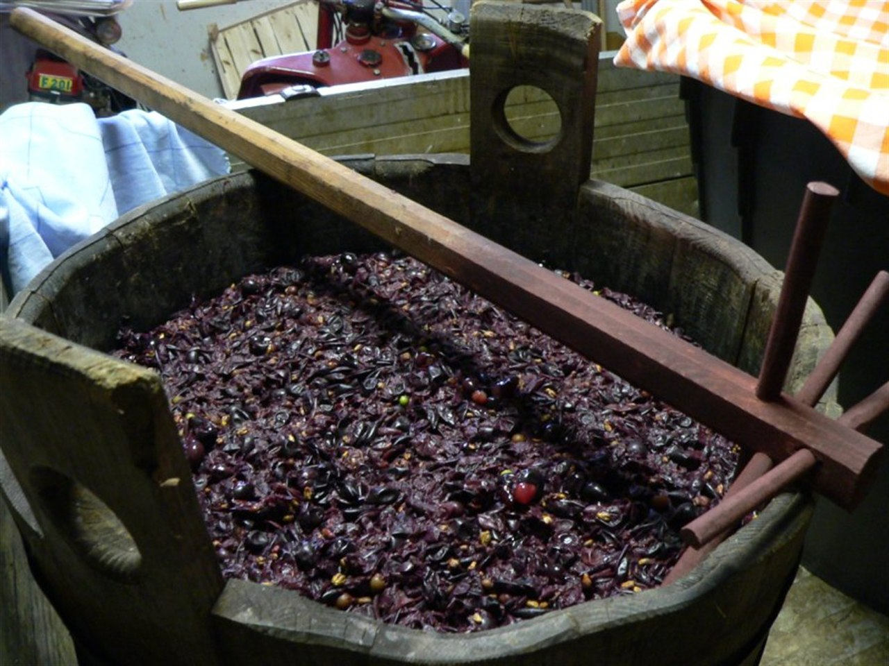

# Must

Must is the juice obtained after crushing or pressing grapes, together with the pulp, skins, seeds and a little stem that remain suspended in it. It can be unfermented sweet juice or a fermenting grape mash; in technical usage, must often includes both the liquid and the solid fraction. Must is the starting point of wine, and its sugar, acidity, clarity and solid content determine whether fermentation runs well and where the style will go.

Figure: Must. Image: Wikimedia Commons contributor, CC BY-SA 3.0, via Wikimedia Commons ([source page](https://commons.wikimedia.org/wiki/File:Mosto.jpg)).

## Definition and boundaries

First, must is not the commercial "grape juice drink" sold in shops; that is usually pasteurised, sweetened or diluted and is not intended for fermentation. Second, must is not wort: wort is the liquid from mashing grain, must is the liquid from pressing fruit, and although both are measured by sugar content, their raw materials and enzyme systems differ. Third, must is not pomace: pomace is the solid residue left after pressing, while must is the liquid and suspended matter obtained from pressing. Fourth, must weight is a density or mass measurement of the must, not a synonym for the must itself. Fifth, must weight is often expressed in grams per litre or potential alcohol in regulations, a different unit system from specific gravity.

## Etymology and origin

English must comes from Latin mustum, meaning new wine or unfermented grape juice; vinum mustum is "new wine". French moût, Italian mosto and German Most share the root. The word appears in Roman winemaking texts and later entered the languages of Europe to mean the juice before it becomes wine. Older Chinese usage says "grape mash" or "grape juice", while modern technical texts sometimes keep must to avoid confusion with fruit juice. Roman practice separated unfermented juice from finished wine, and that distinction became a foundation of European winemaking vocabulary.

## Mechanism and parameters

The core parameters of must are sugar, acid, pH and solid content. Sugar is expressed as Brix, Baumé, Oechsle or potential alcohol; as a working rule, 1 °Brix corresponds to about 0.55–0.6 % vol potential alcohol, and 20 °Brix to about 11%–12% vol. Acidity is given as total acid in g/L, usually as tartaric acid, and as pH; a high pH reduces the effectiveness of sulfur dioxide and raises microbial risk. White juice is often sulfited after pressing, commonly around 30–80 mg/L, and settled cool so that solids fall; red must keeps the skins and is managed by punching down, pumping over or mixing the cap. OIV sets a cumulative acidification limit of 54 meq/L for wine, roughly 4 g/L as tartaric acid, and such limits define the legal boundaries of adjustment. Solid content affects pressing and settling: more skins, pulp and seeds mean greater pressing resistance and more phenolic material.

## Practical use in the industry

White wine: crush, gentle press, press cut, cool settling, fermentation. Press fractions are kept separate, with free-run juice and later press fractions handled differently because the latter are coarser and higher in pH. Red wine: crush or destem, tank, ferment with skins, macerate, press. Saignée for rosé and whole-bunch fermentation both change the composition of the must. Sweet wines may let high-sugar must ferment slowly or stop partway. Chaptalisation is permitted in some regions within limits, and acidification or deacidification is equally regulated. The clarity of must also affects yeast nutrition: over-clarified juice can be slow to start. Red must is usually fermented warmer than white to encourage colour and tannin extraction, while white is kept cooler to preserve aroma. Sugar and acid adjustments should be made before fermentation or at a stage allowed by the rules, with batch and dose recorded.

## Confusable terms compared

First, must versus wort: one comes from grapes, the other from grain, and the saccharification logic differs. Second, must versus juice: must is a winemaking raw material that contains solids and wild microorganisms and is not necessarily sterile. Third, must versus pomace or lees: pomace is the skin and stem residue, lees are settled yeast and solids, and must is the mixture before separation. Fourth, must weight versus °Brix: must weight is a density or mass measure, while °Brix is one expression of sugar content; they are related but not equal.

## Common misuses and disputes

First, assuming that high-sugar must necessarily gives a sweet wine; sweetness depends on whether fermentation finishes and on [residual sugar](ref:residual-sugar). Second, assuming that clearer is always better; over-clarification can leave yeast short of nutrients and slow the start. Third, assuming that adding sugar is a free operation; the EU and producing regions regulate amounts, timing and labelling. Fourth, treating red must as "coloured grape juice"; it contains skins, seeds and stems, and maceration brings tannin and colour. The wider dispute is whether chaptalisation is cheating: legally permitted enrichment is a tool for climate and vintage variation, but excess or undeclared addition undermines transparency. Sixth, reading must density as alcohol content; density indicates potential sugar, not finished alcohol.

## Typical figures and examples

Must at 20 °Brix has a potential alcohol of about 11%–12% vol; 24 °Brix gives about 13.5%–14.5% vol; 1 °Brix is about 0.55–0.6 % vol. Common sulfur dioxide addition to white juice is around 30–80 mg/L; the OIV cumulative acidification limit is 54 meq/L, roughly 4 g/L tartaric acid. One hectolitre (hl) equals 100 litres and is a standard winery volume unit. Must weight is measured at 20°C, and density and sugar readings shift with temperature, so recording temperature and method matters as much as the number. The same sample reads lower at high temperature, which is why wineries stress the reference temperature.

## From crushing to fermentation

Crushing and destemming determine how much stem and intact berry enter the must; pressing determines the separation of juice and skins; settling determines the starting point of fermentation. White grapes are often held cool for 12–24 hours so solids settle before clear juice is drawn; red must ferments with the skins and is kept in contact by punching down or pumping over. Once fermentation starts, sugar falls, alcohol rises, temperature rises, the liquid becomes wine and the solids become [lees](ref:lees) and pomace. Understanding this chain explains why the same variety handled through different must preparation can produce completely different wines. Press fractions differ markedly in phenolics, pH and turbidity, so wineries often tank free-run and later press juice separately.

## See also

- [Maceration](ref:maceration): skin contact in red-wine making.
- [Fermentation](ref:fermentation): sugar converted into alcohol and carbon dioxide.
- [Residual sugar](ref:residual-sugar): sugar remaining after fermentation.
- [Lees](ref:lees): solids that settle after fermentation.

[Maceration](ref:maceration) and [Residual sugar](ref:residual-sugar) are the nearest useful comparisons: one clarifies definition, the other tests applicable standard.

**In brief:** Must is the juice, pulp, skins and solids obtained from crushed or pressed grapes and the starting point of wine fermentation; its sugar, acid, solid content and clarity shape fermentation and style.
