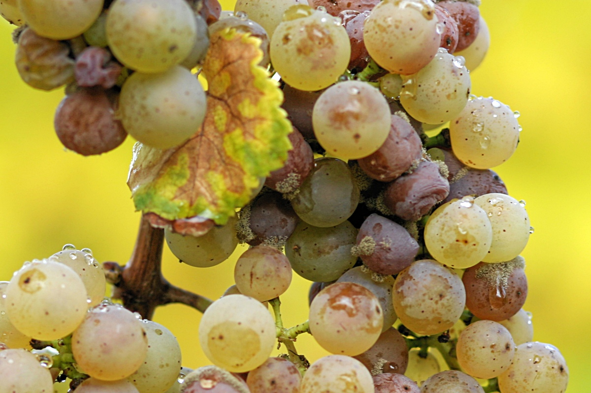

# Noble rot

Noble rot is the outcome of Botrytis cinerea infecting ripe grapes under an alternating weather pattern: humid nights and mornings, then dry, sunny afternoons. It is not a separate fungus, and it is not a synonym for "mouldy grapes". The same species causes grey rot when wet weather persists, leaving fruit soft, leaking and off-flavoured. Noble rot occurs only when the fungus penetrates the skin without destroying the flesh, so water escapes through the berry surface and sugar, acid and aroma compounds concentrate. Treating noble rot as a condition-dependent outcome, rather than a mould, is the most useful starting point.

Figure: Noble rot. Image: Photographer: Tom Maack No machine-readable author provided. T.o.m.~commonswiki assumed (based on copyright claims)., CC BY-SA 3.0, via Wikimedia Commons ([source page](https://commons.wikimedia.org/wiki/File:Botrytis_riesling.jpg)).

## Definition and boundaries

Three boundaries matter. First, the species is the same: Botrytis cinerea can produce either noble rot or grey rot depending on humidity, ventilation and fruit health. Second, noble rot happens at ripeness; hard, unripe berries resist penetration and do not shrivel in the same way. Third, noble rot is not a sufficient condition for sweet wine: late harvest, drying, ice wine and fortification also produce sweetness, and noble rot is only one route. Terms such as "noble" or "botrytised" on a label are also shaped by regional rules, so the word alone does not define the process.

## Etymology and origin

French pourriture noble, German Edelfäule, Italian muffa nobile and Hungarian aszúsodás all mean, roughly, "noble rot". The naming convention shows that European winemaking drew a line between two outcomes of the same fungus: destructive grey rot and beneficial noble rot. The Chinese term "guifu" is a literal rendering that keeps the contrast between "noble" and "rot". The term carries no legal force by itself, but in Sauternes, Tokaj and the German and Austrian systems it corresponds to concrete picking and sugar requirements.

## Mechanism and parameters

Botrytis spreads by conidia. Germination needs high humidity; the literature often cites around 20°C and relative humidity above 80%. Morning mist or dew lets spores attach and germinate, while a sunny, breezy afternoon lowers surface moisture and stops the hyphae from advancing into the flesh. Once the skin is perforated, the berry loses water through its surface; berry weight can fall by more than 30%, concentrating sugar, acid, minerals and aroma precursors. The fungus also consumes some tartaric acid, produces glycerol and gluconic acid, raises pH and juice viscosity, and releases laccase-type oxidases that increase browning and complicate pressing. Growers judge ripeness and infection with potential alcohol, Brix or must weight.

## Practical use in the industry

Sauternes and Barsac sit where the Garonne meets the Ciron. Autumn mists and afternoon sun create a stable microclimate. Official regional material gives a variety mix of about 80% Sémillon, 20% Sauvignon Blanc and a small share of Muscadelle. Because infection is uneven, picking can last up to three months and is sorted three to five times, berry by berry. Tokaji Aszú is also hand-selected and traditionally graded by puttonyos (3–6). German and Austrian Trockenbeerenauslese require individually selected botrytised berries. Vinification usually uses gentle pressing, cool settling and slow fermentation, often in oak, leaving substantial [residual sugar](ref:residual-sugar); the wines belong to the [sweet](ref:sweet) category, and their honey, apricot, citrus-marmalade and saffron notes mark an [aroma](ref:aroma) clearly different from normally ripe fruit.

## Confusable terms compared

First, noble rot versus grey rot: the same species under different humidity, one controlled and one destructive, not two different moulds. Second, noble rot versus [late harvest](ref:late-harvest): late harvest is only a delayed pick, and the fruit may be healthy or infected, whereas noble rot involves fungal transformation. Third, noble rot versus passerillage: drying concentrates the berry without the fungus, while noble rot adds fungal metabolism and its aromatic signature. Fourth, "botrytis" versus "noble rot": the first is the organism, the second is the outcome, so not every Botrytis infection deserves the name.

## Common misuses and disputes

The commonest misuse is to treat noble rot as "mouldy fruit" and therefore as unhygienic; in practice, safety depends on pressing, settling, fermentation and sulfur dioxide management, not on the presence of hyphae. A second misuse is to assume noble rot appears every year. Autumn weather decides infection and yield, and one estate can differ sharply between vintages, which is why vintage matters more here than in most dry whites. A third dispute is "the sweeter the better": residual sugar can be very high, but without enough acidity the wine feels syrupy. A fourth dispute concerns yield and cost: selective picking, several passes and low juice yields make botrytised wine more expensive than dry whites from the same region; that is a process result, not marketing.

## Typical figures and examples

Sauternes and Barsac: picking can last up to three months and is sorted three to five times; the mix is about 80% Sémillon and 20% Sauvignon Blanc. Tokaji Aszú: traditional puttonyos grading runs from 3 to 6. Botrytised sweet whites commonly hold about 100–150 g/L residual sugar and 13%–14% vol alcohol. Berry weight can fall by more than 30% during infection, depending on the balance of mist, sun and wind. These figures are references, not fixed standards; they explain why the wines are concentrated, expensive and vintage-sensitive.

## Vintage and yield variation

Vintage variation in noble rot comes from autumn weather rather than summer heat alone. Too little mist means too little infection; too much rain lets grey rot take over; persistent dryness gives late harvest without botrytis. Producers walk the same block repeatedly and decide parcel by parcel whether to pick. As a result, yield, sweetness, acidity and aroma can differ markedly between vintages at one estate. When reading a label, the vintage, the appellation and the word "botrytised" are more informative together than the word "sweet" alone.

## See also

- [Late harvest](ref:late-harvest): the sugar base from a delayed pick.
- [Sweet](ref:sweet): how finished sweetness is classified and perceived.
- [Residual sugar](ref:residual-sugar): the measured basis of sweetness in botrytised wine.
- [Aroma](ref:aroma): the aromatic layers noble rot creates.

Read Noble rot through where the term is used, then what it is contrasted with, and finally whether the source is a standard. The sequence matters.

The comparison with [Sweet](ref:sweet) and [Late harvest](ref:late-harvest) runs through definition and applicable standard. Each answers a different question.

**Short definition:** Noble rot is infection of ripe grapes by Botrytis cinerea under humid nights and dry, sunny days, which shrinks the fruit and concentrates sugar, acid and flavour; it makes Sauternes and Tokaji-style sweet wines but differs from grey rot in persistently wet conditions.

**Read alongside.** Put Noble rot next to Sweet, Aroma, Late harvest: the first fixes identity and boundary, the others provide a region, process or peer comparison. Read this page first, then return to those entries; the links become coordinates, not decoration.

**Sources and limits.** The key claims about Noble rot are checked against the following sources: International Organisation of Vine and Wine (OIV) (Used to check noble-rot and sweet-wine terminology), Oxford University Press (Used for entries on noble rot, Botrytis cinerea and botrytised wines), Sauternes Barsac AOC (Used to check the microclimate, variety shares and repeated selective picking in Sauternes and Barsac) and 5 sources in total. Prices, batches and status change; the body is project-written and does not reproduce source text.

For Noble rot, this page was last checked in 2026; prices, batches and availability change, so confirm them against the sources below.
