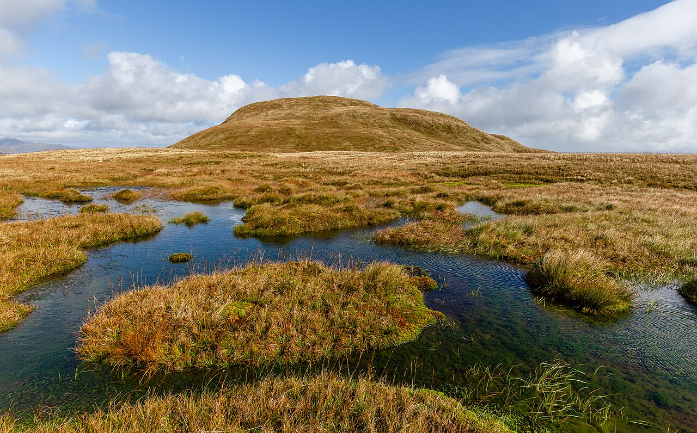

# Peat phenol value (PPM)

Peat phenol value, often written as phenol ppm or peating level, is a number used in the whisky trade to describe how heavily malted barley has been exposed to peat smoke. The usual basis is the total phenol content of the malt, expressed in milligrams per kilogram (mg/kg); 1 ppm is 1 mg/kg. It is not the phenol concentration in the bottled spirit, and it is not a single sensory grade: two distilleries can both print 40 ppm and still produce spirits of very different smoke intensity, because barley variety, mashing, distillation, maturation and dilution all intervene.

Figure: A peat bog below Doune Hill in the Luss Hills, Scotland; a peatland scene, not a PPM measuring instrument and not a sample of any bottled whisky. Image: Michal Klajban, CC BY-SA 4.0, via Wikimedia Commons ([source page](https://commons.wikimedia.org/wiki/File:A_peat_bog_below_the_top_of_Doune_Hill,_Luss_Hills,_Scotland.jpg)).

## Definition: ppm measures malt, not spirit

In whisky production, ppm usually appears on a malt specification or in a distillery's product notes. After barley has germinated, peat smoke is passed through the malt bed; phenols from the smoke are adsorbed on the malt surface and some of them later pass through mashing, fermentation and distillation. The maltster or distillery measures total phenols in the malt and reports them in ppm. By the time the spirit is new make or aged whisky, the phenols have been transferred and lost several times, so the concentration is no longer the figure printed on the malt. Reading “128.9 ppm” as “128.9 milligrams of phenol per litre of spirit” is therefore wrong.

Ppm is a ratio unit, not a quality judgment. It says neither that the smoke is good nor that the palate will be strong. The same ppm can present as herbs, ash, tar or medicinal notes depending on the phenol mix; phenols are only one part of smoke flavour, not the whole of it.

## From peat to malt: how phenols enter the spirit

Peat is partly decomposed plant material formed in waterlogged, oxygen-poor bogs; it burns at a low temperature and produces a large amount of smoke. A traditional kiln uses peat as one of the heat sources, and the smoke passes through a layer of moist malt, where phenols attach to the grain. The plants in the peat, the degree of decomposition, the water content and the burning conditions all affect the smoke; the malt's moisture, bed depth, smoke temperature and drying speed affect adsorption and retention. Too much heat can scorch some phenols and make the smoke coarse, while slow drying tends to preserve finer herbal and ashy layers.

This is why “same ppm” does not mean “same style”. Islay peat, mainland Scottish peat and peat from different bog depths do not have the same plant composition or burning behaviour; a distillery can also choose different maltings, kilns and smoking times. PPM is a comparable specification, but it is not a recipe and not a regional label.

## Reading the numbers: 80 ppm versus 128 ppm

Take Bruichladdich's Octomore series as an example. The distillery's official product pages in 2026 give figures including 17.1 at 81.0 PPM, 16.2 at 101.4 PPM and 14.1 at 128.9 PPM. All are placed by the distillery in the “super heavily peated” range, yet the numbers span a wide interval. The example shows that ppm can support a rough comparison within one series, but cannot by itself decide which whisky is “more peated”. ABV, cask type, age and bottling method all change the final impression.

A rough industry shorthand is: below 20–30 ppm is light, 30–50 ppm is clearly peated, above 50 ppm is heavy, and above 80 ppm is often called super-heavy. These bands are not law and not an official classification; distilleries use “heavy” and “super heavy” inconsistently. When you see “higher ppm means more peat”, treat it as a trend, not a straight line.

## Regions and styles: Islay is not the only answer

Islay is often treated as shorthand for peated whisky because of its peat resources, maritime setting and several heavily peated distilleries. But peated styles are not confined to Islay: mainland Scotland, island distilleries, Ireland and Japan all use peated malt. Islay peat is often described as medicinal, iodine-like, seaweed and ash; mainland peat may read more woody, earthy or like a campfire. Attributing all of these differences to ppm ignores the peat source and the distillery's process.

Equally, not every Islay distillery makes heavy peat. The island has distilleries with no-peat or lightly peated styles; equating “Islay” with “heavy peat” is a common overgeneralisation. A region supplies geography and history; ppm supplies a malt specification. Neither replaces the other.

## Process variables: mashing, distillation and maturation rewrite the number

Once phenols enter the liquid, they are not evenly distributed in every drop. Mash water temperature, pH and sparging affect how much phenol is extracted; fermentation changes some precursors; distillation divides phenols among heads, hearts and tails. A distillery can keep more tails for a heavier smoke, or tighten the cut for a cleaner spirit. During maturation, phenols are adsorbed by oak, oxidised or combined with other compounds; over time the smoke usually becomes more integrated rather than simply “stronger”.

Dilution also changes perception. Water or ice lowers ABV, can release some aromas and can make smoke seem more prominent or more diffuse. Treating ppm as the only measure of palate intensity misses these variables.

## Common misreadings

First, ppm is not the phenol concentration of the spirit. It is a malt specification; the concentration in the finished whisky is usually lower than the malt figure and varies greatly between expressions. Second, ppm is not a legal grade. The Scotch Whisky Regulations set rules on raw materials, distillation, oak maturation and minimum ABV, but no minimum or maximum peat phenol value. Third, ppm is not a linear sensory scale. 80 ppm is not necessarily “lighter” than 100 ppm, because phenol composition, cut point and maturation all change the impression. Fourth, ppm is not a quality score. A high or low figure describes smoke intensity, not craft.

Fifth, “unpeated” does not mean “no smoke”. Oak char, fermentation and distillation can also bring smoky or toasted notes; peat phenol value is an indicator of one source, not the sum of all smoke flavours. Sixth, ppm is not proof of region. One region can host several ppm levels, and one ppm level can come from different regions.

## Buying and speaking about it

If you want to judge a whisky's peat intensity, ppm is a starting point, but do not stop there. First check whether the distillery states a malt phenol value, then look at ABV, age, cask type and whether the whisky is chill filtered. If there are tasting notes, notice whether they describe herbs, ash, tar or sea air rather than only “very peaty”. The change before and after adding water is also worth recording.

In writing or conversation, the more accurate wording is “this whisky's malt is specified at 80 ppm”, not “this whisky has 80 ppm of phenol”. The first states the source of the figure; the second silently turns a malt specification into a spirit concentration. Being clear about the basis is more useful than arguing over a “most peated” title.

## Further reading and see also

- [Peat](ref:peat): the formation, burning and malt-smoking basics.
- [Malting](ref:malting): germination, kilning and the making of a malt specification.
- [Whisky](ref:whisky): the raw-material, distillation and maturation framework.
- [Islay](ref:islay): the region most often associated with peated whisky.
- [Ardbeg 10](ref:ardbeg): a specific heavily peated single malt.
