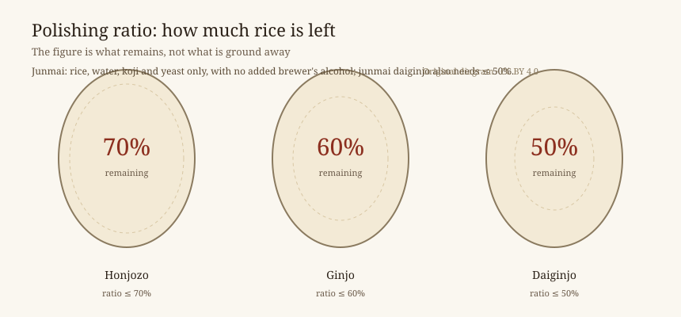

# Polishing ratio

The polishing ratio (seimaibuai) is the percentage of sake rice remaining after milling. A figure of 50% means half the grain has been removed and 50% remains; 60% means 60% remains. It describes how far the rice has been milled, not how good the sake is. In Japan's special-designation system, the polishing ratio is one legal condition, but it must be read together with whether brewer's alcohol is added, the rice, the yeast and the process.

Figure: the polishing ratio is what remains, not what is ground away. Original diagram, CC BY 4.0.

## Definition and boundaries

First, the polishing ratio is the share remaining, not the share removed. 50% and "half milled away" describe the same result, but 60% means 40% removed, not 60%. Second, it describes only the degree of milling, not the rice variety, origin or grade. Third, it is not a quality score; a low figure may bring a cleaner aroma, or may simply reflect cost and positioning. Fourth, it is entirely different from nihonshudo, which measures the density or sugar character of the finished liquid, not the processing of the rice.

## Etymology and origin

In Japanese, seimai means milling brown rice into white rice and buai means ratio, so seimaibuai is the "ratio of polished rice". Chinese usually renders it as "polishing ratio" or "rice-polishing ratio". The term entered labels with the sake grade system: when a label says "junmai daiginjo, polishing ratio 50%", it gives two pieces of information, a grade and a processing parameter. English-speaking markets often keep the romanised seimaibuai, because "polishing ratio" can be misread as surface polishing rather than removal of the outer bran. In Japanese the term is sometimes shortened to buai, but that alone can be confused with "ratio" in general, so formal texts keep the full form.

## Mechanism and parameters

The outer layers of sake rice, the bran and the germ, contain more protein, fat, minerals and vitamins; excess amounts bring off-flavours and affect koji enzymes and yeast fermentation. Milling removes these layers step by step and leaves the starch-rich core, the shinpaku. Water absorption, the elasticity of steamed rice and the ease with which koji penetrates all change with the polishing ratio, so brewers adjust washing, soaking, steaming and koji making together. A lower polishing ratio means a lower yield, longer milling, greater risk of broken grains and higher cost. Milling is not "the harder the better": over-milling can lose the core, increase broken grains and thin the body.

## Practical use in the industry

The National Tax Agency's labelling standards tie special-designation names to polishing ratios: daiginjo requires no more than 50%, ginjo no more than 60%, honjozo no more than 70%, and junmai also no more than 70%. Junmai daiginjo and junmai ginjo add the "junmai" condition, meaning no brewer's alcohol, on top of the relevant ratio. On the label, special-designation sake must show the polishing ratio near the ingredient list. In production, rice varieties such as Yamadanishiki and Gohyakumangoku are often used for highly polished products, but variety, water, yeast and temperature also shape style. Sake saccharification and fermentation run in parallel as multiple parallel fermentation, and the polishing ratio affects that chain indirectly through koji and moisture.

## Confusable terms compared

First, polishing ratio versus removal rate: 50% means half remains, and only then is the removal rate 50%; at 60% the removal rate is 40%, and the two must not be swapped. Second, polishing ratio versus nihonshudo: the first is a rice-processing ratio, the second a density or sugar indicator in the finished sake, one at the raw-material end and one at the product end. Third, polishing ratio versus special-designation grade: the grade is the name, the ratio is a condition; a low ratio does not automatically earn a daiginjo name, because ingredient and process rules also apply. Fourth, polishing versus washing: polishing is milling, washing is cleaning and soaking, and they are separate steps.

## Common misuses and disputes

First, treating the polishing ratio as a quality score and assuming 50% is always better than 60%. Second, reading 50% as "only 50% of the rice is used" when it means "50% remains". Third, looking only at the number and ignoring junmai versus added alcohol, yeast and ageing. Fourth, assuming a low ratio must be more expensive while ignoring rice variety and yield. Fifth, confusing sake polishing with the milling of grain for distilled spirits. The dispute is whether low polishing is worth it: supporters point to cleaner aroma and fewer off-flavours, while critics argue that over-milling wastes raw material, raises cost and that most flavour differences come from koji, yeast and water.

## Typical figures and examples

100% is unpolished brown rice; 50% means half removed and is common for daiginjo and junmai daiginjo; 60% is the threshold for ginjo and junmai ginjo; 70% is the ceiling for honjozo and junmai. At a polishing ratio of 50%, 100 kg of brown rice yields 50 kg of white rice, with the other 50 kg becoming bran and broken grains. The traditional Japanese volume unit, the koku, is about 180 litres and is used for brewery output; it is a different dimension from the polishing ratio but often appears alongside it in brewery material. High-polish products commonly sit at 35%–50%, subject to the label.

## Brewing and label reading

Read a sake label in four layers: first the special-designation name (junmai daiginjo, ginjo, honjozo and so on); second the polishing ratio; third the rice and yeast; fourth nihonshudo, acidity and whether the sake is unpasteurised or aged. The polishing ratio explains how far the rice was milled, while nihonshudo explains whether the finished sake leans dry or sweet; one cannot replace the other. Price should also be read through yield: a lower ratio requires more brown rice for the same brewery output, so cost rises, but that does not guarantee a flavour the drinker will prefer.

## See also

- [Sake](ref:sake): categories, raw materials and the brewing framework.
- [Rice](ref:rice): the difference between sake rice and table rice.
- [Saccharification](ref:saccharification): how koji converts starch into sugar.
- [Fermentation](ref:fermentation): sake fermentation and flavour development.
- [Japan](ref:japan): sake regions and styles.

For Polishing ratio, begin with where the term is used, then what it is contrasted with, and finish with whether the source is a standard; that order keeps the account grounded.

The comparison with [Sake](ref:sake) and [Saccharification](ref:saccharification) runs through definition and applicable standard. Each answers a different question.

**Short definition:** The polishing ratio is the percentage of sake rice remaining after milling, so 50% means half has been removed and half remains; it is tied to daiginjo, ginjo and honjozo grades but is not a direct quality score.

**Read alongside.** Put Polishing ratio next to Sake, Rice, Saccharification: the first fixes identity and boundary, the others provide a region, process or peer comparison. Read this term first, then return to those entries; the links become coordinates, not decoration.

**Sources and limits.** The key claims about Polishing ratio are checked against the following sources: Japan Sake and Shochu Makers Association (Used to check polishing ratios and special-designation sake definitions; Used to check polishing ratio thresholds for junmai and ginjo designations), National Tax Agency of Japan (Used to check legal requirements for sake labels, polishing ratios and special-designation sake), Oxford University Press (Used for entries on sake, rice polishing and brewing) and 5 sources in total. Prices, batches and status change; the body is project-written and does not reproduce source text.

For Polishing ratio, this term was last checked in 2026; prices, batches and availability change, so confirm them against the sources below.
