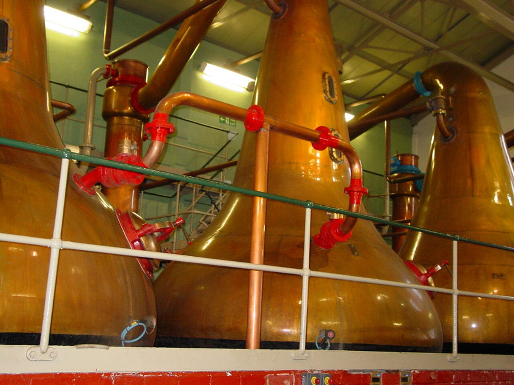

# Pot still

Figure: Pot still. Image: see Source, CC BY-SA 3.0, via Wikimedia Commons ([source page](https://commons.wikimedia.org/wiki/File:Sjb_whiskey_still.jpg)).

## Definition and boundaries

A pot still is a copper batch-distillation vessel. Its basic parts are a heated pot, a neck connecting the pot to the condenser, and the condenser itself. It has no continuous rectifying column, so every batch of liquid must be charged, heated, distilled, shut down and cleaned separately. The process is inefficient, but it preserves more of the detail contributed by the raw material and the fermentation.

It helps to say what a pot still is not. A pot still is not a synonym for handmade distillation: large pot-still distilleries exist, and the equipment can be very large. Nor does it mean “distilled only once”: most whisky distilleries use pot stills twice, the first run yielding low wines and the second yielding the finished spirit. Pot versus column is a distinction of equipment, not a moral contest between traditional and modern or good and bad.

## Etymology and origin

Pot comes from Old English pott, meaning a vessel or container. Still comes from Latin stillare, “to drip”, because the condensed spirit is collected drop by drop. Alembic arrived through Arabic al-anbīq, whose roots go back to Greek ambix, a cup-shaped still head. The Chinese term describes both the vessel shape and the function, which is more literal than either English term.

This history shows that distillation technology travelled between languages together with vessel shapes and names. Today's pot stills still carry onion-shaped heads, swan necks and worm condensers as old features, while heating, control systems and material testing have been modernised.

## Mechanism and parameters

The pot is charged with fermented liquid, called wash in Scotland, at about 8%–10% vol. Heat drives off ethanol, water and other components according to their boiling points: ethanol boils at about 78.4°C and water at 100°C, and the vapour rises through the neck into the condenser. A pot still has no plates, so the “reflux” comes from vapour condensing on the inner walls and the pot head and falling back. A taller, narrower neck with a flatter top usually gives more reflux and a cleaner distillate; a low, straight neck retains more heavy components.

Copper itself takes part in the process. It binds sulfur compounds, reducing reductive and sulfurous notes, so copper pot bodies and copper condensers do real work in whisky distillation, not just decorative work. Pot size, neck height, the angle of the lyne arm and the type of condenser (shell-and-tube or worm tub) all change reflux and copper contact, so two distilleries with different equipment can differ even with identical process settings.

## Practical use in the drinks industry

During a single distillation the distillate is not uniform from start to finish. The operator separates it in order into heads (foreshots), hearts (the middle cut) and tails (feints). Heads and tails carry more fusel alcohols, esters and sulfur compounds and are usually collected and added to the next batch; hearts are the middle fraction that is bottled or distilled again. Choosing the cut points is one of the most experience-dependent tasks: cutting too early leaves sharp, aggressive impurities in the hearts; cutting too late loses aroma and fullness.

Practices differ widely by region. Most Scotch distilleries distil twice in pot stills: the first distillation yields low wines, the second yields the finished spirit. A few distil three times for a lighter body. Cognac traditionally distils twice, the second pass being the bonne chauffe. Irish pot stills are larger and may combine malted and unmalted barley.

The Scotch Whisky Regulations set explicit requirements for [Scotch whisky](ref:scotch-whisky): Single Malt Scotch Whisky must be distilled in pot stills, all Scotch whisky must be distilled below 94.8% abv, matured in oak casks for at least 3 years with a capacity not exceeding 700 litres, and bottled at no less than 40% abv. These figures are the basis for its stylistic boundaries and explain why pot distillation is often linked with the retention of raw-material flavour.

## Confusable terms

Pot and column stills first differ in how they run. Pot distillation is a batch operation where reflux comes mainly from neck geometry and natural condensation, retaining more flavour at lower efficiency; column distillation is continuous, with strong separation and high efficiency, suited to large-scale production and neutral base spirit. Pot still versus alembic belongs to a historical lineage. Alembic is a historical still form defined by its head and condenser; the modern pot still is an industrial descendant of the same lineage, and the two are not fully interchangeable.

Single and double distillation differ in product stage. A single run yields low wines, usually not the final product; a second run yields the finished spirit. The number of distillations is a style choice, not a quality grade. “Pot still” and “handmade small batch” are also often mixed. Pot still describes equipment, while handmade describes the organisation of production; a large pot-still plant can also be highly automated.

## Common misuses and disputes

First, pot still does not mean handmade or small-scale; large pot-still distilleries exist. Second, copper equipment is not decorative: copper contact genuinely changes the chemical composition. Third, double distillation is not a mark of higher quality; the number of distillations is a style choice. Fourth, cut points are a process judgement, and no “standard hearts percentage” applies to every product.

The dispute is mainly whether pot still equals more complexity. In [whisky](ref:whisky), pot distillation is often associated with “more complex, more characterful” styles, but that is not an absolute quality judgement; grain whisky from a column still can also be excellent and is a standard component of blends. The defensible position is that pot distillation offers an equipment route that retains flavour, while drinkability still depends on raw material, fermentation, cuts and maturation.

## Typical values and examples

- Wash alcohol content: about 8%–10% vol.
- Ethanol boiling point: about 78.4°C; water boiling point: 100°C.
- Scotch whisky distillation limit: below 94.8% abv.
- Scotch whisky minimum maturation: 3 years; maximum cask capacity: 700 litres; minimum bottling strength: 40% abv.
- Common number of distillations: two; a few distilleries use three; the second Cognac pass is called the bonne chauffe.
- Typical examples: Scotch malt whisky, Cognac and Irish pot still whisky.

Reading these figures together shows that pot-still style is not decided by the word “copper” alone, but by pot shape, reflux, cut points and the number of distillations.

## See also

- [Distillation](ref:distillation): basic principles and equipment types.
- [Whisky](ref:whisky): raw materials, distillation and maturation.
- [Scotch whisky](ref:scotch-whisky): protected region, ingredients and process rules.

Read Pot still through where the term is used, then what it is contrasted with, and finally whether the source is a standard. The sequence matters.

[Distillation](ref:distillation) explains definition; [Scotch whisky](ref:scotch-whisky) adds applicable standard. Put Pot still between them before deciding what it is.
