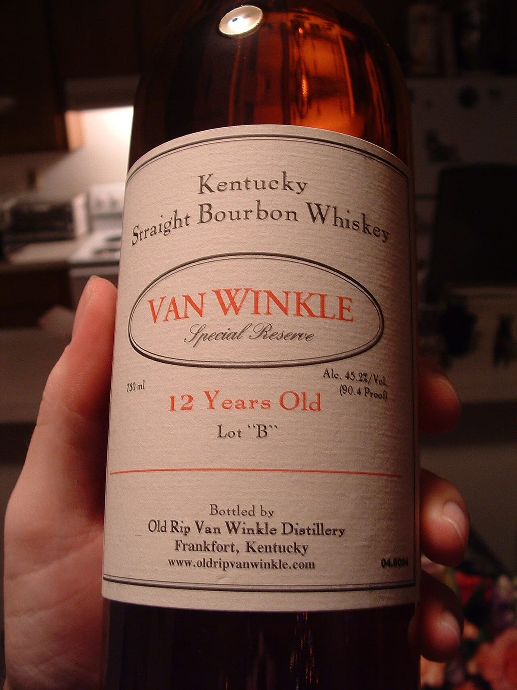

# Standard strength and proof

“Standard strength” in Chinese usage often means the volume fraction of ethanol, written % vol or ABV; it answers “how much of this bottle's volume is ethanol”. Proof is another historical convention, common on US spirits labels and tax documents. The two can be converted, but they are not the same thing: US 100 proof equals 50% ABV, while old British 100 proof is about 57.1% ABV. When you see proof, establish the system first, then discuss the number.

Figure: An Old Rip Van Winkle bourbon bottle and label; a real example of how strength and proof are declared, not a hydrometer or measuring instrument. Image: Joe Hall from Oakland, USA, CC BY 2.0, via Wikimedia Commons ([source page](https://commons.wikimedia.org/wiki/File:Old_Rip_Van_Winkle_Whiskey_301243232.jpg)).

## Definition and conversion

ABV (alcohol by volume) is the volume fraction of ethanol at 20°C. Under Annex XII of the EU Food Information Regulation, drinks above 1.2% vol must state the actual alcoholic strength, with no more than one decimal place, followed by “% vol”, measured at 20°C. The reference temperature matters: water and ethanol expand at different rates, so the same bottle measured at different temperatures gives a different volume and a different volume fraction. Fixing the temperature makes data from different laboratories and batches comparable.

The US legal definition of proof comes from 27 CFR 5.1: proof is the ethyl alcohol content of a liquid at 60°F (about 15.56°C), stated as twice the percentage of ethyl alcohol by volume. So 100 proof = 50% ABV, 80 proof = 40% ABV, 90 proof = 45% ABV and 200 proof = 100% ABV. This “times 2” applies only to US proof, not globally. Britain historically used a different proof system in which 100 British proof is about 57.1% ABV; today UK labels mainly use ABV, and old proof survives in historical texts and retro labels.

## Why 60°F

The US fixed proof at 60°F rather than 20°C. One reason is the historical measurement tradition: alcohol tables, hydrometers and tax conversion tables long used 60°F as the standard temperature, and the TTB Gauging Manual still reports proof at 60°F. Below 60°F, a hydrometer reads lower than the true proof; above 60°F, it reads higher, so a correction table is required. 20°C and 60°F are not identical: 20°C is 68°F, and converting between the two bases is not just a matter of switching thermometers.

This is why “80 proof on a US label and 40% vol on an EU label” is not a contradiction: they describe the same thing with different bases and formats. Conversely, treating 80 proof as 80% ABV doubles the strength and is a common unit error.

## The history of US proof and the old British system

The word proof comes from an early spirits test: pour a sample on gunpowder and ignite it. If it burns, the spirit is “above proof”; if not, it is “under proof”. That rough test was later replaced by hydrometers and tax tables, but the name remained. The US gradually established a system in which 100 proof = 50% ABV in the 19th century; Britain long used another standard in which 100 British proof is about 57.1% ABV, a clear difference from the US figure.

When discussing “standard strength” today, the safest wording gives both the ABV and the proof system. For example, “40% ABV (US 80 proof)”, not just “80 proof”. If you write “100 proof”, it means 50% ABV in a US context and about 57.1% ABV in an old British context; without the system, the reader cannot tell.

## Labels and regulation

The core US requirement for distilled spirits is to state ABV. 27 CFR 5.65 requires alcohol content to be expressed as “Alcohol __ percent by volume”, “__ percent alcohol by volume” or “Alcohol by volume __ percent”; proof may appear as additional information, but if used it must be in the same field of vision as the mandatory ABV statement. The purpose is to let consumers compare products on the same shelf without converting between two units.

EU rules use volume fraction at 20°C, mandatory above 1.2% vol, with at most one decimal place. Chinese pre-packaged alcoholic drinks are governed by food-safety standards and product-specific rules; the format, tolerance and exemptions must be checked by category. Markets also define “low” and “high” strength differently; the label figure describes alcohol content, not quality.

## Measurement: hydrometer, temperature and proof gallon

Laboratories and distilleries usually determine proof with a calibrated hydrometer (alcoholometer) and thermometer: place the sample in a clean glass cylinder, bring it to temperature, remove bubbles, let the hydrometer float freely, read where the meniscus crosses the scale, then correct to 60°F using the temperature table. The TTB Gauging Manual specifies hydrometers graduated from 0 (water) to 100 (proof spirits) to 200 (absolute alcohol), with precision models for different ranges. Modern plants may use oscillating densitometers or near-infrared instruments, but these still need calibration against standard materials.

A “proof gallon” is a tax unit: a gallon at 60°F containing 50% ethanol by volume, or the alcoholic equivalent. It combines volume and strength into one taxable quantity, so strength is not only label information but a tax base. ABV and proof therefore meet in the laboratory, on the production line and in tax filing; an error in any one of these bases has real consequences.

## Common misreadings

First, proof is not a global “ABV times 2”. The US system is times 2; the old British system is not. Ask which system a proof figure uses. Second, 100 proof is not pure alcohol. US 100 proof is 50% ABV; 200 proof is 100% ABV. Third, higher proof does not mean better quality. Strength is a style and formulation parameter, not a quality score; a drink category can have several strengths, and the law only sets ranges.

Fourth, ABV is not “raw material concentration”. Fermentation converts sugar to ethanol; strength first depends on fermentable sugar and yeast tolerance. Distillation concentrates existing ethanol; it does not create new alcohol. Fifth, ABV is not an “age indicator”. Maturation mainly changes aroma, colour and texture and need not change strength much; fortified and sweet wines may gain strength from added grape spirit. Sixth, the label figure is not “palate intensity”. A high-strength drink can be diluted with water, ice or mixer, and a lower-strength drink can still taste rich because of aroma and texture.

## Use in drinking and recipes

In a recipe, ABV determines how much ethanol each serving contains, not how “strong” it tastes. The same 40 ml of 40% ABV spirit and 40 ml of 20% ABV liqueur differ by a factor of two in ethanol; ice, water and soda change the ABV in the final glass. To control strength in a cocktail, adjust the spirit measure, dilution and glass size together rather than reading only the base spirit's label.

Drinking pace can also be understood quantitatively: a 700 ml bottle at 40% ABV contains about 280 ml of ethanol; divided into 10 servings, each has about 28 ml of ethanol. That figure says more about intake than “how many glasses” you had. National “standard drink” definitions differ, so compare the units rather than treating “one glass” as a fixed amount.

## Buying and describing

When buying, ABV and proof are starting points, not conclusions. Read the system and unit on the label, then consider the category, region, process and style. A whisky, rum or gin may show proof on a US version and only % vol on an EU version. To compare the two, convert to one system first, then discuss “higher strength”.

In writing, the more accurate expression is “40% ABV (US 80 proof, 60°F basis)”, or “old British 100 proof is about 57.1% ABV”. State the temperature, system and conversion so the reader does not mistake two different numbers for one concept. Standard strength is not an isolated number; it is a language shared by measurement, labelling and taxation.

## Further reading and see also

- [Alcohol by volume](ref:abv): the 20°C volume-fraction definition and labelling rules.
- [Original gravity](ref:gravity): soluble solids in wort before fermentation.
- [Distillation](ref:distillation): concentrating ethanol and making the cut.
- [Hydrometer](ref:hydrometer): the instrument that reads density and converts it to proof.
- [Whisky](ref:whisky): one of the categories where proof and ABV most often appear.
