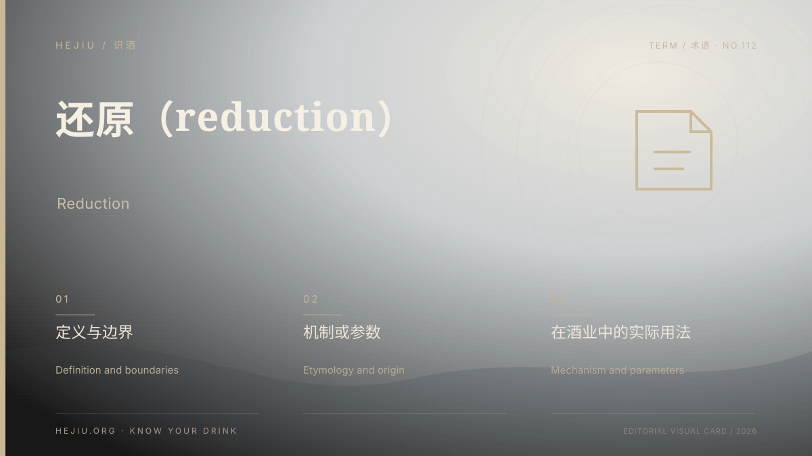

# Reduction

Figure: thematic illustration for Reduction. Image: AI-assisted illustration generated with Doubao Seedream 5.0 (project-owned); not a photograph of the subject.

## Definition and boundaries

In chemistry, reduction means that a substance gains electrons, lowers its oxidation number or loses oxygen. Wine usage borrows the word for two related but unequal things. The first is reductive winemaking: keeping oxygen away with inert gas, closed vessels and low temperatures. The second is reductive off-flavour: in oxygen-poor conditions, yeast metabolism and wine components form volatile sulfur compounds such as hydrogen sulfide, thiols and disulfides. The first is a process choice; the second is a sensory outcome.

Three things need separating here: reductive winemaking, reductive off-flavour and a reducing agent. Reductive winemaking is not the same as adding a reducing agent, and it is not a guarantee of quality simply because oxygen was excluded. Nor are all reductive notes the same as minerality. In cooking, “reduce” means to concentrate a sauce, a different meaning of the same word. Reductive winemaking and reductive faults can coexist: a wine protected with inert gas may still produce hydrogen sulfide if the yeast runs short of nitrogen.

## Etymology and origin

Reduction comes from the Latin reducere, formed from re- (back, again) and ducere (to lead), literally “to lead back”. Chemistry adopted the term for the removal of oxygen or the gain of electrons. The wine trade later extended reductive to mean sulfurous odours formed under low-oxygen conditions, and reductive winemaking to mean a deliberate policy of limiting oxygen contact. The Chinese term for reduction is also a chemical translation, so saying “this wine has reduction” is trade shorthand rather than a strict chemical statement.

Cognates appear across French, Italian and Spanish with similar spelling and a similar division of meaning. The etymology helps separate “reductive” as a method from “reduced” as a sensory result: they describe different layers of the same word.

## Mechanism and parameters

Yeast converts sulfate, sulfite and sulfur-containing amino acids into hydrogen sulfide during fermentation. Material from the Australian Wine Research Institute notes that low yeast nitrogen, elemental sulfur left on grape skins, insufficient pantothenic acid or pyridoxine, unusually high cysteine, high metal-ion concentrations and yeast-strain differences can all increase hydrogen sulfide production. Fermentation that is too cold, over-clarification that leaves yeast without suspended solids, and long undisturbed lees contact can also let sulfur compounds accumulate.

The sensory thresholds are measurable. Hydrogen sulfide is detected at about 1–2 µg/L; methanethiol at 0.02–2.0 µg/L; ethanethiol at 1.1 µg/L; dimethyl disulfide at 29 µg/L; diethyl disulfide at 4.3 µg/L; and dimethyl sulfide at 30–60 µg/L. At low levels the wine may simply smell muted or unclean rather than clearly of rotten eggs.

Treatment depends on the compound. Copper reacts with hydrogen sulfide and thiols to form poorly soluble copper sulfide or copper thiolates, but disulfides do not respond well to copper: they must first be reduced back to thiols with ascorbic acid and sulfur dioxide. Dimethyl sulfide does not bind to copper and is usually reduced by nitrogen sparging or reverse osmosis. Copper above about 0.5 mg/L in wine can cause instability, so any copper addition should be preceded by a bench trial.

## Practical use in the drinks industry

Reductive winemaking is common in white wines that aim for fresh fruit, and is also used in some fruit-forward reds. Typical tools include rapid cooling after harvest, dry ice or nitrogen, closed pressing, inert-gas cover, fewer unnecessary rackings and controlled sulfur dioxide. The aim is not an oxygen-free museum specimen but lower oxygen exposure at the critical stages, so that varietal and fermentation aromas stay clear.

In fermentation management, adding assimilable nitrogen is a standard way to prevent hydrogen sulfide. Australian winemaking guidance recommends diammonium phosphate at the first sign of hydrogen sulfide during fermentation, and notes that additions after the yeast growth phase are less effective and can leave high residual nitrogen. Red wines can be aerated at the first racking to volatilise hydrogen sulfide, but aeration may also oxidise thiols into disulfides that are harder to remove, so the order of operations matters.

Diagnosis has its own tool. The copper/cadmium test compares a control, a copper-treated glass, a cadmium-treated glass and a glass treated with ascorbic acid then copper, using aroma changes to judge whether the problem is mainly hydrogen sulfide, thiols, disulfides or dimethyl sulfide. Mild reduction may ease with [decanting](ref:decanting) or an air-contact racking, but disulfides already formed will not disappear simply through aeration.

## Confusable terms

Reduction and oxidation are often placed as opposites. Oxidative winemaking deliberately uses oxygen to build nutty, honeyed, caramel and sherry-like notes; reductive winemaking keeps oxygen out. They are opposite process directions, not opposite quality labels.

Hydrogen sulfide, thiols and disulfides form another easily confused group. Hydrogen sulfide smells of rotten eggs or sewage; methanethiol and ethanethiol lean toward cabbage, onion, garlic and burnt rubber; dimethyl disulfide and diethyl disulfide are closer to cooked cabbage and burnt rubber. They need different treatments, so “reductive” alone is not a sufficient diagnosis.

Reductive character also needs separating from minerality. Gunflint, struck match, smoke and wet stone can overlap in sensory language, but minerality usually describes a dry, hard-to-attribute impression, while reductive notes have a defined volatile sulfur source. As for reduction versus cork taint, the latter is damp cardboard and mustiness from TCA and related haloanisoles, and it does not improve with aeration.

## Common misuses and disputes

The most common misuse is to equate reduction with a fault. Reductive winemaking is a mainstream approach, and low-level reductive notes may even contribute complexity; Australian material notes that hydrogen sulfide below the detection threshold might play a role in wine complexity. What matters is concentration, compound type and whether the aroma persistently suppresses fruit.

The second misuse is to treat every struck-match note as hydrogen sulfide. A struck-match aroma may come from sulfur dioxide or other sulfur compounds, and it is not the same signal as rotten eggs. The third misuse is to assume aeration solves every reduction problem: it helps hydrogen sulfide, may convert thiols into disulfides and does little for dimethyl sulfide. The fourth misuse is to treat copper as routine; dose, later filtration and oxidation risk all need control.

The dispute is mainly about where style ends and fault begins. Chablis and some Champagnes are often cited as carrying a slight gunflint or struck-match note. Supporters read it as terroir and reductive winemaking; critics argue that no sulfide should be romanticised. The defensible position is that a low-level, transient reductive note that does not suppress fruit can be discussed as style, while a persistent, high-level sulfide note with bitterness should be handled as a fault.

## Typical values and examples

- Hydrogen sulfide detection threshold: about 1–2 µg/L.
- Methanethiol threshold: 0.02–2.0 µg/L; ethanethiol threshold: 1.1 µg/L.
- Dimethyl disulfide threshold: 29 µg/L; diethyl disulfide threshold: 4.3 µg/L.
- Dimethyl sulfide threshold: 30–60 µg/L.
- Copper above about 0.5 mg/L in wine may cause instability.
- Examples: dry whites protected with inert gas, whites aged on fine lees with stirring, and Chablis or some Champagnes described as having a gunflint note.

Read together, these figures show that reduction is not a yes-or-no judgement. Compound, concentration and sensory context together decide whether the wine is complex, muted or faulty.

## See also

- [Lees](ref:lees): long lees contact and reductive odours.
- [Aroma](ref:aroma): how reductive notes affect aromatic layers.
- [Decanting](ref:decanting): aeration as relief for mild reduction, and its limits.

Further reading: [Acidity](ref:c-extra-1).
