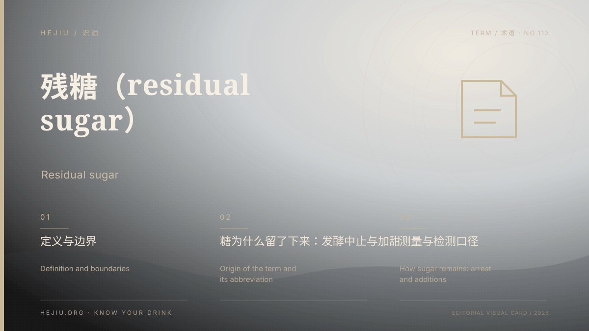

# Residual sugar

Residual sugar, usually abbreviated RS, is the sugar still present in a drink after fermentation. Yeast turns sugar into alcohol and carbon dioxide, but fermentation does not always exhaust the sugar: it may stop early, or sugar may be deliberately retained. RS is normally expressed in grams per litre and is central to sweetness, labelling and pairing.

Figure: thematic illustration for Residual sugar. Image: AI-assisted illustration generated with Doubao Seedream 5.0 (project-owned); not a photograph of the subject.

## Definition and boundaries

Residual sugar measures fermentable sugar, mainly glucose and fructose. It is not a synonym for total sugar: total sugar may include non-fermentable fractions, while RS describes what is left at the end of fermentation. Most wine figures are the sum of glucose and fructose, but laboratories and methods do not all draw the line in the same place.

RS is also not the same as sweetness. Acidity, alcohol, glycerol, temperature, bubbles and aroma all shape the impression. A wine with only 3 g/L RS may feel round because of ripe fruit; a wine with 12 g/L may feel fresh because of high acid. Recording the number and the sensation separately is basic professional practice.

## Origin of the term and its abbreviation

Residual sugar is a descriptive English phrase for sugar left after fermentation. French uses sucre résiduel, German Restzucker, and Chinese uses a literal equivalent. The abbreviation RS appears widely in tasting notes, technical sheets and laboratory reports, but not every label prints a number. EU labels usually carry graded words such as dry or medium dry instead of RS.

The pattern of a graded word first and a number later makes it easy to overlook the quantity. When a label says dry, look for RS in the technical data; when a note says RS 8 g/L, check which grading system it belongs to. The term itself is descriptive and carries no legal meaning; the legal meaning comes from each market's labelling rules.

## How sugar remains: arrest and additions

There are several routes. First, fermentation ends naturally when the sugar is exhausted, leaving almost no RS. Second, fermentation is stopped early by cooling, adding sulfur dioxide, filtering or centrifuging out the yeast. Third, sugar is added after fermentation as concentrated grape juice, sweet reserve or sugar. Fourth, alcohol is added to kill the yeast and retain sugar, the basis of Port, Madeira and some fortified sweet wines.

The routes carry different risks. A wine stopped early still holds live yeast and fermentable sugar, so a second fermentation in bottle can cause cloudiness, spritz or even breakage; a sweetened wine needs microbial stability. In [sparkling wine](ref:sparkling), the dosage added after disgorgement is the main source of final RS and sets the labels brut, sec and demi-sec.

## Measurement and analytical basis

Common methods are enzymatic analysis, high-performance liquid chromatography and estimation from density. Enzymatic tests target glucose and fructose and suit routine samples; chromatography separates sugar fractions and suits research or complex samples; density-based estimates are fast but are affected by alcohol, glycerol and extract. Methods cover different fractions, so two data sets cannot be compared without checking the basis.

Units and conversions matter too. RS is reported in g/L, while total sugar is often expressed as glucose; the numbers may be close but the concepts differ. The beer industry more often uses attenuation, final gravity and real extract, so beer sweetness and wine RS cannot be compared on the same numeric scale.

## Use on labels and in regulation

EU wine labelling ties sweetness words to RS bands: dry is up to 4 g/L, or up to 9 g/L when total acidity is at least 7 g/L; medium dry is above 4 and up to 12 g/L, with a ceiling of 18 g/L when total acidity is at least 10 g/L; medium sweet is above 12 and up to 45 g/L; sweet is above 45 g/L. Producers may use these terms only when the conditions are met. [Dry](ref:dry), [semi-dry](ref:semi-dry) and [sweet](ref:sweet) are neighbouring steps in one system.

China's GB/T 15037-2006 Wines divides by total sugar: dry up to 4.0 g/L (up to 9.0 g/L when the difference between total sugar and total acidity is no more than 2.0 g/L), semi-dry 4.1-12.0 g/L, medium-sweet 12.1-45.0 g/L and sweet 45.1 g/L and above. The standard uses total sugar, not RS in the strict sense. To judge a label, check the product standard and labelling rules; [GB/T 17204-2021](ref:gbt-17204) provides the classification and terminology framework but does not replace a product standard.

## Sweet wines and sparkling dosage

Sweet wines obtain RS through late harvest, noble rot, freezing, straw drying or fortification. Late harvest lets grapes accumulate sugar; noble rot concentrates sugar and acid; ice wine presses frozen grapes and leaves a concentrated juice; fortification stops fermentation with alcohol. Their RS often exceeds 50 g/L and can reach 100-200 g/L depending on style and regulation.

Sparkling wine RS comes mainly from dosage. Brut is usually up to 12 g/L, extra dry about 12-17 g/L, sec about 17-32 g/L, demi-sec about 32-50 g/L and doux above 50 g/L. These figures describe the finished wine, not the base wine, which explains how one base can become brut or demi-sec. The sweetness labels of [wine](ref:wine) and sparkling wine therefore cannot be swapped.

## Terms easily confused

The first pair is RS and total sugar. RS is the fermentable sugar remaining; total sugar is the measured sugar total and may include non-fermentable parts. The second pair is RS and perceived sweetness: one is chemistry, the other a sensory judgement shaped by acidity, alcohol, temperature, bubbles and aroma. The third pair is RS and extract: extract is everything dissolved besides alcohol and water, including sugar, glycerol, acids and minerals, and is not sugar alone.

The fourth pair is wine RS and beer attenuation. Beer residual sugar is tied to final gravity and attenuation, and the industry usually describes it that way. Applying wine g/L figures to [beer](ref:beer) ignores malt extract and carbon dioxide, so "dry" in beer and "dry" in wine are analogies rather than the same measurement.

## Common misuses and disputes

First, equating RS with sweetness. Second, assuming lower RS is always better: in some styles a little sugar is part of balance, in others it creates stability risk. Third, treating "no sugar" as "no calories": alcohol itself carries calories, and RS is only one part. Fourth, ignoring the analytical basis and comparing figures from different laboratories.

Disputes sit at both the label and health ends. On labels, the argument is whether thresholds should be tied to acidity and whether RS should be printed as a number. On health, the concern is that "low sugar" claims distract from alcohol calories. For producers, RS also affects second-fermentation risk and shelf stability; for consumers, the reliable route is the label plus technical data, not the single word dry or sweet.

## Typical figures and examples

EU bands: dry up to 4 g/L (up to 9 g/L when total acidity is at least 7 g/L); medium dry above 4 and up to 12 g/L (up to 18 g/L when total acidity is at least 10 g/L); medium sweet above 12 and up to 45 g/L; sweet above 45 g/L. China's GB/T 15037-2006: dry up to 4.0 g/L, semi-dry 4.1-12.0 g/L, medium-sweet 12.1-45.0 g/L, sweet 45.1 g/L and above.

Concrete examples: most dry white wines carry 1-3 g/L RS; brut Champagne is often around 10 g/L; semi-dry Riesling is commonly 8-12 g/L; noble-rot sweet wines and ice wine often exceed 100 g/L. These are style references, not substitutes for a label or a laboratory report.

## See also

- [Wine](ref:wine)
- [Sparkling wine](ref:sparkling)
- [Beer](ref:beer)
- [Dry](ref:dry)
- [Semi-dry](ref:semi-dry)
- [Sweet](ref:sweet)
- [GB/T 17204-2021](ref:gbt-17204)
