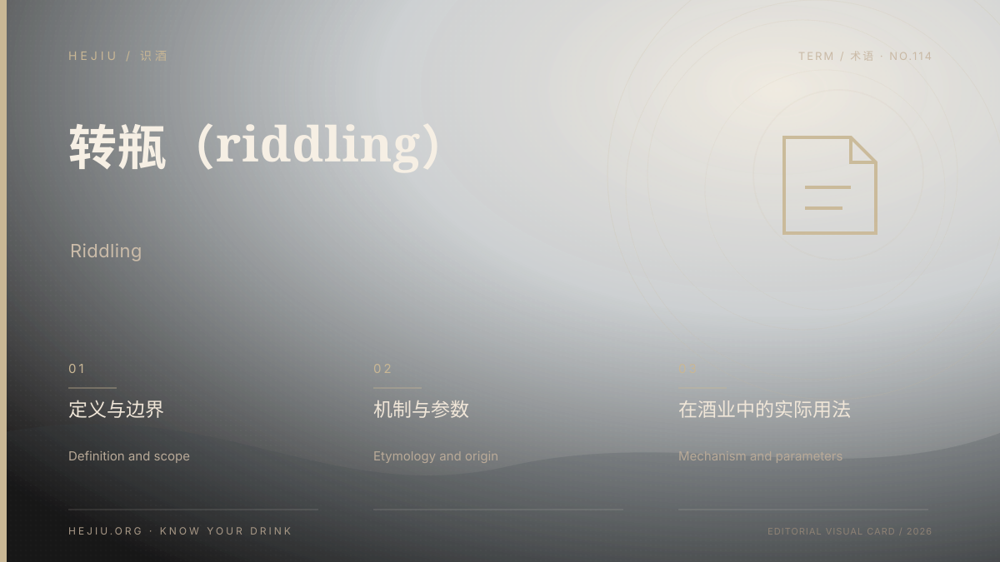

# Riddling

Riddling (French remuage) is the step in traditional-method [sparkling wine](ref:sparkling-wine) after the in-bottle second fermentation and before [disgorging](ref:disgorgement): the bottles are repeatedly turned and gradually tilted so that the yeast sediment slides towards the neck and gathers in a small plug. It is neither flavouring nor ageing, but a mechanical gathering process driven by gravity.

Figure: thematic illustration for Riddling. Image: AI-assisted illustration generated with Doubao Seedream 5.0 (project-owned); not a photograph of the subject.

## Definition and scope

Riddling has one aim: to move the [lees](ref:lees) that were spread across the bottom of the bottle into the inside of the neck, so that the neck can be frozen and the sediment removed. It does not change the chemical composition of the wine, and it is not intended to extend lees contact. The boundaries are clear: putting bottles on the rack and giving them a first tilt is pointage; the continuing turns and tilts that follow are riddling; pushing the sediment out is disgorging, and the order cannot be reversed.

Not every sparkling wine is riddled. Tank fermentation completes the second fermentation under pressure in a vessel and removes sediment by filtration inside that vessel, so no in-bottle riddling is needed. Only wines that finish their second fermentation in the bottle and are meant to age on the lees go through this step.

## Etymology and origin

French remuage comes from the verb remuer, to move or stir. English riddling comes from riddle, originally a sieve or a shaking action, and was used in the English wine trade in the nineteenth century for the work of shaking sediment towards the neck. Chinese renderings such as "turning the bottle" or "shaking the bottle" are descriptive translations, while the phrase "tipping the bottle" stresses the gradually downward neck. The rack is called a pupitre in French, literally a sloping desk or reading stand, named for its shape; the automated machine is a gyropalette, from gyro (rotation) and palette (tray or frame).

The division of labour between these words matters: remuage is the process, pupitre is the hand tool, and gyropalette is the commercial name of the machine.

## Mechanism and parameters

Two movements do the work. The first is tilt: the neck moves from almost horizontal towards pointing down, and the sediment slides along the glass under gravity. The second is rotation: the bottle is turned by a set angle at regular intervals, breaking up sediment that has stuck to the wall and preventing it from setting into a hard ring. The traditional hand rhythm is about a quarter turn each time, with the neck raised a little further.

Timing depends on the method. Material from the Champagne trade body states that hand riddling, after the bottles are racked and given an initial settling period, needs at least 26–30 days; counting the resting week, the trade body puts the whole cycle at about six weeks. When labour is tight the cycle can stretch to two or three months. Mechanical riddling uses gyropalettes that hold hundreds of bottles and perform the same turns and tilts to a programme, usually compressing the work to a few days. Temperature also affects settling: when it is low the sediment slides slowly, and when it is high the pressure in the bottle and the risk of oxidation rise.

## Use in the industry

Traditional-method Champagne, Burgundy sparkling wines, some Cava and South African traditional-method sparkling wines all use riddling. The value of hand riddling lies in bottle-by-bottle judgement: an operator can feel whether the sediment is loose or stuck and give individual bottles extra handling. Large houses prefer mechanical riddling because the rhythm is uniform, the footprint is smaller and labour costs are lower.

When riddling ends, the bottles rest neck down for a period so that the sediment settles firmly in the neck, then move on to neck freezing and disgorging. The quality of riddling directly affects how clean disgorging is: if the sediment has not gathered properly, particles may remain, or more wine must be lost to flush the neck clean.

## Terms easily confused

- **Riddling versus pointage**: pointage is racking the bottles and giving them a first tilt; riddling is the continuing turns and tilts that follow. The first is the start, the second is the main body of work.
- **Riddling versus disgorging**: riddling concentrates the sediment, disgorging removes it. One gathers, the other ejects, and the order cannot be swapped.
- **Remuage versus gyropalette**: remuage is the process, gyropalette is the mechanical cradle that performs it. "Using a gyropalette for remuage" is the accurate pairing.
- **Riddling versus lees ageing**: the wine is still on its lees during riddling, but the aim is to gather sediment, not to prolong ageing. Confusing the two overstates the effect of riddling on flavour.

## Misconceptions and disputes

First, riddling is often described as a technique that "makes the wine better". It only moves the sediment; it creates no aroma or structure. Quality comes from the base wine, the fermentation and the time on the lees. Second, mechanical riddling is equated with lower quality. The machine simply performs the same movements, and it is often more consistent. Third, people assume every sparkling wine is riddled, ignoring tank methods. Fourth, riddling and disgorging are treated as one step, which scrambles the order when the process is described.

The main dispute is manual versus mechanical. Hand riddling is often marketed as more delicate, but blind comparisons rarely prove a difference in the finished wine; its real value lies in small-batch adjustment and in the story. A second dispute concerns duration: running riddling longer than necessary does not improve the wine and raises the risk of oxidation and pressure problems.

## Typical figures and examples

- Hand method: about one week of rest after racking, then 26–30 days of riddling, which the trade body puts at roughly six weeks in total; with limited labour the cycle can stretch to two or three months.
- Each turn is about a quarter of a rotation, and the neck moves from nearly horizontal to nearly upside down.
- Mechanical method: one gyropalette holds hundreds of bottles and completes a cycle in a few days.
- Example: a house that must hand-riddle 100,000 bottles in six weeks needs a large number of skilled positions; the same volume on a mechanical line can be finished in a few days, but bottle-by-bottle adjustment is lost.
- Example: when sediment has not gathered properly, fine particles remain visible after disgorging, and the cause is usually found in the angles and rhythm of riddling.

## See also

- [Sparkling wine](ref:sparkling-wine): how traditional and tank methods differ.
- [Disgorgement](ref:disgorgement): the step that follows riddling.
- [Lees](ref:lees): where the sediment comes from and what lees contact does.

**Short definition:** Riddling (French remuage) gathers the yeast sediment of traditional-method sparkling wine at the bottle neck; hand riddling takes about 26–30 days, while a gyropalette can finish in a few days, with different trade-offs in consistency, cost and bottle-by-bottle judgement. 

Start with where the term is used. From there, consider what it is contrasted with, then whether the source is a standard. That is how a practical judgment about Riddling is built.
