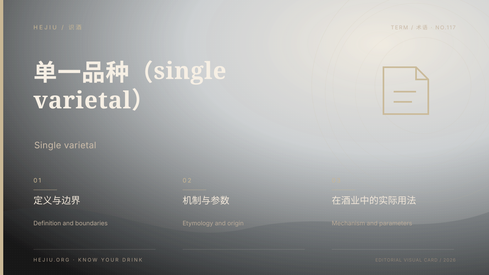

# Single varietal

A single varietal wine is made mainly from one grape variety. It emphasises varietal identity rather than origin, producer or technique. A label saying “Cabernet Sauvignon” or “Chardonnay” usually means the wine's flavour is shaped mainly by that variety, but “mainly” has a specific legal proportion and is far from “100%”.

Figure: thematic illustration for Single varietal. Image: AI-assisted illustration generated with Doubao Seedream 5.0 (project-owned); not a photograph of the subject.

## Definition and boundaries

The boundary is set by the variety proportion. EU wine labelling rules provide that, when only one variety name is shown, at least 85% of the product must come from that variety; when two or more variety names are shown, those varieties must together make up 100% of the product. The United States requires at least 75%, and that 75% must all be grown in the labelled appellation. Australia uses 850 mL/L, which is 85%.

Single varietal is therefore not the same as “100% of that variety”. A wine labelled “Cabernet Sauvignon” may contain another 15% of other varieties; a wine labelled “100% Cabernet Sauvignon” is a producer's explicit claim at the full proportion. The distinction is between the regulatory minimum and a stronger voluntary declaration.

## Etymology and origin

“Varietal” comes from “variety”, and in wine language means a wine identified by its grape variety; “single varietal” stresses one variety as the main component. The trade also uses “varietal wine” for a wine labelled by variety and “monovarietal” as a synonym. The Chinese terms for the concept are different renderings of the same idea with slightly different emphasis.

Varietal labelling is not an ancient label item. It spread with the growth of wine trade, consumer knowledge and regulation: producers needed a language more immediate than appellation to explain flavour, and consumers needed to identify wines on a shelf. Countries therefore created variety thresholds, turning a descriptive phrase into a legally binding declaration.

## Mechanism and parameters

The proportion parameter decides whether the label can stand. The EU 85% threshold means the remaining 15% may be other varieties, or may come from different sites or years; the US 75% threshold also carries an appellation condition, requiring that the 75% be grown in the stated appellation. Australia's 850 mL/L expresses the same logic another way: at least 850 millilitres of every litre must come from that variety.

Beyond proportion, region and regulation also change what “single varietal” means. Some appellations allow only certain varieties or require a blend; there, even a dominant variety may not appear alone on the label. Other appellations allow variety and region names together but attach stricter proportion or growing conditions. Variety, region and regulation need to be read together.

## Practical use in the drinks industry

Producers choose single varietal to highlight varietal character, make consumer recognition easier, simplify market communication, or build a clear product line within the rules. Single-varietal [Cabernet Sauvignon](ref:cabernet-sauvignon) usually emphasises black fruit, structure and tannin; [Chardonnay](ref:chardonnay) usually emphasises apple, citrus and texture from oak or lees; [Riesling](ref:riesling) usually emphasises acidity, citrus and mineral notes. These are typical tendencies, not guarantees for every bottle.

On wine lists and in retail, “single varietal” is often a category that helps drinkers compare one variety across regions. It forms two routes with [blends](ref:blend): single varietal stresses recognition, blending stresses balance and integration. Neither is a hierarchy; they are different goals. For [white wine](ref:white-wine), a single-varietal label also helps separate varietal aroma from winemaking effects.

## Related terms compared

The first pair is single varietal and single vineyard. The former describes variety composition, the latter site; one variety can come from several vineyards, and one vineyard can grow several varieties. The second pair is single varietal and single barrel. The former is an agricultural and labelling concept, the latter a container concept; a single barrel stresses an unrepeatable cask, not a variety proportion.

The third pair is single varietal and 100% varietal. The legal threshold allows a small share of other varieties, so “single varietal” means “mainly that variety”, not “only that variety”. The fourth pair is single varietal and blend. The former centres on variety recognition, the latter on combination and balance; a blend can still be dominated by one variety, but the label usually will not name only that variety. The fifth pair is “varietal” and “variety”: the first is an adjective used in labelling, the second a botanical category.

## Common misuses and debates

First, equating single varietal with 100% of that variety. Second, equating it with single vineyard or single barrel. Third, assuming single varietal is always better than a blend. Fourth, ignoring the different thresholds of 85%, 75% and 850 mL/L. Fifth, looking only at the variety name and not at region, vintage or producer.

Debate centres on whether 85% is enough. Supporters say it gives producers room to adjust and keeps labelling flexible; critics say consumers seeing a variety name often expect a higher share, and the 85% threshold can create a gap in understanding. Another debate is verification of “100%” claims: enforcement and testing capacity differ by country, and not every “100%” label can be checked batch by batch. Buyers should combine official certification with producer transparency.

## Typical figures and examples

Three checkable figures are: the EU minimum of 85% for one named variety; the US minimum of 75%, with that 75% grown in the labelled appellation; and the Australian minimum of 850 mL/L, or 85%. These thresholds mean the same “Cabernet Sauvignon” label can have different legal meanings in different countries. A wine labelled “100% Cabernet Sauvignon” exceeds the EU and US minima and is a voluntary producer claim.

Take [Riesling](ref:riesling) as an example: a single-varietal label helps drinkers expect high acidity, citrus and mineral notes, but the same variety performs very differently in cool and warm regions, so the variety name alone is not enough. Recording proportion, region and vintage side by side is the complete way to read the label.

## See also

- [Wine](ref:wine): categories, vintage and appellation rules.
- [Cabernet Sauvignon](ref:cabernet-sauvignon): a typical variety for structure and tannin.
- [Chardonnay](ref:chardonnay): a typical variety for texture and oak expression.
- [Riesling](ref:riesling): a variety with high acidity and distinctive aroma.
- [White wine](ref:white-wine): varietal expression and style differences.
- [Blend](ref:blend): the other route, in contrast to single varietal.

**At a glance:** Single varietal describes a wine made mainly from one grape variety; whether the variety may appear on the label depends on national rules, with the EU and Australia usually requiring 85% and the United States 75%, so it is not a synonym for 100% of that variety.

**Sources and limits.** The key claims about Single varietal are checked against the following sources: European Union (Used to check the 85% rule for varietal labelling and related label requirements), U.S. Department of the Treasury, Oxford University Press (Used for entries on single varietals, blends and labelling) and 7 sources in total. Prices, batches and status change; the body is project-written and does not reproduce source text.
