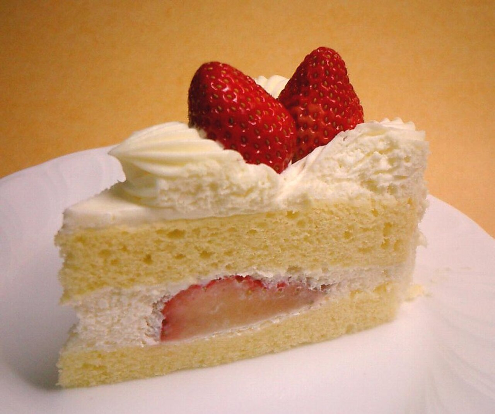

# Sweet

Figure: Sweet. Image: Tomomarusan, CC BY 2.5, via Wikimedia Commons ([source page](https://commons.wikimedia.org/wiki/File:Strawberry_shortcake.jpg)).

## Definition and boundaries

Sweet is first a taste: the sensation of sugar on the tongue. It is also a regulated label. Under EU wine labelling rules, sweet for still wine means residual sugar of 45 g/L or more; the band below it, up to 45 g/L, is medium sweet. Sparkling wine uses a different set of terms, where the equivalent doux threshold is above 50 g/L. The still-wine and sparkling-wine figures therefore cannot be swapped.

The boundary also separates “sweet” from “sweet category”. Sweetness is a subjective perception shaped by temperature, acidity, alcohol and bubbles; the sweet category is a label band defined by residual sugar. Two wines both labelled sweet can taste very different: one may sit just above 45 g/L, another may reach 150 g/L. The label says which band the wine occupies, not how sweet it will feel.

## Etymology and origin

Sweet comes from Old English swēte and can be traced to Proto-Germanic *swōtuz, with distant relatives in Latin suavis and Greek hēdys. The word first described a pleasant taste and later extended to meanings such as gentle or agreeable. In wine, sweet keeps its taste meaning, but on a label it is institutionalised into a residual-sugar band.

The Chinese term for the sweet category combines the word for sweet with a suffix meaning type or class. That is a useful distinction: sweet is a sensation, while the category is a band in a labelling system, not a single compound and not proof that sugar was added.

## Mechanism and parameters

Sweetness is mainly triggered by sugars such as glucose, fructose and sucrose, detected by the T1R2/T1R3 receptors on the tongue. Fructose usually tastes sweeter than glucose, so the sugar mix affects perception at the same residual-sugar level. Fermentation converts sugar into alcohol; residual sugar is what remains when fermentation stops or is stopped early. Fortification adds alcohol during fermentation, killing the yeast and retaining sugar, while sparkling-wine dosage is added after disgorgement to set final sweetness.

Acidity, alcohol, temperature and bubbles all modulate the sensation. High acidity makes sweetness seem fresher, while low acidity makes it cloying. High alcohol adds sweetness and heat; too cold a temperature suppresses aroma and makes sweetness feel blunt, while too warm a temperature amplifies it. Bubbles add tingling freshness and change the perceived intensity of sweetness.

The regulatory parameters are just as important. For still wine, dry is up to 4 g/L, or up to 9 g/L when total acidity is no more than 2 g/L below residual sugar; medium dry is up to 12 g/L, or up to 18 g/L under the acidity condition; medium sweet is up to 45 g/L; sweet is 45 g/L or more. For sparkling wine, brut is below 12 g/L, extra dry is 12–17 g/L, sec is 17–32 g/L, demi-sec is 32–50 g/L and doux is above 50 g/L.

## Practical use in the drinks industry

Sweet wine is produced by five main routes. The first is late harvest: grapes stay on the vine to ripen further, concentrating sugar and reducing acidity. The second is noble rot: botrytis-infected grapes lose water, concentrating sugar and flavour compounds, common in sweet whites. The third is ice wine: grapes freeze on the vine and are pressed while frozen, leaving ice crystals behind and concentrating both sugar and acidity. The fourth is fortification: neutral alcohol is added during fermentation, killing the yeast and retaining residual sugar, producing [fortified wine](ref:fortified). The fifth is sparkling-wine dosage: a sugar solution added after disgorgement sets the final sweetness.

Different routes produce different structures. Late-harvest and noble-rot wines usually retain high acidity, so the sweet-acid balance is more obvious; fortified wines carry alcoholic weight and a heavier palate; sweet [sparkling wine](ref:sparkling) adds bubbles and freshness. Treating sweet as a single style ignores these differences.

On labels and in sales, the sweet category is a useful filter but not a substitute for technical information. Buyers should check residual sugar, total acidity, alcohol and production method together. In a restaurant, sweet wines are often listed by sweetness and pairing rather than colour alone. For producers, the difficulty is stability: high residual sugar with low acidity, low alcohol or poor storage can invite re-fermentation or microbial risk.

## Confusable terms

Sweet and fruity are often confused. Ripe fruit aromas can appear in dry wines, and fruitiness is not sugar; a dry wine that smells of peach may have less than 4 g/L residual sugar. Sweet and dry sit at the two ends of the sweetness scale, with medium dry and medium sweet between them; equating “not sweet” with “dry” ignores the sweet illusion created by acidity and alcohol.

Sweet versus residual sugar is a label band versus a number. Residual sugar is a figure in grams per litre; sweet is a regulatory band. A 45 g/L wine and a 150 g/L wine can both be called sweet, even though their sugar levels differ by more than three times. Sweet versus dessert wine follows a different classification logic. Dessert wine describes a use or category, while sweet is a sweetness label; some dessert wines are not very high in sugar and rely on concentration and alcohol, and some sweet wines do not pair well with dessert.

## Common misuses and disputes

First, equating sweet with low quality. Many sweet wines require specific weather, hand harvesting and long ageing, and are not cheap to make. Second, assuming sweet wines only pair with dessert. Saltiness, blue cheese and spicy dishes can also form contrasts with sweet wine. Third, confusing “sweet” with “fruity”; a dry wine can also have ripe fruit aromas. Fourth, ignoring storage after opening: sweet wines contain sugar and may still oxidise or ferment, so refrigerate and finish them promptly.

The dispute centres on the gap between label and sensation. Sweetness thresholds are not identical in every region, and the same wine can seem sweeter or less sweet at different temperatures and in different glasses. Consumers buy by label, yet the experience may diverge. The safer approach is to read sweet as a residual-sugar band and then judge balance together with acidity, alcohol and style.

## Typical values and examples

- Still-wine sweet: 45 g/L or more; medium sweet: up to 45 g/L.
- Still-wine dry: up to 4 g/L, or up to 9 g/L when total acidity is no more than 2 g/L below residual sugar.
- Sparkling doux: above 50 g/L; demi-sec: 32–50 g/L; sec: 17–32 g/L.
- Sparkling extra dry: 12–17 g/L; brut: below 12 g/L.
- Comparison: a 50 g/L sweet wine and a 150 g/L noble-rot wine can both fall in the sweet category, yet differ greatly in concentration.
- Typical variety: [Riesling](ref:riesling) can retain high acidity in late-harvest and noble-rot form, so even a very sweet wine still tastes fresh.

These thresholds show that sweet is not a single ladder of “more is better”, but a band shaped by residual sugar, acidity, alcohol and process.

## See also

- [Wine](ref:wine): categories, vintage and appellation rules.
- [Fortified wine](ref:fortified): how fortification retains residual sugar.
- [Sparkling wine](ref:sparkling): dosage and sweetness categories.
- [Riesling](ref:riesling): a high-acid variety that supports sweet wines.
- [Residual sugar](ref:residual-sugar): the core number behind sweetness categories.
- [Semi-dry](ref:semi-dry): the middle band before sweet.
- [Dry](ref:dry): the other end of the sweetness scale.

For Sweet, begin with where the term is used. Then look at what it is contrasted with, and finally ask whether the source is a standard. The answers point to different choices, not to a single score.

Read [Wine](ref:wine) for the definition side of Sweet, and [Sparkling wine](ref:sparkling) for the applicable standard side. Together they locate it.
