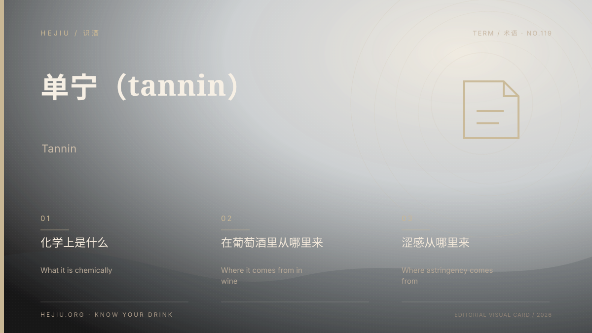

# Tannin

Tannins are a group of polyphenolic compounds found widely in plants. They bind proteins and therefore produce a “dry” or astringent sensation, and they have long been used in leather tanning, dyeing and ink making. In wine, tannins come mainly from grape skins, seeds and stems, and may also come from oak barrels.

Figure: thematic illustration for Tannin. Image: AI-assisted illustration generated with Doubao Seedream 5.0 (project-owned); not a photograph of the subject.

## What it is chemically

Tannin is not a single substance but a group of structurally related polyphenols. Chemically, they are usually divided into two main classes: hydrolyzable tannins and condensed tannins. Hydrolyzable tannins can break down in water into products such as gallic acid and sugars, and are common in oak and gallnuts. Condensed tannins are built from polymerised flavanol units, are larger in structure, and are more common in grapes and tea.

“Tannin” and “tannic acid” are not synonyms. Tannic acid usually refers to a type of hydrolyzable tannin, while the main tannins in wine are condensed tannins, also called proanthocyanidins. Treating the two as interchangeable can lead to confusion when discussing oak, tea astringency and wine structure.

## Where it comes from in wine

Red-wine tannin comes mainly from fermentation with skins. Grape juice itself contains almost no tannin; colour and tannin enter the liquid during maceration from skins and seeds. Stems also contribute tannin, but modern winemaking often destems to avoid rough, herbal astringency. Pressing pressure, maceration time, fermentation temperature and extended maceration all change the amount and texture of the final tannin.

White wines are usually fermented without skins and therefore contain little tannin. Even so, white grapes may undergo brief skin contact, or the wine may be aged on lees or in oak to gain a subtle sense of texture. Oak barrels release hydrolyzable tannins and add vanilla, toast and structure; a higher proportion of new oak usually makes the effect more pronounced.

## Where astringency comes from

Tannins bind with proteins in saliva, reducing its lubricating effect, and the mouth feels dry and tight. This is astringency. It is not bitterness: bitterness comes from taste receptors, while astringency is closer to touch. High tannin is not automatically unpleasant; what matters is texture. Fine, ripe, well-integrated tannins can support a wine, while coarse, unripe or over-extracted tannins feel hard and dry.

With ageing, condensed tannins continue to polymerise and some form sediment, so the wine may feel softer. But “ageing always softens tannin” is not an absolute rule: storage conditions, wine structure, oxygen exposure and cork condition all matter. Decanting can increase oxygen contact and open the aroma of some young reds, making tannin seem less harsh, but over-decanting an old or low-tannin wine can let aroma fade.

## Tannin and food

When a high-tannin red wine meets food rich in protein and fat, the tannins bind with food proteins and the astringency is often reduced. In contrast, spicy, very acidic or sweet food can amplify the dry sensation. Matching food does not need a mechanical “red wine with red meat” rule; a more reliable approach is to look at tannin intensity, the fat and protein content of the dish, and the acid, sugar and heat in the seasoning.

## Common misconceptions

First, tannin is not “the more astringent, the better”. Astringency is only one part of structure; ripeness and balance matter more.

Second, tannin is not found only in red wine. Tea, persimmons, oak-aged white wines and some spirits can also provide a tannin sensation.

Third, tannin is not a substitute for alcohol. Alcohol, acidity, sugar and aroma also determine body; tannin is only one dimension.

## Describing tannin

In tasting, tannin is usually described by amount and texture together, not by "more or less" alone. Common words include fine, coarse, tight, loose, silky, dry, astringent and resolved. A practical order is to judge first whether tannin is noticeable, then whether it supports the body or blocks the fruit, and finally how long it persists in the mouth. Tannin that keeps tightening and does not fade usually points to heavy extraction or insufficient ripeness; tannin that appears quickly and disappears quickly may point to a lighter body or shorter maceration.

These descriptions are sensory language, not chemical measurement. Two people may judge the same wine's "fineness" differently, so professional panels often use blind tasting, comparison and repetition. For ordinary drinkers, a more reliable method is side-by-side comparison: put two wines of the same variety and region together, and the difference becomes easier to perceive.

## Tannin in other drinks

Tannin does not belong to wine alone. Catechins in tea are condensed-tannin-type substances and an important source of astringency in the brew; unripe persimmons contain more tannin and feel clearly astringent; oak-aged white wines and some aged spirits also gain woody tannin. Understanding these common points helps turn "astringency" from a wine-specific word into a widely occurring sensory phenomenon.

Different sources, however, have different tannin structures and therefore different sensations. Grape tannin is mainly condensed tannin, oak tannin includes more hydrolyzable tannin, and tea tannin differs from grape tannin in molecular size and combination. It is therefore wrong to say simply "tea is astringent, so wine should be astringent too"; source, concentration and texture should be considered separately.

## Measuring and expressing tannin

Laboratories can measure total phenolics, total tannin or specific flavanol content chemically, but these figures do not correspond one-to-one with the "dry" sensation in the mouth. With the same total tannin, particle size, degree of polymerisation and binding with other components all change the perception. Professional description therefore separates "content" from "texture": content is an analytical result, texture is a sensory judgement. Confusing the two is why many discussions of tannin go astray.

For Tannin, begin with where the term is used. Then look at what it is contrasted with, and finally ask whether the source is a standard. The answers point to different choices, not to a single score.

**Short definition:** Tannins are a group of polyphenolic compounds that bind proteins and create astringency; in wine they come mainly from skins, seeds, stems and oak.

**Sources and limits.** The key claims about Tannin are checked against the following sources: Encyclopaedia Britannica (Used to check the chemical classes, astringency and main plant sources), EMBL-EBI (Used to check the definition of tannins as polyphenolic substances), Oxford University Press (Used for entries on grape tannins, oak tannins and ageing) and 5 sources in total. Prices, batches and status change; the body is project-written and does not reproduce source text.

## Further reading

- [Wine](ref:wine): categories, vintage and appellation rules.
- [Red wine](ref:red-wine): skin fermentation as the main source of colour and tannin.

Further reading: [Maceration](ref:c-extra-1), [Body](ref:c-extra-2), [Acidity](ref:c-extra-3).
