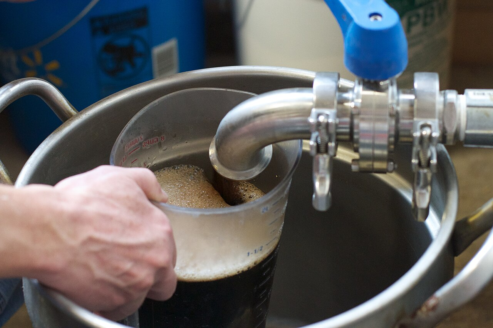

# Wort

Wort is the sugar-rich liquid separated from spent grain at the end of mashing. It carries the sugars, dextrins, amino acids, vitamins and minerals that the grain and water produced under enzyme action, and it is the direct raw material of beer fermentation. In one sentence: wort is beer before fermentation and before hops.

In a brewery, wort gravity sets the total amount of fermentable sugar and therefore alcohol and body. Its amino-acid profile decides whether yeast can grow healthily. Its turbidity and lipid content affect foam, flavour stability and filtration. Two breweries using the same malt and the same equipment can still end up with very different beer because of small differences in mashing and lautering.

Figure: Wort running off after lautering, before hops are added. Image: cogdogblog, CC BY 2.0, via Wikimedia Commons ([source page](https://commons.wikimedia.org/wiki/File:Here_Comes_Some_Wort!_(8424827095).jpg)).

## From grain to liquid: how wort is made

The chain starts with malting. Barley is steeped, germinated and then kilned or roasted, which develops amylases and proteases and fixes the colour of the malt. The brewery mills the malt into grist, mixes it with hot water in a mash tun and holds it through temperature rests. Enzymes cut starch into maltose, maltotriose and glucose, and break proteins into amino acids.

After mashing, the mash goes into a lauter tun. The spent grain forms a natural filter bed, and clear wort runs off from the bottom. To recover sugar still held in the grain, the brewer sprays hot water over the bed, a step called sparging. The liquid collected is wort; the spent grain becomes feed or waste.

Water chemistry matters as much as the grain. Calcium, magnesium, carbonate and sulphate in the brewing water influence enzyme activity, pH and the way hop bitterness is perceived. Historically, local water shaped regional beer styles: hard water suited English bitter, soft water suited Pilsner. Modern breweries adjust their water, but the saying that water is the skeleton of beer has not aged.

## What is in wort

Wort is mostly water, with sugars, dextrins, proteins and amino acids, minerals, vitamins and a small amount of lipid making up the rest. Maltose dominates the sugar profile, followed by maltotriose and glucose. Dextrins are not fermented by brewer's yeast, but they contribute body and a sense of fullness. Free amino nitrogen is the yeast's nitrogen source; too much can produce higher alcohols and biogenic amines, too little can slow fermentation.

Wort strength is usually expressed in degrees Plato or as specific gravity. A twelve-degree Plato wort is close to the starting point of an ordinary beer; sixteen degrees or more is common in strong beers. Gravity tells you the total amount of sugar, not the sugar profile. Two worts at the same gravity can finish at different alcohol levels and different residual sweetness if their fermentable fractions differ.

Turbidity deserves attention too. Moderate turbidity brings lipids and yeast nutrients; excessive turbidity hurts foam and shelf life. Modern breweries tend toward clear wort, while some traditional Belgian and English breweries keep some cloud for a fuller mouthfeel. There is no absolute rule, only a trade-off between style and stability.

## Boiling, hopping and cooling

After lautering, wort enters the kettle. Boiling has four jobs: sterilise the liquid, stop enzyme activity, isomerise alpha acids from hops into bitter compounds, and coagulate proteins into hot break. A boil usually lasts about an hour. Hops are added in stages: early for bitterness, late for aroma, and at whirlpool for flavour.

Boiling also drives off unwanted volatiles such as dimethyl sulphide and its precursors. Too much DMS gives a cooked-corn note, so boil vigour and duration have to be sufficient. After the boil, wort goes into a whirlpool, where centrifugal force gathers hot break and hop debris in the centre as trub.

Then comes cooling and aeration. Wort must drop quickly to the yeast's working temperature to reduce infection risk, and it must be aerated so yeast can grow during the first phase. The cooled, aerated wort is pitched with yeast and enters fermentation. Only at that point does it begin to become beer.

## Beer and whisky: same word, different route

In brewing, wort is boiled with hops and then fermented. In whisky, wort is usually not hopped and often not boiled; it is cooled and fermented into wash, which is then distilled. The front end is similar in both cases: malting, mashing and lautering. The fork in the road is whether the liquid is boiled with hops and whether it is distilled.

The Scotch whisky industry calls the fermented liquid wash and the sugary liquid from mashing wort. Wash alcohol is relatively low, and pot-still or column distillation turns it into new-make spirit. A brewery's wort, by contrast, must retain hop bitterness and aroma, so boiling is a flavour-building step rather than simple sterilisation.

Sake is often compared with beer. Steamed rice, koji and water form moromi, in which saccharification and fermentation run in parallel; the finished mash is pressed to release sake. The logic is similar — a sugary liquid becomes alcoholic through microbial action — but the raw material, the enzyme source and the separation method are different. Calling moromi "wort" hides those differences.

## Common misunderstandings and how to judge

The first misunderstanding is that wort is beer. It has no hops, no fermentation and no carbon dioxide; it is a semi-finished liquid. The second is that clearer wort is always better. Clarity helps stability, but over-filtration can strip foam proteins and flavour. The third is that higher gravity is always better. High gravity brings more alcohol, but also risks stuck fermentation and an unbalanced residual sugar profile.

To judge wort, a brewer looks at gravity, pH, turbidity, colour, an iodine test for complete starch conversion, and yeast fermentability. Home brewers can use a hydrometer or refractometer for gravity and an iodine solution for the end of saccharification. Commercial wort concentrate needs a production date and careful storage, because sugars and amino acids change with time and temperature.

For Wort, begin with where the term is used. Then look at what it is contrasted with, and finally ask whether the source is a standard. The answers point to different choices, not to a single score.

## See also and references

- Malting: see [malting](ref:malting).
- Saccharification: see [saccharification](ref:saccharification).
- Fermentation: see [fermentation](ref:fermentation).
- Beer: see [beer](ref:beer).
- Whisky: see [whisky](ref:whisky).
- Sake: see [sake](ref:sake).

**Short definition:** Wort is the sugar-rich liquid separated from spent grain after mashing. It is the starting point of beer fermentation, not beer itself, and its composition depends on the grain, the mash schedule, the lautering and whether it is boiled with hops.
