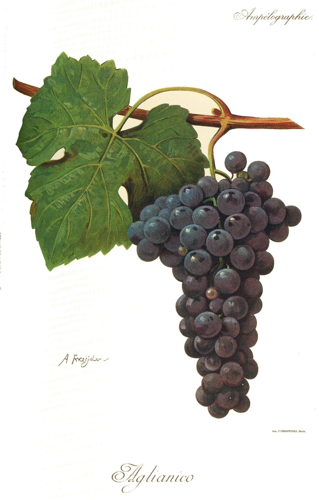

# Aglianico

Aglianico is one of the weightiest red grapes of southern Italy, planted mainly on the slopes of Monte Vulture in Basilicata and in the inland hills of Campania. It ripens late, colours deeply, and carries both high tannin and high acidity; young examples often taste closed and drying, and need several years in bottle before they open. Calling it "the Nebbiolo of the south" is imprecise, but the two do share a logic of high acid, high tannin and complexity bought with time. Within the red wines of the south it is the variety most often compared with the north's finest, and its best bottles are discussed in the same breath as Italy's long-lived reds (ref:italy).

Figure: Aglianico. Image: Alexis Kreyder, Public domain, via Wikimedia Commons ([source page](https://commons.wikimedia.org/wiki/File:Aglianico_Viala_Vermorel.jpg)).

> **Quick verdict**
> **In one line:** This variety helps you decide whether Aglianico suits you, and compare it with other varieties.
>
> - **Best for:** Anyone comparing Aglianico with other varieties and trying to pin down the flavour difference.
> - **Not for:** If you want only want a famous producer recommendation and do not care about the variety itself.
> - **Check first:**
>   - The variety is Aglianico.
>   - The name is usually linked to the Italian ellenico, "Greek", pointing to an arrival in southern Italy during the Greek colonial period.

## Definition and synonyms

The variety is Aglianico. It belongs to Vitis vinifera and is native to southern Italy. Names are easily confused with places: Aglianico del Vulture is the DOCG of Basilicata and Taurasi is the DOCG of Campania, both made from the same grape. Older spellings include Aglianica and Uva Aglianica. A label that says only Aglianico may come from several southern zones, while Taurasi or Aglianico del Vulture carries specific rules on origin, variety proportion and ageing. In drink terms it is a red wine, not a fortified or sweet style (ref:red-wine).

## Parentage and origin

The name is usually linked to the Italian ellenico, "Greek", pointing to an arrival in southern Italy during the Greek colonial period. The historical setting supports the idea: Campania and Basilicata formed the heart of Magna Graecia, and Greek-type vines were grown there in antiquity. But a name is only a clue. DNA work has not produced a confirmed parent pair, and there is no proof that the vine was brought as a single variety from one place in Greece. What is certain is several centuries of cultivation in the south, long as a blending and local grape, and a revival as a single-variety wine and protected denomination only in the later 20th century.

## Botanical character

Bunches are medium and fairly compact, berries medium and round, turning deep blue-black with thick skins. The thick skins and the high skin-to-pulp ratio give both colour and a large load of tannin, the foundation of its ageing capacity (ref:tannin). Leaves are medium and five-lobed. Aglianico buds late and ripens very late, often not picked until late October or November in the south, among the last varieties of the region. That lateness demands warm, exposed, well-drained sites; in years without enough heat, tannin and sugar do not ripen together and the wine turns green and harsh.

## Viticultural behaviour

Vines are vigorous and need crop control, otherwise the canopy closes and the fruit fails to ripen. Late budding avoids spring frost, but autumn rain at ripening invites grey rot, so growers prefer airy slopes. Thick skins give some disease tolerance, yet the vine dislikes excess water, and drainage before the rains matters. Traditional short pruning and fairly high planting density keep yields in check. The high-altitude parcels of Vulture, with cool nights, let the fruit build sugar while holding acidity; the clay and limestone inland of Campania give fuller body and deeper fruit.

## The volcanic soil of Vulture

Monte Vulture is an extinct volcano, and its soils are weathered ash, tuff and lava, free-draining and rich in mineral salts, with clay in places. Aglianico here is usually planted at altitude, and the wines are tighter, scented with smoke, crushed stone and blackberry, with clearly drawn tannin. Compared with Taurasi, Vulture wines often look leaner and more mineral, and need more air when young. Volcanic soil is not magic; altitude, slope, ripeness and ageing decide the style. Still, the difference in drainage and nutrient holding does make one variety read differently in the two zones.

## Distribution

Vulture in Basilicata is the core, with Aglianico del Vulture covering several villages and vineyards commonly between 400 and 700 metres. Taurasi lies in the province of Avellino in Campania, fuller and more tannic; Taburno is another DOCG. Falerno del Massico and parts of Irpinia also make Aglianico-based wines, and there are plantings in Puglia and Molise. Outside Italy, Australia, the United States and Argentina have small experimental plots, far below the scale of the southern Italian homeland.

## Legal rules

Aglianico del Vulture was promoted from DOC to DOCG in 2011, requiring at least 90% Aglianico and a minimum period of ageing, with the exact months set by the current rules. Taurasi became a DOCG in 1993, requiring at least 85% Aglianico and at least three years of total ageing, including time in oak; Riserva demands longer. Aglianico del Taburno became a DOCG in 2011. The purpose of these rules is not that older is always better, but that a late-ripening, tannic grape is given time to soften. Zone and vintage say more than the word Riserva on the label.

## Winemaking and ageing

Maceration is usually long, from two to four weeks, to extract colour and tannin, and fermentation temperatures are relatively warm. Because the tannin is strong, many estates age in large or used oak (ref:oak-ageing), so that vanilla and toast do not bury the variety's smoke, dark fruit and flowers. Modernists use some new and small barrels for a rounder style; traditionalists stay in large casks to keep acidity and structure. Either way, the wine usually needs years in bottle after release, especially Taurasi. Heavy oak and early bottling both make the tannin taste drier than it needs to.

## Sensory style

Young Aglianico is deep in colour with a purple rim, and smells of blackberry, black cherry, plum, violet, black pepper and liquorice, often with smoke, tar and leather. On the palate acidity is high and tannin heavy, the body full and alcohol substantial; the finish is long but dries out when young (ref:acidity). With age the tannin turns fine, and dried fig, cocoa, tobacco, forest floor and truffle appear. Vulture versions lean mineral and smoky, Taurasi towards fruit and power. Good bottles can last more than twenty years, and even entry-level examples are better after five to eight.

## At the table

High tannin and high acid need fat and protein: braised beef, roast lamb, game, slow-cooked meat sauce and hard cheese all work. Decant for one to two hours, longer for young bottles, and serve at 16 to 18 °C. Avoid delicate seafood and sweet sauces, where the tannin turns harsh. Its acidity also makes it a natural match for the tomato- and olive-oil-rich cooking of southern Italy, a point that is often overlooked.

## Producers and vintages

In Vulture, names include Paternoster, D'Angelo, Basilisco, Elena Fucci with Titolo, Grifalco and Cantine del Notaio; in Campania, Mastroberardino, Feudi di San Gregorio, Terredora di Paolo, Villa Raiano and Pietracupa. Vintage differences come mainly from autumn rain and heat: hot, dry years give denser, stronger wines, while cool, wet years demand strict selection and yield a fresher but sometimes harder style. Certain Taurasi vintages are much discussed, but a ranking of years is no substitute for tasting.

## Common misconceptions

First, that Aglianico must be Greek in origin; the name and history support the idea, but the genetic evidence is not conclusive. Second, that Taurasi and Aglianico del Vulture are the same wine; they are separate denominations. Third, calling it a "southern Barolo"; the comparison is convenient but flattens two different aromatic and legal identities. Fourth, that the grape is naturally rough; strong tannin is not the same as poor quality, and the usual fault is drinking it too young. Fifth, that it is only a blending grape; single-variety bottling is now the norm. Sixth, using Aglianico and Aglianico del Vulture interchangeably when the second is a place.

## Further reading

- [Wine](ref:wine): the broad category to which Aglianico belongs.
- [Red wine](ref:red-wine): its drink style.
- [Italy](ref:italy): the background to the southern denomination system.
- [Tannin](ref:tannin): the core of its structure.
- [Acidity](ref:acidity): why it stays fresh in a warm south.
- [Oak ageing](ref:oak-ageing): the process that softens its tannin and adds spice.

## Related images

Image: ' 09 - ITALY - Vineyard and signs Emilia Romagna wine - Mollino. Credit: Topural 1, CC BY-SA 2.0, via Wikimedia Commons.. Credit: Topural 1, CC BY-SA 2.0, via Wikimedia Commons ([source page](https://commons.wikimedia.org/w/index.php?curid=35825496)). Related image for Aglianico.
