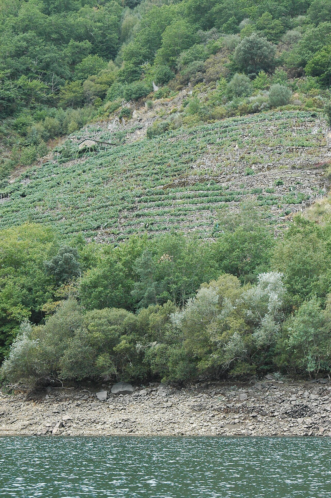

# Albariño

Albariño is the white grape of Spain's Atlantic northwest and the same variety that Portugal calls Alvarinho. It grows in the wet, cool corner of Galicia and northern Portugal, where thick skins and high acidity help it survive rain and humidity. The wines typically smell of lemon, green apple, white flowers and wet stone, with a saline note on the finish. Unlike many white grapes that rely on fruit alone, Albariño is valued for the interplay of acidity, aroma and texture; it can be crisp and young or, with lees contact and careful ageing, deeper and more complex (ref:wine).

Figure: Albariño. Photograph: Albarino Vineyards. Credit: chicadelatele, CC BY 2.0, via Wikimedia Commons ([source](https://commons.wikimedia.org/w/index.php?curid=4106753)).

> **Quick verdict**
> **In one line:** This variety helps you decide whether Albariño suits you, and compare it with other varieties.
>
> - **Best for:** Anyone comparing Albariño with other varieties and trying to pin down the flavour difference.
> - **Not for:** If you want only want a famous producer recommendation and do not care about the variety itself.
> - **Check first:**
>   - Albariño belongs to the European grape Vitis vinifera and is a white variety.
>   - Albariño is native to the northwest of the Iberian Peninsula, in what is now Galicia in Spain and the Minho region of Portugal.

## Definition and synonyms

Albariño belongs to the European grape Vitis vinifera and is a white variety. Spanish sources spell it Albariño, Portuguese sources Alvarinho, and both refer to the same grape; the Chinese name is a phonetic rendering of the Spanish form. It is often mistaken for Riesling, but DNA research has ruled out a close relationship, and the two differ in aroma, acidity and viticultural needs. On a label, "Albariño" is the variety, while Rías Baixas or Vinho Verde is the region. Keeping the two apart helps avoid confusing varietal character with regional style (ref:white-wine).

## Parentage and origin

Albariño is native to the northwest of the Iberian Peninsula, in what is now Galicia in Spain and the Minho region of Portugal. The story that monks brought it from the Rhine is widely repeated but poorly supported, and the supposed Riesling link has been rejected by genetic research. DNA analysis points to a close relationship with the Caíño family of Galicia, and one study treats Caíño Blanco as an offspring of Albariño and Caíño Bravo; the exact parentage is still discussed. The grape has been grown locally for centuries and is well adapted to high rainfall and granite soils. After phylloxera in the late 19th century, growers replanted with grafted vines; the creation of the Rías Baixas appellation in the late 20th century turned a local wine into an international variety.

## Botanical characteristics

Albariño has small berries, thick skins and relatively loose clusters, traits that help it resist grey rot in a wet coastal climate. The thick skins also contribute phenolics, giving the wine a slight grip and bitterness alongside its acidity. Sugar accumulation is moderate and acidity falls slowly, so the fruit retains fresh malic and tartaric acidity at ripeness. Aromatically, the grape contains terpenes and thiols that read as citrus, white flowers and stone fruit. Clone and vintage strongly affect aroma intensity; overripe fruit can turn to banana and melon and lose the acidity and sea-air character that define the variety (ref:acidity).

## Viticultural characteristics

The main difficulties in growing Albariño come from water and disease. Galicia receives high rainfall, so vineyards need good drainage and airflow; the traditional pergola, or parral, lifts the canopy and fruit away from damp ground and increases leaf area. The variety does well on granite, sand and alluvial soils, and deep roots help it cope with summer dry spells. It buds early, so spring frost is a risk, and it ripens in the middle of the season, when autumn rain can interrupt the harvest. Growers must pick quickly to balance acidity, aroma and sugar. Crop control matters: high yields give thin, dilute wine, while low yields and old vines give more concentrated fruit and a longer finish.

## Regional distribution

Rías Baixas in Galicia is the core region for Albariño (ref:spain). It is divided into five sub-zones: Val do Salnés, O Rosal, Condado do Tea, Soutomaior and Ribeira do Ulla. Val do Salnés, closest to the Atlantic, gives saline, bright wines; O Rosal, near the Minho river, often blends Albariño with Loureiro and Treixadura for a softer aroma; Condado do Tea, further inland, gives riper fruit. The Vinho Verde region of northern Portugal is the other core (ref:vinho-verde), and Monção e Melgaço is the best-known source of varietal Alvarinho. Other Spanish regions, California, Australia, New Zealand, Uruguay and Brazil also grow the grape, usually in a fruitier style.

## Legal rules

Rías Baixas received its Denominación de Origen status in 1988. The rules require white wines to contain at least 70% Albariño, and a wine labelled "Albariño" normally must be 100% of the variety; individual sub-zones and wine styles have their own rules on yields, alcohol and ageing. The Vinho Verde region also regulates Alvarinho, and Monção e Melgaço may label the variety provided the wine meets the required proportions and alcohol levels. Both countries prohibit passing off other varieties as Albariño, and the latest regulations should be consulted. For consumers, the regional names Rías Baixas and Vinho Verde often say more about style than the variety name alone.

## Winemaking

The mainstream approach to Albariño is cool fermentation in stainless steel to preserve citrus, white flower and thiol aromas. After fermentation, a short period on the lees adds roundness and a bread-like note, but malolactic fermentation is usually avoided in order to keep the acidity high. Some producers use old oak, large barrels or concrete eggs for more texture and oxidative complexity, and a few use brief skin contact to extract aroma and a little tannin. Residual sugar is usually low and the style is dry. Albariño can also be made into sparkling wine or blended with Loureiro and Treixadura. In every case, the aim is to protect acidity and aroma rather than mask the variety with oak.

## Sensory profile

Young Albariño shows lemon, lime, grapefruit, green apple, peach, apricot, honeysuckle and orange blossom, often with wet stone, sea salt and white pepper. The body is medium, the acidity high and the alcohol usually 12% to 13%, with a lightly bitter, saline finish. Lees contact adds cream, bread and nuts, while old oak broadens the texture without obvious vanilla. It pairs well with seafood, shellfish, salads and light fish dishes. Most Albariño is best within a few years of bottling, while well-structured examples can age longer and develop honey, dried fruit and mineral notes.

## Representative producers and vintages

Spanish producers include Pazo de Señoráns, Martín Códax, Fillaboa, Terras Gauda, Mar de Frades and Granbazán. Pazo de Señoráns is known for precise lees work and ageing potential, Martín Códax played a key role in internationalising the variety, and Terras Gauda's O Rosal blend shows how Albariño works with other local grapes. In Portugal, Soalheiro and Anselmo Mendes are leading Alvarinho producers, the former emphasising the acidity and minerality of Monção e Melgaço. Vintage differences come mainly from rain and temperature at harvest: cool years give higher acidity and tighter aromas, warm years give riper fruit and slightly more alcohol, while sub-zone and picking decisions still matter most.

## Common misconceptions

First, that Albariño is Riesling; no close parentage has been confirmed, and the two differ in aroma and acidity. Second, that Albariño is always sweet; most examples are dry, and the slight spritz or residual sugar of some Vinho Verde is a regional style, not a variety requirement. Third, that Albariño and Alvarinho are different grapes; they are the Spanish and Portuguese names for one variety. Fourth, that Albariño comes only from Spain; Vinho Verde in Portugal is equally important. Fifth, that Vinho Verde is a grape; it is a region that may contain several white varieties. Sixth, that Albariño must be drunk young; good wines can gain complexity from lees contact and bottle age.

## Further reading

- [Wine](ref:wine): where white wine sits in the wider category.
- [White wine](ref:white-wine): the drink style to which Albariño belongs.
- [Spain](ref:spain): the regional framework that includes Rías Baixas.
- [Vinho Verde](ref:vinho-verde): the Portuguese home of Alvarinho.
- [Acidity](ref:acidity): the measure that defines Albariño's fresh style.
