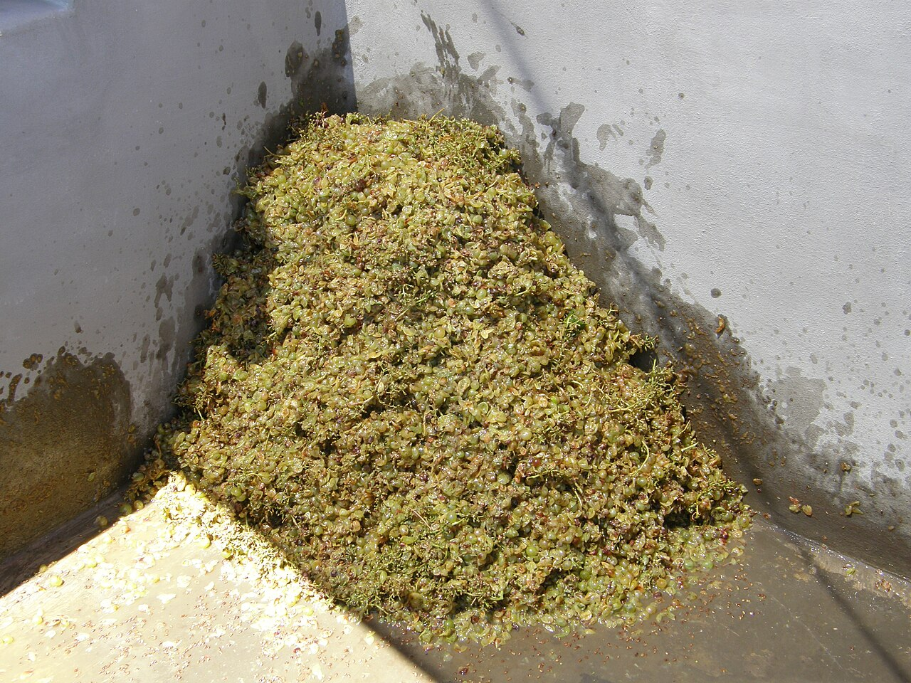

# Assyrtiko

Assyrtiko is the signature white grape of Santorini, and one of the few varieties that can hold both high acidity and real concentration under fierce sun, strong wind and poor volcanic soil. Its wines are usually dry, medium to full in body, and scented with lemon, green apple, flint and sea salt. On Santorini the grape is tied to a distinctive basket training system, to sandy volcanic ground and to very old ungrafted vines. Over the past two decades it has moved from a local Greek speciality to a white grape that the international market takes seriously — a rare case of high acid and ripeness arriving together (ref:white-wine).

Figure: Assyrtiko. Photograph: File:White wine grape pressing in Santorini.jpg. Credit: Klearchos Kapoutsis, CC BY 2.0 ([source page](https://commons.wikimedia.org/wiki/File:White_wine_grape_pressing_in_Santorini.jpg)). Category image; not a claim that it shows the exact product, site or event.

> **Quick verdict**
> **In one line:** This variety helps you decide whether Assyrtiko suits you, and compare it with other varieties.
>
> - **Best for:** Anyone comparing Assyrtiko with other varieties and trying to pin down the flavour difference.
> - **Not for:** If you want only want a famous producer recommendation and do not care about the variety itself.
> - **Check first:**
>   - The variety is Assyrtiko.
>   - The parents of Assyrtiko have not been established.

## Definition and synonyms

The variety is Assyrtiko. Chinese sources transliterate it in several ways, but the wine label almost always carries the Latin name. It belongs to Vitis vinifera and is native to Greece. Santorini preserves a number of biotypes with slight differences in berry size and ripening speed, yet they are the same variety. On a label, "Santorini" is a place, "Nykteri" is a traditional style and "Vinsanto" is a sweet wine; none of them is a synonym for the grape. Nor should Assyrtiko be confused with Athiri and Aidani, the other white grapes of the island, which have lower acidity and softer aromatics and mainly add fruit and volume to blends.

## Parentage and origin

The parents of Assyrtiko have not been established. DNA work places it within the old variety group of the Cyclades rather than among modern crosses; studies have looked at its relationship with other Greek whites but no accepted parent pair has emerged. Its history is bound up with the island's volcanoes. The Minoan eruption around 1600 BC buried Santorini in ash, and viticulture was re-established on pumice and ash afterwards. During the Venetian and Ottoman periods the island's sweet wine was shipped across the Mediterranean, and the name Vinsanto is often explained as a contraction of the Italian vino santo, "holy wine". In the 19th century Santorini wine also reached Russia and the eastern Mediterranean.

## Botanical character

Bunches are medium and fairly loose. Berries are small to medium, round, and turn from yellow-green to gold at ripeness; the skins are thicker than in most white varieties and the pulp is juicy. Leaves are medium, five-lobed, with pronounced teeth. Acidity falls slowly late in ripening while sugar accumulates only moderately, which is how the grape keeps a pH near 3.0 on a hot island (ref:acidity). The thicker skins carry more phenolics, so even a short maceration can produce an orange wine with a little tannin and a tea-like feel. Assyrtiko also ripens late, normally after the island's other whites, which means it needs a long, stable autumn.

## Viticultural behaviour

The vine is vigorous with deep roots, tolerant of drought and wind, and able to crop on ground with almost no organic matter. Cold is not the main risk; drought, wind and autumn rain are. The traditional Santorini training is the kouloura, a low basket of coiled canes with the fruit hidden inside, which shields it from wind and limits evaporation and sunburn. Because the island's soil is sandy volcanic material and the island is isolated, phylloxera never took hold, and many old vines grow on their own roots — unusual in Europe. Irrigation is almost unknown: the vines live on night mist and dew, yields are naturally low, and that is part of the wine's concentration. Younger mainland vineyards crop far more heavily and need firmer control.

## The volcanic soils of Santorini

Santorini's ground is pumice, ash and lava fragments, ranging from grey-white to black, draining very fast and holding few nutrients. Locals call the white pumice soil aspra and distinguish parcels with black volcanic sand. Such soil is often said to give flint, smoke and salt to the wine, but more precisely it is the combination of low nutrients, fast drainage and sea wind that produces tight, low-yielding, high-acid fruit; "minerality" is a sensory description, not a chemical finding about soil entering the wine (ref:terroir). The caldera cliffs in the west and the plains in the east also differ in sun and wind, so growers vinify parcels separately before deciding on a blend.

## Distribution beyond Santorini

Outside Santorini, Assyrtiko has spread quickly on the Greek mainland: Halkidiki, Attica, Thessaly, Drama and Crete all have plantings, and the Peloponnese has experimental plots. Warmer mainland sites and more varied soils usually give fuller wines with slightly lower acidity and scents of yellow peach and citrus. Abroad, the best-known plantings are in Australia's Clare Valley and Margaret River, with small trials in California, South Africa and New Zealand. Everywhere the same rule applies: Assyrtiko needs plenty of light and careful water management, or it loses its acid frame, and once acidity drops its neutral side shows through.

## Legal rules

The dry whites of Santorini fall under the PDO Santorini, based on Assyrtiko with small amounts of Athiri and Aidani permitted; exact proportions follow the current rules. Vinsanto PDO uses grapes dried in the sun, mainly Assyrtiko with Aidani and Athiri, and ages for several years in oak, giving a sweet wine with unusually high acidity — the point that separates it from most dessert wines. Nykteri is a traditional Santorini style name, historically a dry white picked at night, pressed immediately and fermented in oak, with higher alcohol and often oak and ripe fruit on the nose. Other Greek regions may label Assyrtiko as a PGI or a local wine under looser rules, so the origin on the label matters.

## Winemaking and fermentation

The guiding principle is to preserve acidity. Most dry whites are fermented cool in stainless steel, usually between 15 and 18 °C, to keep citrus and floral notes (ref:fermentation). Whether malolactic fermentation happens depends on the style: producers who want freshness avoid it, while those after texture may allow it in part. Lees stirring adds roundness and a saline edge. Oak is mostly reserved for Nykteri and some premium dry whites, and the proportion of new wood is usually restrained so the variety is not buried. Orange styles extend skin contact from days to weeks, giving an amber colour and tannic grip. Vinsanto dries the grapes in the sun for ten days or more, ferments the concentrated juice slowly and matures it for years in old casks.

## Sensory style

Young Assyrtiko is built on lemon, lime, grapefruit, green apple, unripe white peach and white flowers, followed by flint, wet stone, smoke and sea salt. On the palate acidity is high and linear, the body medium to full, alcohol usually 12.5% to 14%, and the finish saline with a hint of bitter almond. Santorini wines are notably denser than young mainland plantings because of low yields and old vines. After five to ten years, beeswax, honey, dried herbs and nuts appear while acidity still holds the structure. Nykteri is fuller and rounder, with more oak and alcohol, and often needs air when young.

## At the table

High acidity and a saline streak suit seafood: oysters, sea urchin, grilled fish, fried small fish, and dishes dressed with lemon and olive oil, as well as sheep's milk cheese and tomato starters. Serve dry versions at 8 to 10 °C, Nykteri a little warmer. The acidity stands up to oil and frying, but sweet sauces clash with it. Vinsanto works with nuts, blue cheese or on its own as a small, well-chilled glass after dinner.

## Producers and vintages

Santorini producers include Santo Wines, a cooperative, Domaine Sigalas, Hatzidakis, Argyros, Gaia with its Thalassitis, Venetsanos and Vassaltis; in Australia, Jim Barry is one of the names that carried Assyrtiko beyond Greece. Vintage variation comes mainly from rain and wind: dry springs and hot summers give denser, stronger wines, while wet autumns demand strict selection. Santorini's output is small against demand, so prices usually sit above mainland Assyrtiko, but price alone is a poor guide; site and ageing matter more.

## Common misconceptions

First, that Assyrtiko is always sweet; Vinsanto is one branch, and dry white is the mainstream. Second, that it comes only from Santorini; mainland Greece and Australia now have real plantings. Third, that high acidity means unripeness; it is the variety's signature and the basis of its food affinity. Fourth, that volcanic soil automatically equals "minerality"; the terroir effect is real, but the tasting note is not a chemical proof. Fifth, that the wine cannot age; good Santorini whites keep for more than a decade. Sixth, treating Nykteri or Vinsanto as grape names.

## Further reading

- [Wine](ref:wine): the broad category to which Assyrtiko belongs.
- [White wine](ref:white-wine): the main style made from the grape.
- [Acidity](ref:acidity): the structural key to Assyrtiko.
- [Terroir](ref:terroir): the framework for discussing Santorini's soil and sea wind.
- [Fermentation](ref:fermentation): the process behind its dry and sweet styles.
