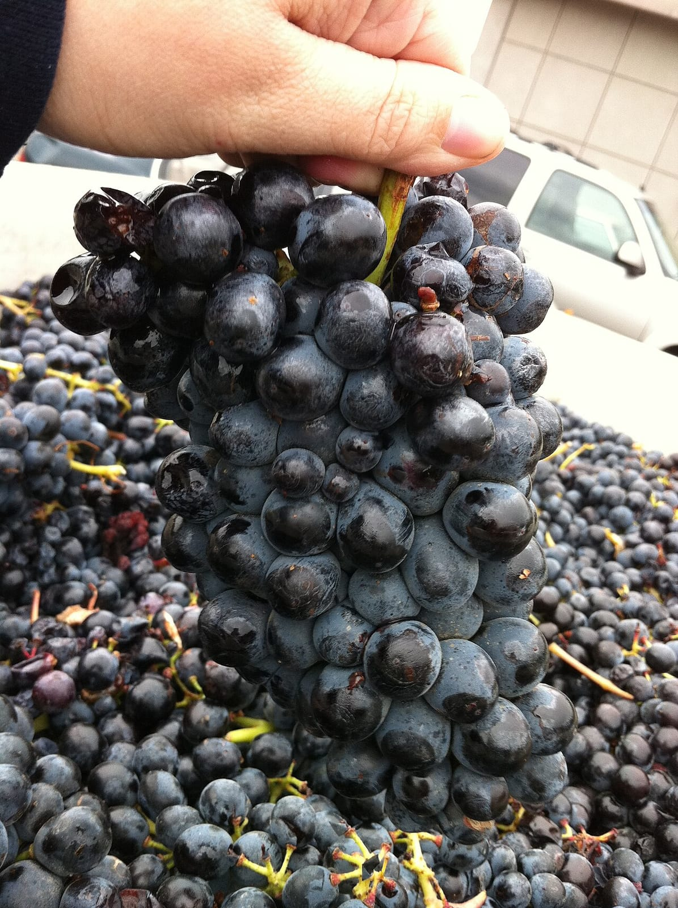

# Barbera

Barbera is one of Piedmont's most important red grapes. Its profile is clear: deep colour, high acidity and medium tannin, giving structure without astringency. In Piedmont it often appears alongside Nebbiolo, Barbera supplying everyday fruit and acidity, Nebbiolo stronger tannin and ageing potential. It is also one of the few red grapes that keeps acidity in hot years, which has brought it renewed attention under climate change.

Figure: Barbera. Image: Agne27, CC BY-SA 3.0, via Wikimedia Commons ([source page](https://commons.wikimedia.org/wiki/File:Barbera_cluster.JPG)).

## Definition and synonyms

The name is Barbera. It belongs to the European grape Vitis vinifera. Common legal names include Barbera d'Asti, Barbera del Monferrato and Barbera d'Alba; these are appellations, not different varieties. Labels usually state the variety directly, and some add "Superiore" for longer ageing and a higher minimum alcohol. Calling Barbera a "cheap Nebbiolo" is inaccurate: the two differ clearly in acidity, tannin and ripening rhythm.

## Parentage and origin

The parents of Barbera are not established. Research has long placed its origin in Piedmont, with records going back at least to the 17th century; some accounts link it to Spanish varieties, but genetic evidence is insufficient. What is certain is that it was long grown around Monferrato and the Langhe as a blending and everyday grape, and only from the late 19th century was it increasingly bottled as a single variety. The name may come from an Italian word for a sharp, acidic drink, matching its high acidity.

## Botanical character

Bunches are medium, berries large, skins deep in colour and medium in thickness. The dark skins give good colour and anthocyanins, while medium thickness keeps tannin from becoming too strong. It buds early and ripens in the middle of the season, between Dolcetto and Nebbiolo. Berries are juicy with moderate sugar and slow acid loss, its most important viticultural advantage. Against Nebbiolo, its skins are thicker, its tannin softer and its ripening more even.

## Viticultural behaviour

Barbera is vigorous and high-yielding, adaptable to soil and climate, tolerant of heat and drought, and able to crop steadily on poor slopes. It buds early, so spring frost is the main risk; thicker skins give some tolerance to grey rot. High yield cuts both ways: without crop control the wine can taste dilute with sharp acidity, while lower yields clearly improve colour and concentration. Old-vine Barbera in Piedmont is mostly on slopes, with deep roots and more even ripening.

## Distribution in Piedmont

Barbera is planted across Piedmont but concentrated in three areas. Asti and Monferrato are the core, on limestone, clay and sandstone, giving fuller body and brighter acidity; Alba and the Langhe give more elegant Barbera, often interplanted with Nebbiolo parcels. Alessandria and Cuneo also have plantings. Outside Piedmont there is some in Lombardy, Emilia-Romagna and Sardinia, and experimental planting in the New World.

## Legal tiers and rules

Barbera has three main appellations in Piedmont. Barbera d'Asti became a DOCG in 2008, requiring at least 90% Barbera with a little local red permitted; Barbera d'Alba is a DOC requiring at least 85% Barbera; Barbera del Monferrato is also a DOC, usually more everyday in style. "Superiore" normally requires lower yields, higher minimum alcohol and longer ageing. Exact parameters follow the latest rules for each appellation, and vintage and producer often say more about style than the tier.

## Winemaking and acidity

Barbera's high acidity comes from high malic acid and slow acid loss. Traditionally it was given a short maceration and cool fermentation to keep fruit and colour, followed by malolactic fermentation in stainless steel to soften the edge. Modern quality wines may extend maceration and use small oak for tannin and spice, but too much oak masks acidity and fruit. Typical total acidity is 8 to 10 g/l with pH often 3.2 to 3.4, making it fresher than many reds from warm regions.

## Sensory style

Young Barbera shows sour cherry, blackberry, plum, violet and white pepper, with high acidity, medium tannin and a medium to full body. Oak-aged versions add vanilla, cocoa, tobacco and liquorice and feel rounder; unoaked versions are more direct and food-friendly. Its colour is deep but its tannin modest, so it works with tomato sauce, roast meat and hard cheese as well as on its own when young. Ageing potential is medium, and good single vineyards can keep for more than a decade.

## The difference from Nebbiolo

The two are often compared. Nebbiolo is paler, extremely tannic and high in acid, with rose, tar and red fruit, and needs long ageing; Barbera is deeper in colour, softer in tannin but equally high in acid, with sour cherry and blackberry, and is ready earlier. Nebbiolo is more demanding of site and vintage, while Barbera is steadier and higher-yielding. Treating Barbera as a substitute for Nebbiolo underrates its own value at the table and as an everyday wine.

## Producers and vintages

Piedmont producers include Giacomo Conterno, Vietti, Braida, Coppo, Paolo Scavino and Michele Chiarlo. Braida's Bricco dell'Uccellone is often seen as the flagbearer of modern oaked Barbera, while Conterno and Vietti stress single sites and ageing potential. Vintage differences come mainly from summer heat and harvest rain: hot years keep acidity but raise alcohol, cool years are fresher with slightly lighter colour. In the market, Barbera has long been one of Piedmont's best-value reds.

## Common misconceptions

First, that Barbera is only an everyday wine; good single vineyards can age. Second, treating high acidity as a fault; it is the base of food pairing and freshness. Third, assuming deep colour means heavy tannin; Barbera has plenty of pigment but softer tannin. Fourth, treating Barbera d'Asti and Barbera d'Alba as the same area; sites and rules differ. Fifth, thinking all Barbera sees oak; the traditional style stresses fruit and acidity. Sixth, confusing Barbera with Nebbiolo; the varieties and their ageing logic differ.

**At a glance:** A red grape of Piedmont in Italy with high acidity, medium tannin and deep colour, heat-tolerant and steady in yield, often contrasted with Nebbiolo as high acid against high tannin. Barbera d'Asti became a DOCG in 2008 with a minimum of 90% Barbera.

**Key facts.**

| Item | Detail |
| --- | --- |
| In one line | A red grape of Piedmont in Italy with high acidity, medium tannin and deep colour, heat-tolerant and steady in yield, often contrasted with Nebbiolo as high acid against high tannin. Barbera d'Asti became a DOCG in 2008 … |
| Species | Vitis vinifera |
| Key regions | Italy、Piedmont |

**Sources and limits.** The key claims about Barbera are checked against the following sources: International Organisation of Vine and Wine (OIV) (Used to check the variety description and the Vitis species framework), Oxford University Press (Consulted for entries on Barbera, Piedmont and acidity; Migrated from the former reference list at the end of the article; access date not re-verified), Regione Piemonte (Used to check the Piedmont wine area and the legal names for Barbera). Prices, batches and status change; the body is project-written and does not reproduce source text.

## Further reading

- [Wine](ref:wine): the overall classification of wine.
- [Red wine](ref:red-wine): the drink style to which Barbera belongs.
- [Piedmont](ref:piedmont): the core region for Barbera.
- [Italy](ref:italy): the regional and legal framework of Italian wine.
- [Nebbiolo](ref:nebbiolo): the variety often contrasted with Barbera.

## Related images

Image: Piedmont vineyard in autumn. Credit: Giorgio Montersino, CC BY-SA 2.0, via Wikimedia Commons.. Credit: Giorgio Montersino, CC BY-SA 2.0, via Wikimedia Commons ([source page](https://commons.wikimedia.org/w/index.php?curid=5816942)). Related image for Barbera.
