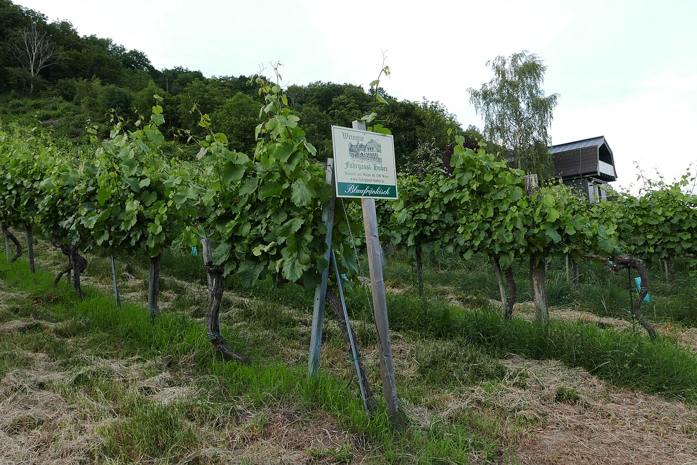

# Blaufränkisch

A red grape of Burgenland, Austria, also called Kékfrankos in Hungary and Frankovka in Czechia; deep in colour with black cherry, pepper and spice, high acidity, medium-high tannin and good ageing potential.

In the “Hejiu” variety index, Blaufränkisch is both a recognisable name and a set of comparable viticultural and winemaking choices. Read it first through its ripening rhythm, acid frame and tannin direction at home, then through what survives or fades when it travels. The gap between Old and New World versions often explains more than the label. For the reader, the point is not a fixed flavour tag but how climate, soil and winemaking decisions turn the same grape into a different wine. This also explains why the same name carries different descriptions across sources: one stresses botany, another market style, another a single region’s rules.

Figure: Blaufränkisch: Ried Neuberg Blaufränkisch (Wikimedia Commons). Image: Geolina163, CC BY-SA 4.0, via Wikimedia Commons ([source page](https://commons.wikimedia.org/wiki/File:Ried_Neuberg_Blaufr%C3%A4nkisch.jpg)).

## Definition and naming

Blaufränkisch comes from Central Europe; the name may combine “blue” and “Frank”, and it is widely planted in Burgenland, Hungary, Czechia and Slovakia.

Blaufränkisch is a vines variety or raw material with a definable botanical origin and cultivation history. The name may come from a place, a shape, a farming habit or a promoter; synonyms and homonyms are common, so check the scientific name or classification first.

## Origin and spread

Burgenland is the core, with Mittelburgenland, Leithaberg and Eisenberg differing in style; Hungarian Kékfrankos is common in Egri Bikavér blends.

The origin of Blaufränkisch can usually be traced to a mountain, valley or coast, then spread through trade, migration and replanting after disease. Spread is not copying: in each new environment growers select different clones, rootstocks and pruning.

Blaufränkisch is a Central European grape with an unresolved parentage and several local names: Kékfrankos in Hungary, Frankovka in Czechia and Slovakia, Modri Frank in Croatia. It was already planted in Burgenland, Lower Austria and western Hungary by the eighteenth century, and spread through German-speaking settlement, trade and monastic estates rather than a single migration.

## Botany and cultivation

Berries are medium, thick-skinned and late-ripening, with high acidity and medium-high tannin; ripe fruit shows black cherry, blackberry, pepper, liquorice and violet.

The performance of Blaufränkisch depends on budbreak, ripening, vigour, yield and disease resistance. Early varieties carry less risk in cool regions, late varieties need a long autumn; excessive vigour shades fruit, while weak vines crop poorly.

The vine ripens late and carries thick skins, so it needs a long, warm autumn and careful canopy management. Mittelburgenland’s clay retains warmth and gives fuller fruit; Leithaberg’s limestone produces tighter, more mineral wines; Eisenberg’s schist and cooler sites keep acidity and red-fruit lift. High yields dilute pepper and tannin.

## Style and palate

Traditional large-oak ageing gives a tighter, more mineral style; modernists use new oak and later picking for more richness.

The style of Blaufränkisch is defined by acidity, tannin or bitterness, alcohol, aroma and texture. It can be made alone or as part of a blend; in a blend it may supply colour, acidity, aroma or structure rather than the dominant flavour.

Traditional producers ferment partly whole-cluster and age in large old oak, preserving acidity and pepper; modernists use riper fruit, some new oak and longer maceration for a fuller frame. Whole-cluster stems add herbal spice, while destemming gives cleaner fruit. Neither route removes the grape’s high acidity.

## Main regions and representative wines

Representative wines include Moric, Weninger, Prieler, Heinrich and Esterházy; Leithaberg and Eisenberg are terroir benchmarks in Austria.

To find representative Blaufränkisch, start with the place of origin or the most typical region, then compare a New World example. Keep alcohol, sweetness and vintage as close as possible, or you will mistake technique for variety.

Mittelburgenland is the fullest and most clay-driven; Leithaberg is limestone-fresh and structured; Eisenberg is cooler and more red-fruited. In Hungary, Kékfrankos anchors Egri Bikavér and Szekszárd blends; in Czechia, Frankovka is often lighter and higher in acid. Moric, Weninger, Prieler, Heinrich and Esterházy are useful reference producers.

## How to drink and pair

To drink Blaufränkisch, confirm sweetness and alcohol first, then choose temperature and food. Dry high-acid styles suit fat, seafood and salt; sweet styles suit spice, blue cheese and fruit desserts; high alcohol clashes with sweet or very spicy dishes.

Serve at 14–16°C in a medium-bowled Burgundy glass, decanting young wines for 30–60 minutes and older bottles only briefly. Roast pork, beef stew, paprika dishes, game and hard cheese suit the acidity and moderate tannin; delicate seafood and sweet sauces do not. Drink within two or three days of opening.

## Buying and common misreadings

Start with where it is grown. From there, consider how it is labelled, then whether the style is dry or sweet. That is how a practical judgment about Blaufränkisch is built.

### Key dates and figures

- 1921: after Burgenland passed to Austria, Blaufränkisch became the region’s red mainstay.
- 1980s: from the 1980s, Moric and Weninger re-emphasised old vines and low yields.

## Further reading and see also

To study Blaufränkisch, read botanical and viticultural sources first, then taste three wines from different regions side by side. Do not buy many bottles of one style; build a benchmark, then move to blends, sweet or aged versions.

Compare an Austrian Blaufränkisch, a Hungarian Kékfrankos and a Czech Frankovka at similar alcohol and vintage. Then place Blaufränkisch beside Cabernet Franc to separate pepper-and-acid lift from leafy, denser tannin. Fix vintage and serving temperature so the country, not the bottle, explains the difference.

- Related: [red-wine](ref:red), [oak-ageing](ref:oak), [terroir](ref:terroir), [vintage](ref:vintage), [cabernet-sauvignon](ref:cabernet).
- This page offers no plant identification, prices or shopping channels; a label name is not a botanical identification.

**In brief:** A red grape of Burgenland, Austria, also called Kékfrankos in Hungary and Frankovka in Czechia; deep in colour with black cherry, pepper and spice, high acidity, medium-high tannin and good ageing potential.

[Red wine](ref:red) explains variety character; [Terroir](ref:terroir) adds regional performance. Put Blaufränkisch between them before deciding what it is.

Blaufränkisch is the leading red grape of Burgenland, where it appears as Blaufränkisch in Austria, Kékfrankos in Hungary and Frankovka in Czechia. The best sites are on the Leithaberg and Eisenberg hills, where limestone and schist give a firmer, more mineral wine than the warm plains. It ripens late and keeps high acidity, so it responds well to whole-cluster fermentation and long maceration; oak is used sparingly because the grape already has enough structure. In Hungary, Kékfrankos is the base of Egri Bikavér blends and a common varietal wine in Szekszárd. A bottle labelled Blaufränkisch may come from any of these countries, so the origin and the producer's style matter more than the synonym on the front label.
