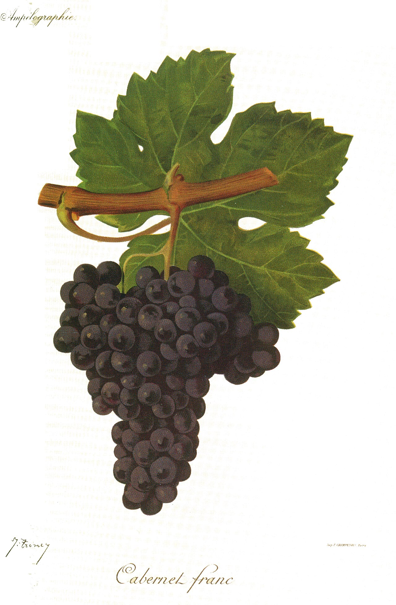

# Cabernet Franc

Cabernet Franc is a red grape variety from [Bordeaux](ref:bordeaux) and the Loire Valley in France, with thinner skins than Cabernet Sauvignon and earlier ripening, moderate tannin and expressive aroma, known for raspberry, violet, graphite and green pepper notes. It is one of the parents of Cabernet Sauvignon and is used both as a varietal wine and in blends on Bordeaux's Right Bank and in the Loire.

Figure: Cabernet Franc. Image: Viala et Vermorel, Public domain, via Wikimedia Commons ([source page](https://commons.wikimedia.org/wiki/File:Cabernet-franc.jpg)).

## Definition and synonyms

The French name of the variety is Cabernet Franc. It is a separate variety from [Cabernet Sauvignon](ref:cabernet-sauvignon), which arose as a natural cross of Cabernet Franc and Sauvignon Blanc; the two therefore share some aroma, but differ in ripening, tannin and body.

On Bordeaux's Right Bank Cabernet Franc is often called Bouchet, and in parts of the Loire it is called Breton. These names refer to the same variety, not different ones, and the official variety lists and appellation rules govern usage. Chinese wine literature uses several transliterations for this variety; they all mean Cabernet Franc.

## Botanical characteristics

Cabernet Franc has medium bunches and relatively small berries, with thinner skins than Cabernet Sauvignon and slightly lower colour and tannin potential. It buds and ripens early, reaching ripeness more easily than Cabernet Sauvignon in cool regions, which is why it plays the role of a reliable ripening variety on the Right Bank and in the Loire.

Thinner skins make it more sensitive to grey rot and leave a shorter picking window. Pyrazines in the aroma read as green pepper when the fruit is under-ripe and turn into raspberry, violet and graphite when ripe, so the ripeness decision directly sets the style.

## Main regions

Core regions include Bordeaux's Right Bank (Saint-Émilion and Pomerol) and the Loire Valley (Chinon, Bourgueil, Saumur-Champigny) in [France](ref:france). In Bordeaux it is often blended with Merlot, adding aroma and structure; in the Loire it is often a varietal wine, fresher and more herbal and mineral.

Italy, Hungary, the United States and South America also plant it, mostly for blends or locally styled varietal wines. Styles vary widely: cool regions give more herbal, higher-acid wines, while warm regions give more fruit and body. Region pages describe geography and rules; this variety describes the variety's potential only.

## Typical flavours

Typical aromas are raspberry, red cherry, violet, graphite and green pepper, with green pepper and herbs clear when ripeness is short. The palate has medium-plus acidity, medium tannin of fairly fine texture, a medium body and a finish of mineral and spice. With age it develops tobacco, leather and dried flowers.

Compared with Cabernet Sauvignon, Cabernet Franc is usually lighter, more aromatic and finer in tannin. Quality turns on ripeness and aroma purity: too much green pepper means under-ripeness, while over-ripe fruit loses the variety's freshness.

## Representative wines

[Cheval Blanc](ref:cheval-blanc) is one of the best-known expressions of Cabernet Franc, a blend built on Cabernet Franc and Merlot that shows the variety's depth and ageing potential on the Right Bank. Chinon and Bourgueil in the Loire are known for varietal wines with a high share of Cabernet Franc and a fresher style.

The same variety differs clearly between Bordeaux and the Loire: the former relies on clay and blending for structure and suppleness, the latter on a cool climate and varietal wine to highlight aroma and acidity. This variety describes potential; wine pages record the blending ratios and winemaking of individual estates.

## Viticulture

The difficulty with Cabernet Franc is ripeness control and disease management. It ripens early and suits cool regions, but thin skins make it more sensitive to grey rot; in wet years the picking window can be short, requiring a trade-off between sugar, acidity and fruit health.

High yields dilute aroma and increase green pepper; yield control and canopy management improve ripeness. Specific parameters vary by region and estate, and this variety gives no universal figures; appellation rules and estate information govern.

## Common misconceptions

First, treating Cabernet Franc as another name for Cabernet Sauvignon. They are separate varieties with a parent-offspring link.
Second, believing Cabernet Franc is only for blending. The Loire has many varietal wines.
Third, treating green pepper as a variety defect. Some is characteristic, and only excess signals under-ripeness.
Fourth, believing Cabernet Franc cannot age. Good Right Bank blends and Loire varietal wines both age.
Fifth, judging ripeness by colour depth. Pigment and ripeness are not the same thing.

Cabernet Franc ripens earlier than Cabernet Sauvignon, with thinner skins and a more aromatic, less massive profile. Raspberry, violet, graphite and green pepper are common, and the tannin is moderate rather than dense. It is one of Cabernet Sauvignon’s parents and is used alone in parts of the Loire and right-bank Bordeaux. It is not simply a lighter clone of Cabernet Sauvignon; the ripening window and structure are different.

To read Cabernet Franc, start with where it is grown, then how it is labelled, then whether the style is dry or sweet; no single check settles it.

[Red wine](ref:red-wine) explains variety character; [Bordeaux](ref:bordeaux) adds regional performance. Put Cabernet Franc between them before deciding what it is.

**Short definition:** A red grape variety from Bordeaux and the Loire Valley in France, with thinner skins than Cabernet Sauvignon and earlier ripening, moderate tannin and expressive aroma, known for raspberry, violet, graphite and green pepper notes. It is one of the parents of Cabernet Sauvignon and is used both as a varietal wine and in blends on Bordeaux's Right Bank and in the Loire.

A frequent error is to treat Cabernet Franc as the name of a wine. Establish what it is, then how the variety is labelled. Neither answer settles the question alone.

**Key facts.**

| Item | Detail |
| --- | --- |
| In one line | A red grape variety from Bordeaux and the Loire Valley in France, with thinner skins than Cabernet Sauvignon and earlier ripening, moderate tannin and expressive aroma, known for raspberry, violet, graphite and green pep… |
| Species | Vitis vinifera |
| Key regions | France、Bordeaux |

**Sources and limits.** The key claims about Cabernet Franc are checked against the following sources: International Organisation of Vine and Wine (OIV) (Used to check the variety description and the Vitis species framework), CIVB (Used to check planting and blending roles on Bordeaux's Right Bank), Oxford University Press (Consulted for entries on Cabernet Franc, Bouchet, Breton and the parentage of Cabernet Sauvignon; Migrated from the former reference list at the end of the article; access date not re-verified). Prices, batches and status change; the body is project-written and does not reproduce source text.

## Further reading

- [Red wine](ref:red-wine): the wider category to which Cabernet Franc belongs.
- [Cabernet Sauvignon](ref:cabernet-sauvignon): the variety descended in part from Cabernet Franc.
- [Cheval Blanc](ref:cheval-blanc): a Right Bank estate built on Cabernet Franc.
- [Bordeaux](ref:bordeaux): Cabernet Franc's role in Right Bank blends.
- [France](ref:france): French wine law and appellations.

## Related images

Image: Related photograph of Château Cheval Blanc. Credit: Benjamin Zingg, Switzerland, CC BY-SA 2.5, via Wikimedia Commons ([source page](https://commons.wikimedia.org/wiki/File:Ch%C3%A2teau_Cheval-Blanc.jpg)). Related image for Cabernet Franc.
