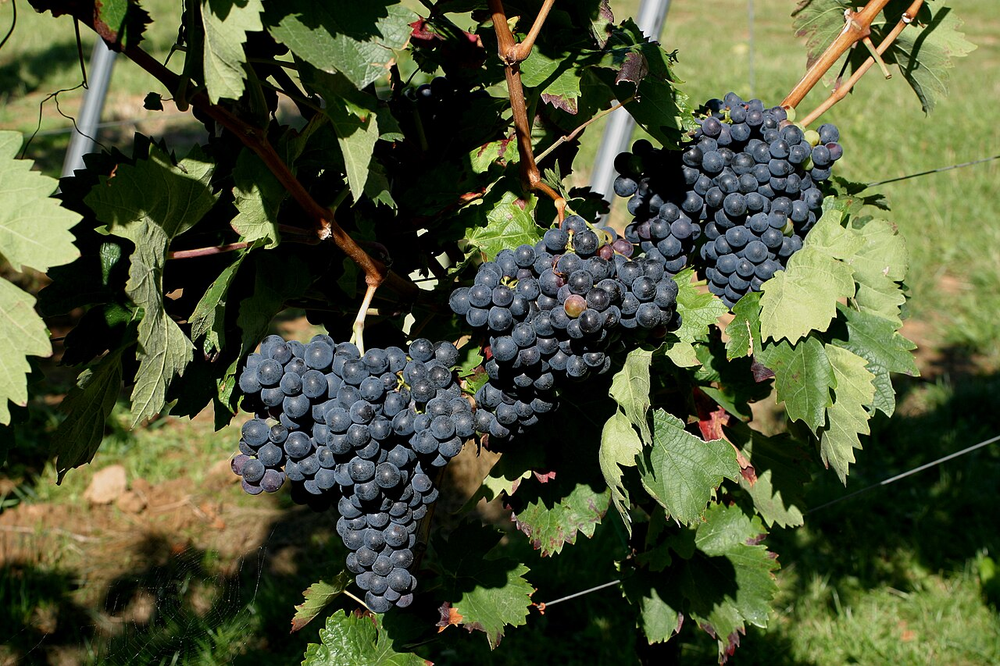
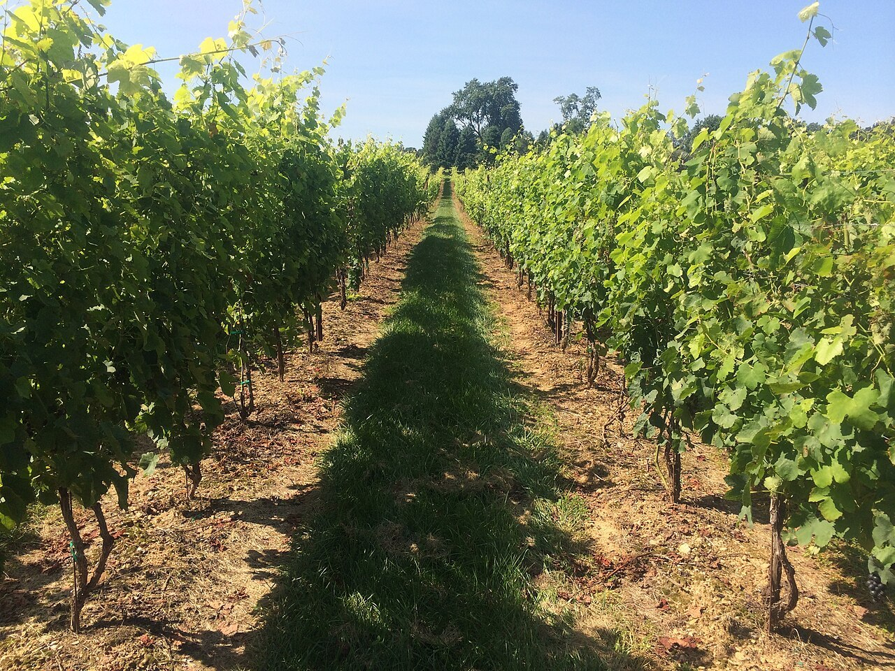

# Carignan

A western Mediterranean red grape from Aragon in Spain, widely planted in Languedoc, Catalonia and Sardinia; old low-yielding vines give high acidity, firm tannin, spice and earth.

Figure: Carignan: VIVC2098 CARIGNAN NOIR Cluster in the field 8921 (Wikimedia Commons). Image: Please note: This photo can be reproduced. Please quote the source as indicated below: Doris Schneider, Julius Kühn-Institut (JKI), Federal Research Centre for , CC BY-SA 4.0, via Wikimedia Commons ([source page](https://commons.wikimedia.org/wiki/File:VIVC2098_CARIGNAN_NOIR_Cluster_in_the_field_8921.jpg)).

## Definition and naming

Carignan is a dark-skinned wine grape whose name changes with region: Cariñena in Spain, Mazuelo in Rioja, Samsó in Catalonia, Carignano in Sardinia, Carignane in old Californian records, and Bovale Grande locally in Sardinia. Genetic analysis groups the Spanish Mazuelo and the Sardinian Bovale with the same variety; the French name Carignan is the most common on international labels. When these synonyms appear, identity should be checked against the variety register before reading the style off the region's rules.

As an ancient variety it carries dozens of European synonyms, and it has also contributed to crossings such as Argaman and Ruby Cabernet. Its colour mutations include Carignan Blanc and Carignan Gris. Beyond the variety itself, a label may name an appellation, a parcel or a blending role; these are not the same level of information.

## Origin and spread

The grape most likely originated around Cariñena in Aragon, northeast Spain, in the province of Zaragoza, and takes its name from the town. Cultivation there is recorded in the fifteenth century, and the Nájera documents of 1562 mention it as well. Modern genetic work identifies Castellana Blanca as one parent, while the second parent has not been confirmed; whether the precise homeland lies in Aragon or an adjoining area remains open. The Cariñena PDO sits in the middle Ebro Valley, with vineyards between 400 and 800 metres above sea level, swept by the dry Cierzo wind, and vines have been grown here since Roman times.

It spread along Mediterranean trade and colonial routes into southern France, Sardinia and North Africa. French plantings peaked in 1988 at about 167,000 hectares, making it the most widely planted vine variety in France at the time; vine-pull schemes and changing tastes then drove grubbing down to roughly 53,155 hectares nationwide by 2009. Along with Aramon, it was long counted among the main contributors to France's wine lake. After the Algerian war of independence in 1962, the cross-Mediterranean wine trade broke off, and southern French merchants began growing Carignan themselves, which pushed the area higher still. In Spain it played a supporting role in Priorat old bush vines and Rioja Mazuelo blends; in Sardinia it arrived between 1323 and 1720 under Aragonese rule, developing local clones there.

## Botany and cultivation

Carignan has large, tight bunches with medium, round, thick-skinned, deeply coloured berries and juicy flesh. It ripens late, loves heat and tolerates drought, and struggles to ripen in more northerly continental climates or the damp maritime climate of southwest France. The vine is vigorous; unchecked yields can exceed 200 hectolitres per hectare, and then colour fades, the body thins and a trace of bitterness appears. Only on poor, low-fertility soils under water stress do berries shrink, the skin-to-juice ratio rise, and the wine gain depth of colour, acidity and firm tannin with a violet floral note.

Yield control is the first priority in the vineyard. Southern sites are mostly trained as bushes, alberello, or low vines on wires; thinning, cropping limits and ripeness decisions matter more than irrigation or fertilising. Deep-rooted old vines crop naturally low and are the basis of today's high-end Carignan; young vines or high-yielding sites dilute colour and structure. Disease pressure is lower in dry, windy sites, though rain at flowering and ripening brings bunch rot risk.

## Style and palate

High-yield Carignan is often made into everyday reds or sold as blending stock. Low-yielding old-vine versions show blackberry, black cherry, bramble, dried plum, liquorice, black pepper, tobacco and wet earth, with rough but firm tannin, high acidity and a strong structural frame. Young fruit is direct and open; with age it develops leather, dried fruit and smoked spice. In southern France, carbonic maceration is routinely used to soften young wines for early drinking, while concentrated old-vine examples need bottle age or decanting to settle the tannin.

Its common role is the structural backbone of a blend: it trades fruit and alcohol with Grenache, spice and colour with Syrah, and body and ageworthiness with Mourvèdre. AOC rules in Minervois, Corbières, Faugères, Fitou and St-Chinian all set minimum Carignan proportions in the blend. As a single varietal, the style runs from fresh and fruity to dense and concentrated, depending on site, yield and extraction. Compared with an aromatic red such as [syrah](ref:syrah), Carignan leans on acid, tannin and an earthy skeleton.

## Main regions and representative wines

Southern France holds its largest concentration, with broad plantings in Aude, Gard, Hérault, Pyrénées-Orientales and Var. Old-vine references include Domaine Bertrand Bergé in Fitou and Domaine de l'Aupilhac in the Languedoc, estates known for old-vine Carignan bottlings or blends. In Spain, century-old bush vines remain on the llicorella schist slopes of Priorat; Clos Mogador's Manyetes is a benchmark single-varietal, and Celler de Capçanes in Montsant is known for low-yield old-vine Carignan wines.

The Sulcis district of southwest Sardinia is another stronghold. The Carignano del Sulcis DOC was established in 1977; sandy soil repels phylloxera and preserves ungrafted old vines. The Cantina Santadi cooperative, founded in 1960, makes the flagship Terre Brune Superiore and the Rocca Rubia Riserva, local reference points. In the New World, Chile's VIGNO, Vignadores de Carignan, association was formed in 2011 in the Maule Valley; members include Miguel Torres, Undurraga, Valdivieso and Gillmore. Its rules require dry-farmed vines at least 30 years old and a minimum of 65% Carignan in the wine, creating a de facto small appellation for old-vine expressions.

## How to drink and pair

Structured old-vine Carignan is best at 16–18°C; too cool and tannin and acidity tighten up, too warm and alcohol and roughness take over. Younger, fruity versions can be served a little cooler at 14–16°C. A broad-bowled glass suits the wine, and tannic examples benefit from half an hour to an hour of decanting so fruit and tannin open together; older bottles should be carefully settled and decanted off deposit.

Pairing revolves around Mediterranean and inland home cooking: grilled lamb, beef stew, lentil ragout, sausages and cured meats, mushroom dishes and hard aged cheeses all absorb its acidity and tannin. Sauced red meat, game and tomato-based stews are safe matches; delicate white fish or white meat, and spicy dishes, are overwhelmed by the tannin and bitterness. As a [red-wine](ref:red), its concentration suits substantial main courses rather than light snacks.

## Buying and common misreadings

One common mistake is equating Carignan with cheap bulk blend wine. That image comes from past high-yield vineyards and jug wine; today's low-yield old-vine bottlings have real weight in colour, acidity and structure, at a clearly higher price and positioning. Another mistake is relying on the variety name alone: French blends, Priorat old vines, Sulcis sand and Chilean dry-farmed vines share one grape but differ greatly in soil and craft, and vintage has a strong effect on ripeness and tannin finesse.

When buying, first separate single-varietal wine from blend, then read site tier, vine age and vintage. Old vines are not a legal grade label; actual yield and vine age should follow the producer's notes. Organic farming is a growing method, not a flavour guarantee. Store away from heat, strong light and vibration; structured reds keep two to three days after opening, and a vacuum stopper slows oxidation.

## Further reading and see also

The most direct comparison is to taste a Languedoc old vine, a Priorat single varietal and a Sulcis DOC in the same vintage, setting acidity, tannin and earthy aroma side by side. It ties closely to the poor-slope [terroir](ref:terroir), the choices of [oak-ageing](ref:oak) and the ripeness differences driven by [vintage](ref:vintage), and can be read alongside entries for its blending partners Syrah and Grenache.

- Related: [syrah](ref:syrah), [red-wine](ref:red), [terroir](ref:terroir), [oak-ageing](ref:oak), [vintage](ref:vintage).

[Syrah](ref:syrah) explains variety character; [Terroir](ref:terroir) adds regional performance. Put Carignan between them before deciding what it is.

## Related images

Image: Syrah Grapes on the Vine. Credit: U.S. Geological Survey, CC0, via Wikimedia Commons.. Credit: U.S. Geological Survey, CC0, via Wikimedia Commons ([source page](https://commons.wikimedia.org/w/index.php?curid=114429512)). Related image for Carignan.
