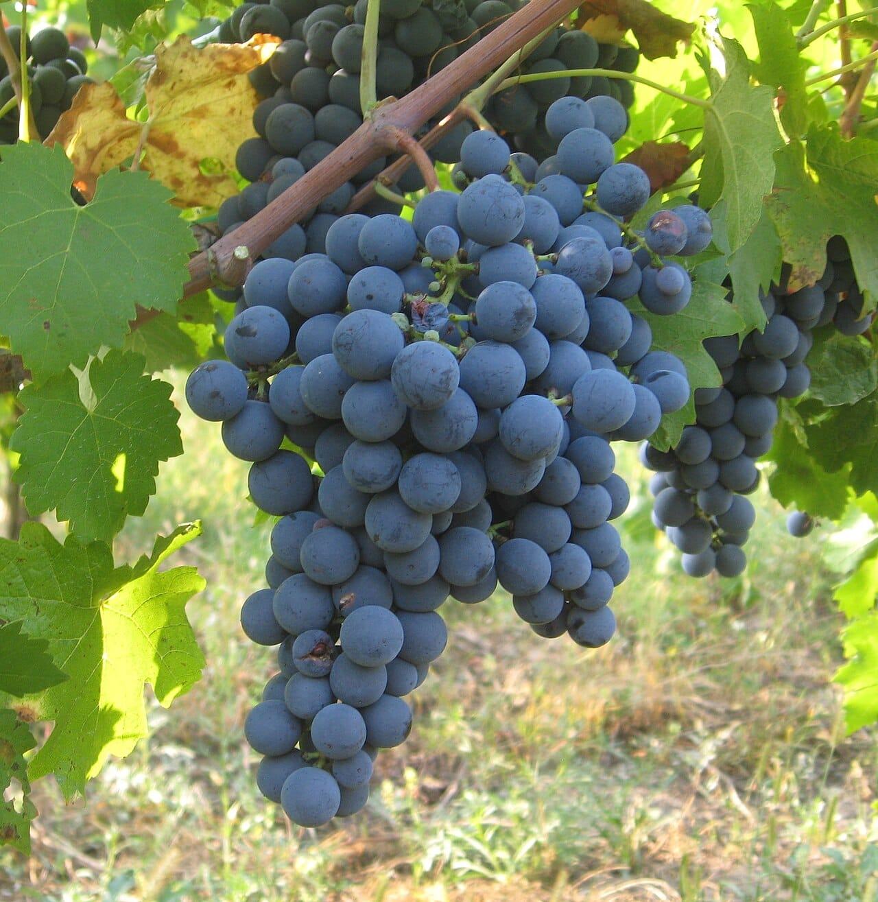

# Carménère

Carménère's story is a story of mistaken identity. It was once part of the Bordeaux blend, almost vanished from Europe after phylloxera, and then spent more than a century in Chile labelled as Merlot before being identified again in 1994. The variety ripens late, colours deeply and carries tannin that is firm but rounder than Cabernet Sauvignon. Its flavours move between sweet black plum and the greener notes of bell pepper, paprika and tobacco. Carménère is both Chile's signature grape and a clear lesson in how variety, climate and regulation combine to shape a wine (ref:wine).

Figure: Carménère. Image: Lebowskyclone, CC BY-SA 3.0, via Wikimedia Commons ([source page](https://commons.wikimedia.org/wiki/File:CarmenereW.jpg)).

> **Quick verdict**
> **In one line:** This variety helps you decide whether Carménère suits you, and compare it with other varieties.
>
> - **Best for:** Anyone comparing Carménère with other varieties and trying to pin down the flavour difference.
> - **Not for:** If you want only want a famous producer recommendation and do not care about the variety itself.
> - **Check first:**
>   - Carménère belongs to the European grape Vitis vinifera and is a red variety.
>   - Carménère originated in Bordeaux and was already recorded there in the 18th century, when it took part in blends alongside Cabernet Sauvignon, Cabernet Franc and Merlot.

## Definition and synonyms

Carménère belongs to the European grape Vitis vinifera and is a red variety. The name appears in English as both Carménère and Carmenere; Chinese sources also use several phonetic renderings. Grande Vidure is a historic Bordeaux synonym, but the name has also been applied to other grapes and is therefore ambiguous. The essential point is that Carménère is not Merlot and not a Merlot clone: the two are related, but their ripening, colour and flavour profiles differ (ref:red-wine). On a Chilean label, "Carmenère" is an official variety name, not a place name.

## Parentage and origin

Carménère originated in Bordeaux and was already recorded there in the 18th century, when it took part in blends alongside Cabernet Sauvignon, Cabernet Franc and Merlot. DNA work has shown that it is a natural cross of Cabernet Franc and the Basque variety Gros Cabernet, which makes it a half-sibling of Merlot and Cabernet Sauvignon rather than the same grape. After phylloxera swept Europe in the late 19th century, Carménère was gradually abandoned because it ripens late, sets fruit poorly and struggled to mature in the cool Bordeaux climate; for a time it was considered extinct in Europe. Chile had imported the variety around the 1850s, and its dry climate and old vineyards, less damaged by phylloxera, allowed it to survive. Because its leaves resemble Merlot, it was long labelled as Merlot. In 1994 the French ampelographer Jean-Michel Boursiquot identified it in Chilean vineyards, and DNA testing confirmed the finding.

## Botanical characteristics

Carménère has small berries, deeply coloured skins and high anthocyanin content, so the wine is usually darker than Merlot. The clusters are relatively loose, and the leaves resemble those of Merlot but are often more deeply lobed, which gives growers a field clue. It is a late-ripening variety, normally two to three weeks behind Merlot; in cool regions the fruit can stay green and herbal, and the tannin becomes hard. Fruit set is unstable, with coulure and millerandage causing large differences in yield from year to year. The skins are rich in pigment, but the tannin is softer than Cabernet Sauvignon, which is why Carménère is often used in blends to add colour and mid-palate fruit.

## Viticultural characteristics

Carménère needs a long, warm autumn to ripen fully, which explains its unreliable performance in a cool maritime climate such as Bordeaux and its marginal status there. Chile's Central Valley offers a dry autumn, abundant sunshine and irrigation from Andean snowmelt, giving the variety more reliable ripening. It adapts to a range of soils but performs best on well-drained alluvial and gravelly slopes. Because coulure and millerandage are common, growers need to manage crop load, water and nutrition around flowering to stabilise yields. Late picking reduces green pepper notes but can raise alcohol and lower acidity, so harvest timing is one of the most important decisions in making Carménère.

## Regional distribution

Chile is the most important home of Carménère (ref:chile). Colchagua is the core, especially around Apalta and Marchigüe, where granite, clay and alluvial soils give colour, structure and spice (ref:colchagua). Maipo, Cachapoal, Curicó and Maule also have substantial plantings, with styles ranging from rich and fruity to greener and fresher. Bordeaux still permits Carménère, but plantings are tiny and it is no longer a mainstream variety there; only scattered old vines and experimental parcels remain. Italy, Argentina, Brazil and China have small plantings, usually for blending or experimental varietal wines. Outside Chile, few regions treat Carménère as a signature grape.

## Legal rules

Chile manages wine through its Denominación de Origen system. Varietal labelling normally requires at least 75% of the named grape, while exports to the European Union follow the 85% rule; the latest regulations and market requirements should be checked. Carménère is an officially recognised variety name in Chile, and a label may state "Carmenère". Wines blended with Cabernet Sauvignon, Syrah or Petit Verdot may carry a varietal label under the applicable rules or use a regional name instead. Vintage, region and variety claims are regulated, with enforcement by the Agricultural and Livestock Service (SAG). Carménère remains a permitted red variety in Bordeaux, but plantings are tiny; its historical role should not be taken to mean it is widely used today, and exact rules vary by appellation.

## Winemaking

The central issue in making Carménère is ripeness. Growers often pick late to reduce green pepper and herbal notes while trying to avoid jammy fruit and excessive alcohol. Fermentation temperatures are kept moderate to preserve fruit and colour, and maceration length depends on the target style: a short maceration gives a fresher wine, while a long one builds tannin and structure. Quality wines are often aged in French oak (ref:oak-ageing), with the proportion of new barrels chosen to add spice, tobacco and toast rather than to mask the fruit. Malolactic fermentation is standard and softens the acidity. Carménère is frequently blended with Cabernet Sauvignon, Syrah or Petit Verdot to add acidity, tannin or colour, while varietal bottlings emphasise Chile's claim to the grape.

## Sensory profile

Young Carménère shows black plum, blackberry, blueberry, black cherry and violet, often with bell pepper, paprika, tobacco, dark chocolate and a soy-like savoury note. The body is medium to full, the tannin medium to high but rounder than Cabernet Sauvignon, the acidity medium and the alcohol usually high. Underripe fruit lets green and herbal notes dominate; well-ripened fruit gives sweetness and polished tannin, with the herbal side adding complexity. Oak and bottle age bring leather, cedar, truffle and coffee. Its ageing potential is medium to long, and good Colchagua Carménère can improve for a decade or more.

## Representative producers and vintages

Chilean producers include Concha y Toro, whose Carmín de Peumo is a benchmark varietal Carménère; Montes with its Alpha range; Lapostolle, whose Clos Apalta is a blend; De Martino, Viu Manent and Santa Rita. Concha y Toro emphasises the variety's pure expression, while Montes and Lapostolle stress the structure of Apalta slopes. Vintage differences come mainly from fruit set in spring and autumn temperatures: a stable set gives more even yields, and a long warm autumn gives ripe fruit and softer tannin, while cool years show more herbal notes that producers balance through picking date and blending. Site and winemaking choices still explain most of the variation between bottles.

## Common misconceptions

First, that Carménère is Merlot; the two are related but clearly different in ripening, colour and herbal character. Second, that the variety is extinct; it survives on a large scale in Chile after a long period of mislabelling. Third, that green pepper is always a fault; in moderation it adds complexity, and it becomes a problem only when it overwhelms the fruit. Fourth, that Carménère comes only from Chile; it originated in Bordeaux and is planted in several other countries. Fifth, that it can only make inexpensive wine; old vines and low-yielding sites in Colchagua can produce structured, ageworthy bottles. Sixth, that Grande Vidure is a separate variety; it is one of Carménère's historic synonyms.

To read Carménère, start with where it is grown, then how it is labelled, then whether the style is dry or sweet; no single check settles it.

Start with [Wine](ref:wine) for variety character, then read [Chile](ref:chile) for regional performance. Seeing both keeps Carménère from being confused with a neighbouring idea.

## Further reading

- [Wine](ref:wine): an entry point to variety, region and labelling.
- [Red wine](ref:red-wine): the drink style to which Carménère belongs.
- [Chile](ref:chile): the variety's most important modern region.
- [Colchagua](ref:colchagua): the core sub-region for Chilean Carménère.
- [Oak ageing](ref:oak-ageing): the process behind its spice and structure.

## Related images

Image: Category image for Colchagua. Credit: https://www.chile.gob.cl/india/noticias/lanzamiento-de-wines-of-chile-academy-en-dependencias-de-la-embajada, CC0, via Wikimedia Commons ([source page](https://commons.wikimedia.org/wiki/File:Vinos_chilenos.jpg)). Related image for Carménère.
