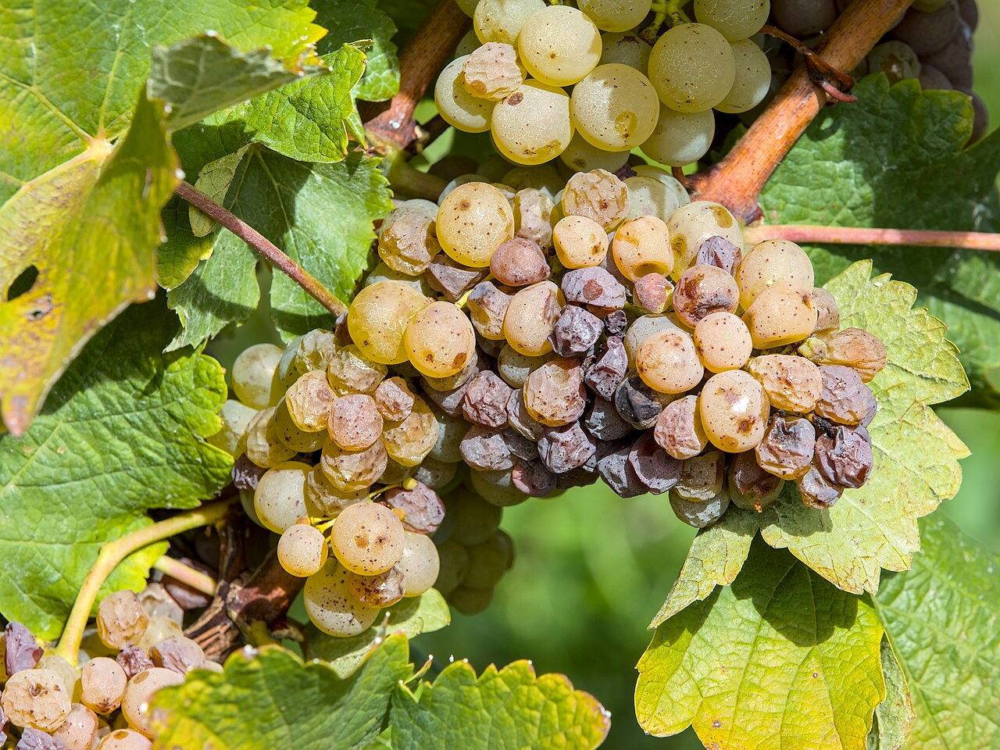

# Chenin Blanc

Chenin Blanc is the signature white grape of the Loire Valley and one of the most versatile white grapes in the world: the same variety can make dry, off-dry, sweet, botrytised sweet and sparkling wine. Its high acidity is the frame that holds a wide spectrum from green apple to honey, from quince to wet wool. Understanding Chenin means understanding how growers choose among acidity, ripeness and residual sugar.

Figure: Chenin Blanc. Image: Benjamin Smith, CC BY-SA 4.0, via Wikimedia Commons ([source page](https://commons.wikimedia.org/wiki/File:Rochecorbon_-_Vignoble_-_02.jpg)).

## Definition and synonyms

The French name is Chenin Blanc, often shortened to Chenin in English. It belongs to the European grape Vitis vinifera and is a distinct variety. The Loire once called it Pineau de la Loire, and South Africa calls it Steen, all referring to the same plant. A label saying Steen usually means South African origin; Vouvray or Savennières points to a specific Loire appellation. The many names are traces of its spread, not evidence of separate varieties.

## Parentage and origin

DNA work indicates that Chenin Blanc is a natural cross of Savagnin and an unknown variety. Savagnin is also the source of Traminer and Gewürztraminer parentage, so Chenin is distantly related to those aromatic grapes but stylistically completely different. It originated in the middle Loire, with records going back at least to the 15th century, and travelled to South Africa with Dutch and French ships. Vine planting began at the Cape in 1655, and Chenin gradually became the country's most important white grape.

## Botanical character

Bunches are medium, berries small with thin yellow-green skins, and ripening is late. Thin skins are the physical basis of its susceptibility to botrytis and also to grey rot. It buds early, raising spring frost risk, and cold rain at flowering can cause poor set. Sugar accumulates moderately slowly and acidity falls slowly, so it can keep high acid even at higher sugar, the key to making both dry and sweet styles.

## Viticultural behaviour

Chenin is vigorous and high-yielding and needs pruning, green harvesting and canopy work to control crop load. It performs best on poor schist, sandstone and limestone slopes with deep roots and more even ripening; on fertile plains it can grow too much leaf and taste thin. Botrytis needs humid, foggy autumn mornings with dry afternoons, a window the Loire often provides. South Africa's warmer climate makes it more common there for bulk dry white and sparkling wine.

## Loire Valley appellations

The Loire is the classic home. Vouvray is known for dry, off-dry, sweet and sparkling wines on limestone and clay; Montlouis is similar but often lighter; Savennières is known for dry, oxidative styles with ageing potential; Coteaux du Layon, Bonnezeaux and Quarts de Chaume are the core of botrytised sweet wine. Anjou, Saumur and Crémant de Loire also use Chenin heavily. Local rules decide residual sugar and picking method, and the words sec, demi-sec and moelleux on the label are important clues.

## Steen in South Africa

South Africa has the largest Chenin plantings, about 18000 ha, roughly half the world total. Vine planting began at the Cape in 1655, and Chenin gradually displaced other white grapes to become the main variety. It was long used for distillation and bulk dry white, but since the 21st century old-vine Steen and single-vineyard wines have regained attention, with styles from crisp citrus to rich honey. Warm climates give less piercing acidity than the Loire, but old vines and schist soils can restore complexity.

## Winemaking and the style range

Winemaking choices are unusually wide. Dry wines usually ferment in stainless steel or old barrels, some with lees stirring and malolactic fermentation for roundness; the traditional Savennières style deliberately exposes the wine to air, producing nut, beeswax and oxidative notes. Sweet wines rely on botrytis or late picking, with residual sugar from off-dry to very sweet; sparkling wine is made by traditional or tank method. The key parameters are high acid and low pH: total acidity is often 7 to 10 g/l and pH can fall to around 3.0, so even high residual sugar does not taste cloying.

## Sensory style

Young dry Chenin shows green apple, quince, lemon, white flowers and wet stone, with high acidity and a medium body; with age it develops honey, chamomile, beeswax, lanolin and nuts. Sweet versions bring dried apricot, honey, ginger and citrus marmalade, with acidity holding the sweetness in check. Sparkling versions are built on green apple and bread, with a fine bead. Against Chardonnay, Chenin has higher acidity, more quince and honey, and usually less oak influence.

## The difference from Sémillon

Chenin and Sémillon are both prone to botrytis and both make sweet wine, but they are not interchangeable. Chenin has high acid and low pH, a sharper and more versatile profile, and can make sparkling and dry wine; Sémillon has low acid and a waxier texture, sweeter wines that feel rounder, and dry wines often blended with Sauvignon Blanc. Chenin's home is the Loire, Sémillon's is Bordeaux; Chenin is Steen in South Africa, while Sémillon is known in Australia's Hunter Valley for early-picked dry white. Reducing both to "botrytis varieties" loses their separate winemaking logic.

## Producers and vintages

Loire names include Domaine Huet, Foreau, François Chidaine, Baumard and Nicolas Joly; in South Africa, Ken Forrester, The Sadie Family and Mullineux. Vintage differences come mainly from autumn humidity and botrytis development: dry years suit dry wine, humid foggy years are needed for good botrytis. In the market, Chenin has long been undervalued and has gained attention over the past decade through old vines and natural wine, though prices remain below Chardonnay of equal quality.

## Common misconceptions

First, that Chenin is always sweet; Vouvray and Savennières both make plenty of dry wine. Second, taking Steen for another variety; it is the South African name for Chenin. Third, reading high acidity as under-ripeness; Chenin's acid is structure, not a fault. Fourth, assuming all Chenin ages; ordinary dry whites are for early drinking, while top sweet wines and Savennières can keep. Fifth, confusing Chenin with Sémillon; acidity and texture differ clearly. Sixth, thinking South African Chenin is always cheap; old-vine single vineyards now reach the fine-wine market.

[White wine](ref:white-wine) and [Vouvray](ref:vouvray) are the nearest useful comparisons: one clarifies variety character, the other tests regional performance.

**Key facts.**

| Item | Detail |
| --- | --- |
| In one line | A white grape native to the Loire Valley, thin-skinned, high in acidity and late-ripening, prone to botrytis and able to make dry, off-dry, sweet and sparkling wine. It shows quince, apple, honey and chamomile, and DNA w… |
| Species | Vitis vinifera |
| Key regions | France |

## Further reading

- [White wine](ref:white-wine): the drink style to which Chenin belongs.
- [France](ref:france): the legal and regional framework of French wine.
- [Vouvray](ref:vouvray): a core Loire appellation for Chenin.
- [Fermentation](ref:fermentation): how fermentation and residual sugar shape style.

Further reading: [Aglianico](ref:c-extra-1).
