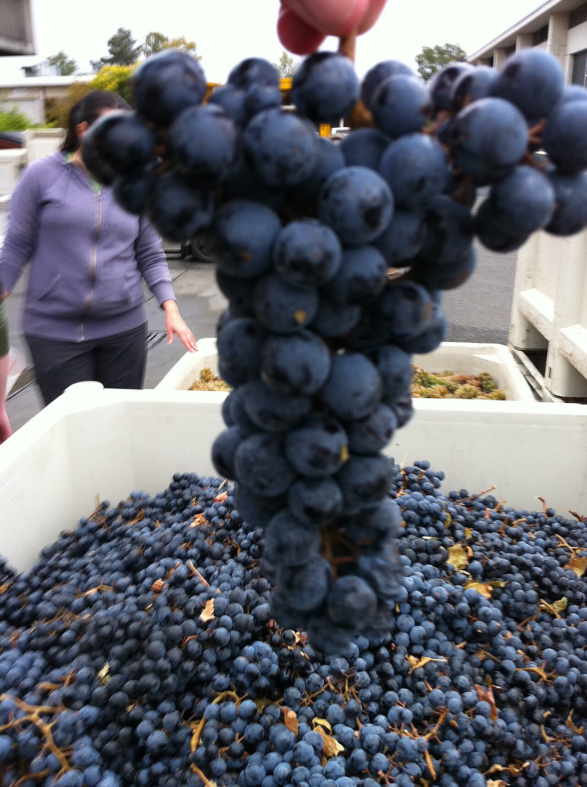
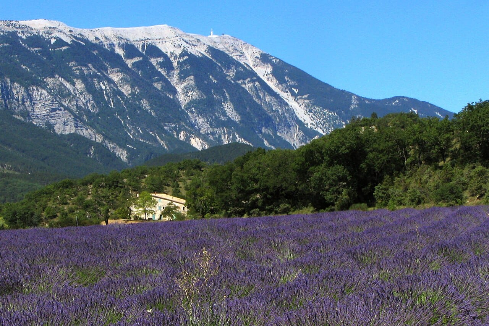

# Cinsault

Cinsault (official French name Cinsaut) is a red grape born of the Mediterranean climate of southern France. Heat- and drought-tolerant, vigorous and high-yielding, it has thin skins, pale colour, supple tannin and medium-high acidity, with red cherry, strawberry, white peach and floral notes. Long used in blends and rosé to add fruit, perfume and freshness to Grenache, Syrah and Mourvèdre, it has recently been rediscovered as a single-variety old-vine wine in southern France, South Africa and Lebanon (ref:grenache).

The through-line for this grape is yield. Left to crop heavily, it makes pale, simple, dilute wine; restrict the crop, rely on old vines and pick at the right moment, and a more layered, fine-tannined Cinsault appears. Understanding that contrast between volume and restraint explains most of the stylistic gap between regions.

Figure: Cinsault: Cinsault cluster (Wikimedia Commons). Image: Agne27, CC BY-SA 3.0, via Wikimedia Commons ([source page](https://commons.wikimedia.org/wiki/File:Cinsault_cluster.JPG)).

## Definition and naming

Cinsault is a red Vitis vinifera grape with colourless juice. The official French name is Cinsaut; Cinsault is the common international spelling. It has a long list of synonyms: Black Malvoisie in the United States, Blue Imperial and Black Prince in Australia, Ottavianello in Apulia, Italy, Hermitage in South Africa, Samsó and Sinsó in Spain, Senso in Bulgaria, Mavro Kara Melkii in Greece, plus local names such as Oeillade noire, Marocain, Plant d'Arles, Picardan noir and Piquepoul d'Uzès. Some folk names are shared with other varieties, so a name alone cannot fix the identity.

Two name confusions come first. The old South African name Hermitage has no direct link to the Hermitage district of the Rhône, and Cinsault is not the historic “true Oeillade” once grown in Languedoc and Provence, which is no longer cultivated. On the vine it has medium-sized, five-lobed leaves, compact conical clusters, spherical thin-skinned juicy berries and pale juice; it buds late, which lets it escape spring frost. On Provence and Tavel labels it appears mostly as a direct-press or short-maceration rosé grape, while in southern Rhône blends it is only a permitted minor variety.

## Origin and spread

The variety most likely originated in Provence, southern France, where it has been grown since the Middle Ages, before spreading into the Rhône Valley, Languedoc-Roussillon and, with French colonial influence, Algeria, Morocco, Tunisia and Lebanon. Genetic work identifies it as one parent of South Africa's Pinotage and links it to Bouteillan and Morrastel. In the twentieth century it was widely planted for its high yield and drought tolerance as a replacement for direct-producing hybrids, and uprooted in parts of France in the later decades.

Worldwide plantings are around 25,000 hectares; France recorded nearly 24,773 hectares in 2006, concentrated in Languedoc-Roussillon, the southern Rhône and Provence. North Africa is another important block: Morocco grows it as its leading variety by production, and it remains important in Algeria and Tunisia. South Africa, Lebanon, Apulia, Spain, Australia and California also have plantings, on a far smaller scale than the traditional Mediterranean districts.

## Botany and cultivation

Leaves are medium with five lobes; bunches are conical and fairly compact, berries spherical with thin skins and juicy pulp, and the juice is pale. Budburst is late, avoiding spring frost; the vine is vigorous with high yield potential, commonly 40–60 hl per hectare. The thin skin makes it relatively susceptible to powdery and downy mildew, which needs watching in damp years, while heat and drought are tolerated very well, with deep roots finding moisture in dry soil.

The cultivation priorities are yield control and leaf-fruit balance: high crops give thin aroma, loose tannin and paler colour, while a dense canopy shades the fruit, lowers acidity and invites disease. Pruning, trellis height, leaf removal and limited irrigation all adjust that balance. Sunny slopes with free-draining gravel or limestone suit textured wines; flat, fertile blocks go into fresh young wines and blend material.

## Style and palate

Typical Cinsault reds and rosés are pale and bright, with supple tannin, medium-high acidity and a light, thirst-quenching palate. Young wines show strawberry, red cherry, raspberry, white peach and flowers such as violet and rose, with a touch of garrigue and spice; bottle age brings confit fruit, soft spice and dried herb, and the tannin settles further. Alcohol is usually 12.5–13.5%, and it is not a heavy, extracted style.

Most often it enters blends, contributing fruit, perfume and fresh acidity to Grenache, Mourvèdre and Syrah. In Provence and Tavel it goes heavily into rosé, by direct pressing or short skin contact for a pale salmon colour and red-berry fruit. As a single variety, old vines and low-yield parcels support a more concentrated structure; oak is used sparingly, so new-wood vanilla does not cover the fresh floral character (ref:red).

## Main regions and representative wines

In France, Côtes de Provence, Bandol and Coteaux d'Aix-en-Provence use Cinsault as a key direct-press rosé grape. Tavel, France's only AOC dedicated entirely to rosé, often blends it with Grenache for a structured, ageworthy pink. In the southern Rhône it is a permitted minor variety in Châteauneuf-du-Pape blends, and it also appears in Gigondas, Vacqueyras and Lirac; Languedoc-Roussillon uses it mostly in blends and regional wines.

Château Musar in Lebanon's Bekaa Valley is the best-known overseas example: mature Cinsault is blended with Cabernet Sauvignon and Carignan, contributing red fruit, floral character and an almost airy quality to wines with extraordinarily long bottle life. South Africa is another revival: there the grape was once called Hermitage, and in 1925 Abraham Izak Perold crossed it with Pinot Noir to create Pinotage. Today producers in Swartland, Stellenbosch and Bot River are again making old-vine single-variety Cinsault, among them Beaumont Family Wines in Bot River. In Bandol, Provence, Château de Pibarnon was founded in 1977; its rosé blends Cinsault with Mourvèdre (an early proportion of about 40% Cinsault, 60% Mourvèdre), on terraced vineyards around 300 m above sea level, farmed organically.

## How to drink and pair

Cinsault reds and rosés are best at 12–16 °C: fresh young wines and rosés lower, structured old-vine reds slightly higher. No long decanting is needed; it drinks well on opening. Use a medium-bowl white glass for rosé and a universal red glass for the red. It is a summer, food-friendly wine whose acidity and fruit match light cooking.

For food, rosé and light reds suit grilled vegetable salads, cold cuts, roast chicken, seafood, grilled fish, garlic prawns and ham. Southern French dishes such as ratatouille, tapenade and herb-roasted lamb ribs work well. Delicate seafood or fruit desserts clash with the more tannic versions; for spicy food choose the fresher, lower-alcohol bottling.

## Buying and common misreadings

The first mistake is writing Cinsault off as a plain filler grape: high-yield blends are simple, but old-vine, low-yield single-variety wines have complete fruit and fine tannin. The second is reading the South African old name Hermitage as a Rhône Hermitage wine; the names coincide by chance. The third is equating Pinotage with Cinsault: Pinotage is the hybrid offspring of Cinsault and Pinot Noir, a more concentrated style, and the two should not be mixed.

On the label, separate rosé from dry red, single variety from blend, and note region and vintage. Young Cinsault is for drinking within one to eight years, depending on site and winemaking; store bottles on their side, away from light and temperature swings. It reaches overseas mainly through specialist importers, so check storage history; fresh-style whites and rosés held in an overheated warehouse can show muted fruit.

## Further reading and see also

- Related: [provence](ref:provence), [grenache](ref:grenache), [rose-wine](ref:rose), [red-wine](ref:red), [terroir](ref:terroir).
- To compare blend and single-variety expressions, taste a Provence rosé alongside a South African old-vine Cinsault red and contrast fruit concentration, tannin texture and floral presence.

## Related images

Image: Provence. Credit: Robert Brink, CC BY-SA 3.0, via Wikimedia Commons ([source page](https://commons.wikimedia.org/wiki/File:Lavender_field_and_Mont_Ventoux.jpg)). Related image for Cinsault.
