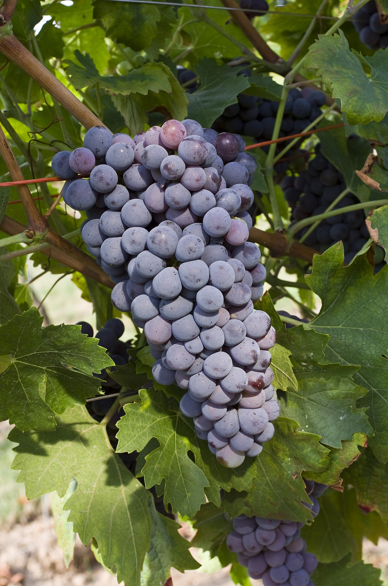
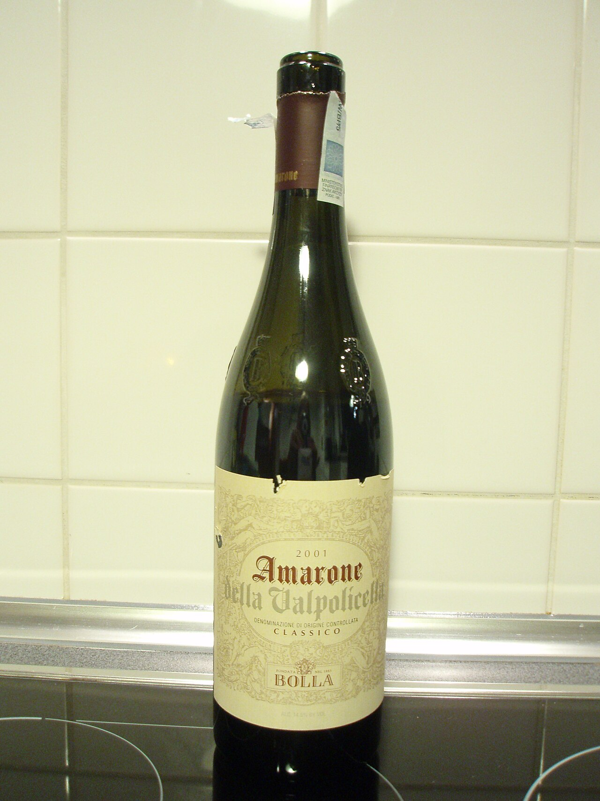

# Corvina

Corvina is a red grape variety from Veneto, Italy, with relatively thin skins and moderate colour, known for sour cherry, almond and herbal aromas. It is the core variety of Valpolicella and Amarone, usually blended with Corvinone and Rondinella rather than made as a single-variety wine.

Figure: Corvina. Image: Please note: This photo can be reproduced. Please quote the source as indicated below: Ursula Brühl, Julius Kühn-Institut (JKI) Bundesforschungsinstitut für Kul, CC BY-SA 4.0, via Wikimedia Commons ([source page](https://commons.wikimedia.org/wiki/File:VIVC2863_CORVINA_VERONESE_Cluster_in_the_field_19664.jpg)).

## Definition and synonyms

The Italian name is Corvina, often written Corvina Veronese in Veneto to distinguish it from other varieties with similar names. It is a distinct variety of the European grape Vitis vinifera.

Historically, Corvinone was long treated as a type or clone of Corvina and was later recognised as a separate variety; Rondinella is another separate variety. The three are often discussed together because of the traditional Valpolicella blend, but their botany and field behaviour differ, and their proportions are listed separately on the label.

## Botanical characteristics

Corvina has medium to large bunches and medium berries, with thin skins and moderate to low colour and tannin, so the wines are usually not deeply coloured. Budbreak and ripening are moderate, and it performs reliably in the hills of Veneto.

Thin skins have a direct consequence: the variety suits drying, but it is also more exposed to mould in damp vintages. During drying, water evaporates and sugar and flavour concentrate, while humidity and airflow must be controlled or the fruit may spoil before fermentation even starts.

## Main regions

The core region is Valpolicella and Bardolino in north-eastern Veneto, [Italy](ref:italy), where hills, gravel and limestone soils are mixed and Lake Garda moderates the climate to the north. Plantings outside Veneto are limited.

The Italian appellation system sets the variety proportions: Valpolicella and Amarone both require Corvina as the main variety, working with Corvinone, Rondinella and other permitted varieties. A region page describes geography and rules, while a variety page describes the potential of the grape.

## Typical flavours

Typical aromas are sour cherry, red cherry, almond, dried hay and herbs, developing dried fruit, spice and leather with age. Acidity is medium to high, tannin is medium and the body is light to medium; after drying, sugar and alcohol rise and the flavour becomes more concentrated.

Tasted on its own, Corvina can seem lean, which is exactly why the traditional blend gives it partners: Corvinone adds colour and structure, Rondinella adds fruit and acidity. When judging a Valpolicella, the variety proportions and the drying process matter more than colour alone.

## Representative wines

[Amarone](ref:amarone) is Corvina's best-known wine: the grapes are dried for months after harvest before fermentation and [oak ageing](ref:oak-ageing), giving a full-bodied wine with high alcohol. Ordinary Valpolicella and Ripasso are also based on this group of varieties, in lighter styles.

The same variety differs greatly with method: fresh grapes fermented directly give a light red, while dried grapes give a concentrated sweet or dry wine. A variety page describes potential; a wine page records the estate's drying time and ageing decisions.

Ripasso is made by mixing fresh-grape Valpolicella with the still-sweet dried-grape pomace left after Amarone fermentation and running a second maceration and fermentation, so the pomace adds colour, alcohol and dried-fruit aroma; the result sits between ordinary Valpolicella and Amarone. The drying room needs ventilation, low temperature and low humidity, with bunches laid in a single layer or hung on racks and turned and sorted for mould during the weeks of drying. Water loss concentrates sugar, acidity and aroma and also raises the risk from rising alcohol late in fermentation. Estates decide the details, and this variety gives no uniform duration.

## Viticulture

The key points in growing Corvina are ripeness and skin integrity. Under-ripe fruit is high in acidity with green aromas, while over-ripe fruit loses freshness. Veneto traditionally uses pergola training to suit the hills and the available light.

Fruit destined for Amarone needs extra sorting: only intact, mould-free bunches should enter the drying room. Yield control and harvest timing directly affect drying losses and final quality; specific parameters vary by estate, so no uniform figures are given here.

## Common misconceptions

First, treating Corvina and Corvinone as the same variety. They were once seen as one, but are now separate.
Second, treating Rondinella as a synonym for Corvina. It is another variety with a different role in the blend.
Third, assuming pale Corvina means a thin wine. Drying and blending can change the structure markedly.
Fourth, assuming Amarone is a single-variety wine. The rules allow and usually use several varieties.
Fifth, treating all Valpolicella wines as one method. Ordinary, Ripasso and Amarone are made very differently.

Corvina is a thin-skinned red variety from Veneto with moderate colour, bright acidity and sour-cherry, almond and herbal notes. It is the core of Valpolicella and Amarone, usually blended with Corvinone and Rondinella. Amarone’s concentration comes from post-harvest drying, not from the variety becoming sweeter on the vine. Keep the variety’s own character separate from the appassimento method.

**In brief:** A red grape variety from Veneto, Italy, with relatively thin skins and moderate colour, known for sour cherry, almond and herbal aromas. It is the core variety of Valpolicella and Amarone, usually blended with Corvinone and Rondinella. 

For Corvina, begin with where it is grown, then how it is labelled, and finish with whether the style is dry or sweet; that order keeps the account grounded.

Start with [Red wine](ref:red-wine) for variety character, then read [Amarone della Valpolicella](ref:amarone) for regional performance. Seeing both keeps Corvina from being confused with a neighbouring idea.

Corvina is the core of Valpolicella and Amarone, usually blended with Corvinone and Rondinella; its thin skins give moderate colour but high acidity and a sour-cherry aroma.

**Key facts.**

| Item | Detail |
| --- | --- |
| In one line | A red grape variety from Veneto, Italy, with relatively thin skins and moderate colour, known for sour cherry, almond and herbal aromas. It is the core variety of Valpolicella and Amarone, usually blended with Corvinone … |
| Species | Vitis vinifera |
| Key regions | Italy |

**Sources and limits.** The key claims about Corvina are checked against the following sources: International Organisation of Vine and Wine (OIV) (Used to check the variety description and the Vitis species framework), Consorzio Tutela Vini della Valpolicella (Used to check the variety make-up and the drying process of Valpolicella and Amarone), Oxford University Press (Consulted for entries on Corvina, Corvinone, Rondinella and Valpolicella). Prices, batches and status change; the body is project-written and does not reproduce source text.

## Further reading

- [Red wine](ref:red-wine): red wine categories and basic winemaking.
- [Italy](ref:italy): where Veneto sits on the Italian wine map.
- [Amarone](ref:amarone): the representative wine made from Corvina with dried grapes.
- [Oak ageing](ref:oak-ageing): how ageing shapes dried-grape reds.

## Related images

Image: A bottle of Amarone della Valpolicella. Credit: Jerzy Kociatkiewicz, CC BY-SA 2.0, via Wikimedia Commons.. Credit: Jerzy Kociatkiewicz, CC BY-SA 2.0, via Wikimedia Commons ([source page](https://commons.wikimedia.org/w/index.php?curid=8844471)). Related image for Corvina.
