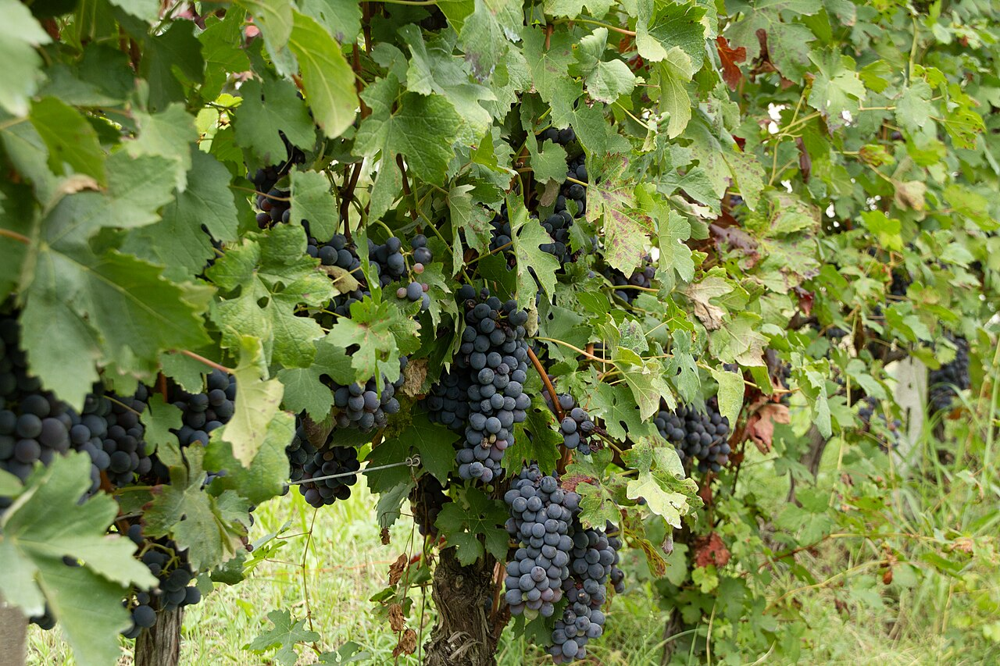
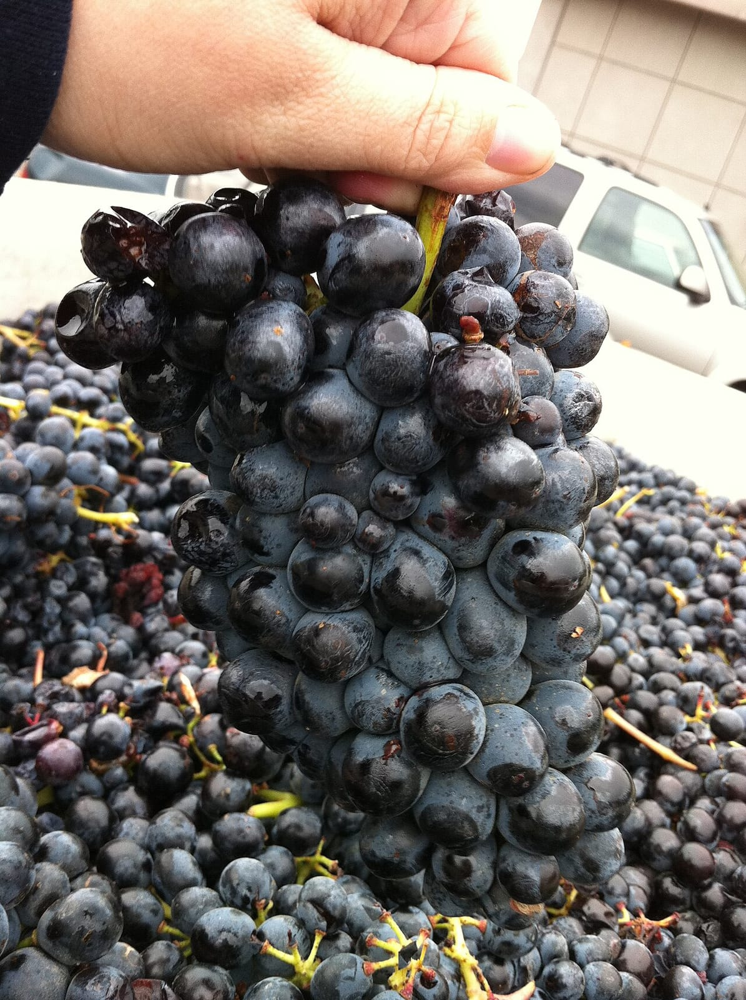

# Dolcetto

Dolcetto is one of Piedmont's three great red varieties in northwest Italy, alongside Nebbiolo and Barbera. The Italian name means "little sweet one", yet the wine is almost always dry. It ripens early with low acidity and tannin that can be gently extracted into a rounded frame; the colour is deep purple, with black cherry, plum, liquorice and a signature bitter-almond finish. Most bottlings are made to drink young, the everyday red Langhe estates release while their costly Nebbiolo and Barbera mature (ref:piedmont).

The grape's place in the Piedmont vineyard matters: it ripens several weeks before Nebbiolo, so it tends to be planted on cooler, north-facing or higher sites, while the best sun-facing slopes are reserved for Nebbiolo. Understanding that vineyard division explains why Dolcetto is built around fruit, balanced acidity and drinkability rather than ageing structure.

Figure: Dolcetto: Old Vine Dolcetto - Fontanavi (Wikimedia Commons). Image: Tenutailfinale, CC0, via Wikimedia Commons ([source page](https://commons.wikimedia.org/wiki/File:Old_Vine_Dolcetto_-_Fontanavi.jpg)).

## Definition and naming

Dolcetto is a black-skinned Vitis vinifera grape, VIVC variety number 3626 under the prime name Dolcetto. Local synonyms include Dolsin; it is called Ormeasco in Liguria and Nebbiolo or Nibièu in the Oltrepò Pavese, while the Dogliani dialect knows it as duzet or duset. Some names overlap with other varieties or districts, so a folk name alone cannot fix identity.

Whether “little sweet one” refers to fruit sugar is unsettled; another theory traces the name to the hills where the vine grows. What makes the wine taste sweet is its low acidity, not residual sugar. On the vine it has small-to-medium berries with deep purple, highly pigmented skins that give colour with short maceration; it buds and ripens early, finishing several weeks before Nebbiolo, which suits cooler, higher or more northerly sites. In the Oltrepò Pavese it is called Nebbiolo or Nibièu as a local folk name; that should not be confused with the late-ripening Nebbiolo of Piedmont.

## Origin and spread

Pedigree work identifies Dolcetto's parents as Dolcetto Bianco and Moissan, a combination confirmed by molecular markers. The DNA genealogy study of ancient northwestern Italian grapes published on 25 September 2020 places the overlap of the two parents' distribution in today's Langhe, the likely cradle of Dolcetto. Two origin theories compete: one traces the grape to France, brought into Monferrato around the 11th century; the other places its birth around the village of Dogliani.

Documents support a long local history. A 1593 ordinance of the Dogliani municipality forbade harvesting dozzetti grapes before Saint Matthew's Day, and this is taken to refer to the variety; a 1633 record notes Dolcetto in the cellars of the Arboreo family of Valenza; in 1700 Barnabà Centurione sent the wine as a gift to Queen Anne of Great Britain. Today it is concentrated almost entirely in the Piedmontese provinces of Cuneo and Alessandria, with small related plantings on the Ligurian and Lombard edges; overseas there are trial-scale plantings in Brazil, Australia and California.

## Botany and cultivation

Bunches are medium, berries small to medium, skins deep purple and high in anthocyanins, so short skin contact already yields a deep colour. Budburst and ripening are early, several weeks ahead of Nebbiolo and sooner than Barbera; in the vineyard division, cooler, higher or north-facing sites suit it, while the best sun-facing slopes go to the late-ripening Nebbiolo.

The variety is naturally low in acidity but carries real tannin potential; winemakers usually keep fermentation short and pressing gentle to avoid hard, coarse tannin. In the vineyard, watch downy mildew, botrytis and damp-year disease pressure; leaf-fruit balance, leaf removal and drainage set fruit concentration. Old vines and low-yield parcels support more complex wines, while ordinary high-crop blocks give straightforward, fresh fruit (ref:terroir).

## Style and palate

Typical Dolcetto runs deep ruby to purple-red, almost opaque when young with violet highlights. The nose leads with black cherry, plum, blueberry, blackcurrant and liquorice, alongside lavender, violet, orange peel and black tea, finishing in the variety's signature bitter almond. On the palate it is dry, medium-bodied and juicy; acidity is lower than Barbera, and tannin rounds out under gentle extraction rather than gripping. Paired with the low acidity, the fruit reads full and sweet on the mouth.

Most entry bottlings ferment and age briefly in temperature-controlled stainless steel to keep fresh fruit; large or old oak barrels add a little frame for a short period, while too much new wood covers the variety's own fruit. Superiore bottlings and old-vine single parcels are more complex, developing dried fruit, ink, spice and mineral layers. It is not a decades-aged wine: standard examples drink best within one to five years of the vintage, while fine Dogliani and old-vine Alba wines hold five to eight years (ref:nebbiolo).

## Main regions and representative wines

Piedmont has seven Dolcetto DOC/DOCG systems. Dolcetto d'Alba is the best-known DOC, granted in 1974, covering 36 communes around Alba on hillside sites no higher than 650 m; the standard bottling requires a minimum 11.5% ABV, and the Superiore 12.5% with 14 months of ageing. Dogliani DOCG spans 21 municipalities in Cuneo province: it gained DOC in 1974, the Superiore was promoted to DOCG in 2005, and in 2011 the former Langhe Monregalesi plots were merged in; in 2018 the district farmed 542 hectares, producing about 218,900 cases. Dolcetto di Diano d'Alba became a DOCG in 2010, Dolcetto d'Ovada Superiore in 2008; other labels include Dolcetto d'Acqui, Dolcetto d'Asti and Langhe Dolcetto. Liguria's Riviera Ligure di Ponente Ormeasco requires at least 95% Dolcetto/Ormeasco.

Representative producers include Poderi Luigi Einaudi in Dogliani, whose Dogliani Superiore Vigna Tecc comes from vineyards at San Giacomo and Madonna delle Grazie around 350 m, 4.5 hectares in extent, with some vines planted in 1937 and an annual production of about 20,000 bottles; San Fereolo and Clavesana are other names in the district. On the Alba side, Fratelli Giacosa has worked around Neive since 1895, and its Madonna Como Dolcetto d'Alba is a common single-variety bottling; Paitin, Elio Grasso, Vietti and Damilano also make Dolcetto.

## How to drink and pair

Dolcetto is served slightly cool, around 14–17 °C: young, fruity bottlings lower, fuller Superiore slightly higher. A medium-bowl red glass suits it; no long decanting is needed, and the bottle is finished within a short sitting. It is a food wine whose low acidity and rounded tannin meet fat and savoury salt.

Traditional Piedmontese matches include tajarin meat ragù pasta, bagna cauda vegetables, cured ham and air-dried meats, aged cheese, mushroom dishes and liver crostini; the bitter-almond finish goes with earthy flavours. Tomato-raised braises and roast poultry work well; delicate seafood or sweet desserts do not suit its fruit and tannin.

## Buying and common misreadings

The first mistake is reading "little sweet one" as a sweet wine: Dolcetto is almost always dry, and the mouthfeel sweetness comes from low acid and ripe fruit, not residual sugar. The second is confusing it with Nebbiolo: both grow in the Langhe, but ripening rhythm, acidity, tannin and ageing direction differ entirely, and Dolcetto is the early-drinking daily red. The third is assuming all Dolcetto is light: Dogliani Superiore and old-vine single sites carry clear structure and ageing room.

On the label, separate DOC from DOCG, standard from Superiore, and single-vineyard (Vigna) bottlings, then check vintage and alcohol. Standard wines drink within three to five years; Superiore and old-vine examples keep longer. Store bottles on their side, away from light and temperature swings. Overseas it often appears as an entry-level Piedmont red, with price layers driven mainly by site, vine age and ageing tier.

## Further reading and see also

- Related: [piedmont](ref:piedmont), [nebbiolo](ref:nebbiolo), [barbera](ref:barbera), [red-wine](ref:red), [terroir](ref:terroir).
- To compare the districts, taste a Dolcetto d'Alba and a Dogliani Superiore from the same vintage and contrast fruit concentration, tannin texture and the length of the bitter-almond finish.

To read Dolcetto, start with where it is grown, then how it is labelled, then whether the style is dry or sweet; no single check settles it.

[Piedmont](ref:piedmont) and [Barbera](ref:barbera) are the two useful reference points for Dolcetto. [Piedmont](ref:piedmont) sets out variety character; [Barbera](ref:barbera) brings in regional performance. Read them together.

## Related images

Image: Barbera. Credit: Agne27, CC BY-SA 3.0, via Wikimedia Commons ([source page](https://commons.wikimedia.org/wiki/File:Barbera_cluster.JPG)). Related image for Dolcetto.
