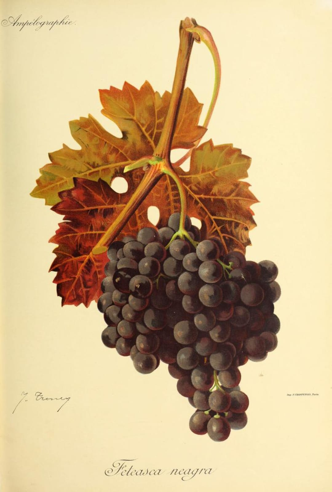

# Fetească Neagră

Fetească Neagră is an ancient indigenous red grape of Romania and Moldova, whose name means "black maiden". It is concentrated around the Prut Valley of the old Principality of Moldavia and the Carpathian piedmont hills; its thick skins and late ripening yield red wines with bright acidity, medium-high tannin, and notes of black cherry, plum, blackberry, spice and earth, making it one of the most respected native red varieties of Romania.

Read the variety first at home: its ripening rhythm, bunch structure and tannin direction under a continental climate, then trace what survives or what gets amplified when it is made into dry red, off-dry or rosé styles. The same name appears in different descriptions across sources — one focuses on botany, another on market style, a third on a single region's rules.

Figure: Fetească Neagră: Feteasca Neagra (Wikimedia Commons). Image: Jules Troncy, Public domain, via Wikimedia Commons ([source page](https://commons.wikimedia.org/wiki/File:Feteasca_Neagra.jpg)).

> **Quick verdict**
> **In one line:** This variety helps you decide whether Fetească Neagră suits you, and compare it with other varieties.
>
> - **Best for:** Anyone comparing Fetească Neagră with other varieties and trying to pin down the flavour difference.
> - **Not for:** If you want only want a famous producer recommendation and do not care about the variety itself.
> - **Check first:**
>   - Fetească Neagră dry reds are best served at 15–18 °C: young, fruit-forward examples at 15–16 °C, while structured, oak-aged wines can go up to 17–18 °C.
>   - The most common mistake is treating "Fetească" as one variety.

## Definition and naming

Fetească Neagră belongs to Vitis vinifera. The name combines the Romanian fetească (maiden, girl) with neagră (black). Synonyms registered across its range include Schwarze Mädchentraube in German, Fekete Leányka in Hungarian, Chornaya Fetyaska in Russian, and the Romanian local names Păsărească neagră, Poama fetei neagră and Coada rândunicii; these names on a label generally refer to the same variety.

The easy confusion is with the two other grapes of the same naming family: Fetească Albă and Fetească Regală are white grapes, whereas Fetească Neagră is a black-skinned red with roundish, dark purple, thick-skinned, juicy berries and colourless juice. The shared “Fetească” is a traditional convention, not evidence the three are bud mutations of one another. The quickest check is skin and wine colour: the two white varieties make pale whites, while Fetească Neagră makes a deep red. A label such as Negru de Purcari is a blend of local and international varieties, not a 100% Fetească Neagră bottling.

## Origin and spread

The variety's home territory was the old Principality of Moldavia, covering today's Republic of Moldova and the neighbouring Romanian region also named Moldova, with its core origin around the Prut Valley near Uricani. Archaeological and documentary evidence points to cultivation here for more than 2,000 years, and seeds attributed to the variety have been found in ancient vestiges in Romania. For a long time researchers assumed it was a dark bud mutation of the white Fetească Albă; recent DNA profiling shows the black grape is not a mutation of the white one, and at least four distinct types exist, indicating a long history of independent evolution.

During the Soviet period the variety nearly disappeared from its Moldovan homeland: quantity-driven policies replaced large areas of native grapes with international varieties, and it survived mainly in fragments of family vineyards in eastern Romania. Privatisation and the quality revival after 1989 brought it back into focus. Today plantings are concentrated in Romania and Moldova, with small acreage in Ukraine, Hungary and Bulgaria and trial plots in France; commercial production remains essentially within Eastern Europe. In Romania the registered area is about 2,971.9 hectares, among the country's leading red grapes. In Moldova, the area registered on 30 December 2019 was 242.0 hectares, of which 54.0 hectares were registered for PGI wine, ranking it third among Moldovan indigenous varieties by area.

## Botany and cultivation

Bunches are large, conical or cylindrical-conical, often with winged shoulders. Berries are nearly round, black-violet, with thick skins and juicy flesh; the juice itself is colourless. The hard, tight berries are unsuitable as table grapes and go almost entirely into winemaking. Thick skins mean a higher skin-to-juice ratio and more anthocyanins, producing deeply coloured wines with firmer extracted tannin. The variety ripens late and is both cold- and drought-resistant, tolerating winter temperatures down to −24 °C under a continental climate; it does not bud particularly early, though flowering and fruit set still need protection against wind and late frost.

The central cultivation task is balance between leaf and fruit: too little leaf area and sugar fails to build; too dense a canopy causes shade, lowers acidity and invites disease. Pruning method, trellis height, leaf-removal timing and limited irrigation all adjust that balance. Vineyards favour south- or southwest-facing slopes, where sunlight and drainage help the late-ripening variety complete ripening; low, poorly drained flat sites encourage disease and slow the ripening rhythm. The at least four recognised types differ in berry, ripening and aroma, so clone selection matters more concretely than a generic description under the variety name.

## Style and palate

Fetească Neagră reds appear deep red in the glass with ruby or violet reflections. Young wines carry wild cherry, plum, blackberry, blackcurrant and raisin, alongside cinnamon, black pepper and allspice, with a touch of dried herb and earth. As the bottle ages, the nose moves toward dried plum, fig, smoke, dark chocolate, leather and tobacco; these secondary notes usually come from oak ageing. On the palate the wine has clear acidity and medium-high tannin with a firm frame, rather than a soft, sweet-fruited style. Alcohol is usually 12–14%, and some low-yield premium parcels reach 14.5% or more. Depending on ripeness and fermentation control, it can be made dry, off-dry or semi-sweet red, or into a rosé; the off-dry and semi-sweet versions foreground sun-dried plum sweetness.

In the cellar, whole-cluster fermentation adds spice and structure, while destemming gives a cleaner result; cool maceration leans toward colour and perfume, warmer fermentation extracts more tannin and pigment. Oak ranges from large casks to small barriques, contributing vanilla, toast and smoke; oak proportion and ageing length are the main variables that separate two wines from the same site. The market often describes the grape as sitting between Pinot Noir's red fruit and Syrah's spicy structure (ref:pinot) (ref:syrah), but this is only an analogy: it is neither a blend nor a hybrid of the two.

## Main regions and representative wines

In Romania, plantings cover the Muntenia and Oltenia hills, the Moldavia hills, Banat, Crișana and Maramureș, the Dobrogea hills, the Danube terraces and the Transylvanian Plateau. Dealu Mare, on the southern Carpathian piedmont, produces structured, tannin-concentrated examples; the milder Recaș area of Banat tends to rounder, more open-knit fruit; Cotnari in Moldavia, known above all for noble-sweet whites, also makes rosé and dry red from the grape.

On the Moldovan side, planting centres on the Ștefan Vodă PGI area, in the valley country near the Dniester River and toward the Black Sea. Château Purcari is the district's most representative estate; its history reaches back to 1827, and it was reorganised and revived in 2003. The winery's Fetească Neagră Limited Edition and Academia Purcari series express the native grape as a single variety, while Negru de Purcari is a landmark blend of native and international varieties, not a one-hundred-percent Fetească Neagră wine. Representative Romanian producers in Dealu Mare include Budureasca, Vitis Metamorfosis (part of Cramele Halewood), 1000 de Chipuri and Anima Wines; Anima's "3 Fete Negre" is a 100% dry Fetească Neagră aged 12–24 months in 225-litre oak barrels. In Recaș, Petro Vaselo is known for its single-variety "Melgis"; on the Moldovan side, Radacini and Cricova are among the other producers.

## How to drink and pair

Fetească Neagră dry reds are best served at 15–18 °C: young, fruit-forward examples at 15–16 °C, while structured, oak-aged wines can go up to 17–18 °C. A medium-bowl universal red glass is enough; tannic vintages benefit from about 30 minutes of decanting after opening, and there is no need for a long decant, which can strip the fruit. For food, it pairs reliably with roast lamb, spiced lamb ribs, venison stew with polenta, braised beef and aged cheese; mushrooms and earthy aubergine dishes connect with the herbal and savoury notes. The rosé is served at 8–10 °C and suits white meat, cold cuts and starters, but not very fatty or heavy sauces.

## Buying and common misreadings

The most common mistake is treating "Fetească" as one variety. Fetească Albă and Fetească Regală are white grapes; only Fetească Neagră is red, and the names are not interchangeable on a label. A second mistake is reading a name such as Negru de Purcari as Fetească Neagră: it is a blend, and the exact variety breakdown should be checked against the winery's technical notes. On the label, read appellation level (DOC or IGP), vintage, sweetness type and blend proportion first. Vintage differences are marked: flowering wind, harvest rain and frost all change yield and ripeness, with warm vintages giving higher alcohol and riper fruit and cooler vintages showing brighter acidity and more herbal character. Ageworthy bottles should be stored on their side, away from light and temperature swings; its export volume abroad is limited, so check the import channel and storage history when buying.

## Further reading and see also

- Related: [pinot-noir](ref:pinot), [syrah](ref:syrah), [red-wine](ref:red), [oak-ageing](ref:oak), [terroir](ref:terroir).
- To compare the Dealu Mare and Recaș terroirs, the most direct exercise is to taste two single-variety Fetească Neagră wines of the same vintage and sweetness, then compare acidity brightness, tannin texture and fruit concentration.

For Fetească Neagră, begin with where it is grown, then how it is labelled, and finish with whether the style is dry or sweet; that order keeps the account grounded.

## Related images

Image: Syrah Grapes on the Vine. Credit: U.S. Geological Survey, CC0, via Wikimedia Commons.. Credit: U.S. Geological Survey, CC0, via Wikimedia Commons ([source page](https://commons.wikimedia.org/w/index.php?curid=114429512)). Related image for Fetească Neagră.
