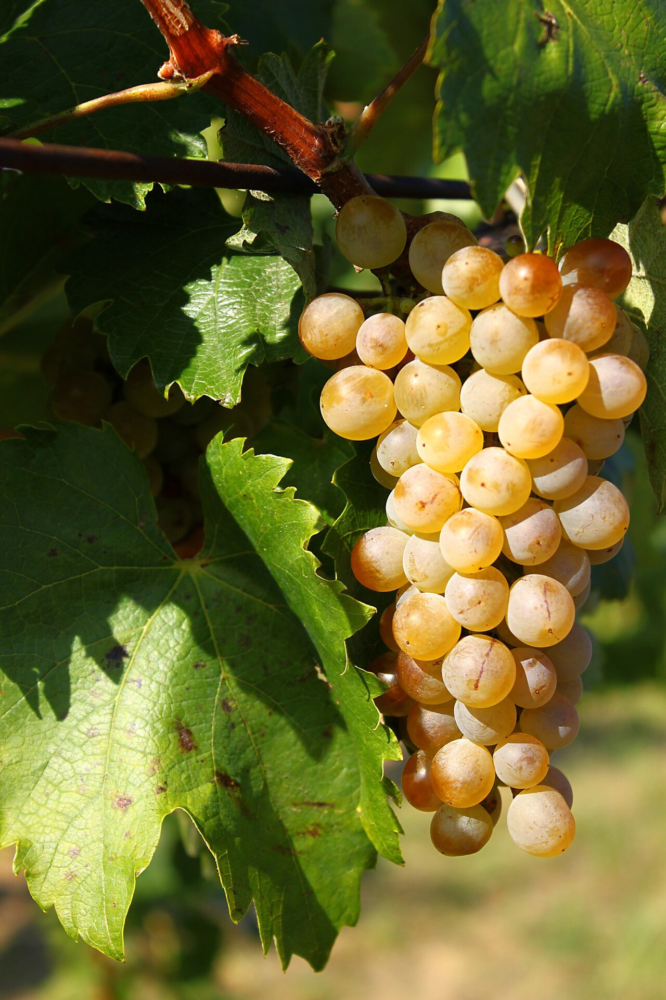

# Furmint

Furmint is the most important white grape of Tokaj in Hungary and one of the most misunderstood varieties in the world. Most drinkers know it only through luscious botrytised sweet wine, yet the grape is high in acidity, thick-skinned and late-ripening, and can make dry whites of real tension. The fog and rivers of Tokaj, noble rot and oak shaped the honeyed apricot of Aszú; the dry Furmint revival of recent decades has brought the variety's citrus, smoke and saline side to the fore.

Figure: Furmint. Image: Andrs.kovacs, CC BY-SA 3.0, via Wikimedia Commons ([source page](https://commons.wikimedia.org/wiki/File:Furmint_grape_cluster.jpg)).

## Definition and synonyms

Furmint is the variety; Tokaj is the region, and the two should not be confused. The name is Furmint in Hungarian and English, and it is also grown in Slovakia, Austria, Slovenia and Croatia under essentially the same name. Szamorodni is a wine style—made from whole clusters with some botrytis, either dry or sweet—not a synonym for the grape, and Aszú is likewise a wine, not a variety. The origin of the name is uncertain; one common explanation links it to wheat, referring to the wheat-gold colour of ripe berries, while another ties it to older local usage. What is clear is that it has been grown in Central Europe for centuries and forms part of the traditional Tokaj blend with Hárslevelű and Sárgamuskotály.

## Parentage and origin

Furmint is native to the Carpathian Basin, with Tokaj-Hegyalja as its heartland. It is documented from the early 17th century, and by the later 17th century Tokaj's botrytised sweet wines were reaching European courts, establishing the Aszú tradition. Genetic work places Furmint among the old Central European varieties and links it to Gouais Blanc; it is a different variety from Hárslevelű, even though the two are often blended and frequently confused by drinkers. Furmint is not a modern hybrid but the result of long vegetative propagation and local selection, so villages and clones differ in ripening, acidity and aroma. Its history is bound up with the volcanic soils, loess and river fog of Tokaj and with the trading networks that carried its wines abroad.

## Botanical character

Furmint has medium bunches and small to medium yellow-green berries, sometimes with a pink tinge at ripeness. The skins are relatively thick, the flesh juicy, sugar accumulation slow and acidity slow to fall. Late ripening is a defining trait: in Tokaj it needs a long, warm autumn to ripen fully, which also gives it the chance to develop noble rot on the vine. Thick skins protect the berries during autumn hang time and allow botrytis to develop on the surface before the fruit collapses. Its aroma is based on citrus, pear, white flowers and minerals, with honey and apricot appearing at full ripeness. Compared with Hárslevelű, Furmint has higher acidity and a tighter frame, while Hárslevelű is more aromatic and softer.

## Viticultural behaviour

Furmint ripens late and needs ample sunshine and a long growing season, favouring south- or south-east-facing slopes. Its slow autumn ripening means it may fail to mature in cool years; in warm years it can accumulate sugar while losing some acidity. Thick skins and moderately tight bunches make it prone to grey rot in wet weather, yet Tokaj's fog season provides the ideal conditions for Botrytis cinerea: warm days, foggy nights and dry afternoons. Viticulture centres on pruning, crop control and selective picking to balance yield and quality: dry wine needs ripeness with retained acidity, sweet wine needs fully botrytised berries. Tokaj's volcanic rock, loess and clay give the wines different mineral and textural signatures.

## Distribution

Tokaj-Hegyalja is the core, with vineyards spread across a series of villages on volcanic rock, loess and river deposits. Other Hungarian regions include Somló, whose volcanic soils give a tight, smoky style, as well as Eger, the Balaton areas of Balatonfüred-Csopak and Badacsony, and Mátra. Slovakia's Tokaj region shares history and some rules with Hungary; Austria's Burgenland, Slovenia's Štajerska and Croatia have small plantings. Furmint is limited outside Hungary, though there are experimental vineyards in the United Kingdom, the United States and Australia. Regional differences are clear: Tokaj is fuller and more mineral, while Somló is tighter and more smoky.

## Legal rules

Tokaj is a protected origin, and Hungary and Slovakia share the use of certain historical names. Tokaji Aszú has required a minimum residual sugar of 120 g/l since the 2013 vintage, and the traditional puttonyos scale is no longer the legal basis, though it remains common in trade and criticism; minimum acidity, ageing and labelling details follow the current regulations. Eszencia is made from the free-run juice of botrytised grapes and has extremely high sugar and very low alcohol. Szamorodni may be dry or sweet and is made from whole clusters containing some botrytis. Dry Furmint may be labelled by variety and region, with Hungarian PDO rules setting yields, alcohol and ageing requirements. Buyers should distinguish Tokaji Aszú, Szamorodni, Eszencia and dry Furmint, which are not the same wine.

## Winemaking

Dry Furmint is made to preserve acidity and minerality: whole-bunch or gentle pressing, cool fermentation, and in many cellars wild yeast and old oak, with lees contact for texture. Malolactic fermentation may be allowed or blocked; many producers block it to keep a bright edge. Aszú is more complex. Botrytised berries are picked one by one, macerated in base wine or fermenting must, then pressed and aged in oak, usually for at least eighteen months, with the exact period set by regulation and house style. Eszencia ferments extremely slowly because of its enormous sugar, giving very low alcohol and intense sweetness. Temperature, yeast and oxygen management during fermentation shape the final style, and the humid Tokaj cellars encourage slow evolution in barrel.

## Sensory style

Dry Furmint is usually pale gold, with lime, quince, pear, green apple, white pepper, smoke and wet stone, high acidity, medium body and a saline, slightly phenolic finish. Good examples can age and develop honey, beeswax and nuts. Sweet Aszú shows apricot, peach, orange peel, honey, ginger and botrytis spice, with acidity high enough to balance extreme sugar, a thick texture and a long finish. Eszencia is closer to syrup and is served in small glasses. Szamorodni sits between the two: sweet versions are round, dry versions show yeast, nuts and oxidative notes. Whether dry or sweet, Furmint is defined by high acidity and a pronounced mineral frame.

## Producers and vintages

Leading Tokaj estates include Royal Tokaji, Disznókő, Oremus, Château Pajzos, István Szepsy, Demeter Zoltán and Bott Frigyes; these producers make both Aszú and dry Furmint. Vintage matters enormously. The autumn fog and humidity decide whether noble rot succeeds; cool years give higher acidity and tighter dry wines, warm years give more sugar and richer sweet wines, and very wet years can bring grey rot and demand rigorous sorting. Dry Furmint varies in the balance between ripeness and acidity, with good years worth ageing and ordinary years best drunk young. Look at producer, village and vintage rather than the word Tokaji alone.

## Common misconceptions

First, that Tokaj is only sweet; dry Furmint has centuries of history and has been a regional priority for the past two decades. Second, that Furmint can only make sweet wine; its acidity and minerality suit dry styles very well. Third, that Tokaji is a grape; it is a region. Fourth, that Szamorodni is another name for Furmint; it is a wine style. Fifth, that Furmint and Hárslevelű are the same; they are often blended but are distinct varieties. Sixth, that sweeter Aszú is always better; acidity and botrytis complexity matter just as much. Seventh, that Furmint grows only in Hungary; Slovakia, Austria and Slovenia also have plantings.

## Further reading

- [Wine](ref:wine): the broad category to which Furmint belongs.
- [White wine](ref:white-wine): the main form of Furmint.
- [Noble rot](ref:noble-rot): the heart of Tokaji Aszú.
- [Late harvest](ref:late-harvest): the picking logic behind sweet Furmint.
- [Acidity](ref:acidity): the frame of both dry and sweet Furmint.
- [Fermentation](ref:fermentation): the process behind styles from dry white to Aszú.
