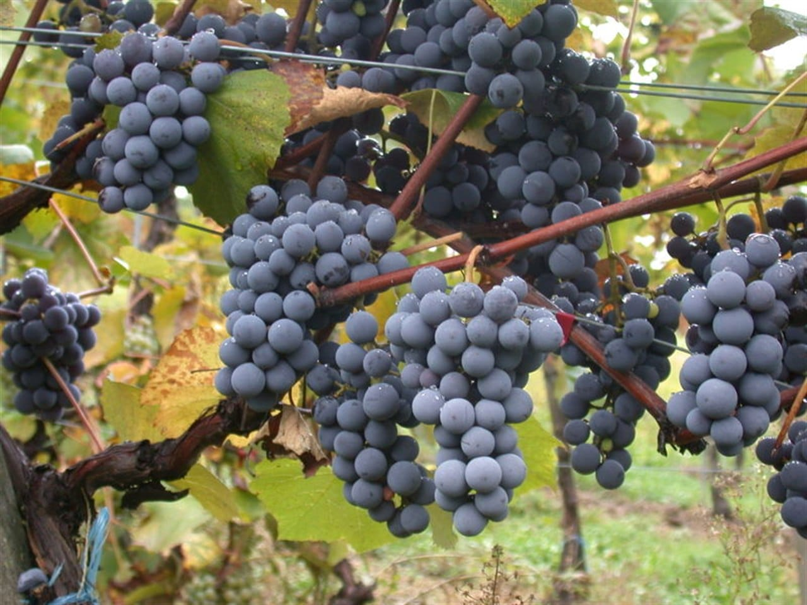
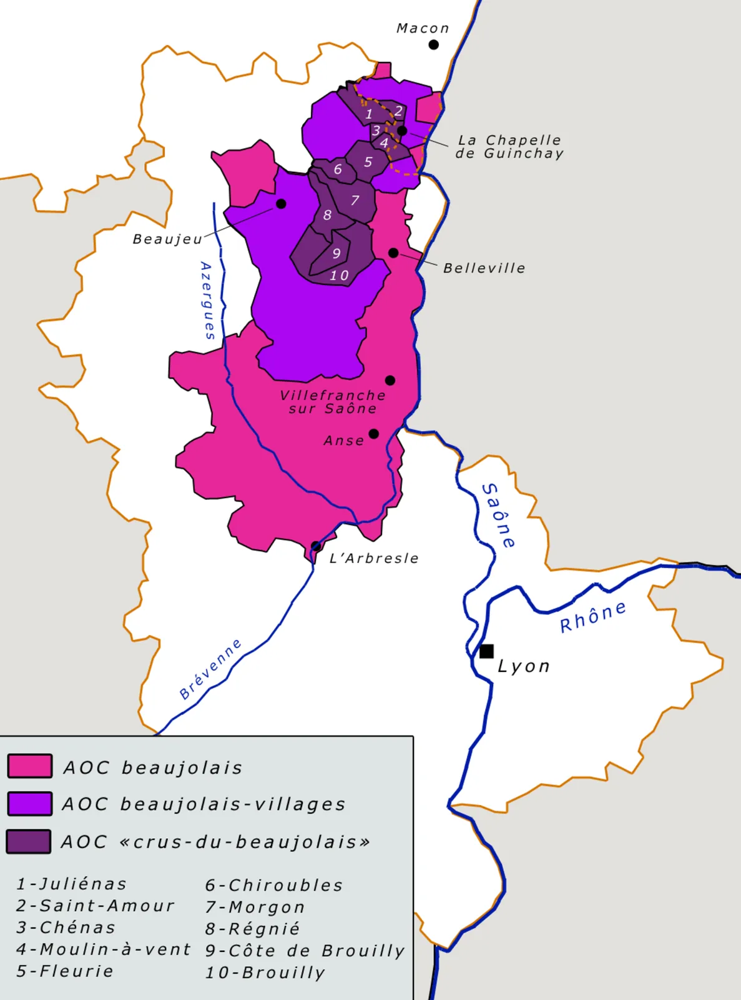

# Gamay

Gamay is a red grape variety, botanically Vitis vinifera, whose full name is usually written Gamay Noir à Jus Blanc. It is thin-skinned, early-ripening and high in acidity, and it is the core variety of [Beaujolais](ref:beaujolais) [red wine](ref:red-wine); it is also planted in France's [Loire](ref:loire) and elsewhere. Compared with [Pinot Noir](ref:pinot-noir), Gamay is easier to grow and more direct in fruit, and its styles range from light and easy to ageworthy village crus.

Figure: Gamay. Image: Viking59, Public domain, via Wikimedia Commons ([source page](https://commons.wikimedia.org/wiki/File:Gamay.jpg)).

## Definition and identity

Gamay is a variety name, not a wine name or an appellation. [Red wine](ref:red-wine) is the category, Gamay is the variety, Beaujolais is the region, and individual crus and estates are the product level. Chinese also translates it as 加美, English usually shortens it to Gamay, and the French full name emphasises its white juice, which distinguishes it from teinturier grapes.

Keeping variety and wine separate explains why one variety can vary so much: Gamay in a village cru can have structure and ageing potential, while regional Beaujolais Nouveau is a light [wine](ref:wine) built on fresh fruit.

## Botanical traits

Gamay has fairly tight bunches and medium berries, thin skins, modest colour and tannin, and high acidity. Its buds break early and it ripens early, which suits regions with a shorter season or a rapid autumn cool-down; thin skins also make it more vulnerable to grey rot and harvest rain.

Genetic research shows that Gamay is a natural cross of Pinot Noir and Gouais Blanc, the same parent combination as Chardonnay. Many field variations and clones exist, differing in yield, berry size and ripening time, which is one reason estates differ in style.

## Main regions

Gamay's core region is France's [Beaujolais](ref:beaujolais), south of Burgundy and north of Lyon, where granite and schist slopes hold most of the village crus. The Mâconnais to the north also plants it, and the Loire's Touraine and Anjou use Gamay for lighter reds.

Outside France, Switzerland, Oregon and New Zealand also plant Gamay, though on a much smaller scale than Beaujolais. Style differences between regions come mainly from climate, soil and whether whole clusters are used, not from the variety itself.

## Typical flavours

Typical Gamay aromas are red cherry, raspberry, strawberry and violet or peony, with some wines showing white pepper and granitic minerality. Tannin is light to medium, acidity is clear, and the body is light to medium; young wines often show banana or bubblegum notes, mostly from particular yeasts and rapid fermentation rather than from the variety itself.

With age, Gamay develops dried flowers, earth and mushroom notes, and the colour shifts from purple-red to brick. Village crus have tighter structure and longer ageing potential, while regional wines and Beaujolais Nouveau aim at fresh fruit and are not for long keeping.

## Representative wines

[Morgon](ref:morgon) is one of the most representative village crus of Beaujolais, known for granite slopes and a fuller body, showing that Gamay can have structure and ageing ability. Beaujolais Nouveau is the other extreme: it stresses fresh fruit from the current harvest and is meant for early drinking.

Seeing the two together shows Gamay's range: the same variety, under different soils, yields and winemaking, can run from light fruit to a red with backbone that rewards keeping.

## Viticulture

Gamay is relatively forgiving in the vineyard, but yield control remains key. Too high a yield dilutes fruit and exaggerates the impression of banana; moderate yields with even ripeness give more concentrated fruit and livelier acidity.

Beaujolais slopes are mostly weathered granite, draining well and encouraging deep roots; flatter, more fertile ground tends to give higher yields. Pruning, crop thinning and canopy management balance yield and ripeness, and harvest date sets the ratio of acidity to fruit.

## Common misconceptions

First, thinking Gamay is only for Beaujolais Nouveau. It can also make structured, ageworthy village crus.
Second, taking the banana note as a varietal aroma. It mostly comes from particular yeasts and rapid fermentation.
Third, assuming pale Gamay has little flavour. Its flavour comes from acidity, fruit and texture rather than colour density.
Fourth, treating Gamay and Pinot Noir as the same thing. They are related, but ripening, skin thickness and body differ.
Fifth, assuming all Beaujolais is for ageing. Regional wines and Nouveau should be drunk early, and only some crus keep well.

Gamay is thin-skinned, early-ripening and high in acidity, and it is the red grape of Beaujolais. Whole-cluster fermentation and granite soils give direct fruit, from light and juicy wines to more serious village crus. It shares a thin skin with Pinot Noir but ripens earlier and keeps a brighter acid line. Beaujolais Nouveau is one product, not the limit of Gamay’s potential. In Beaujolais, village crus differ from basic Beaujolais through site, slope and winemaking, not through the variety alone. The same Gamay can be light and juicy or structured enough to age. Read the appellation and the producer before the style label.

Start with where it is grown. From there, consider how it is labelled, then whether the style is dry or sweet. That is how a practical judgment about Gamay is built.

**Short definition:** A thin-skinned, early-ripening red grape with high acidity and the core variety of Beaujolais reds; known for whole-cluster fermentation and fruit from granite soils, with styles from light and easy to ageworthy village crus.

Treating Gamay as the name of a wine mixes two different questions: identity and use. Separate them before comparing.

Gamay is the base of Beaujolais, where granite soils and whole-cluster fermentation give light colour, high acidity and a peppery red-fruit profile; cru villages such as Morgon and Moulin-à-Vent can age well.

**Key facts.**

| Item | Detail |
| --- | --- |
| In one line | A thin-skinned, early-ripening red grape with high acidity and the core variety of Beaujolais reds; known for whole-cluster fermentation and fruit from granite soils, with styles from light and easy to ageworthy village … |
| Species | Vitis vinifera |
| Key regions | Loire Valley、France |

**Sources and limits.** The key claims about Gamay are checked against the following sources: International Organisation of Vine and Wine (OIV) (Used to check variety descriptions and the Vitis species framework), Oxford University Press (Consulted for entries on Gamay parentage, Beaujolais and winemaking; Migrated from the former reference list at the end of the article; access date not re-verified), INAO (Used to check the relationship between Gamay and its appellations in the French system). Prices, batches and status change; the body is project-written and does not reproduce source text.

For Gamay, this variety was last checked in 2026; prices, batches and availability change, so confirm them against the sources below.

## Further reading

- [Red wine](ref:red-wine): the wider category to which Gamay belongs.
- [Wine](ref:wine): the basic categories and logic of winemaking.
- [France](ref:france): French wine law and appellations.
- [Beaujolais](ref:beaujolais): Gamay's core region and its tiers.
- [Morgon](ref:morgon): a Beaujolais village cru made from Gamay.
- [Pinot Noir](ref:pinot-noir): Gamay's better-known parent and a useful comparison.

## Related images

Image: Beaujolais. Credit: Cyril5555, CC BY-SA 3.0, via Wikimedia Commons ([source page](https://commons.wikimedia.org/wiki/File:Carte_vignoble_beaujolais.png)). Related image for Gamay.
