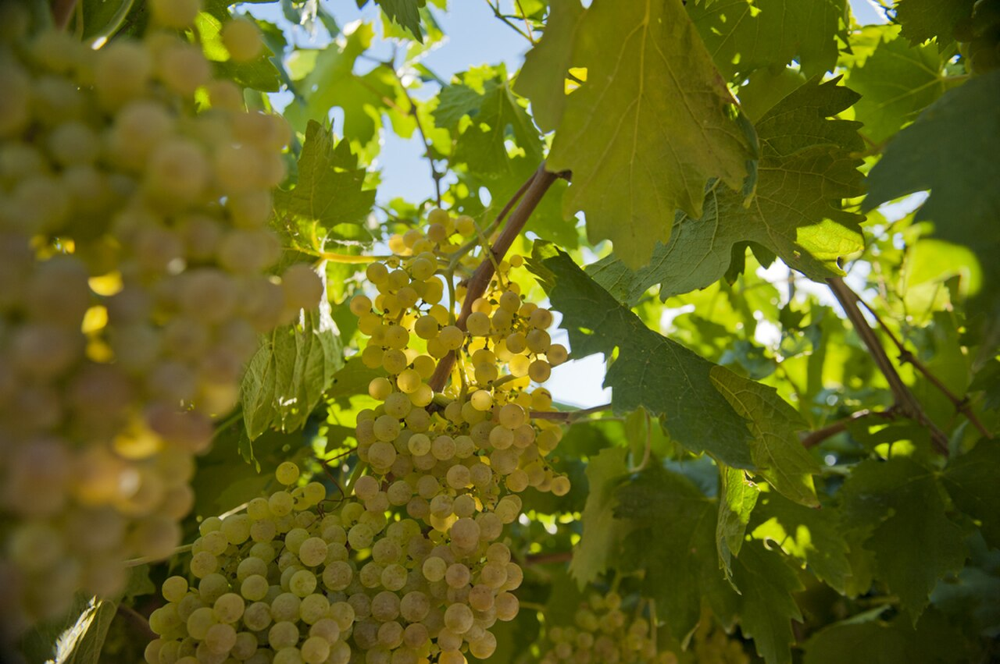

# Garganega

A white grape of Soave in Veneto, Italy, late-ripening and high-yielding, with lemon, almond, white flowers and mineral; it makes dry Soave, sweet Recioto di Soave and sparkling wine.

In the “Hejiu” variety index, Garganega is both a recognisable name and a set of comparable viticultural and winemaking choices. Read it first through its ripening rhythm, acid frame and tannin direction at home, then through what survives or fades when it travels. The gap between Old and New World versions often explains more than the label. For the reader, the point is not a fixed flavour tag but how climate, soil and winemaking decisions turn the same grape into a different wine. This also explains why the same name carries different descriptions across sources: one stresses botany, another market style, another a single region’s rules.

Figure: Garganega: Garganega Soave (Wikimedia Commons). Image: Alessandro Pighi, CC BY-SA 4.0, via Wikimedia Commons ([source page](https://commons.wikimedia.org/wiki/File:Garganega_Soave.jpg)).

## Definition and naming

Garganega is the leading white grape of Soave, Veneto, possibly related to other Verona varieties; it is widely planted in the hills and plains of Veneto.

Garganega is a vines variety or raw material with a definable botanical origin and cultivation history. The name may come from a place, a shape, a farming habit or a promoter; synonyms and homonyms are common, so check the scientific name or classification first.

## Origin and spread

It ripens late and crops high, with thin skins; high yields give faint aroma, while controlled yields and hillside sites bring lemon, almond, white flowers and mineral.

The origin of Garganega can usually be traced to a mountain, valley or coast, then spread through trade, migration and replanting after disease. Spread is not copying: in each new environment growers select different clones, rootstocks and pruning.

Garganega is the dominant white grape of Soave in Veneto and also grown in Gambellara and Colli Berici. It has been recorded around Verona since the Middle Ages, and Soave received DOC status in 1968. The grape is not Riesling or Pinot Blanc; its almond finish and mineral frame come from the variety and the volcanic hillsides, not from a northern European parentage.

## Botany and cultivation

Soave’s volcanic and limestone soils and autumn diurnal range are key to style; Classico and Superiore indicate greater ripeness and structure.

The performance of Garganega depends on budbreak, ripening, vigour, yield and disease resistance. Early varieties carry less risk in cool regions, late varieties need a long autumn; excessive vigour shades fruit, while weak vines crop poorly.

The vine is late-ripening, vigorous and high-yielding, with thin skins and good acidity. Soave’s volcanic basalt and tuff, limestone and alluvial soils give drainage and mineral tension; Classico hillsides ripen later than the plains. Growers prune and thin bunches, and often pick in two passes: one for dry wine, one for Recioto.

## Style and palate

It makes dry Soave, sweet Recioto and sparkling wine; sweet versions use dried grapes and show apricot, honey and nuts.

The style of Garganega is defined by acidity, tannin or bitterness, alcohol, aroma and texture. It can be made alone or as part of a blend; in a blend it may supply colour, acidity, aroma or structure rather than the dominant flavour.

Dry Soave is usually fermented in stainless steel with lees contact; Classico and Superiore may see large oak or barrel fermentation for texture. Recioto di Soave uses grapes dried for three to four months, then fermented slowly and stopped with residual sugar. The same variety gives a dry, almond-edged white and a sweet, dried-apricot wine.

## Main regions and representative wines

Representative wines include Pieropan, Inama, Gini and Suavia; Pieropan’s La Rocca is a Soave benchmark.

To find representative Garganega, start with the place of origin or the most typical region, then compare a New World example. Keep alcohol, sweetness and vintage as close as possible, or you will mistake technique for variety.

Soave Classico centres on Monteforte d’Alpone, San Bonifacio and the Soave hills; Colli Berici and Gambellara give rounder versions. Pieropan, Inama, Gini and Suavia are reference producers, with Pieropan’s Calvarino and La Rocca and Inama’s Froscà among the benchmark hillside wines. Soil and picking date explain more than the word Soave.

## How to drink and pair

To drink Garganega, confirm sweetness and alcohol first, then choose temperature and food. Dry high-acid styles suit fat, seafood and salt; sweet styles suit spice, blue cheese and fruit desserts; high alcohol clashes with sweet or very spicy dishes.

Serve dry Soave at 10–12°C and Recioto at 12–14°C. Seafood, shellfish, vegetables, risotto and fried food suit the dry wine; blue cheese, almond biscuits, fruit tarts and foie gras suit Recioto. Finish dry bottles within two or three days and sweet bottles within one or two weeks.

## Buying and common misreadings

For Garganega, begin with where it is grown. Then look at how it is labelled, and finally ask whether the style is dry or sweet. The answers point to different choices, not to a single score.

### Key dates and figures

- 1968: Soave received DOC status, with Classico and Superiore rules following.
- 1990s: from the 1990s, Pieropan, Inama, Gini and Suavia re-emphasised hillside sites and large-cask fermentation.
- Recioto alcohol: about 12–14%, with residual sugar often above 100 g/L.

## Further reading and see also

To study Garganega, read botanical and viticultural sources first, then taste three wines from different regions side by side. Do not buy many bottles of one style; build a benchmark, then move to blends, sweet or aged versions.

Compare a plain Soave with a Classico and a Superiore, then a dry Soave with a Recioto from the same producer. Fix vintage and sweetness; the almond finish and acidity should remain recognisable across the dry and sweet versions.

- Related: [veneto](ref:veneto), [white-wine](ref:white), [sparkling-wine](ref:sparkling), [terroir](ref:terroir), [oak-ageing](ref:oak).
- This variety offers no plant identification, prices or shopping channels; a label name is not a botanical identification.

**Short definition:** A white grape of Soave in Veneto, Italy, late-ripening and high-yielding, with lemon, almond, white flowers and mineral; it makes dry Soave, sweet Recioto di Soave and sparkling wine.

Soave Classico comes from the volcanic hills between Soave and Monteforte d'Alpone, where Garganega ripens more slowly than on the flat plains; the difference shows as a firmer mineral edge and a bitter-almond finish rather than simple orchard fruit. The appellation also allows a small proportion of Trebbiano di Soave in some wines, which adds acidity and perfume, while modern labels increasingly declare 100% Garganega. Recioto di Soave uses the same grape dried on racks until sugar concentrates, and the resulting wine ranges from apricot and honey to candied citrus. When comparing bottles, check whether the label says Soave, Soave Classico or Recioto, and whether the vineyard site is named; those terms describe different ripeness and winemaking choices, not a quality ladder.

The name Garganega also appears in the Veneto as a synonym for other local grapes in older texts, so the scientific name and the appellation rule are the reliable checks.

## Related images

Image: Vineyard, San Giorgio di Valpolicella, Veneto, Italy. Credit: Unknown photographer, CC BY-SA 2.0, via Wikimedia Commons.. Credit: Unknown photographer, CC BY-SA 2.0, via Wikimedia Commons ([source page](https://commons.wikimedia.org/w/index.php?curid=354325)). Related image for Garganega.
