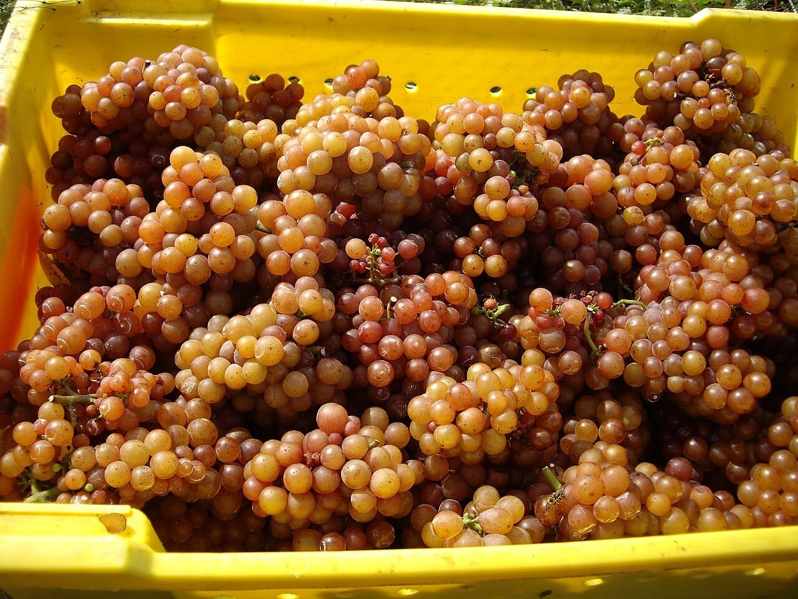
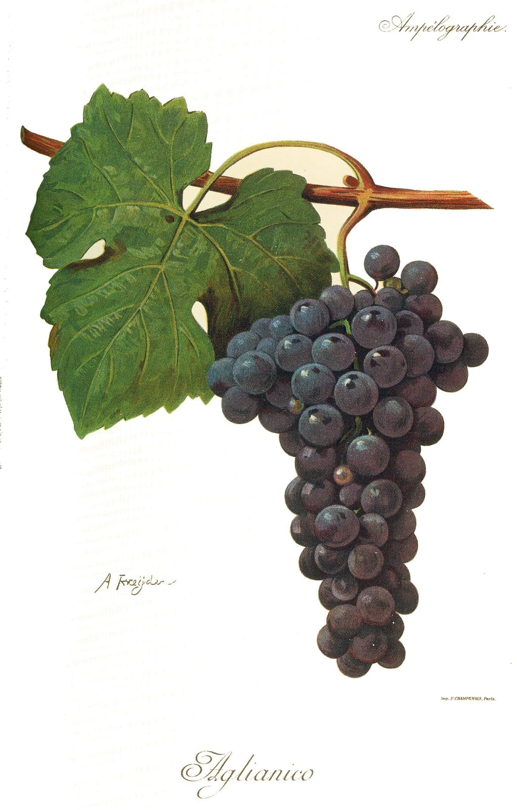

# Gewürztraminer

Gewürztraminer is one of the world's most recognisable white grapes: lychee, rose, ginger and cinnamon need almost no training to identify. That recognisability also brings misunderstanding, since many assume it must be sweet or that more aroma means better quality. In fact it is low in acidity and high in alcohol, ranges from dry to botrytised sweet, and balance is the real difficulty.

Figure: Gewürztraminer. Photograph: Gewürztraminer grapes. Credit: Robert Pitkin, CC BY-SA 2.0, via Wikimedia Commons ([source](https://commons.wikimedia.org/w/index.php?curid=20125056)).

## Definition and synonyms

The German name is Gewürztraminer, where "Gewürz" means spice and "Traminer" refers to Tramin (Termeno) in South Tyrol. It belongs to the European grape Vitis vinifera. Common synonyms include Traminer, Savagnin Rose and Roter Traminer; Traminer in different places may mean types of varying aromatic intensity and is not always a straight synonym. It is not a separate species but an aromatic mutation of Savagnin, which is the key to its aroma and acidity.

## Parentage and origin

Gewürztraminer is treated as an aromatic mutation of Savagnin Blanc rather than a new cross. Savagnin originated in the Alps, and its name shares roots with Traminer; Gewürztraminer was named separately for its pink skins and stronger aroma. Its origin is generally placed at Tramin in northern Italy, and it reached Alsace and Germany through Alpine passes in the Middle Ages. DNA work confirms a relationship with Savagnin and Pinot Gris, but mutation and crossing are different mechanisms and should not be conflated.

## Botanical character

Bunches are medium to small, berries small and tightly packed, skins pink to pale purple, the most visible difference from most white grapes. It buds at mid-season, ripens late, accumulates sugar quickly and loses acidity quickly; thin skins make it prone to grey rot and botrytis. Small berries mean a high skin-to-juice ratio and concentrated aroma, but also lower yields and uneven ripening. Against Pinot Gris, Gewürztraminer has pinker skins, smaller berries and stronger aroma.

## Viticultural behaviour

Gewürztraminer is moderately vigorous with low yields, suiting cool, well-drained slopes. It adapts to many soils, with limestone, marl and granite in Alsace giving different styles, while volcanic soils in Baden and the Pfalz bring more spice. It ripens late, so autumn rain affects picking; thin skins let botrytis develop quickly, good for late-harvest sweet wine but demanding strict selection. Growers trade off yield against ripeness to avoid high alcohol with too little acidity.

## The core of Alsace

Alsace is the classic home of Gewürztraminer, one of its four noble varieties alongside Riesling, Pinot Gris and Muscat. Alsace has 51 Grand Cru sites, and Gewürztraminer is permitted in them; a Grand Cru label must state the site and the variety. Vendanges Tardives and Sélection de Grains Nobles are the two sweet tiers, and Gewürztraminer performs strongly in both. Alsace Gewürztraminer is usually full-bodied with low acidity, in both dry and sweet forms.

## Germany, Austria and Italy

Germany is an important producer, with plantings in Baden and the Pfalz and styles from dry to sweet, often with rose and spice. Austria calls it Traminer, with small plantings in Styria and Lower Austria and a fresher style. Northern Italy has plantings in Alto Adige and Friuli, with tradition surviving around Tramin; there the acidity is slightly higher and the style more restrained. The New World, including California, Australia and New Zealand, has experimental plantings but little area.

## Winemaking and style

Low acidity and high pH demand care: fermentation should not run too hot or aroma is lost; malolactic fermentation lowers acidity further and is avoided by most estates; residual sugar ranges from dry to sweet depending on local rules and house style. Some producers give brief skin contact for texture and colour, but too much extraction brings bitterness. The typical aroma comes from monoterpenes (geraniol, linalool) and cis-rose oxide, the latter central to the lychee note. With age, Gewürztraminer develops honey, gingerbread and smoke.

## Sensory style and pairing

Young Gewürztraminer shows lychee, rose, ginger, cinnamon, apricot and citrus peel, with a full body, low acidity and alcohol often above 13%. Dry versions suit Alsace Munster cheese, foie gras, smoked pork and Asian spiced dishes; sweet versions suit blue cheese and fruit desserts. Because acidity is low, it does not work with very acidic or very hot food, which makes it feel flabby. Serve it slightly cooler than a standard white to restrain the alcohol.

## The difference from Pinot Gris

Gewürztraminer and Pinot Gris are both Alsace noble varieties with pinkish skins, but they differ clearly. Gewürztraminer is an aromatic mutation of Savagnin, with lychee, rose and ginger, lower acidity and a fuller body; Pinot Gris is a colour mutation of Pinot Noir, with pear, apple and almond, slightly higher acidity and a finer texture. Confusing them loses Gewürztraminer's own spice and lychee. Pinot Gris is Pinot Grigio in Italy and lighter in style; Gewürztraminer in Italy is concentrated around Tramin.

## Producers and vintages

Alsace names include Trimbach, Zind-Humbrecht, Hugel and Domaine Weinbach; Trimbach's Cuvée des Seigneurs de Ribeaupierre is often treated as a benchmark dry Gewürztraminer, while Zind-Humbrecht is known for sweet wines and site expression. Baden has estates such as Dr. Heger. Vintage differences come mainly from autumn humidity and botrytis: dry years suit dry wine, humid years suit late harvest and noble rot. In the market, Gewürztraminer rose on its lychee aroma in the late 20th century and has more recently been challenged by its low-acid, sweet image.

## Common misconceptions

First, that Gewürztraminer is always sweet; Alsace makes plenty of dry wine. Second, that more aroma is better; over-ripeness loses acidity and detail. Third, equating Traminer completely with Gewürztraminer; Traminer may mean types of different aromatic intensity. Fourth, that it cannot pair with food; dry versions work well with cheese and smoked dishes. Fifth, that low acidity means it cannot age; good late-harvest and botrytis wines can keep for decades. Sixth, confusing it with Pinot Gris; their origins and aromas are entirely different.

**At a glance:** An aromatic white grape with pink skins, named after Tramin in South Tyrol. An aromatic mutation of Savagnin, it is low in acidity and quick to accumulate sugar, known for lychee, rose, ginger and cinnamon, and grown mainly in Alsace, Germany, Austria and northern Italy. 

## Further reading

- [White wine](ref:white-wine): the drink style to which Gewürztraminer belongs.
- [France](ref:france): the country and legal framework of Alsace.
- [Germany](ref:germany): another important producer of Gewürztraminer.
- [Fermentation](ref:fermentation): how temperature and residual sugar affect aroma.

Further reading: [Aglianico](ref:c-extra-1).

## Related images

Image: Aglianico. Credit: Alexis Kreyder, Public domain, via Wikimedia Commons ([source page](https://commons.wikimedia.org/wiki/File:Aglianico_Viala_Vermorel.jpg)). Related image for Gewürztraminer.
