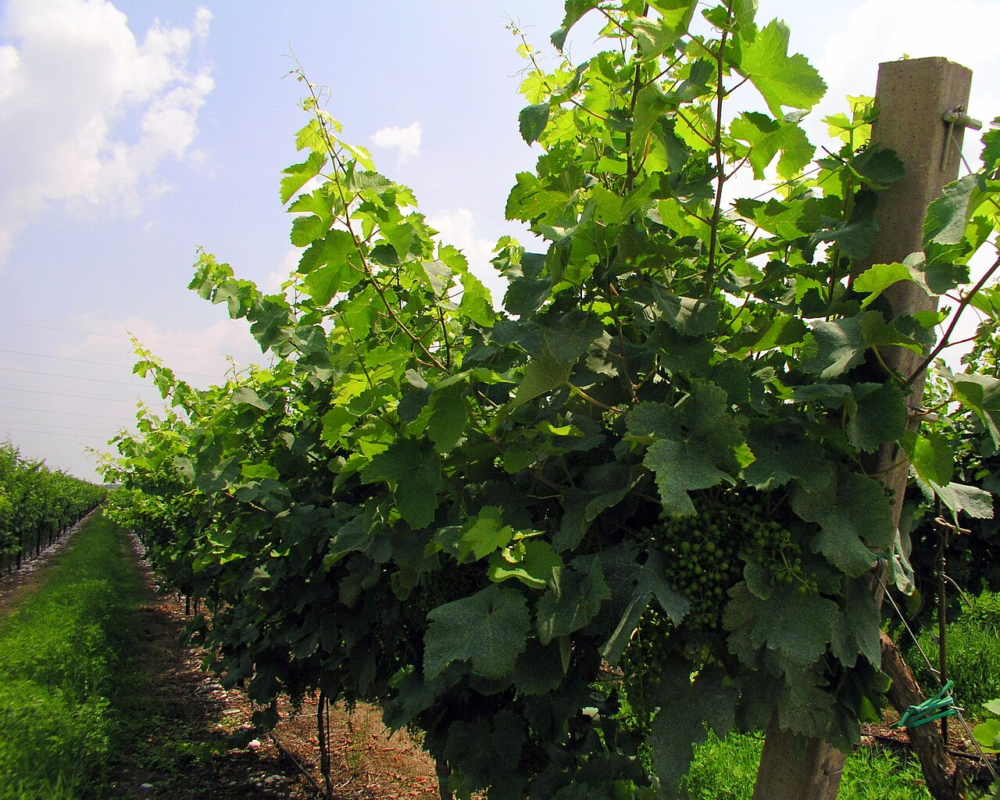

# Glera

Glera is a white grape of north-east Italy and the core of Prosecco. Half of its story is in the vineyard, the other half in naming rules: until 2009 both grape and wine were called Prosecco, after which the variety officially became Glera while the wine kept the name Prosecco and the production area was redrawn. That renaming is the premise for understanding why the wine expanded so quickly in global markets.

Figure: Glera. Image: paul Barker Hemings from seregno, 85, CC BY-SA 2.0, via Wikimedia Commons ([source page](https://commons.wikimedia.org/wiki/File:Prosecco_vitigni.jpg)).

## Definition and synonyms

The Italian name is Glera. It belongs to the European grape Vitis vinifera. Historical synonyms include Prosecco, Prosecco Bianco, Prosecco Nostrano and Serprino; Serprino is still used for sparkling wine around the Euganean Hills (Colli Euganei) in Veneto. The name change was an institutional and market adjustment and did not alter the botanical variety. A label saying Glera usually marks the variety, while Prosecco points to the appellation and the wine type.

## Parentage and origin

The parentage of Glera is still unresolved. Early work linked it to Traminer, but later genetic analysis has not produced a consistent parent pair; the safer statement is that it belongs to an old variety group on the northern Adriatic coast, related to white grapes of the Friuli and Slovenian borderlands. It was long grown in Veneto and Friuli and became a regional protagonist only after Prosecco's commercial rise in the 19th century. Treating Glera as a newly bred variety is a mistake: a change of name is not a change of plant.

## Botanical character

Bunches are large, berries medium and loosely packed, skins thin and yellow-green, flesh juicy. Budbreak is early to medium and ripening late, making it a late variety; thin skins make it sensitive to grey rot, sunburn and hail. Sugar accumulation is moderate and acidity falls slowly, which matters for sparkling base wine: the base needs enough acidity to stay fresh after second fermentation and disgorging. Compared with Chardonnay, Glera has larger berries, thinner skins and aromas leaning to pear and white flowers.

## Viticultural behaviour

Glera is vigorous and high-yielding, and historically over-cropped, which diluted flavour. Modern rules control quality through yield ceilings and ripeness requirements; the plains and hills of Veneto differ clearly, with hills draining better and ripening more evenly, while plains give higher yields but weaker acidity and aroma. Double Guyot and pergola are common, with mechanisation on the plains and hand work on the hills. Late ripening means picking often falls in mid to late September, and autumn rain demands quick handling.

## The legal area of Prosecco

Prosecco DOC covers nine provinces in Veneto and Friuli: Treviso, Venice, Vicenza, Padua and Belluno, plus Gorizia, Pordenone, Trieste and Udine in Friuli. The two DOCGs are Conegliano Valdobbiadene and Asolo, the first gaining DOC in 1969 and DOCG in 2009, the second upgraded the same year. Prosecco DOC requires at least 85% Glera, with up to 15% from Verdiso, Bianchetta Trevigiana, Perera, Glera Lunga, Chardonnay, Pinot Bianco, Pinot Grigio and others; the DOCG rules are also built on Glera but stricter on yields and sites. Cartizze is a famous sub-zone within Conegliano Valdobbiadene, while Rive denotes steep single-village parcels.

## Winemaking and sparkling method

Prosecco is mostly made by tank second fermentation (Charmat/Martinotti): the base wine ferments cool in stainless steel, then sugar and yeast are added for a second fermentation in a sealed tank, completed in about 30 days and filtered before bottling. This preserves fruit and freshness at lower cost than traditional bottle fermentation. A few producers use bottle fermentation or rifermentazione in bottiglia, giving more complexity but limited volume. Residual sugar sets the style: Brut is 0 to 12 g/l, Extra Dry 12 to 17 g/l, Dry 17 to 32 g/l and Demi-Sec 32 to 50 g/l. Note that Extra Dry is sweeter than Brut, the most common beginner's confusion.

## Sensory style

Typical Glera sparkling wine is pale lemon with a fine bead, aromas of green apple, pear, white peach, white flowers and citrus, moderate acidity and a light to medium body. Warm years give sweeter fruit and lower acidity; cool years are leaner and more citrus-driven. Cartizze parcels are fuller and more concentrated, while Rive wines show more acidity and mineral tone from slopes and old vines. Ageing potential is limited, and most bottles are best within three to five years, though top DOCGs can go longer.

## Differences from Chardonnay and Muscat

Glera is often compared with Chardonnay, but their roles differ: Chardonnay is a neutral, malleable base variety, while Glera carries its own pear and white-flower aroma with lower acidity and a lighter body. Against Muscat, Glera is more delicate and lacks the obvious grape and orange-blossom notes. Prosecco is often mistaken for a sweet wine made from Muscat, yet its sweetness comes from dosage at second fermentation, not from Muscat aromas.

## Producers and market

The Prosecco area has many estates and cooperatives. Nino Franco, Bisol, Ruggeri, Zardetto, Villa Sandi, Carpenè Malvolti and Bortolomiol are often cited, and large cooperatives account for a high share of volume. In the market, Prosecco became one of the world's best-selling sparkling categories in the 21st century, driven by affordability, distinctive packaging and easy drinking; the cost is stylistic uniformity and a "sweet water" reputation. DOCG and Rive wines try to show that the grape can also express site and vintage depth.

## Common misconceptions

First, that Glera is a new variety; it is simply the renamed Prosecco grape. Second, that Prosecco means sweet wine; Brut and Extra Brut are dry. Third, that Extra Dry is drier than Brut; it is the opposite. Fourth, that all Prosecco comes from one area; DOC and the two DOCGs have different boundaries and rules. Fifth, that tank fermentation is a low-end process; it is a style choice, not a quality level. Sixth, that Prosecco cannot age; top DOCGs can keep for several years, though most bottles are indeed for early drinking.

[Sparkling wine](ref:sparkling) and [Prosecco](ref:prosecco) are the two useful reference points for Glera. [Sparkling wine](ref:sparkling) sets out variety character; [Prosecco](ref:prosecco) brings in regional performance. Read them together.

**At a glance:** A white grape of Veneto and Friuli in Italy, known as Prosecco for both grape and wine until 2009, when the variety was renamed Glera to protect the place name. Thin-skinned with moderate acidity, it shows green apple, pear and white flowers and is the core of Prosecco, called Serprino around the Euganean Hills. 

## Further reading

- [Sparkling wine](ref:sparkling): the overall classification and process of sparkling wine.
- [Italy](ref:italy): the regional framework of Italian wine.
- [Prosecco](ref:prosecco): the wine and appellations built on Glera.
- [Fermentation](ref:fermentation): second fermentation and the tank method.

Further reading: [Aglianico](ref:c-extra-1).
