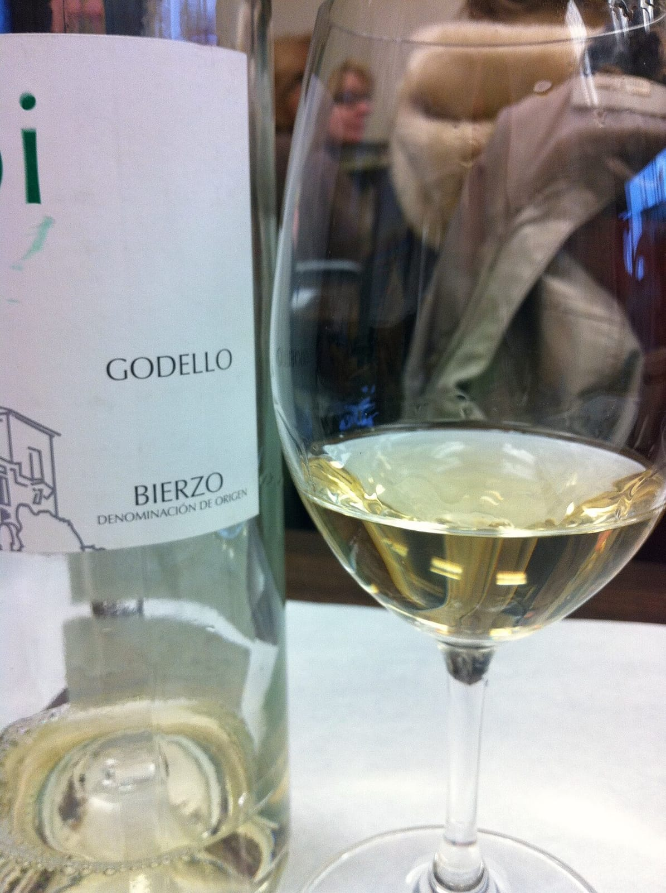

# Godello

A white grape of Valdeorras, Ribeiro and Monterrei in northwest Spain, with citrus, white flowers, mineral and nuts, medium-high acidity and a full texture; it can be made crisp or oaked.

In the “Hejiu” variety index, Godello is both a recognisable name and a set of comparable viticultural and winemaking choices. Read it first through its ripening rhythm, acid frame and tannin direction at home, then through what survives or fades when it travels. The gap between Old and New World versions often explains more than the label. For the reader, the point is not a fixed flavour tag but how climate, soil and winemaking decisions turn the same grape into a different wine. This also explains why the same name carries different descriptions across sources: one stresses botany, another market style, another a single region’s rules.

Figure: Godello: Bierzo Godello (Wikimedia Commons). Image: Agne27, CC BY-SA 3.0, via Wikimedia Commons ([source page](https://commons.wikimedia.org/wiki/File:Bierzo_Godello.JPG)).

## Definition and naming

Godello comes from northwest Spain, with Valdeorras, Ribeiro and Monterrei as core regions; it may share origins with Portuguese Gouveio.

Godello is a vines variety or raw material with a definable botanical origin and cultivation history. The name may come from a place, a shape, a farming habit or a promoter; synonyms and homonyms are common, so check the scientific name or classification first.

## Origin and spread

Valdeorras’ slate and granite soils and river valleys give mineral notes and acidity; Ribeiro is warmer and rounder.

The origin of Godello can usually be traced to a mountain, valley or coast, then spread through trade, migration and replanting after disease. Spread is not copying: in each new environment growers select different clones, rootstocks and pruning.

Origin research relies on genetic markers, old vineyards and documents together. Parentage, spread and local names do not always agree; two places using the same name do not prove the same variety.

## Botany and cultivation

Berries are medium and thin-skinned, mid-late ripening; acidity is medium-high, with lemon, grapefruit, white flowers, fennel and nuts.

The performance of Godello depends on budbreak, ripening, vigour, yield and disease resistance. Early varieties carry less risk in cool regions, late varieties need a long autumn; excessive vigour shades fruit, while weak vines crop poorly.

The key in cultivation is balance between leaf and fruit: too little leaf area and sugar fails; too much and shade lowers acidity. Pruning, training, leaf removal and irrigation all adjust that balance.

## Style and palate

It can be fermented in stainless steel or oak; lees stirring adds texture, and oak versions show vanilla, toast and a fuller body.

The style of Godello is defined by acidity, tannin or bitterness, alcohol, aroma and texture. It can be made alone or as part of a blend; in a blend it may supply colour, acidity, aroma or structure rather than the dominant flavour.

Winemaking pushes a variety in different directions: whole-cluster fermentation adds spice and structure, destemming gives cleanliness; cool maceration extracts colour and perfume, warmth more tannin. Variety is not destiny; process is a variable.

## Main regions and representative wines

Representative wines include Rafael Palacios, Valdesil, Guímaro and Pazo de Monterrey; Rafael Palacios’ Sorte O Soro is a benchmark.

To find representative Godello, start with the place of origin or the most typical region, then compare a New World example. Keep alcohol, sweetness and vintage as close as possible, or you will mistake technique for variety.

The same variety drifts across regions: warmer sites give more ripeness and alcohol, cooler sites more acidity and herbal notes. When seeking benchmarks, compare at least one origin with one New World region.

## How to drink and pair

To drink Godello, confirm sweetness and alcohol first, then choose temperature and food. Dry high-acid styles suit fat, seafood and salt; sweet styles suit spice, blue cheese and fruit desserts; high alcohol clashes with sweet or very spicy dishes.

Temperature and glass follow body: light reds can be cooler, structured reds warmer; high-acid whites need cold, rich whites can be warmer. Wrong temperature lets alcohol or coldness hide the variety.

## Buying and common misreadings

To read Godello, start with where it is grown, then how it is labelled, then whether the style is dry or sweet; no single check settles it.

### Key dates and figures

- 1970s: in the 1970s–1980s, Valdeorras growers and nurseries reselected local Godello material after high-yield hybrids displaced old plots.
- 2000s: the modern revival has relied on old vines, slate soils and lees ageing rather than a single estate’s marketing.

## Further reading and see also

To study Godello, read botanical and viticultural sources first, then taste three wines from different regions side by side. Do not buy many bottles of one style; build a benchmark, then move to blends, sweet or aged versions.

The most efficient way to learn a variety is a triangle comparison: same vintage, alcohol and sweetness, changing only variety or region. Change one variable at a time so the palate memory stays clear.

- Related: [white-wine](ref:white), [oak-ageing](ref:oak), [terroir](ref:terroir), [fermentation](ref:fermentation), [chardonnay](ref:chardonnay).
- This variety offers no plant identification, prices or shopping channels; a label name is not a botanical identification.

Read [White wine](ref:white) for the variety character side of Godello, and [Terroir](ref:terroir) for the regional performance side. Together they locate it.

**Short definition:** A white grape of Valdeorras, Ribeiro and Monterrei in northwest Spain, with citrus, white flowers, mineral and nuts, medium-high acidity and a full texture; it can be made crisp or oaked.

Godello survives mainly in Valdeorras, Ribeiro and Monterrei, where slate and granite terraces force low yields and give the grape its citrus-and-mineral core. Valdeorras is the benchmark: vineyards along the Sil river ripen Godello to a full texture while keeping acidity, and both crisp unoaked and lees-aged or barrel-fermented versions are common. The variety was nearly abandoned in the twentieth century before replanting from old vines; its modern reputation rests on that recovery. A label may say Godello or Godello de Valdeorras; the second ties the wine to a narrower zone and usually a firmer mineral profile. Compared with Albariño, Godello has more body and less aromatic lift, so match it with richer fish and poultry rather than light shellfish.

Godello is also planted in Bierzo and Valdeorras, where slate soils and old vines give a firmer mineral edge.

**Key facts.**

| Item | Detail |
| --- | --- |
| In one line | A white grape of Valdeorras, Ribeiro and Monterrei in northwest Spain, with citrus, white flowers, mineral and nuts, medium-high acidity and a full texture; it can be made crisp or oaked. |
| Species | Vitis vinifera |

**Sources and limits.** The key claims about Godello are checked against the following sources: Julius Kühn-Institut (variety names, synonyms, origins and global distribution), OIV (the grape-variety and viticulture framework), USDA ARS (botanical classification, germplasm and cultivation information) and 4 sources in total. Prices, batches and status change; the body is project-written and does not reproduce source text.
