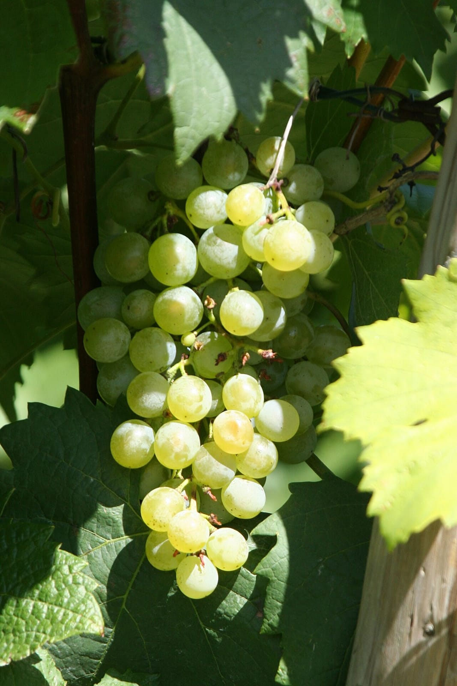
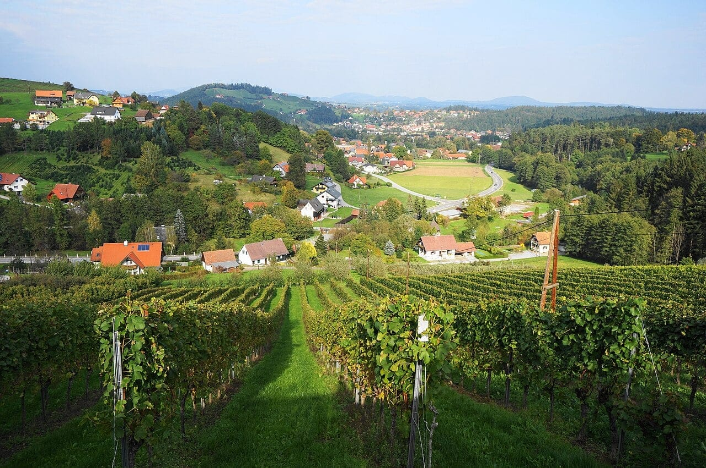

# Grüner Veltliner

Grüner Veltliner is Austria's signature white grape, widely planted in the Wachau, Kremstal, Kamptal and Weinviertel. Its identity comes from acidity and aroma: citrus, green pea, white pepper and a mineral note, fresh when young and fuller and more layered when ripe. It is also one of the few white grapes whose signature is white pepper, an aroma that comes from a compound called rotundone.

Figure: Grüner Veltliner. Image: Rosenzweig, CC BY-SA 3.0, via Wikimedia Commons ([source page](https://commons.wikimedia.org/wiki/File:Gruener_Veltliner_Weinsberg_20060909.jpg)).

## Definition and synonyms

The German name is Grüner Veltliner, sometimes written Gruener Veltliner or Gruner Veltliner in English. It belongs to the European grape Vitis vinifera. "Grüner" means green, referring to the yellow-green colour at ripeness; "Veltliner" may come from Valtellina in northern Italy, hinting at an Alpine origin. A label may also use Weißgipfler, but that is a related name and should not be treated as a straight synonym.

## Parentage and origin

DNA research shows that Grüner Veltliner is a natural cross of Traminer (Savagnin) and the old Austrian variety St. Georgen. This explains why it carries spice from the Traminer side along with the acidity and structure of a local Austrian grape. Its origin is generally placed in eastern Austria, perhaps the Wachau or Weinviertel, though early spread remains debated. It is not directly related to Riesling; the two are compared only because both are late-ripening, high-acid whites.

## Botanical character

Bunches are medium to large, berries medium and fairly tight, skins yellow-green and relatively thick. It buds at mid-season and ripens late; thick skins give some tolerance to grey rot and help aroma accumulation. Sugar accumulates moderately and acidity falls slowly, so it stays fresh at ripeness. Against Riesling, Grüner Veltliner has larger berries, thicker skins and aromas leaning to pepper and green pea rather than flowers and stone.

## Viticultural behaviour

Grüner Veltliner is vigorous and high-yielding and needs pruning and green harvesting to control crop load. It grows on loess, gneiss, granite and limestone, but soil changes the style clearly: loess in the Weinviertel gives a fuller body and softer acidity, while gneiss and granite terraces in the Wachau give tighter structure and a mineral tone. Cold tolerance is moderate, spring frost is the main risk, and late ripening means picking often falls in October, with autumn rain deciding vintage quality.

## Distribution in Austria

Austria has about 14000 ha of Grüner Veltliner, roughly one third of the national vineyard area and the most planted white grape. Core regions are the Wachau, Kremstal, Kamptal, Traisental, Wagram and Weinviertel; Styria also has plantings but is better known for Sauvignon Blanc. Lower Austria along the Danube is the centre of gravity, with terraces, river valleys and loess plateaus giving different ripening conditions.

## The Wachau three-tier system

The Wachau uses a distinctive alcohol-based hierarchy rather than the usual sugar-based one. Steinfeder is the lightest tier, with a maximum of 11.5% alcohol, a light body and early drinking; Federspiel runs from 11.5% to 12.5%, medium in style with clear acidity; Smaragd has a minimum of 12.5% alcohol, the fullest body and the best ageing potential. The names come from local plants and birds, and the rules also limit chaptalisation and yields. Other regions use the DAC system: Weinviertel DAC became Austria's first DAC in 2002, stressing dry style and pepper aroma.

## Winemaking and style

Grüner Veltliner is mostly fermented in stainless steel to stress fresh fruit and acidity; Smaragd and top single vineyards often use large old barrels or some new oak for texture and complexity. Malolactic fermentation is usually suppressed to keep acidity, and lees stirring can add roundness. The classic profile is citrus, green apple, green pea, white pepper and wet stone, dry, high in acid and spicy on the finish. With age it develops honey, toast and a more complex pepper note. It can be dry, off-dry or occasionally sweet, but dry white dominates.

## The difference from Riesling

Both are high-acid Austrian whites, but they differ. Riesling leans to flowers, white peach and stone, with sharper acidity and a petrol note with age; Grüner Veltliner leans to green pea, white pepper and citrus, with a broader body, slightly softer acidity and easier early drinking. Riesling is often on steep sites in the Wachau and Kamptal, while Grüner Veltliner is more widely spread. Calling Grüner Veltliner "Austria's Riesling" overlooks its own pepper aroma and food-matching strength.

## Producers and vintages

Wachau names include F.X. Pichler, Emmerich Knoll, Prager and Hirtzberger; the Kamptal has Bründlmayer and Loimer; the Weinviertel relies more on cooperatives and medium-sized estates. Vintage differences come mainly from autumn rain and ripeness: dry warm years give fuller body and more alcohol, cool wet years sharper acidity and lower yields. In the market, Grüner Veltliner became internationally known in the early 21st century for its white pepper note, with prices ranging from everyday bottles to top single vineyards.

## Common misconceptions

First, that Grüner Veltliner comes only from the Wachau; it is planted across Lower Austria and Styria. Second, taking Smaragd for a vineyard classification; it is an alcohol and ripeness tier, not a site tier. Third, assuming Grüner Veltliner always tastes of pepper; pepper depends on vintage, soil and winemaking. Fourth, treating it as a Riesling substitute; aromas and structure differ. Fifth, that it cannot age; good Smaragd can keep for more than a decade. Sixth, that all Grüner Veltliner is for early drinking; everyday wines are, but top bottles need time.

**Short definition:** Austria's signature white grape, late-ripening and high in acidity, with citrus, green pea and white pepper aromas. DNA work shows it is a natural cross of Traminer and the old Austrian variety St. Georgen, and in the Wachau it is graded by alcohol into Steinfeder, Federspiel and Smaragd.

Grüner Veltliner is best read by starting with where it is grown, moving to how it is labelled, and ending with whether the style is dry or sweet.

Read [Wine](ref:wine) for the variety character side of Grüner Veltliner, and [Wachau](ref:wachau) for the regional performance side. Together they locate it.

**Key facts.**

| Item | Detail |
| --- | --- |
| In one line | Austria's signature white grape, late-ripening and high in acidity, with citrus, green pea and white pepper aromas. DNA work shows it is a natural cross of Traminer and the old Austrian variety St. Georgen, and in the Wa… |
| Species | Vitis vinifera |
| Key regions | Styria、Wachau |

## Further reading

- [Wine](ref:wine): the overall classification of wine.
- [White wine](ref:white-wine): the drink style to which Grüner Veltliner belongs.
- [Wachau](ref:wachau): the core region and its three-tier system.
- [Styria](ref:styria): another important Austrian region.
- [Riesling](ref:riesling): the variety often compared with Grüner Veltliner.

## Related images

Image: Vineyards and villages in the Schilcher wine country of Weststeiermark, Austria.. Credit: Naturpuur, CC BY 4.0, via Wikimedia Commons ([source page](https://commons.wikimedia.org/wiki/File:Panorama_Schilcher_Weingegend,_Weststeiermark.jpg)). Related image for Grüner Veltliner.
