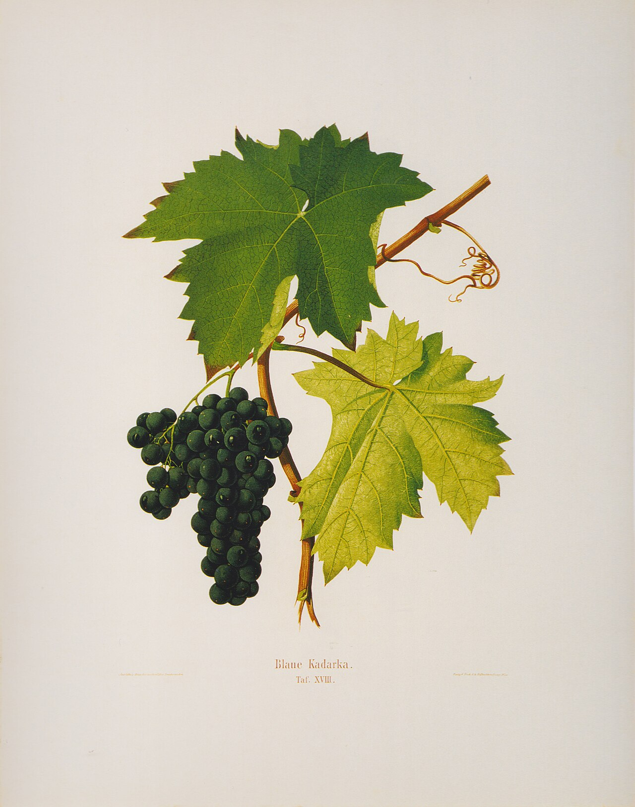

# Kadarka

A red grape of Hungary and the Balkans, pale in colour, high in acidity and low in tannin, with red cherry, spice and pepper; once Hungary’s most important red grape, it survives as a traditional variety in Szekszárd and Eger.

In the “Hejiu” variety index, Kadarka is both a recognisable name and a set of comparable viticultural and winemaking choices. Read it first through its ripening rhythm, acid frame and tannin direction at home, then through what survives or fades when it travels. The gap between Old and New World versions often explains more than the label. For the reader, the point is not a fixed flavour tag but how climate, soil and winemaking decisions turn the same grape into a different wine. This also explains why the same name carries different descriptions across sources: one stresses botany, another market style, another a single region’s rules.

Figure: Kadarka: Kreuzer Ampelographie 144 Blaue Kadarka (Wikimedia Commons). Image: Vinzenz Kreuzer / Conrad Kreuzer, Public domain, via Wikimedia Commons ([source page](https://commons.wikimedia.org/wiki/File:Kreuzer_Ampelographie_144_Blaue_Kadarka.jpg)).

## Definition and naming

Kadarka comes from the Balkans, possibly Hungary or Serbia; it was Hungary’s most important red grape in the nineteenth century before being replaced by Kékfrankos and Merlot.

Kadarka is a vines variety or raw material with a definable botanical origin and cultivation history. The name may come from a place, a shape, a farming habit or a promoter; synonyms and homonyms are common, so check the scientific name or classification first.

## Origin and spread

It adapts to continental climates, ripening late with thin skins; Szekszárd and Eger are core regions, often blended with Kékfrankos.

The origin of Kadarka can usually be traced to a mountain, valley or coast, then spread through trade, migration and replanting after disease. Spread is not copying: in each new environment growers select different clones, rootstocks and pruning.

Kadarka is a red grape of Hungary and the Balkans, most closely associated with Szekszárd and Eger. It probably entered Hungary from the Balkans in the eighteenth century and became a mainstay of the Great Plain and Danube-side vineyards. Phylloxera, war and socialist-era planting of higher-yielding varieties reduced it sharply before a 1990s revival.

## Botany and cultivation

Berries are medium and thin-skinned, late-ripening, giving pale colour, high acidity and low tannin; red cherry, strawberry, spice, pepper and earth.

The performance of Kadarka depends on budbreak, ripening, vigour, yield and disease resistance. Early varieties carry less risk in cool regions, late varieties need a long autumn; excessive vigour shades fruit, while weak vines crop poorly.

The vine is late-ripening with thin skins, high acidity and low tannin, so colour is pale and grey rot is a constant risk in wet years. Szekszárd’s loess and limestone give fullness and spice; Eger’s volcanic soils give higher acidity and brighter red fruit. Short maceration and careful yield control protect the delicate structure.

## Style and palate

Traditional large or old oak stresses lightness and spice; modernists use whole clusters for more structure.

The style of Kadarka is defined by acidity, tannin or bitterness, alcohol, aroma and texture. It can be made alone or as part of a blend; in a blend it may supply colour, acidity, aroma or structure rather than the dominant flavour.

Traditional producers use large old oak and short maceration, emphasising lightness and pepper; modernists use whole-cluster fermentation, small amounts of new oak and longer maceration for more colour and structure. In Egri Bikavér, Kadarka supplies acidity and red fruit while Kékfrankos and Merlot provide tannin and depth.

## Main regions and representative wines

Representative wines include Takler, Vida and Heimann in Szekszárd; Kadarka is often blended with Kékfrankos and Merlot in Hungary.

To find representative Kadarka, start with the place of origin or the most typical region, then compare a New World example. Keep alcohol, sweetness and vintage as close as possible, or you will mistake technique for variety.

Szekszárd is the fullest and most loess-driven; Eger is cooler and more acid-driven; Kunság and the Great Plain produce lighter volumes. Takler, Vida, Heimann and Bock are useful reference producers. A single-varietal Kadarka is rare and should be judged separately from the Bikavér blends that contain it.

## How to drink and pair

To drink Kadarka, confirm sweetness and alcohol first, then choose temperature and food. Dry high-acid styles suit fat, seafood and salt; sweet styles suit spice, blue cheese and fruit desserts; high alcohol clashes with sweet or very spicy dishes.

Serve at 13–15°C in a medium red-wine glass; young wines need little decanting, older bottles only a brief one. Paprika chicken, pork stew, sausage, game and medium-hard cheese suit the acidity; heavy sauces and high-tannin dishes overwhelm it. Drink within two or three days of opening.

## Buying and common misreadings

For Kadarka, begin with where it is grown. Then look at how it is labelled, and finally ask whether the style is dry or sweet. The answers point to different choices, not to a single score.

### Key dates and figures

- 1990s: after the socialist period, small wineries restored the style with old vines and low yields.
- Alcohol: usually 12–13.5%, with low residual sugar.

## Further reading and see also

To study Kadarka, read botanical and viticultural sources first, then taste three wines from different regions side by side. Do not buy many bottles of one style; build a benchmark, then move to blends, sweet or aged versions.

Compare a single-varietal Kadarka with a Kékfrankos from the same region, then a Kadarka-led Bikavér with a Kékfrankos-led one. Record maceration length and blend proportion; colour alone will not tell you which grape is doing the structural work.

- Related: [blaufrankisch](ref:blaufrankisch), [red-wine](ref:red), [terroir](ref:terroir), [oak-ageing](ref:oak), [vintage](ref:vintage).
- This page offers no plant identification, prices or shopping channels; a label name is not a botanical identification.

**At a glance:** A red grape of Hungary and the Balkans, pale in colour, high in acidity and low in tannin, with red cherry, spice and pepper; once Hungary’s most important red grape, it survives as a traditional variety in Szekszárd and Eger. 

Read [Blaufränkisch](ref:blaufrankisch) for the variety character side of Kadarka, and [Terroir](ref:terroir) for the regional performance side. Together they locate it.

Kadarka was once the most widely planted red grape in Hungary, but phylloxera and the socialist-era shift to higher-yielding varieties reduced it to a few traditional sites. It survives in Szekszárd and Eger, where thin skins and late ripening give pale colour, high acidity and low tannin; the best wines are light, spicy and peppery rather than deep and powerful. The grape is sensitive to rot and yields irregularly, so growers often field-graft it and pick selectively. In the Balkans it appears under local synonyms, and the name can cover more than one clone. A Kadarka label from Szekszárd or Eger is the most reliable starting point; blends with Kékfrankos are common, so check the proportion if you want the variety's light, aromatic style.
