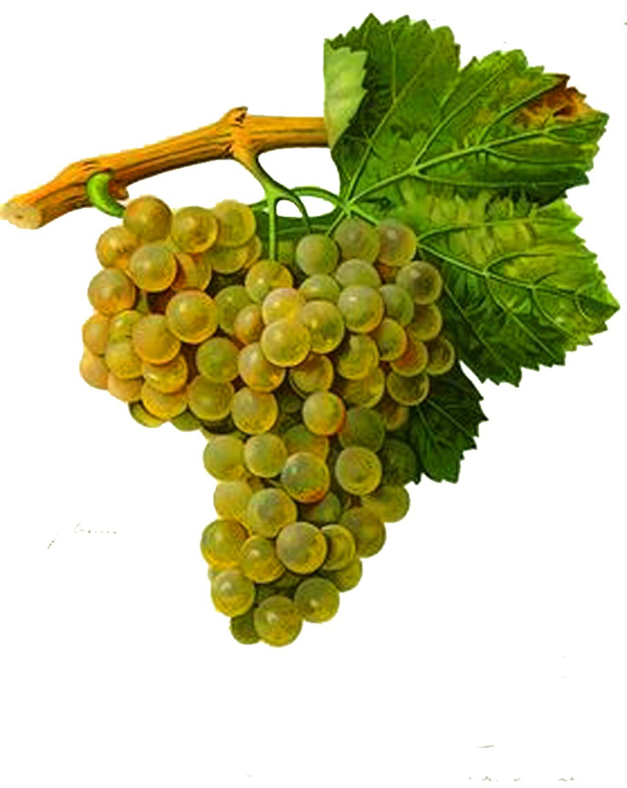
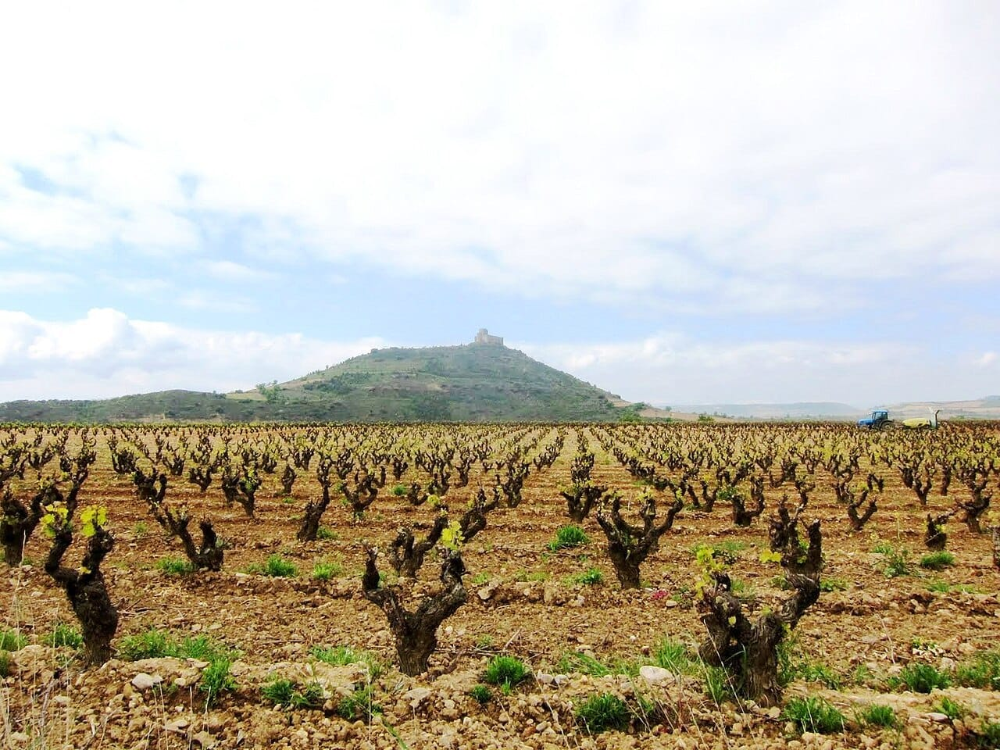

# Macabeo

Macabeo is one of Spain's most widely planted white grapes, known as Viura in Rioja and Navarra and as Macabeu in Catalonia and French Roussillon. High-yielding and adaptable, it carries medium acidity with green apple, white flower and citrus, and serves both as the base grape of Cava and as the leading variety of Rioja whites: clean and fresh in stainless steel, honeyed, nutty and mineral after oak ageing.

Two lines need to be read separately. In Catalonia and the Cava system it is a sparkling base wine, built for freshness, fruit and balanced acidity; in Rioja it is a still white that can spend long years in oak and bottle, developing nutty, beeswax and savoury texture. The stylistic gap between regions often says more than the variety name alone.

Figure: Macabeo: Maccabeo blanc (Wikimedia Commons). Image: Viala et Vermorel, Public domain, via Wikimedia Commons ([source page](https://commons.wikimedia.org/wiki/File:Maccabeo_blanc.jpg)).

## Definition and naming

Macabeo is a white Vitis vinifera grape. Castilian-speaking areas call it Macabeo, Rioja and neighbouring Navarra call it Viura, and Catalonia plus southern France write it Macabeu. Registered synonyms include Alcañón, Alcañol, Blanca de Daroca, Forcalla, Gredelín, Lardot, Lloza, Macaban, Maccabeo, Subirat and Rossan; some of these names are also used for other varieties, so a folk name alone cannot fix the identity.

The key point is that Viura and Macabeo are two names for the same grape in Rioja and Catalonia, not two adjacent but distinct varieties. On the vine it carries long, compact clusters with medium berries and a fairly thick skin; it buds and ripens late and is usually picked early to hold acidity, while its relatively oxidation-resistant juice is what allows oak ageing. On Rioja white and Cava labels claiming a single variety, the composition can be checked against appellation rules; folk names such as Alcañón and Alcañol are also used by other grapes, so those labels should be confirmed against regional and bottling records rather than read on the name alone.

## Origin and spread

The variety probably originated in the Penedès region of Catalonia; the earliest documentary mention dates to 1617, in Fray Miquel Agustí's work around Vilafranca. Pedigree studies point to Hebén and Brustiano faux as parent varieties, though parentage should be checked against the latest genetic register. It has been grown in northern and Mediterranean Spain for centuries and entered Rioja after the phylloxera epidemic, partly replacing Malvasía and Garnacha Blanca there.

By area, Spanish plantations stood at nearly 45,000 hectares in 2015, making it the country's second most grown white grape. France recorded about 2,800 hectares in 2007, almost all in Languedoc-Roussillon; Israel has grown small amounts since 2009. Within Spain it is found in Rioja, Navarra, Aragon (Calatayud, Somontano, Costers del Segre, Terra Alta), Catalonia (Penedès, Tarragona, Conca de Barberà), and further in Valencia, Yecla, Jumilla, Utiel-Requena and Rueda.

## Botany and cultivation

Bunches are long and compact, berries medium, skin fairly thick; the vine is vigorous and high-yielding. It has a long cycle and buds and ripens late, but is usually picked early to preserve acidity. Sugar and acidity are both moderate, and the skins carry relatively high antioxidant compounds, so the pressed must resists oxidation reasonably well — part of why it suits oak ageing.

The central cultivation task is leaf-fruit balance: too little leaf area and sugar fails to build; too dense a canopy shades the fruit, lowers acidity and invites disease. Pruning, trellis height, leaf removal and irrigation all adjust that balance. As a productive variety, controlling yield is the precondition for concentrated aroma. Aspect and soil set the ripening rhythm: free-draining, sunny slopes suit ageworthy wines, while flat, fertile blocks go into fresh young whites and sparkling base wine.

## Style and palate

Early-picked, stainless-fermented Macabeo is light and clean, with green apple, pear, white citrus, white flower and a touch of fennel herb, fresh acidity and a smooth, elegant palate — the typical young-drinking white and sparkling base. Riper, oak-fermented or oak-aged examples have more weight, with honey, toasted nuts, beeswax and a faint saline mineral edge, held up by acidity.

In Rioja, Viura is often blended with Malvasía Riojana and Garnacha Blanca, and small amounts have traditionally gone into red wines. The traditional route makes long-oaked, long-bottled reserva whites that over years or decades develop lemon peel, dried apple, beeswax, nuts and a fino-like saline finish. Fermentation vessel, oak proportion, lees contact and barrel ageing are the variables that shape the wine; the variety itself is not intensely aromatic, so winemaking choices carry a large share of the final style (ref:fermentation).

## Main regions and representative wines

Inside the Cava DO, Macabeo is the most planted variety at 13,955 hectares, 36.58% of all Cava plantings; Xarel·lo follows with 9,825 hectares and Parellada with 7,385. The classic Cava coupage blends the three, Macabeo contributing liveliness, freshness and fruit with balanced acidity and delicate aroma. Other authorised varieties include Chardonnay, Subirat Parent and the reds Garnacha, Trepat, Monastrell and Pinot Noir.

Representative Rioja producers include R. López de Heredia, founded in Haro in 1877; its Viña Tondonia Blanco Reserva and Gran Reserva blend Viura with Malvasía and age for long periods in American oak, while Viña Gravonia is the more accessible oak-aged white. CVNE's Monopole Blanco, Marqués de Murrieta and Luis Cañas' barrel-aged old-vine white are also Viura-based. In Catalan sparkling wine, Recaredo's Reserva Particular is made from 53% Macabeu and 47% Xarel·lo old vines, farmed organically and biodynamically, at about 11% alcohol; Gramona, Freixenet, Codorníu and Segura Viudas also use Macabeo in Cava or Corpinnat. In French Roussillon, Macabeu goes into dry Corbières and Minervois as well as late-picked Banyuls and Maury vin doux naturel.

## How to drink and pair

Fresh young whites and Cava are best at 8–10 °C in a medium-bowl white glass; oak-aged, textured Rioja whites can go up to 10–12 °C to open the nutty and mineral notes. Open Cava just a few minutes before pouring so the sparkle does not dissipate at once; aged Rioja whites should not be over-chilled, or the beeswax and savoury layers stay shut.

Read Macabeo through where it is grown, then how it is labelled, and finally whether the style is dry or sweet. The sequence matters.

## Buying and common misreadings

The first mistake is treating Viura and Macabeo as two varieties; the names differ but the grape is the same. The second is writing Macabeo off as a plain neutral grape: the stainless version is fresh, but old-vine, oak-aged and long-cellared examples have a complete ageing structure. The third is assuming the Cava blend ratio is fixed: proportion varies widely by house and tier, with higher Macabeo giving fresher fruit and higher Xarel·lo giving more frame.

On the label, read region (DOCa Rioja, DO Cava or a specific Catalan district), type (still white, sparkling, sweet fortified), vintage and blend proportion first. Young wines are for drinking within a couple of years; reserva Rioja whites and long-aged Cava can cellar for years. Store away from heat, strong light and vibration. It reaches overseas mainly through specialist importers, so check storage history; wine held in an overheated warehouse can show muted fruit and abrupt acidity.

## Further reading and see also

- Related: [rioja](ref:rioja), [white-wine](ref:white), [sparkling-wine](ref:sparkling), [fermentation](ref:fermentation), [terroir](ref:terroir).
- To compare the Cava and Rioja routes, taste a fresh Cava and an oak-aged Rioja white from the same vintage and contrast fruit concentration, acidity brightness and nutty mineral layers.

## Related images

Image: A Rioja Vineyard - panoramio. Credit: Art Anderson, CC BY-SA 3.0, via Wikimedia Commons.. Credit: Art Anderson, CC BY-SA 3.0, via Wikimedia Commons ([source page](https://commons.wikimedia.org/w/index.php?curid=56546384)). Related image for Macabeo.
