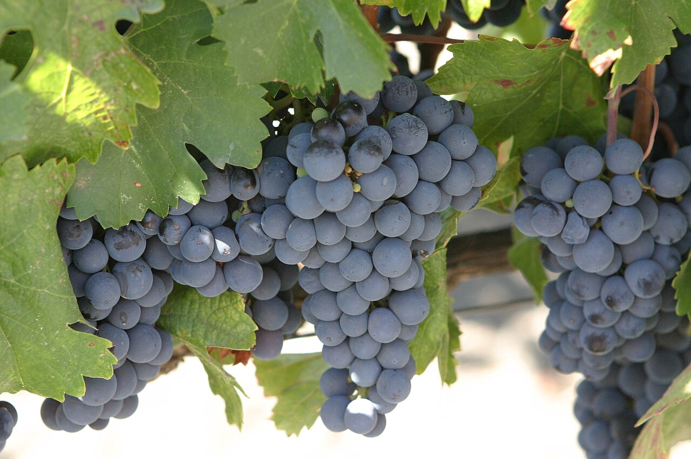

# Malbec

Malbec is a red grape native to south-west France, where it is often called Côt. It was once one of the permitted red varieties in Bordeaux blends, and later found a larger stage in Argentina. Today most people who hear "Malbec" think first of high-altitude vineyards in Mendoza rather than the black wines of Cahors.

Figure: Malbec. Image: Ian L, CC BY 2.0, via Wikimedia Commons ([source page](https://commons.wikimedia.org/wiki/File:Malbec_grapes.jpg)).

## Definition and synonyms

The English name is Malbec; in south-west France Côt is also used. It belongs to Vitis vinifera and to the Bordeaux family that includes Merlot and Cabernet Franc. The difference in names reflects regional tradition rather than a different variety: Malbec and Côt are treated botanically as the same grape.

Calling Malbec "the Merlot of Argentina" is inaccurate. The two differ in skin thickness, tannin structure and ripening rhythm, and they play different roles in blends.

## Botanical characteristics

Malbec clusters are relatively loose, berries medium-sized, skins deep in colour and medium-thick, which makes deeply coloured, firmly tannic wines easy to achieve. It buds early, and low temperatures at flowering easily cause poor fruit set (coulure), making yields unstable; this is one reason it was gradually marginalised in Bordeaux.

Malbec needs a good deal of heat to ripen fully, but in excessive heat it loses acidity and aromatic detail. The skins carry plenty of pigment and firm tannin, so the wine can taste closed in youth and needs time or blending to soften.

## Main regions

France is the home of Malbec. Bordeaux once planted it widely and it survives mainly in parts of the right bank and Entre-Deux-Mers; Cahors in the south-west makes dark, structured "black wines" dominated by the variety. The Loire also has small plantings.

Argentina is now the largest Malbec producer, and the high-altitude vineyards of Mendoza, with large day-night temperature swings and strong sun, give ripe black-fruit flavours with retained acidity. Chile, Australia, the United States and China also plant it. Altitude, temperature range and water supply explain specific styles better than the variety name alone.

## Typical flavours

Typical aromas include black plum, blackberry and blueberry, often with violet, cocoa and liquorice. The body is medium to full, tannin is generous and acidity medium. In youth the wines are driven by dark fruit; with age they can develop leather, tobacco and earth.

Compared with [Merlot](ref:merlot), Malbec is usually deeper in colour, firmer in tannin and tighter in structure; compared with Cabernet Sauvignon its acidity is often a little lower and its fruit sweeter and riper. In blends it is used to add colour and mid-palate fruit density.

## Representative wines

In Bordeaux, Malbec is no longer a mainstream variety but is still a permitted blending component, and traces of it can be found in historical wines. In Argentina many wines are Malbec-dominant, ranging from fresh and fruity to concentrated and powerful; they are useful samples for understanding how one variety changes with altitude and winemaking.

Specific blends and styles vary with vintage, producer and site, so no single bottle should be taken as the fixed character of the variety.

## Viticulture

The main difficulties are fruit-set stability and ripeness management. Cool, wet weather at flowering causes coulure and a sudden drop in yield; the ripening period needs enough heat, or tannin and fruit stay unripe and green, grassy notes appear.

In the high-altitude sites of Argentina, strong sun and cool nights help retain acidity; in south-west France producers rely more on picking date and blending proportions to balance structure. Yield control matters especially for Malbec: too much crop dilutes colour and flavour.

## Common misconceptions

First, that Malbec comes only from Argentina. It is a French variety with a continuing French tradition.

Second, that Malbec must be dark, heavy and high in alcohol. It can be powerful or comparatively fresh depending on site and winemaking.

Third, that Malbec and Merlot are interchangeable. Colour, tannin and ripening needs differ.

Fourth, that Bordeaux blends contain no Malbec. It was historically one of the permitted varieties and is still allowed.

Fifth, that Cahors "black wine" is only marketing. It describes a tradition of deep-coloured, structured wine, not a single brand.

Malbec originated in southwestern France and is known for dark skins, generous tannin and sensitivity to frost and poor fruit set. In Mendoza’s high-altitude sites it became a signature variety, with riper black fruit and floral notes. It belongs to the Bordeaux family with Merlot and Cabernet Franc, but its colour, tannin and climate adaptation differ. Altitude is a factor, not a guarantee of one style. Mendoza’s high altitude brings strong sunlight and cool nights, but altitude alone does not fix a style. Soil, irrigation and elevation vary within the region, and French Malbec more often shows a cooler, structural profile. Treat altitude as one variable among several.

The comparison with [Wine](ref:wine) and [Bordeaux](ref:bordeaux) runs through variety character and regional performance. Each answers a different question.

**Short definition:** A red grape native to south-west France with deep-coloured skins and generous tannin, sensitive to frost and poor fruit set; it became a flagship variety in the high-altitude vineyards of Mendoza, Argentina.

For Malbec, begin with where it is grown, then how it is labelled, and finish with whether the style is dry or sweet; that order keeps the account grounded.

Do not reduce Malbec to the name of a wine.

Malbec originated in Cahors and the south-west of France, where it is still called Côt and makes dark, tannic wines; its modern fame comes from Mendoza, where high-altitude vineyards and intense sunlight give riper fruit and softer tannin. The grape has thin skins relative to its colour and is prone to frost and poor fruit set, so yield control is critical. In Argentina, Malbec is often aged in oak and blended with small amounts of Cabernet Sauvignon or Petit Verdot; in Cahors, it is usually blended with Merlot and Tannat. A label that says Malbec may therefore mean a different wine depending on origin. Check altitude, vintage and oak treatment before comparing a Mendoza bottling with a Cahors one.

**Key facts.**

| Item | Detail |
| --- | --- |
| In one line | A red grape native to south-west France with deep-coloured skins and generous tannin, sensitive to frost and poor fruit set; it became a flagship variety in the high-altitude vineyards of Mendoza, Argentina. |
| Species | Vitis vinifera |
| Key regions | Mendoza、Bordeaux |

**Sources and limits.** The key claims about Malbec are checked against the following sources: International Organisation of Vine and Wine (OIV) (Used to check variety descriptions and the Vitis species framework), Oxford University Press (Used for reference on Malbec, Côt and Argentine planting; Migrated from the former reference list at the end of the article; access date not re-verified), Instituto Nacional de Vitivinicultura (INV) (Used to check Argentina's wine authority and Malbec growing background). Prices, batches and status change; the body is project-written and does not reproduce source text.

For Malbec, this page was last checked in 2026; prices, batches and availability change, so confirm them against the sources below.

## Further reading

- [Wine](ref:wine): classification, winemaking and regional framework.
- [Red wine](ref:red-wine): tannin, acidity and ageing basics.
- [Bordeaux](ref:bordeaux): the historical home and blending tradition of Malbec.
- [Mendoza](ref:mendoza): the core Argentine region for Malbec.
- [Merlot](ref:merlot): a fellow Bordeaux variety for comparison.
