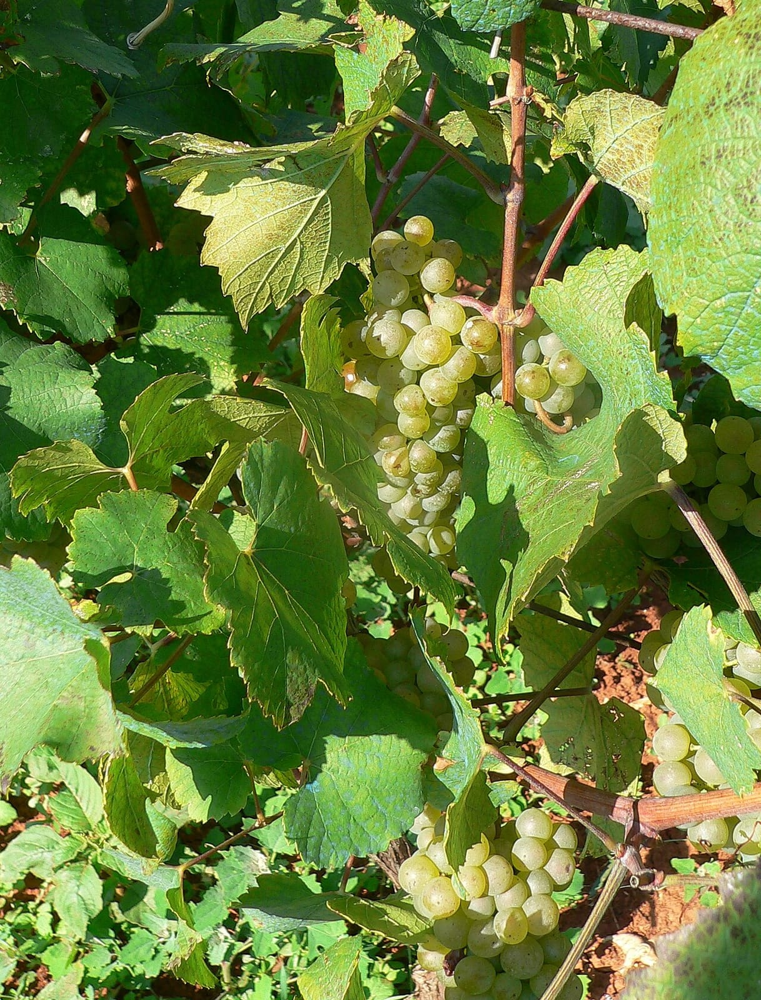

# Malvasia

A white variety family across the Mediterranean and Iberia, with many clones and types; aromas range from white flowers, apricot and honey to spice, and it makes dry, sweet and fortified wines, so it is not one single variety.

In the “Hejiu” variety index, Malvasia is both a recognisable name and a set of comparable viticultural and winemaking choices. Read it first through its ripening rhythm, acid frame and tannin direction at home, then through what survives or fades when it travels. The gap between Old and New World versions often explains more than the label. For the reader, the point is not a fixed flavour tag but how climate, soil and winemaking decisions turn the same grape into a different wine. This also explains why the same name carries different descriptions across sources: one stresses botany, another market style, another a single region’s rules.

Figure: Malvasia: Malvasia grapes (Wikimedia Commons). Image: No machine-readable author provided. Scops~commonswiki assumed (based on copyright claims)., CC BY-SA 3.0, via Wikimedia Commons ([source page](https://commons.wikimedia.org/wiki/File:Malvasia_grapes.JPG)).

## Definition and naming

Malvasia is not one variety but a family including Malvasia Bianca, Malvasia di Candia and Malvasia delle Lipari; the name may come from Monemvasia in Greece.

Malvasia is a vines variety or raw material with a definable botanical origin and cultivation history. The name may come from a place, a shape, a farming habit or a promoter; synonyms and homonyms are common, so check the scientific name or classification first.

## Origin and spread

It spread through Mediterranean trade from Greece, Italy, Spain and Portugal to Madeira; clones and cultivation differ greatly by region.

The origin of Malvasia can usually be traced to a mountain, valley or coast, then spread through trade, migration and replanting after disease. Spread is not copying: in each new environment growers select different clones, rootstocks and pruning.

Malvasia is not one grape but a Mediterranean white family, with distinct types such as Malvasia Bianca, Malvasia di Candia, Malvasia delle Lipari, Malvasia Riojana and Madeira Malvasia. The name probably derives from the Greek port of Monemvasia, whose sweet wine Venetian and Genoese merchants traded across the Mediterranean. Similar names in different islands do not prove the same variety.

## Botany and cultivation

Berries are medium and thin-skinned, mid-late ripening, with medium acidity; white flowers, apricot, peach, honey, citrus and spice, with some types very aromatic.

The performance of Malvasia depends on budbreak, ripening, vigour, yield and disease resistance. Early varieties carry less risk in cool regions, late varieties need a long autumn; excessive vigour shades fruit, while weak vines crop poorly.

The family includes aromatic and neutral biotypes with different berry size, ripening and aroma. Thin skins make grey rot a risk, but botrytis is also the basis of passito and sweet wines on Lipari and Bosa; sea breezes and volcanic soils help keep fruit healthy. In Rioja, continental conditions preserve acidity; in Madeira, altitude and sea air shape ripening.

## Style and palate

It makes dry, sweet, fortified and Madeira wines; sweet styles use drying or late harvest, with dried apricot, honey and nuts.

The style of Malvasia is defined by acidity, tannin or bitterness, alcohol, aroma and texture. It can be made alone or as part of a blend; in a blend it may supply colour, acidity, aroma or structure rather than the dominant flavour.

Winemaking spans dry white, passito, Vin Santo, fortified wine and Madeira. Lipari dries grapes in the sun before fermentation; Madeira adds grape spirit to stop fermentation and then ages the wine oxidatively; Vin Santo ferments dried grapes slowly in small casks. These are different routes to sweetness, not variations on one recipe.

## Main regions and representative wines

Representative wines include Malvasia delle Lipari in Italy, Malvasia Riojana in Spain and Malvasia in Madeira; the range is enormous.

To find representative Malvasia, start with the place of origin or the most typical region, then compare a New World example. Keep alcohol, sweetness and vintage as close as possible, or you will mistake technique for variety.

Lipari’s Malvasia delle Lipari DOC is the sweet benchmark; Bosa on Sardinia makes dry and sweet versions; Rioja uses Malvasia Riojana mostly in blends; Madeira’s Malvasia is one of the island’s four white varieties. Salvatore D’Amico, Columbu and Blandy’s are useful reference producers, but the type and sweetness matter more than the family name.

## How to drink and pair

To drink Malvasia, confirm sweetness and alcohol first, then choose temperature and food. Dry high-acid styles suit fat, seafood and salt; sweet styles suit spice, blue cheese and fruit desserts; high alcohol clashes with sweet or very spicy dishes.

Serve dry Malvasia at 10–12°C, sweet passito at 12–14°C and Madeira at 14–16°C. Seafood, vegetables and spice suit dry versions; blue cheese, apricot tart and nuts suit sweet ones; Madeira works with dried fruit and chocolate. Finish dry bottles within two or three days and sweet bottles within one or two weeks.

## Buying and common misreadings

Begin with where it is grown, move on to how it is labelled, and finish with whether the style is dry or sweet. That order keeps the reading of Malvasia practical.

### Key dates and figures

- 1980s: old plots in Lipari and Bosa were rediscovered only in the 1980s.

## Further reading and see also

To study Malvasia, read botanical and viticultural sources first, then taste three wines from different regions side by side. Do not buy many bottles of one style; build a benchmark, then move to blends, sweet or aged versions.

Compare a dry Malvasia from Bosa with a sweet Malvasia delle Lipari and a Madeira Malvasia. Fix grape type and alcohol where possible; the comparison should separate aroma, sweetness and oxidation rather than treating “Malvasia” as a single flavour.

- Related: [white-wine](ref:white), [fortified-wine](ref:fortified), [terroir](ref:terroir), [fermentation](ref:fermentation), [chardonnay](ref:chardonnay).
- This variety offers no plant identification, prices or shopping channels; a label name is not a botanical identification.

[White wine](ref:white) and [Terroir](ref:terroir) answer different questions about Malvasia: variety character and regional performance. Read them as a pair, not as alternatives.

**Short definition:** A white variety family across the Mediterranean and Iberia, with many clones and types; aromas range from white flowers, apricot and honey to spice, and it makes dry, sweet and fortified wines, so it is not one single variety.

Malvasia is a family of white grapes rather than a single variety, with distinct populations in Italy, Spain, Portugal, Greece and the eastern Mediterranean. The name can mean Malvasia Bianca, Malvasia di Candia, Malvasia Istriana or Malvasia de Sitges, among others, and each has different acidity, sugar and aroma. Some make crisp dry whites, others sweet passito or fortified wines; the common thread is perfume, from white flowers and apricot to honey and spice. Because the name is so broad, a label that says only Malvasia tells you less than one that names the region and the style. In Italy, Malvasia di Candia Aromatica is used in aromatic sparkling wines, while Malvasia delle Lipari is a sweet island wine; those are different products, not different grades of the same grape.

## Related images

Image: Fortified wine. Credit: Jon Sullivan, Public domain, via Wikimedia Commons ([source page](https://commons.wikimedia.org/wiki/File:Port_wine.jpg)). Related image for Malvasia.
