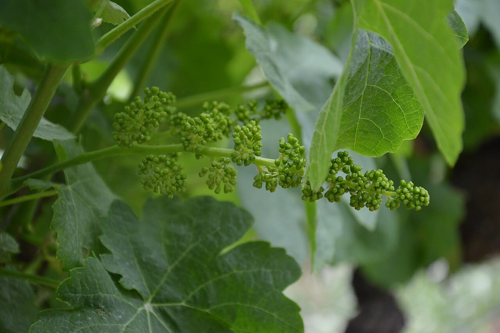
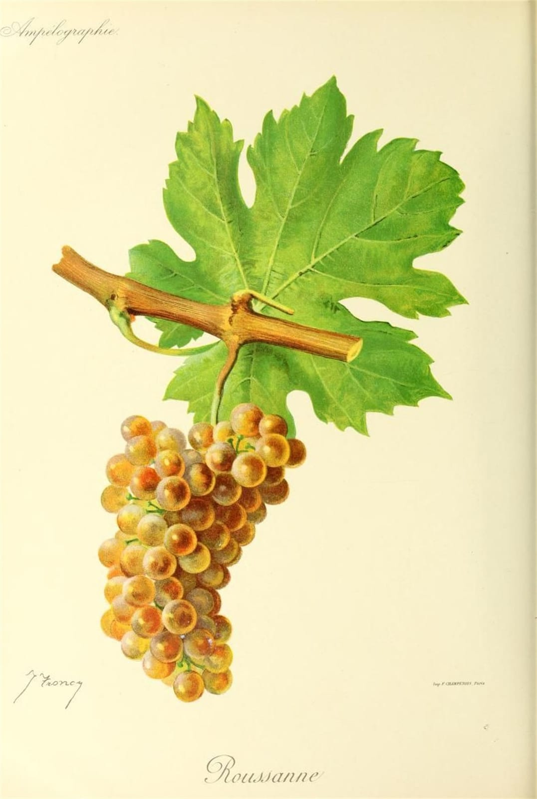

# Marsanne

A white grape of the Northern Rhône, usually blended with Roussanne; full-bodied, low in acidity, with honey, beeswax, nuts and white flowers, rounder with age, and the main variety of Hermitage white.

In the “Hejiu” variety index, Marsanne is both a recognisable name and a set of comparable viticultural and winemaking choices. Read it first through its ripening rhythm, acid frame and tannin direction at home, then through what survives or fades when it travels. The gap between Old and New World versions often explains more than the label. For the reader, the point is not a fixed flavour tag but how climate, soil and winemaking decisions turn the same grape into a different wine. This also explains why the same name carries different descriptions across sources: one stresses botany, another market style, another a single region’s rules.

Figure: Marsanne: Marsanne - inflorescence (Wikimedia Commons). Image: Marianne Casamance, CC BY-SA 4.0, via Wikimedia Commons ([source page](https://commons.wikimedia.org/wiki/File:Marsanne_-_inflorescence.jpg)).

## Definition and naming

Marsanne comes from the Northern Rhône, with Hermitage, Crozes-Hermitage and Saint-Joseph as core regions; it is usually blended with Roussanne.

Marsanne is a vines variety or raw material with a definable botanical origin and cultivation history. The name may come from a place, a shape, a farming habit or a promoter; synonyms and homonyms are common, so check the scientific name or classification first.

## Origin and spread

Berries are medium and thin-skinned, mid-late ripening and relatively high-yielding; acidity is low, with white flowers, honey, beeswax, almond and nuts at maturity.

The origin of Marsanne can usually be traced to a mountain, valley or coast, then spread through trade, migration and replanting after disease. Spread is not copying: in each new environment growers select different clones, rootstocks and pruning.

Marsanne is a white grape of the northern Rhône, most closely associated with Hermitage, Crozes-Hermitage and Saint-Joseph, where it is often blended with Roussanne. Its parentage links it to other Rhône varieties rather than to a single place, and its spread to Australia and California came through Rhône-variety plantings in the twentieth century.

## Botany and cultivation

In Hermitage, Marsanne dominates the whites while Roussanne adds acidity and aroma; old-vine Marsanne can age for a long time.

The performance of Marsanne depends on budbreak, ripening, vigour, yield and disease resistance. Early varieties carry less risk in cool regions, late varieties need a long autumn; excessive vigour shades fruit, while weak vines crop poorly.

The vine is vigorous and late-ripening, with low natural acidity and a tendency to produce heavy crops. Hermitage’s granite and galets retain heat and force roots deep; low yields and old vines concentrate honey and nutty aroma. Growers manage the canopy carefully because shade can leave the wine flat rather than fresh.

## Style and palate

It is usually barrel-fermented and aged, giving a full, round texture; stainless steel can preserve a fresher version.

The style of Marsanne is defined by acidity, tannin or bitterness, alcohol, aroma and texture. It can be made alone or as part of a blend; in a blend it may supply colour, acidity, aroma or structure rather than the dominant flavour.

Marsanne is usually pressed whole-cluster and fermented in barrel or tank, often with lees contact and malolactic fermentation. Hermitage whites may spend months in oak, gaining wax, honey, nuts and a broad texture; stainless-steel versions stay leaner. Roussanne adds perfume and acidity in blends, while Marsanne supplies body.

## Main regions and representative wines

Representative wines include Chapoutier, Jaboulet, Chave and Yann Chave; Hermitage white is small in volume and expensive.

To find representative Marsanne, start with the place of origin or the most typical region, then compare a New World example. Keep alcohol, sweetness and vintage as close as possible, or you will mistake technique for variety.

Hermitage and Crozes-Hermitage are the classic northern Rhône benchmarks; Saint-Joseph produces lighter versions, and Australian plantings in Victoria and New South Wales give riper, broader wines. Chapoutier, Jaboulet and Chave are useful reference houses, but the vintage and oak regime matter more than the name alone.

## How to drink and pair

To drink Marsanne, confirm sweetness and alcohol first, then choose temperature and food. Dry high-acid styles suit fat, seafood and salt; sweet styles suit spice, blue cheese and fruit desserts; high alcohol clashes with sweet or very spicy dishes.

Serve at 10–12°C in a medium white glass; older or oaky examples can take 12–14°C. Roast chicken, veal, creamy fish dishes, white truffle and hard cheese suit the texture; high-acid sauces can make the low acidity look flabby. Drink within two or three days after opening.

## Buying and common misreadings

For Marsanne, begin with where it is grown. Then look at how it is labelled, and finally ask whether the style is dry or sweet. The answers point to different choices, not to a single score.

### Key dates and figures

- 1980s: in the 1980s–90s, Chapoutier, Jaboulet and Chave re-emphasised old vines and barrel ageing.

## Further reading and see also

To study Marsanne, read botanical and viticultural sources first, then taste three wines from different regions side by side. Do not buy many bottles of one style; build a benchmark, then move to blends, sweet or aged versions.

Compare Marsanne and Roussanne from the same appellation and vintage, then a Hermitage blanc with an Australian Marsanne. Record acidity, alcohol, oak and lees contact; those variables explain the difference between wax-and-nut texture and a leaner, more floral profile.

- Related: [rhone](ref:rhone), [roussanne](ref:roussanne), [white-wine](ref:white), [oak-ageing](ref:oak), [terroir](ref:terroir).
- This variety offers no plant identification, prices or shopping channels; a label name is not a botanical identification.

**At a glance:** A white grape of the Northern Rhône, usually blended with Roussanne; full-bodied, low in acidity, with honey, beeswax, nuts and white flowers, rounder with age, and the main variety of Hermitage white. 

The northern Rhône and white-wine categories are the nearest useful references: one fixes the grape’s home and blending tradition, the other provides the broader frame for texture, acidity and ageing.

Marsanne is the main white grape of Hermitage and appears with Roussanne in Crozes-Hermitage and Saint-Joseph; on the granite hill of Hermitage it can carry a single-variety wine of unusual weight. The grape accumulates sugar quickly and loses acidity late, so picking date matters more than in cooler white varieties. Old-vine Marsanne from Hermitage and Saint-Joseph can age for years, gaining beeswax, honey and hazelnut while the fruit recedes. In Australia, Marsanne is planted in the Yarra Valley and Goulburn Valley, often blended with Roussanne or Viognier; the warm climate gives riper stone fruit but less of the Rhône's mineral cut. A label that names Marsanne alone is rare, so check the blend before judging the variety.

## Related images

Image: Roussanne: Roussanne (Wikimedia Commons). Credit: Jules Troncy, Public domain, via Wikimedia Commons ([source page](https://commons.wikimedia.org/wiki/File:Roussanne.jpg)). Related image for Marsanne.
